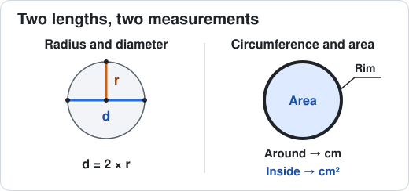
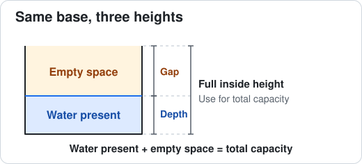
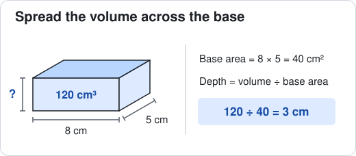
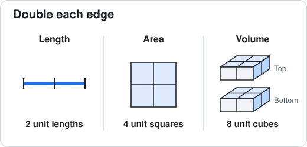
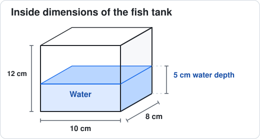
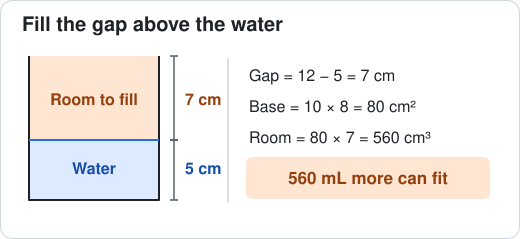

# M2 — Geometry and measurement: Learning

[← Back to the index](../../README.md) · [Go to the M2 practice questions →](2.%20Practice.md)

## 1. What you remember

**From the test (your own recollection):**
- Radius and circumference appeared.
- A pictured cup or bottle involving water and a volume calculation appeared.
- These are treated as separately recalled items; the circle question and the container question may not be the same question.

**Recognized later when topics were suggested:**
- Water displacement was recognized later. It may refer to a different question from the container-volume recollection, and displacement readings belong to S3.

**Added for practice (not recalled from the test):**
- Composite area/perimeter and scaling are added for transfer.

All questions here are original practice. They are not copies of real test questions.

## 2. Core skills taught on this page

- Read dimensions from a labelled diagram and identify which region is being measured.
- Distinguish radius from diameter; use circumference and circle area with the stated value of π.
- Find volume of rectangular prisms and cylinders, and separate water present, empty space, and total capacity.
- Work backward from a volume to a missing depth or dimension.
- Choose and convert units: cm, cm², cm³, mL, L.

**Formulas you need**

| Shape | Measurement | Formula |
|---|---|---|
| Circle | Circumference (distance around) | C = 2 × π × r = π × d |
| Circle | Area (space inside) | A = π × r × r |
| Rectangle | Perimeter / area | P = 2 × (l + w), A = l × w |
| Triangle | Area | A = ½ × base × height |
| Rectangular prism (box, tank) | Volume | V = l × w × h |
| Cylinder (cup, can, bottle) | Volume | V = π × r × r × h |

Units: 1 mL = 1 cm³, 1 L = 1000 mL = 1000 cm³, 1 m = 100 cm, 1 m² = 10 000 cm².

## 3. Core patterns

### Pattern 1: Radius or diameter? Around or inside?

- **Clue to notice:** a circle (or half or quarter circle, a cup, a can, a wheel) with one length marked. Look at where the line goes: from the centre to the edge is the **radius**; all the way across through the centre is the **diameter**. Then look at the question word: "around", "edge", "fence", "frame", "turns of a wheel" mean **circumference / perimeter**; "cover", "paint", "space", "region" mean **area**.
- **Decision to make:** halve the diameter before using π × r × r. For a half or quarter circle, take half or a quarter of the full circle's answer, then decide whether the straight edges are part of the boundary being measured.
- **How to check:** the units tell you what you found: cm for a length, cm² for an area, cm³ for a volume. If you used the diameter in the area formula, your answer is exactly 4 times too big. Always use the value of π the question gives (3.14, or leave the answer "in terms of π").

### Pattern 2: Which amount of water is the question asking for?

- **Clue to notice:** a container with a water level marked. There are three different volumes in the same picture: **water present** (base × water depth), **empty space** (base × gap above the water), and **total capacity** (base × full inside height).
- **Decision to make:** read the last sentence carefully. "How much water is in it?" is water present. "How much more can be added?" or "how much to fill it?" is empty space. "How much does it hold?" is capacity. Use **inside** dimensions only; the walls do not hold water.
- **How to check:** water present + empty space = capacity. If your answer is bigger than the capacity, something is wrong. The wrong answers on a test are usually the other two volumes.

### Pattern 3: Working backward from a volume to a depth

- **Clue to notice:** you are told how much water is poured in (often in mL or L) and asked for a depth, a rise in level, or a missing side.
- **Decision to make:** for any container with straight vertical sides, **depth = volume ÷ base area**. That gives the rise; add it to any water already there if the question asks for the new depth. Then compare with the inside height: if the new depth is taller than the container, the extra spills.
- **How to check:** multiply back. Base area × your depth should give the volume you started with. Make sure the volume is in cm³ before dividing by a base in cm².

### Pattern 4: Units and scaling

- **Clue to notice:** the question mixes units (cm and m, cm³ and L), or says a shape is enlarged, doubled, or built "to scale".
- **Decision to make:** convert before you calculate, or convert the final answer, but never mix. For scaling, if every length is multiplied by k, then lengths (and perimeters) are multiplied by k, areas by k × k, and volumes by k × k × k. Doubling every edge makes area 4 times as big and volume 8 times as big, not 2 times.
- **How to check:** ask whether the size of the answer is sensible. A drinking glass holds a few hundred mL, not a few hundred litres. A garden measured in metres has an area in the tens or hundreds of m², which is hundreds of thousands of cm².

## 4. Worked example

This example is original practice. It does not count toward the 30 drills.

> A rectangular fish tank has the inside measurements shown. It holds water to a depth of 5 cm.
>
> 
>
> How much more water, in mL, can be added before the tank is full?
>
> A. 400 mL
>
> B. 560 mL
>
> C. 960 mL
>
> D. 1360 mL
>
> E. 0.56 mL
>
> **Answer: B.**

**Decisive step.** The question asks for the **empty space**, not the water. The empty part is a box with the same base, 10 cm × 8 cm = 80 cm², and a height of 12 − 5 = 7 cm. Its volume is 80 × 7 = 560 cm³, and 1 cm³ = 1 mL, so 560 mL more can be added.

**Check.** Water present = 80 × 5 = 400 cm³. Capacity = 80 × 12 = 960 cm³. 400 + 560 = 960, so the three amounts fit together.

**Why the most tempting wrong answer is wrong.** Choice A (400 mL) is the water already in the tank. It uses the 5 cm depth that is labelled on the picture, but the question asks how much more can be **added**, which is the 7 cm gap above the water. Choice C is the full capacity, choice D adds the water to the capacity, and choice E divides by 1000 as if converting to litres while still writing mL.

## 5. Practise

Go to [M2 practice questions (2. Practice.md)](2.%20Practice.md). Commit to an answer for each question before you open the answer key.
