# M2 — Geometry and measurement: Practice

[← Back to the index](../../README.md) · [Review the M2 learning page](1.%20Learning.md)

## How to use this page

1. Answer each question on paper **before** looking at the key.
2. Mark each attempt: ✅ correct, 🤔 guessed (even if right), ❌ wrong, ⏭️ skipped.
3. Review guesses as carefully as misses.
4. Questions M2-Q26 to M2-Q30 are saved for the final weekend. Do not open them early.

All questions are original practice, not real test questions. Diagrams are sketches and are not drawn to scale; use the labelled measurements. Units: 1 mL = 1 cm³ and 1 L = 1000 mL.

## Questions

### M2-Q01

A and B lie on the circle. Segment AB passes through its centre O.

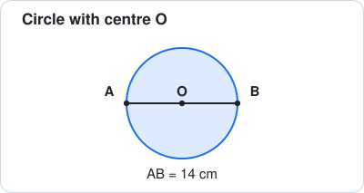

Using π = 3.14, what is the circumference of the circle?

A. 87.92 cm

B. 153.86 cm

C. 43.96 cm

D. 21.98 cm

E. 615.44 cm

### M2-Q02

An open-top glass tank has walls 1 cm thick and a base 1 cm thick. Its measurements are:

| Measurement | Length | Width | Height |
|---|---|---|---|
| Outside | 22 cm | 17 cm | 26 cm |
| **Inside** | **20 cm** | **15 cm** | **25 cm** |

The water inside is 18 cm deep.

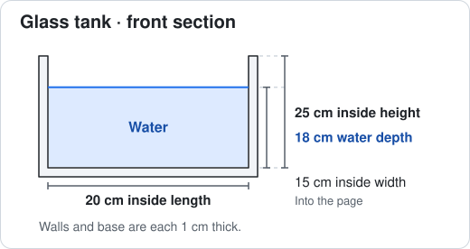

How much more water can be poured in before the tank is full?

A. 2.1 L

B. 5.4 L

C. 7.5 L

D. 2.992 L

E. 21 L

### M2-Q03

A cylindrical cup has an inside radius of 4 cm and an inside height of 10 cm.

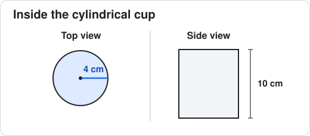

Using π = 3.14, what is the capacity of the cup?

A. 125.6 mL

B. 251.2 mL

C. 2009.6 mL

D. 502.4 mL

E. 5024 mL

### M2-Q04

The L-shaped garden below has square corners. Only four of its six sides are labelled.

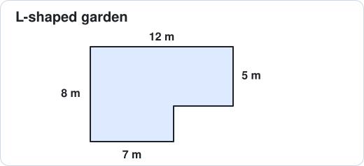

What is the perimeter of the garden?

A. 81 m

B. 40 m

C. 32 m

D. 48 m

E. 96 m

### M2-Q05

A rectangular tank has inside base 30 cm by 20 cm and inside height 12 cm. It already contains water 6 cm deep. Then 4.8 L of water is poured in slowly.

| Inside length | Inside width | Inside height | Water depth before pouring |
|---|---|---|---|
| 30 cm | 20 cm | 12 cm | 6 cm |

How much water spills over the top?

A. 0 L (all of it fits)

B. 3.6 L

C. 4.8 L

D. 8.4 L

E. 1.2 L

### M2-Q06

A window is made of a rectangle with a semicircle on top. The diameter of the semicircle is the whole top side of the rectangle. A metal frame goes around the **outside edge** of the window only.

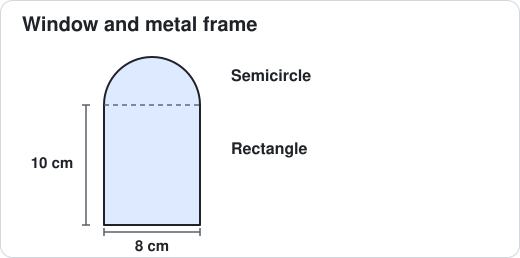

Using π = 3.14, how long is the frame?

A. 48.56 cm

B. 40.56 cm

C. 53.12 cm

D. 105.12 cm

E. 34.28 cm

### M2-Q07

A jug holds 2.4 L of lemonade. Each glass holds 150 cm³. How many glasses can be filled completely from the full jug?

A. 1.6

B. 160

C. 62.5

D. 360

E. 16

### M2-Q08

Box P is a cube with inside edges of 5 cm. Box Q is also a cube, but each of its inside edges is twice as long as Box P's. How many times as much water does Box Q hold as Box P?

A. 2

B. 4

C. 8

D. 6

E. 16

### M2-Q09

A cylindrical can has an inside height of 10 cm and holds exactly 1130.4 mL when full. Using π = 3.14, what is the inside **diameter** of the can?

A. 12 cm

B. 6 cm

C. 36 cm

D. 3 cm

E. 18 cm

### M2-Q10

An aquarium has inside length 40 cm, inside width 25 cm, and inside height 30 cm. The water level is 4 cm below the top edge.

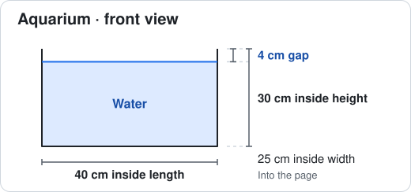

How much water is in the aquarium?

A. 4 L

B. 30 L

C. 2.6 L

D. 26 L

E. 26 000 L

### M2-Q11

The shape below is a quarter of a circle. O is the centre of the circle, and OA = OB = 10 cm.

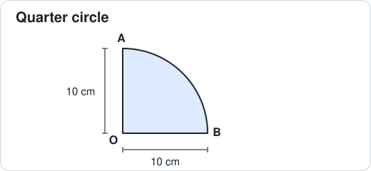

Using π = 3.14, what is the perimeter of the whole shape (the curved edge and both straight edges)?

A. 15.7 cm

B. 78.5 cm

C. 62.8 cm

D. 35.7 cm

E. 25.7 cm

### M2-Q12

A circular tabletop has a circumference of 31.4 cm. Using π = 3.14, what is the area of the tabletop?

A. 31.4 cm²

B. 78.5 cm²

C. 314 cm²

D. 15.7 cm²

E. 157 cm²

### M2-Q13

A juice carton is a rectangular box with inside measurements 6 cm by 9 cm by 20 cm. A factory has 5.4 L of juice. How many cartons can it fill completely?

A. 5

B. 0.5

C. 50

D. 500

E. 1080

### M2-Q14

A semicircle is cut out of a rectangular sheet of card. The diameter of the semicircle is the whole 10 cm right-hand side of the rectangle.

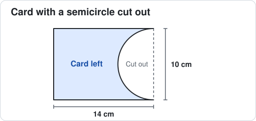

Using π = 3.14, what is the area of the card that is left?

A. 61.5 cm²

B. 124.3 cm²

C. 140 cm²

D. 179.25 cm²

E. 100.75 cm²

### M2-Q15

A cylindrical water bottle has the inside measurements shown.

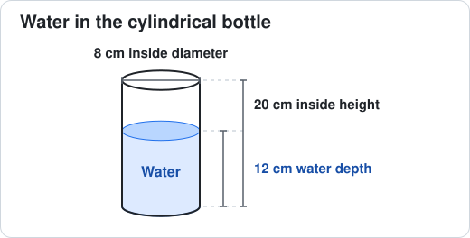

Using π = 3.14, how much more water is needed to fill the bottle?

A. 602.88 mL

B. 1004.8 mL

C. 401.92 mL

D. 1607.68 mL

E. 100.48 mL

### M2-Q16

Two cylindrical tins are compared. Tin B's inside radius is **twice** Tin A's inside radius, and Tin B's inside height is **half** of Tin A's inside height. Tin A holds 300 mL. The volume of a cylinder is π × r × r × h; use π = 3.14 if you need a value. How much does Tin B hold?

A. 150 mL

B. 300 mL

C. 1200 mL

D. 2400 mL

E. 600 mL

### M2-Q17

A circle has a diameter of 10 cm. What is its area, in terms of π?

A. 25π cm²

B. 10π cm²

C. 100π cm²

D. 5π cm²

E. 20π cm²

### M2-Q18

A full cylindrical bottle (inside radius 6 cm, inside height 10 cm) is emptied into an empty rectangular tray. The tray's inside base is 24 cm by 15.7 cm, and it is tall enough that nothing spills.

| Container | Inside measurements |
|---|---|
| Bottle (cylinder, full) | radius 6 cm, height 10 cm |
| Tray (rectangular, empty) | length 24 cm, width 15.7 cm |

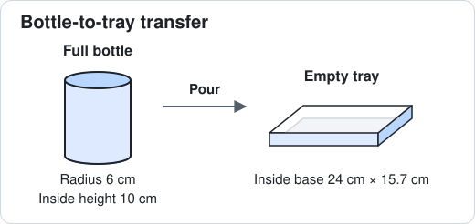

Using π = 3.14, how deep is the water in the tray?

A. 1 cm

B. 10 cm

C. 3 cm

D. 12 cm

E. 0.75 cm

### M2-Q19

The front of a shed is a rectangle with an isosceles triangle on top.

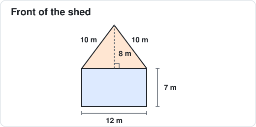

The triangle's base is the whole 12 m top of the rectangle, and its height (the vertical line inside it) is 8 m. What is the area of the front of the shed?

A. 84 m²

B. 132 m²

C. 46 m²

D. 180 m²

E. 144 m²

### M2-Q20

A rectangular poster is 2 m long and 1.5 m wide. What is its area in square centimetres?

A. 3 cm²

B. 300 cm²

C. 3000 cm²

D. 30 000 cm²

E. 350 cm²

### M2-Q21

A bicycle wheel has a radius of 35 cm. Using π = 3.14, how far does the bicycle travel when the wheel makes exactly 10 full turns without slipping?

A. 43.96 m

B. 10.99 m

C. 21.98 m

D. 2198 m

E. 0.2198 m

### M2-Q22

A rectangle has a perimeter of 20 cm and an area of 24 cm². Its length and its width are both multiplied by 3. What is the area of the new rectangle?

A. 72 cm²

B. 60 cm²

C. 48 cm²

D. 648 cm²

E. 216 cm²

### M2-Q23

An empty rectangular tank has inside length 40 cm and inside height 30 cm. Its inside width is not labelled. When 18 L of water is poured in, the water is 15 cm deep.

| Inside length | Inside width | Inside height | Water poured in | Water depth |
|---|---|---|---|---|
| 40 cm | ? | 30 cm | 18 L | 15 cm |

What is the inside width of the tank?

A. 3 cm

B. 15 cm

C. 450 cm

D. 30 cm

E. 0.03 cm

### M2-Q24

A cylindrical rain barrel has an inside diameter of 60 cm and an inside height of 90 cm. The water in it is 50 cm deep. Using π = 3.14, how much water is in the barrel?

A. 141.3 L

B. 14.13 L

C. 254.34 L

D. 565.2 L

E. 1413 L

### M2-Q25

A circle fits exactly inside a square, touching all four sides. The four corner regions outside the circle are shaded.

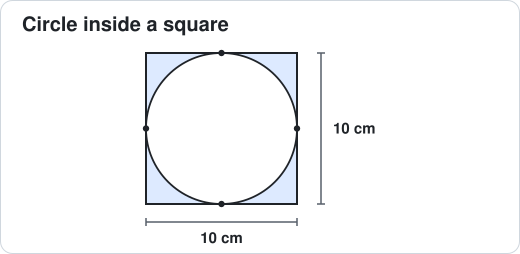

Using π = 3.14, what is the total shaded area?

A. 78.5 cm²

B. 21.5 cm²

C. 68.6 cm²

D. 5.375 cm²

E. 84.3 cm²

### M2-Q26

Maya wants to find how much a cylindrical drinking glass holds when full. She will use π = 3.14. Which pair of measurements is **enough** to work out the glass's capacity?

A. The outside diameter and the inside height

B. The inside diameter and the outside height

C. The inside circumference and the inside height

D. The inside radius only

E. The inside diameter and the depth of the juice now in the glass

### M2-Q27

A circular pond has a radius of 6 m. A path 1 m wide runs all the way around the outside of the pond.

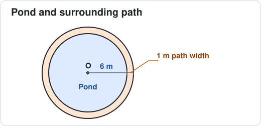

O is the centre of both circles. The pond's radius is 6 m and the path is 1 m wide.

What is the area of the path, in terms of π?

A. 12π m²

B. 13π m²

C. 36π m²

D. 14π m²

E. 49π m²

### M2-Q28

A rectangular yard is 15 m long and 8 m wide. A fence will go all the way around the edge of the yard. Fencing costs $12 per metre. What is the cost of the fence?

A. $276

B. $1440

C. $360

D. $192

E. $552

### M2-Q29

An empty rectangular tank has inside length 50 cm, inside width 40 cm, and inside height 30 cm. A tap adds water at a steady 2 L per minute. How many minutes does it take for the water to reach a depth of 24 cm?

A. 30 minutes

B. 2400 minutes

C. 6 minutes

D. 24 minutes

E. 48 minutes

### M2-Q30

Two students each have an 18 cm by 12 cm sheet of thin card. Each cuts an identical square from all four corners of their own sheet, then folds the four sides straight up to make an open tray. Ignore the thickness of the card. Ada uses 2 cm corner squares and Nico uses 3 cm corner squares.

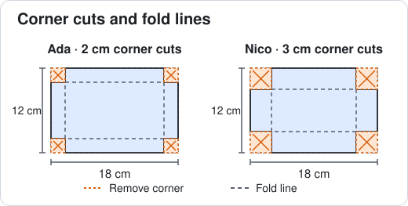

Which tray holds more when full, and by how much?

A. Ada’s, by 8 cm³

B. Nico’s, by 8 cm³

C. Ada’s, by 40 cm³

D. Nico’s, by 85 cm³

E. Nico’s, by 216 cm³

## Answer key

[Go to the full solutions](#full-solutions)

| ID | Answer | Tier | Reasoning | Closest distractor ruled out by |
|---|---|---|---|---|
| M2-Q01 | C | Medium | AB goes through the centre, so it is the diameter: C = π × d = 3.14 × 14 = 43.96 cm. | A (87.92) uses 2 × π × 14, treating the diameter as a radius. |
| M2-Q02 | A | Challenge | Use inside measurements only. Empty height = 25 − 18 = 7 cm; 20 × 15 × 7 = 2100 cm³ = 2.1 L. | D (2.992 L) uses the outside measurements, 22 × 17 × (26 − 18); the glass walls and base hold no water. B (5.4 L) is the water already present. |
| M2-Q03 | D | Medium | V = π × r × r × h = 3.14 × 4 × 4 × 10 = 502.4 cm³ = 502.4 mL. | C (2009.6) uses 8 cm (the diameter) as the radius. B (251.2) is 2 × π × r × h, the side wall area, not the volume. |
| M2-Q04 | B | Medium | Missing sides: inner step across = 12 − 7 = 5 m, inner step down = 8 − 5 = 3 m. Perimeter = 12 + 5 + 5 + 3 + 7 + 8 = 40 m. | A (81) is the area (12 × 5 + 7 × 3), not the distance around. C (32) leaves out the two unlabelled sides. |
| M2-Q05 | E | Challenge | Room left = 30 × 20 × (12 − 6) = 3600 cm³ = 3.6 L. Only 3.6 L of the 4.8 L fits, so 4.8 − 3.6 = 1.2 L spills. | B (3.6 L) is the room that was left, not what spills. A assumes the water fits without checking against the 12 cm height (it would need 14 cm). |
| M2-Q06 | B | Challenge | The frame is two sides and the bottom of the rectangle plus the curved semicircle: 10 + 8 + 10 + ½ × 3.14 × 8 = 28 + 12.56 = 40.56 cm. | A (48.56) also counts the 8 cm top of the rectangle, which is inside the window, not on its edge. C uses a whole circle. |
| M2-Q07 | E | Medium | 2.4 L = 2400 cm³; 2400 ÷ 150 = 16 glasses. | A (1.6) treats 2.4 L as 240 cm³. B (160) treats 2.4 L as 24 000 cm³. |
| M2-Q08 | C | Medium | Each of three dimensions doubles, so volume is 2 × 2 × 2 = 8 times as big (125 cm³ vs 1000 cm³). | A (2) assumes volume doubles when edges double. B (4) is the area factor, not the volume factor. |
| M2-Q09 | A | Challenge | Work backward: base area = 1130.4 ÷ 10 = 113.04 cm²; r × r = 113.04 ÷ 3.14 = 36, so r = 6 cm and d = 12 cm. | B (6 cm) is the radius, but the question asks for the diameter. C (36) is r × r, not r. |
| M2-Q10 | D | Medium | Water depth = 30 − 4 = 26 cm; 40 × 25 × 26 = 26 000 cm³ = 26 L. | A (4 L) is the empty space above the water. B (30 L) is the full capacity. |
| M2-Q11 | D | Medium | Curved edge = ¼ × 2 × 3.14 × 10 = 15.7 cm; add both radii: 15.7 + 10 + 10 = 35.7 cm. | A (15.7) is only the curved edge. E (25.7) adds only one straight edge. B (78.5) is the area. |
| M2-Q12 | B | Challenge | Work backward: d = 31.4 ÷ 3.14 = 10 cm, so r = 5 cm; area = 3.14 × 5 × 5 = 78.5 cm². | C (314) uses 10 cm (the diameter) as the radius. A (31.4) repeats the circumference. |
| M2-Q13 | A | Medium | One carton = 6 × 9 × 20 = 1080 cm³; 5.4 L = 5400 cm³; 5400 ÷ 1080 = 5 cartons exactly. | E (1080) gives the capacity of one carton in mL. The question asks how many cartons the entire supply fills. B (0.5) and C (50) come from converting litres wrongly (540 or 54 000). |
| M2-Q14 | E | Challenge | Rectangle 14 × 10 = 140 cm². Semicircle radius = 10 ÷ 2 = 5 cm, area = ½ × 3.14 × 5 × 5 = 39.25 cm². Left: 140 − 39.25 = 100.75 cm². | A (61.5) subtracts a whole circle. B (124.3) subtracts half the circumference (a length) instead of half the area. |
| M2-Q15 | C | Medium | Empty height = 20 − 12 = 8 cm; r = 4 cm; 3.14 × 4 × 4 × 8 = 401.92 cm³ = 401.92 mL. | A (602.88) is the water already present (12 cm). B (1004.8) is the full capacity. D uses 8 cm as the radius. |
| M2-Q16 | E | Challenge | Doubling the radius multiplies volume by 2 × 2 = 4; halving the height multiplies by ½. 300 × 4 × ½ = 600 mL. | B (300) treats doubling the radius as ×2, which the halved height then cancels. C (1200) ignores the height change. |
| M2-Q17 | A | Medium | r = 10 ÷ 2 = 5 cm; area = π × 5 × 5 = 25π cm². | C (100π) uses the diameter as the radius. B (10π) is the circumference. |
| M2-Q18 | C | Challenge | Bottle volume = 3.14 × 6 × 6 × 10 = 1130.4 cm³. Tray base = 24 × 15.7 = 376.8 cm². Depth = 1130.4 ÷ 376.8 = 3 cm. | B (10 cm) assumes the water keeps the bottle's height. D (12 cm) uses 12 cm (the diameter) as the radius. E (0.75 cm) halves the stated radius as if it were a diameter, giving a quarter of the correct volume and depth. |
| M2-Q19 | B | Medium | Rectangle 12 × 7 = 84 m²; triangle ½ × 12 × 8 = 48 m²; total 132 m². | D (180) is the whole 12 m × 15 m rectangle around the shape, counting the empty corners beside the roof. E (144) uses the 10 m sloping side as the triangle’s height. The perpendicular height is 8 m. C (46) is the perimeter. |
| M2-Q20 | D | Medium | 2 m = 200 cm and 1.5 m = 150 cm; 200 × 150 = 30 000 cm². | B (300) multiplies 3 m² by 100, but 1 m² = 100 × 100 = 10 000 cm². E (350) adds 200 + 150. |
| M2-Q21 | C | Medium | One turn = circumference = 2 × 3.14 × 35 = 219.8 cm. Ten turns = 2198 cm = 21.98 m. | D (2198 m) forgets to convert cm to m. B (10.99 m) uses π × r for one turn (half the circumference). |
| M2-Q22 | E | Medium | Area is multiplied by 3 × 3 = 9: 24 × 9 = 216 cm². | A (72) multiplies the area by only 3. B (60) is the new perimeter, not the area. |
| M2-Q23 | D | Challenge | Work backward: 18 L = 18 000 cm³; 18 000 = 40 × width × 15, so width = 18 000 ÷ 600 = 30 cm. | B (15 cm) divides by 40 × 30, using the tank's height instead of the water depth. A (3 cm) converts 18 L to 1800 cm³. |
| M2-Q24 | A | Medium | r = 30 cm; water volume = 3.14 × 30 × 30 × 50 = 141 300 cm³ = 141.3 L. | C (254.34 L) uses the full 90 cm height (capacity, not water present). D (565.2 L) uses 60 cm as the radius. |
| M2-Q25 | B | Challenge | The circle's diameter equals the square's side, so r = 5 cm. Shaded = 10 × 10 − 3.14 × 5 × 5 = 100 − 78.5 = 21.5 cm². | A (78.5) is the circle, the unshaded part. D (5.375) is only one corner. C (68.6) subtracts the circumference. |
| M2-Q26 | C | Challenge | Capacity needs the inside radius and inside height. The inside circumference gives the inside radius (r = C ÷ (2 × 3.14)), so C is enough. | A uses the outside diameter (includes the glass wall). B uses the outside height (includes the thick base). E gives the juice, not the capacity. D has no height. |
| M2-Q27 | B | Medium | Outer radius = 6 + 1 = 7 m. Path = π × 7 × 7 − π × 6 × 6 = 49π − 36π = 13π m². | A (12π) is the pond's circumference times the 1 m width, which ignores that the outer edge is longer. E (49π) includes the pond. |
| M2-Q28 | E | Medium | Fence = perimeter = 2 × (15 + 8) = 46 m; 46 × $12 = $552. | B ($1440) uses the area 120 m² instead of the perimeter. A ($276) counts only one length and one width. |
| M2-Q29 | D | Medium | Water needed = 50 × 40 × 24 = 48 000 cm³ = 48 L; 48 ÷ 2 = 24 minutes. | A (30 minutes) fills the whole 30 cm height. E (48) forgets to divide by the 2 L per minute rate. |
| M2-Q30 | A | Challenge | Each base loses two cut widths along both dimensions. Ada’s tray holds 14 × 8 × 2 = 224 cm³. Nico’s holds 12 × 6 × 3 = 216 cm³. Ada’s holds 8 cm³ more. | D (85 cm³) subtracts only one cut width per dimension, giving 16 × 10 × 2 = 320 and 15 × 9 × 3 = 405. Each dimension loses a strip at both ends. |

## Full solutions

Solve and mark each question before opening its solution. For a guess or miss, try the steps again on paper before comparing.

### M2-Q01 solution

**Answer C.** 43.96 cm

1. Trace AB through O to see that 14 cm spans the whole circle.
2. Use circumference = π × diameter.
3. Multiply 3.14 × 14 to get 43.96 cm. Halving the diameter first would give radius 7 and the same result from 2 × 3.14 × 7.

**Closest distractor.** A (87.92) uses 2 × π × 14, treating the diameter as a radius.

### M2-Q02 solution

**Answer A.** 2.1 L

1. Measure the space above the water inside the glass: 25 − 18 = 7 cm.
2. Multiply the inside base area by this gap: 20 × 15 × 7 = 2100 cm³.
3. Divide by 1000 to get 2.1 L. Check that 5.4 L already present plus 2.1 L equals the 7.5 L capacity.

**Closest distractor.** D (2.992 L) uses the outside measurements, 22 × 17 × (26 − 18); the glass walls and base hold no water. B (5.4 L) is the water already present.

### M2-Q03 solution

**Answer D.** 502.4 mL

1. Find the circular base area: 3.14 × 4² = 50.24 cm².
2. Multiply by the inside height: 50.24 × 10 = 502.4 cm³.
3. Use 1 cm³ = 1 mL, giving 502.4 mL.

**Closest distractor.** C (2009.6) uses 8 cm (the diameter) as the radius. B (251.2) is 2 × π × r × h, the side wall area, not the volume.

### M2-Q04 solution

**Answer B.** 40 m

1. Subtract the marked 7 m from the full 12 m to find the 5 m horizontal step.
2. Subtract the marked 5 m from the full 8 m to find the 3 m vertical step.
3. Add all six edges: 12 + 5 + 5 + 3 + 7 + 8 = 40 m. The horizontal edges total 24 m and the vertical edges total 16 m.

**Closest distractor.** A (81) is the area (12 × 5 + 7 × 3), not the distance around. C (32) leaves out the two unlabelled sides.

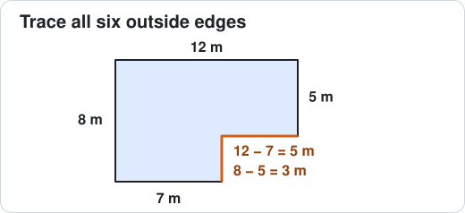

### M2-Q05 solution

**Answer E.** 1.2 L

1. The empty height is 12 − 6 = 6 cm.
2. The empty volume is 30 × 20 × 6 = 3600 cm³, or 3.6 L.
3. Subtract the amount that fits from the 4.8 L poured: 4.8 − 3.6 = 1.2 L.

**Closest distractor.** B (3.6 L) is the room that was left, not what spills. A assumes the water fits without checking against the 12 cm height (it would need 14 cm).

### M2-Q06 solution

**Answer B.** 40.56 cm

1. Trace the outside and count the three straight edges: 10 + 8 + 10 = 28 cm.
2. The arc is half a circle with diameter 8 cm, so its length is 3.14 × 8 ÷ 2 = 12.56 cm.
3. Add 28 + 12.56 = 40.56 cm.

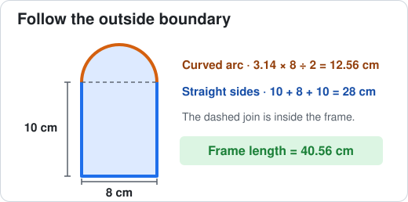

**Closest distractor.** A (48.56) also counts the 8 cm top of the rectangle, which is inside the window, not on its edge. C uses a whole circle.

### M2-Q07 solution

**Answer E.** 16

1. Convert the total: 2.4 L = 2400 mL.
2. Divide by 150 mL per glass: 2400 ÷ 150 = 16.
3. Check by multiplying: 16 × 150 = 2400 mL.

**Closest distractor.** A (1.6) treats 2.4 L as 240 cm³. B (160) treats 2.4 L as 24 000 cm³.

### M2-Q08 solution

**Answer C.** 8

1. The multiplier for each edge is 10 ÷ 5 = 2.
2. Volume uses three dimensions, so its multiplier is 2 × 2 × 2 = 8.
3. Check using the volumes: 1000 ÷ 125 = 8.

**Closest distractor.** A (2) assumes volume doubles when edges double. B (4) is the area factor, not the volume factor.

### M2-Q09 solution

**Answer A.** 12 cm

1. Divide the volume by the height to recover the base area: 1130.4 ÷ 10 = 113.04 cm².
2. Divide by 3.14 to get r² = 36, so the positive radius is 6 cm.
3. Double the radius to obtain the 12 cm diameter.

**Closest distractor.** B (6 cm) is the radius, but the question asks for the diameter. C (36) is r × r, not r.

### M2-Q10 solution

**Answer D.** 26 L

1. The top 4 cm is air, leaving 30 − 4 = 26 cm of water depth.
2. Multiply 40 × 25 × 26 = 26,000 cm³.
3. Convert to litres: 26,000 ÷ 1000 = 26 L.

**Closest distractor.** A (4 L) is the empty space above the water. B (30 L) is the full capacity.

### M2-Q11 solution

**Answer D.** 35.7 cm

1. A full circle of radius 10 cm has circumference 2 × 3.14 × 10 = 62.8 cm.
2. The arc takes a quarter of it: 62.8 ÷ 4 = 15.7 cm.
3. The two straight edges are both radii, giving 15.7 + 10 + 10 = 35.7 cm.

**Closest distractor.** A (15.7) is only the curved edge. E (25.7) adds only one straight edge. B (78.5) is the area.

### M2-Q12 solution

**Answer B.** 78.5 cm²

1. Recover the diameter by dividing the circumference by π: 31.4 ÷ 3.14 = 10 cm.
2. Halve it to get radius 5 cm.
3. Use the area formula: 3.14 × 5² = 78.5 cm².

**Closest distractor.** C (314) uses 10 cm (the diameter) as the radius. A (31.4) repeats the circumference.

### M2-Q13 solution

**Answer A.** 5

1. Calculate one carton's volume: 6 × 9 × 20 = 1080 cm³.
2. Express the total in the same units: 5.4 L = 5400 cm³.
3. Divide: 5400 ÷ 1080 = 5, with no remainder.

**Closest distractor.** E (1080) gives the capacity of one carton in mL. The question asks how many cartons the entire supply fills. B (0.5) and C (50) come from converting litres wrongly (540 or 54 000).

### M2-Q14 solution

**Answer E.** 100.75 cm²

1. Calculate the original rectangle's area: 14 × 10 = 140 cm².
2. The semicircular cutout has radius 5 cm and area 3.14 × 5² ÷ 2 = 39.25 cm².
3. Subtract the cutout: 140 − 39.25 = 100.75 cm².

**Closest distractor.** A (61.5) subtracts a whole circle. B (124.3) subtracts half the circumference (a length) instead of half the area.

### M2-Q15 solution

**Answer C.** 401.92 mL

1. The unfilled part is 20 − 12 = 8 cm tall.
2. The diameter is 8 cm, so the radius is 4 cm and the base area is 3.14 × 4² = 50.24 cm².
3. Multiply 50.24 × 8 = 401.92 cm³ = 401.92 mL.

**Closest distractor.** A (602.88) is the water already present (12 cm). B (1004.8) is the full capacity. D uses 8 cm as the radius.

### M2-Q16 solution

**Answer E.** 600 mL

1. The radius enters the volume formula twice. Doubling it multiplies the base area by 4.
2. Halving the height then multiplies the volume by ½, for a combined factor of 2.
3. The new capacity is 300 mL × 2 = 600 mL.

**Closest distractor.** B (300) treats doubling the radius as ×2, which the halved height then cancels. C (1200) ignores the height change.

### M2-Q17 solution

**Answer A.** 25π cm²

1. Halve the 10 cm diameter to obtain the 5 cm radius.
2. Square the radius: 5² = 25 cm².
3. Multiply by π and leave it exact: 25π cm².

**Closest distractor.** C (100π) uses the diameter as the radius. B (10π) is the circumference.

### M2-Q18 solution

**Answer C.** 3 cm

1. Find the bottle's water volume: 3.14 × 6² × 10 = 1130.4 cm³.
2. Find the tray's base area: 24 × 15.7 = 376.8 cm².
3. Divide volume by base area: 1130.4 ÷ 376.8 = 3 cm. Multiplying back restores the same volume.

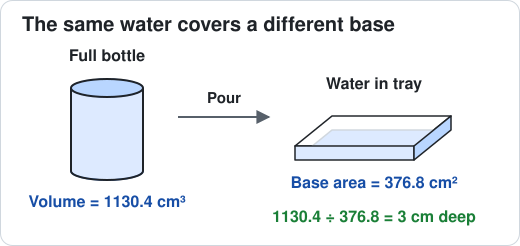

**Closest distractor.** B (10 cm) assumes the water keeps the bottle's height. D (12 cm) uses 12 cm (the diameter) as the radius. E (0.75 cm) halves the stated radius as if it were a diameter, giving a quarter of the correct volume and depth.

### M2-Q19 solution

**Answer B.** 132 m²

1. Find the rectangle's area: 12 × 7 = 84 m².
2. Find the triangle's area using its perpendicular height: 12 × 8 ÷ 2 = 48 m².
3. Add the two non-overlapping areas: 84 + 48 = 132 m².

**Closest distractor.** D (180) is the whole 12 m × 15 m rectangle around the shape, counting the empty corners beside the roof. E (144) uses the 10 m sloping side as the triangle’s height. The perpendicular height is 8 m. C (46) is the perimeter.

### M2-Q20 solution

**Answer D.** 30 000 cm²

1. Convert the two sides separately: 2 m = 200 cm and 1.5 m = 150 cm.
2. Multiply 200 × 150 = 30,000 cm².
3. Check by converting 3 m² at 10,000 cm² per square metre.

**Closest distractor.** B (300) multiplies 3 m² by 100, but 1 m² = 100 × 100 = 10 000 cm². E (350) adds 200 + 150.

### M2-Q21 solution

**Answer C.** 21.98 m

1. Each full turn advances the wheel by one circumference: 2 × 3.14 × 35 = 219.8 cm.
2. Ten turns advance it by 2198 cm.
3. Divide by 100 cm per metre to get 21.98 m.

**Closest distractor.** D (2198 m) forgets to convert cm to m. B (10.99 m) uses π × r for one turn (half the circumference).

### M2-Q22 solution

**Answer E.** 216 cm²

1. A length on the enlarged shape is 3 times the original length in each direction.
2. The area multiplier is 3 × 3 = 9.
3. Apply it to the whole area: 24 × 9 = 216 cm².

**Closest distractor.** A (72) multiplies the area by only 3. B (60) is the new perimeter, not the area.

### M2-Q23 solution

**Answer D.** 30 cm

1. Convert 18 L to 18,000 cm³ and use volume = length × width × depth.
2. The known lengths give 40 × 15 = 600 cm².
3. Divide: width = 18,000 ÷ 600 = 30 cm. Check: 40 × 30 × 15 = 18,000.

**Closest distractor.** B (15 cm) divides by 40 × 30, using the tank's height instead of the water depth. A (3 cm) converts 18 L to 1800 cm³.

### M2-Q24 solution

**Answer A.** 141.3 L

1. Halve the 60 cm diameter to get radius 30 cm.
2. Use the water depth as the cylinder height: 3.14 × 30² × 50 = 141,300 cm³.
3. Divide by 1000 to get 141.3 L.

**Closest distractor.** C (254.34 L) uses the full 90 cm height (capacity, not water present). D (565.2 L) uses 60 cm as the radius.

### M2-Q25 solution

**Answer B.** 21.5 cm²

1. The circle touches opposite sides of the square, so its diameter is 10 cm and its radius is 5 cm.
2. Compute the areas: square = 100 cm² and circle = 3.14 × 5² = 78.5 cm².
3. Subtract the circle from the square: 100 − 78.5 = 21.5 cm².

**Closest distractor.** A (78.5) is the circle, the unshaded part. D (5.375) is only one corner. C (68.6) subtracts the circumference.

### M2-Q26 solution

**Answer C.** The inside circumference and the inside height

1. Write the inputs needed by V = πr²h: inside radius and inside height.
2. An inside circumference gives the radius by division by 2π.
3. Choice C supplies that circumference and the inside height, so both inputs are known.

**Closest distractor.** A uses the outside diameter (includes the glass wall). B uses the outside height (includes the thick base). E gives the juice, not the capacity. D has no height.

### M2-Q27 solution

**Answer B.** 13π m²

1. The path extends 1 m beyond the 6 m radius, making the outer radius 7 m.
2. Compute the outer and inner areas: 49π m² and 36π m².
3. Subtract the inner circle: 49π − 36π = 13π m².

**Closest distractor.** A (12π) is the pond's circumference times the 1 m width, which ignores that the outer edge is longer. E (49π) includes the pond.

### M2-Q28 solution

**Answer E.** $552

1. Add the lengths of both pairs of opposite sides: 2 × (15 + 8) = 46 m.
2. Apply the rate of $12 per metre: 46 × 12 = 552.
3. The fence costs $552.

**Closest distractor.** B ($1440) uses the area 120 m² instead of the perimeter. A ($276) counts only one length and one width.

### M2-Q29 solution

**Answer D.** 24 minutes

1. Find the volume at the requested depth: 50 × 40 × 24 = 48,000 cm³ = 48 L.
2. Divide by the filling rate: 48 L ÷ 2 L/min = 24 min.
3. Check that 24 minutes at 2 L/min gives 48 L.

**Closest distractor.** A (30 minutes) fills the whole 30 cm height. E (48) forgets to divide by the 2 L per minute rate.

### M2-Q30 solution

**Answer A.** Ada’s, by 8 cm³

1. Ada's 2 cm cuts leave a base (18 − 4) × (12 − 4) cm and walls 2 cm high, so her volume is 224 cm³.
2. Nico's 3 cm cuts leave a base (18 − 6) × (12 − 6) cm and walls 3 cm high, so his volume is 216 cm³.
3. Compare the actual volumes: 224 − 216 = 8 cm³ more for Ada.

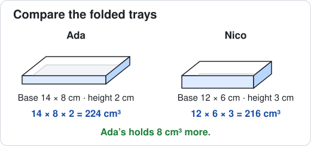

**Closest distractor.** D (85 cm³) subtracts only one cut width per dimension, giving 16 × 10 × 2 = 320 and 15 × 9 × 3 = 405. Each dimension loses a strip at both ends.
