# M3 — Algebra: Practice

[← Back to the index](../../README.md) · [Review the M3 learning page](1.%20Learning.md)

Answer each question on paper. Mark it correct, guessed, wrong or skipped before checking the key. Review guesses as well as misses. Save Q26–Q30 for the final weekend.

## Q01–Q05

### M3-Q01

A print shop charges 8 dollars to set up a poster design and 3 dollars for each copy. Which expression gives the total cost in dollars for `c` copies?

A. 3(c + 8)

B. 11c

C. 8c + 3

D. 3c + 8

E. 8 + c

### M3-Q02

What is the value of `5 − 2(x + 3)` when `x = −6`?

A. −13

B. 11

C. 23

D. −1

E. 5

### M3-Q03

A rectangle has perimeter 50 cm. Its length is 3 cm greater than its width. What is its length?

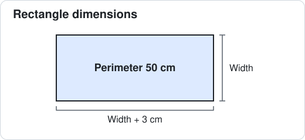

A. 17 cm

B. 11 cm

C. 14 cm

D. 23.5 cm

E. 26.5 cm

### M3-Q04

Which expression equals `4a + 7 − a + 2` for every value of `a`?

A. 3a + 7

B. 5a + 9

C. 3a + 5

D. 12a

E. 3a + 9

### M3-Q05

Loop Rentals charges 16 dollars plus 2 dollars per hour. Wheel Rentals charges 4 dollars plus 5 dollars per hour. At how many hours do the total charges match?

A. 20

B. 3

C. 12

D. 24

E. 4

## Q06–Q10

### M3-Q06

A greenhouse controller follows one linear rule. Which rule gives the output `y` for input `x`?

| x | 2 | 5 | 8 |
|---|---|---|---|
| y | 11 | 23 | 35 |

A. y = 12x − 13

B. y = 4x + 11

C. y = 4x + 3

D. y = 3x + 5

E. y = 3x + 8

### M3-Q07

Mina and Dev hold 36 counters altogether. Mina gives Dev 4 of hers. They now have equal numbers. How many counters did Mina start with?

A. 20

B. 22

C. 26

D. 18

E. 14

### M3-Q08

A poster is reduced in width according to `w = (p − 6)/2`, where both widths are in centimetres. A reduced poster is 15 cm wide. What was its original width `p`?

A. 21 cm

B. 24 cm

C. 42 cm

D. 13.5 cm

E. 36 cm

### M3-Q09

Three consecutive whole numbers total 72. Which equation uses `m` for the **middle** number?

A. m + m + (m + 1) = 72

B. m + (m + 1) + (m + 2) = 72

C. (m − 1) + m + (m + 1) = 72

D. (m − 2) + (m − 1) + m = 72

E. (m − 1) + (m + 1) = 72

### M3-Q10

For inputs `x = 0, 2, 5`, which list gives the matching outputs of `y = 9 − 2x` in that order?

A. 9, 5, −1

B. 9, 13, 19

C. 0, 5, −1

D. 9, 5, 1

E. 9, 7, 4

## Q11–Q15

### M3-Q11

A climber starts 6 m below a marked ledge and rises at 2 m per minute. Which expression gives her signed height in metres relative to the ledge after `t` minutes, taking upward as positive?

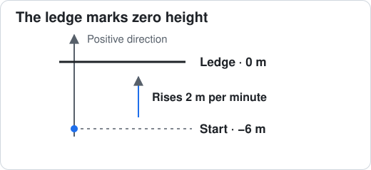

A. −6 − 2t

B. 2t − 6

C. 6 − 2t

D. 6 + 2t

E. 2(t − 6)

### M3-Q12

A music club raised 128 dollars by selling 20 tickets. Adult tickets cost 8 dollars and student tickets cost 5 dollars. How many adult tickets were sold, or is the report impossible?

A. 10

B. 7

C. 16

D. The report is impossible.

E. 9

### M3-Q13

Which value of `v` makes `v/4 + 3 = −2` true?

A. 20

B. −5

C. 4

D. −20

E. −4

### M3-Q14

Which expression equals `3(2b − 5) + 4b` for every value of `b`?

A. 14b − 15

B. 10b − 15

C. 10b − 5

D. 9b − 15

E. 6b − 11

### M3-Q15

A bus has some passengers. At the next stop 5 leave, then 3 board. The number now aboard is twice the number who left. How many passengers were on the bus before the stop?

A. 18

B. 15

C. 10

D. 8

E. 12

## Q16–Q20

### M3-Q16

At a fair, 5 identical games cost `g` tokens each. Nia brings 42 tokens and wants to have 7 left after playing the five games. How many tokens can each game cost?

A. 7

B. 8.4

C. 5

D. 9.8

E. 35

### M3-Q17

On a trail map, marker A is at kilometre 6 and marker B is at kilometre 39. Isha starts at A and walks toward B at 4 km/h. Leo starts at B at the same time and walks toward A at 7 km/h. At which kilometre marker do they meet?

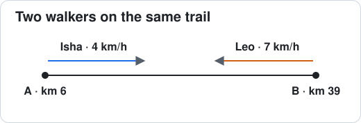

A. 18

B. 27

C. 21

D. 12

E. 3

### M3-Q18

What is `a² − 3b` when `a = −4` and `b = −2`?

A. 10

B. −22

C. 14

D. 22

E. −10

### M3-Q19

A machine follows a linear rule. At input 3 its output is 14. A student claims that the rule must be `y = 4x + 2`. Which additional observation would **rule out** that claim?

A. The output at input 5 is 22.

B. The output at input 1 is 6.

C. The output at input 5 is 24.

D. The output at input 0 is 2.

E. An input increase of 2 raises the output by 8.

### M3-Q20

A puzzle says, “Subtract 7 from my number and divide the result by 3 to get 5.” Which equation describes the puzzle if `n` is the number?

A. 3(n − 7) = 5

B. n/3 − 7 = 5

C. n − 7/3 = 5

D. (n − 7)/3 = 5

E. (7 − n)/3 = 5

## Q21–Q25

### M3-Q21

Arun is 4 years older than Beth. In 3 years their ages will add to 34. How old is Beth now?

A. 10

B. 12

C. 16

D. 13.5

E. 15

### M3-Q22

A row of seats is numbered. A student sits in seat `s`. A friend sits in the seat whose number is one less than twice `s`. If `s = 14`, what is the friend’s seat number?

A. 13

B. 30

C. 29

D. 26

E. 27

### M3-Q23

A straight candle burns at a constant rate. The table shows its height during burning. What was its height when first lit?

| Time since lighting (min) | 4 | 10 |
|---|---|---|
| Height (cm) | 17 | 14 |

A. 15 cm

B. 19 cm

C. 20 cm

D. 17 cm

E. 21 cm

### M3-Q24

For which value of `u` do `5u − 3` and `2u + 9` have the same value?

A. 2

B. 6

C. 4

D. 12

E. −4

### M3-Q25

Two sealed cartons hold only red and blue beads. They contain equal numbers of **red** beads. The first also has 6 blue beads. The second also has 10 blue beads. Which statement gives enough additional information to determine the red count in one carton?

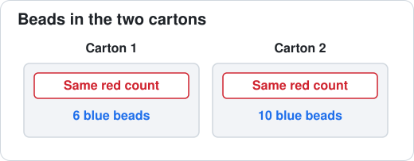

A. Together they hold 16 blue beads.

B. Moving 2 blue beads from the second to the first gives equal totals.

C. Each carton holds at least 11 beads.

D. The second carton has 4 more beads than the first.

E. The cartons contain 40 beads altogether.

## Q26–Q30 · Final weekend

### M3-Q26

On a scoreboard, a win earns 3 points, a draw earns 1 point and a loss earns 0 points. A team plays 8 games, draws 2 of them and earns 14 points. How many games does it lose?

A. 3

B. 6

C. 4

D. 2

E. 0

### M3-Q27

A photo stands in a frame with a left border `b` cm wide and a right border twice that wide. The whole frame is 30 cm wide. Which expression gives the width in centimetres of the visible photo?

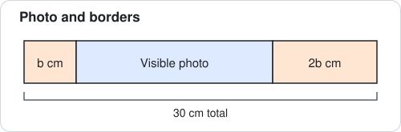

A. 30 − 3b

B. 30 + 3b

C. 3(30 − b)

D. 30 − b

E. 30 − 2b

### M3-Q28

A builder records shelf positions as distances above a floor. Later she measures those same positions from a platform 12 cm above that floor. A shelf is `h` cm above the platform. Which expression gives its height above the floor?

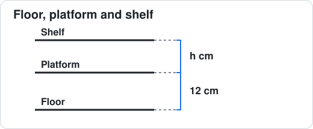

A. h + 12

B. 12h

C. h/12

D. h − 12

E. 12 − h

### M3-Q29

A recipe has a smudged entry for the mass of flour in one batch. Two full batches *plus half a batch* use 450 g of flour. How much flour goes into half a batch?

A. 75 g

B. 112.5 g

C. 90 g

D. 225 g

E. 180 g

### M3-Q30

A judge calculates a score by adding three marks, dropping the smallest mark from the sum, then doubling the result. Two marks are 8 and 11. All marks are whole numbers from 0 to 20. If the final score is 38, which list gives **all** possible values of the third mark?

A. 0 through 8

B. 8 only

C. 8 through 20

D. 0 through 7

E. 0 through 11

## Answer key

[Go to the full solutions](#full-solutions)

| ID | Answer | Tier | Reasoning | Closest distractor ruled out by |
|---|---|---|---|---|
| M3-Q01 | D | Medium | The setup charge occurs once and each copy adds 3 dollars. | C. This charges 8 dollars for every copy. |
| M3-Q02 | B | Medium | The bracket gives −3, so 5 − 2(−3) = 11. | D. Subtracting a negative product increases 5. |
| M3-Q03 | C | Challenge | One length and one width total 25 cm. Removing the extra 3 leaves 22 for two widths, so the length is 11 + 3 = 14 cm. | B. This is the width. |
| M3-Q04 | E | Medium | Combine the three remaining copies of a and add 7 + 2. | C. The minus sign applies to a alone. |
| M3-Q05 | E | Challenge | Loop starts 12 dollars higher, and Wheel catches up by 3 dollars each hour. Both charge 24 dollars after 4 hours. | C. The initial gap is in dollars, while the question asks for hours. |
| M3-Q06 | C | Medium | A 3-unit input increase adds 12 to y, so the rate is 4. At x = 2, 11 − 8 = 3 gives the starting value. | D. This fits the first column but gives 20 in the second. |
| M3-Q07 | B | Challenge | Each finishes with 18. Undo Mina’s transfer by adding 4 to her final 18. | A. A single counter transferred changes the gap by two, so the original gap was 8. |
| M3-Q08 | E | Medium | Double 15 to recover p − 6 = 30, then add 6. | B. Undoing the subtraction requires addition. |
| M3-Q09 | C | Challenge | The neighbours of the middle number are one less and one more. | B. This makes m the smallest number. |
| M3-Q10 | A | Medium | Subtract 0, 4 and 10 respectively from 9. | D. The last subtraction goes below zero. |
| M3-Q11 | B | Medium | The starting height is −6 and each minute adds 2. | D. At zero minutes this puts the climber above the ledge. |
| M3-Q12 | D | Challenge | Twenty student tickets would bring in 100 dollars. Each adult ticket adds 3 dollars, and 28 is not a whole multiple of 3. | E. Nine adults would bring the total to 127 dollars. Rounding changes the reported total. |
| M3-Q13 | D | Medium | Subtract 3 from both sides to get v/4 = −5, then multiply by 4. | B. This is v divided by 4. |
| M3-Q14 | B | Medium | Distribute 3 to get 6b − 15, then add 4b. | C. The 5 inside the bracket is also multiplied by 3. |
| M3-Q15 | E | Challenge | Twice the five who left is 10 aboard now. Undo boarding, then undo leaving, to get 10 − 3 + 5 = 12. | C. This counts passengers after the stop. |
| M3-Q16 | A | Medium | Nia can spend 42 − 7 = 35 tokens, enough for 7 per game. | B. Dividing all 42 tokens leaves none in reserve. |
| M3-Q17 | A | Challenge | They close the 33 km gap at 11 km/h and meet after 3 h. Isha reaches marker 6 + 4 × 3 = 18. | D. Isha walks 12 km from marker 6. |
| M3-Q18 | D | Medium | Squaring −4 gives 16 and subtracting 3(−2) adds 6. | A. This treats b as positive. |
| M3-Q19 | C | Challenge | The claimed rule predicts 4 × 5 + 2 = 22, so an output of 24 contradicts it. | A. This agrees with the prediction at input 5. |
| M3-Q20 | D | Medium | The entire difference n − 7 is divided by 3. | C. This divides only 7 by 3. |
| M3-Q21 | B | Challenge | Their current ages total 34 − 6 = 28. Subtract the 4-year difference and halve 24 to get Beth’s age. | E. This is Beth’s age three years from now. |
| M3-Q22 | E | Medium | Twice 14 is 28 and one less is 27. | D. Doubling 14 − 1 would subtract the 1 too early. |
| M3-Q23 | B | Medium | The candle loses 3 cm in 6 minutes. In its first 4 minutes it lost 2 cm, so it began at 17 + 2 = 19 cm. | E. Adding 4 cm assumes a rate of 1 cm per minute. |
| M3-Q24 | C | Medium | Setting the expressions equal gives 3u = 12. At u = 4 both give 17. | A. At u = 2 the expressions give 7 and 13. |
| M3-Q25 | E | Challenge | Remove 16 blue beads from the total of 40 and halve the remaining 24. | D. The difference of 4 follows from the blue beads for every possible red count. |
| M3-Q26 | D | Challenge | The draws earn 2 points, leaving 12 points from 4 wins. Of the 8 games, 8 − 4 − 2 = 2 are losses. | C. Four counts the wins. |
| M3-Q27 | A | Medium | The two borders use b + 2b = 3b of the width. | E. This subtracts only the right border. |
| M3-Q28 | A | Medium | From the floor, rise 12 cm to the platform and then h cm to the shelf. | D. A shelf level with the platform has h = 0 and is still 12 cm above the floor. |
| M3-Q29 | C | Medium | The recipe quantity is five half-batches. One half-batch uses 450 ÷ 5 = 90 g. | E. This is the flour in a full batch. |
| M3-Q30 | A | Challenge | The two kept marks must total 19. Every third mark up to 8 can be dropped, including a tie at 8. Any larger third mark raises the kept total above 19. | D. A tie still allows one smallest mark to be dropped. |

## Full solutions

Solve and mark each question before opening its solution. For a guess or miss, try the steps again on paper before comparing.

### M3-Q01 solution

**Answer D.** 3c + 8

1. Let the variable count the copies. Multiply that count by 3 to get the charge for the copies.
2. Add the fixed $8 charge once. With zero copies the expression should still give $8.

**Closest distractor.** C. This charges 8 dollars for every copy.

### M3-Q02 solution

**Answer B.** 11

1. Evaluate the bracket first to get −3.
2. Multiply by 2 to get −6.
3. Subtract that product: 5 − (−6) = 5 + 6 = 11.

**Closest distractor.** D. Subtracting a negative product increases 5.

### M3-Q03 solution

**Answer C.** 14 cm

1. Halve the perimeter to find length + width = 25 cm.
2. The length is the width plus 3 cm. Remove those 3 cm and split the remaining 22 cm into two equal widths of 11 cm.
3. The length is 14 cm. Check: 2 × (14 + 11) = 50 cm.

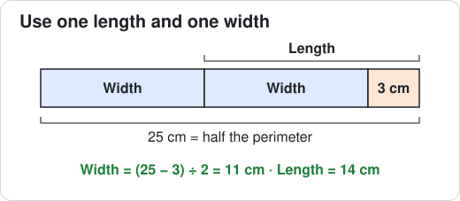

**Closest distractor.** B. This is the width.

### M3-Q04 solution

**Answer E.** 3a + 9

1. Keep the variable terms together: four copies of a minus one copy leaves three.
2. Add the constant terms: 7 + 2 = 9.
3. The result is 3a + 9. At a = 0 both expressions give 9.

**Closest distractor.** C. The minus sign applies to a alone.

### M3-Q05 solution

**Answer E.** 4

1. At hour zero, Loop costs $12 more.
2. Wheel adds $3 more per hour than Loop, so the gap closes in 12 ÷ 3 = 4 hours.
3. Substitute four hours into both cost rules to check that each gives $24.

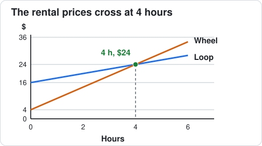

**Closest distractor.** C. The initial gap is in dollars, while the question asks for hours.

### M3-Q06 solution

**Answer C.** y = 4x + 3

1. Between the first two columns, x increases by 3 and y increases by 12. The rate is 12 ÷ 3 = 4.
2. Use x = 2 and y = 11: the fixed amount is 11 − 4 × 2 = 3.
3. The rule y = 4x + 3 also gives 23 at x = 5.

**Closest distractor.** D. This fits the first column but gives 20 in the second.

### M3-Q07 solution

**Answer B.** 22

1. The transfer keeps the total at 36. Equal final piles therefore contain 18 counters each.
2. Undo Mina's transfer by adding her 4 counters back: 18 + 4 = 22.
3. The other pile started with 14, and moving 4 gives 18 in both piles.

**Closest distractor.** A. A single counter transferred changes the gap by two, so the original gap was 8.

### M3-Q08 solution

**Answer E.** 36 cm

1. Reverse the division first: p − 6 = 2 × 15 = 30.
2. Add 6 to both sides to get p = 36.
3. Check by substituting: (36 − 6) ÷ 2 = 15.

**Closest distractor.** B. Undoing the subtraction requires addition.

### M3-Q09 solution

**Answer C.** (m − 1) + m + (m + 1) = 72

1. Call the middle number m. Its neighbours are m − 1 and m + 1.
2. All three numbers total 72, so write (m − 1) + m + (m + 1) = 72.
3. As a check, the −1 and +1 cancel, giving 3m = 72. The numbers 23, 24 and 25 then add to 72.

**Closest distractor.** B. This makes m the smallest number.

### M3-Q10 solution

**Answer A.** 9, 5, −1

1. Substitute each input separately. At 0 the output is 9 − 0 = 9.
2. At 2 the output is 9 − 4 = 5.
3. At 5 the output is 9 − 10 = −1. Each extra input unit drops the output by 2.

**Closest distractor.** D. The last subtraction goes below zero.

### M3-Q11 solution

**Answer B.** 2t − 6

1. Use −6 as the height at minute zero.
2. In t minutes, the rise is 2t. Add it to the starting height to get −6 + 2t.
3. At t = 3 the rule gives zero, since the 6 units gained cancel the starting deficit.

**Closest distractor.** D. At zero minutes this puts the climber above the ledge.

### M3-Q12 solution

**Answer D.** The report is impossible.

1. First price all 20 tickets as student tickets: 20 × $5 = $100.
2. An adult ticket replaces one student ticket and adds $3. The extra $28 would need to equal 3 times a whole number.
3. Nine adult upgrades add $27 and ten add $30, so $128 is impossible.

**Closest distractor.** E. Nine adults would bring the total to 127 dollars. Rounding changes the reported total.

### M3-Q13 solution

**Answer D.** −20

1. Subtract 3 from both sides to get v/4 = −5.
2. Multiply both sides by 4: v = −20.
3. Check that −20 ÷ 4 + 3 = −2.

**Closest distractor.** B. This is v divided by 4.

### M3-Q14 solution

**Answer B.** 10b − 15

1. Distribute the 3 to both terms inside the brackets: 3(2b − 5) = 6b − 15.
2. Add 4b to 6b to get 10b − 15.
3. Test b = 1: both the original and simplified expressions give −5.

**Closest distractor.** C. The 5 inside the bracket is also multiplied by 3.

### M3-Q15 solution

**Answer E.** 12

1. Twice the 5 who left gives the final 10 passengers.
2. Undo the 3 boarding: 10 − 3 = 7.
3. Undo the 5 leaving: 7 + 5 = 12. Running the changes forward gives 12 − 5 + 3 = 10.

**Closest distractor.** C. This counts passengers after the stop.

### M3-Q16 solution

**Answer A.** 7

1. Reserve 7 of the 42 tokens, leaving 35 to spend.
2. Divide the 35 available tokens by 5 games to get 7 tokens per game.
3. Check that 5 × 7 = 35 tokens spent, leaving 42 − 35 = 7 tokens.

**Closest distractor.** B. Dividing all 42 tokens leaves none in reserve.

### M3-Q17 solution

**Answer A.** 18

1. The walkers start 39 − 6 = 33 km apart. Walking toward each other, they close 4 + 7 = 11 km each hour.
2. Divide to get a meeting time of 3 hours.
3. Isha travels 4 × 3 = 12 km from marker 6 and reaches marker 18.

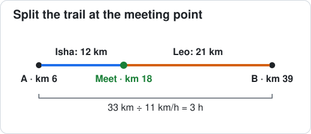

**Closest distractor.** D. Isha walks 12 km from marker 6.

### M3-Q18 solution

**Answer D.** 22

1. Put the negative input inside parentheses before squaring: (−4)² = 16.
2. The second product is 3 × (−2) = −6.
3. Subtract the product to get 16 − (−6) = 22.

**Closest distractor.** A. This treats b as positive.

### M3-Q19 solution

**Answer C.** The output at input 5 is 24.

1. A counterexample needs one input whose claimed output fails.
2. For x = 5, compute 4 × 5 + 2 = 22.
3. The observed 24 differs, so this single pair is enough to disprove the rule.

**Closest distractor.** A. This agrees with the prediction at input 5.

### M3-Q20 solution

**Answer D.** (n − 7)/3 = 5

1. Start with the unknown n. The difference described is n − 7.
2. Divide the entire difference by 3: (n − 7)/3.
3. For example, with n = 13 the difference is 6 and the result is 2.

**Closest distractor.** C. This divides only 7 by 3.

### M3-Q21 solution

**Answer B.** 12

1. Over three years the two people together gain 6 years, so now their ages total 34 − 6 = 28.
2. Let Beth's age be b. The other age is b + 4, so 2b + 4 = 28.
3. Solve to get b = 12. The current ages 12 and 16 become 15 and 19 in three years.

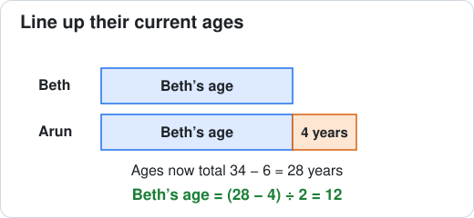

**Closest distractor.** E. This is Beth’s age three years from now.

### M3-Q22 solution

**Answer E.** 27

1. Start with 14 and multiply by 2 to obtain 28.
2. Take one away to obtain 27.
3. You can check by adding one to 27, then halving it to recover 14.

**Closest distractor.** D. Doubling 14 − 1 would subtract the 1 too early.

### M3-Q23 solution

**Answer B.** 19 cm

1. The candle loses 3 cm in 6 minutes, or ½ cm per minute.
2. In the first four minutes it lost 2 cm.
3. Add that loss back to the 17 cm reading: it started at 19 cm.

**Closest distractor.** E. Adding 4 cm assumes a rate of 1 cm per minute.

### M3-Q24 solution

**Answer C.** 4

1. Write 5u − 3 = 2u + 9. Subtract 2u from both sides, then add 3 to both sides.
2. The equality reduces to 3u = 12, giving u = 4.
3. At u = 4, both original expressions evaluate to 17.

**Closest distractor.** A. At u = 2 the expressions give 7 and 13.

### M3-Q25 solution

**Answer E.** The cartons contain 40 beads altogether.

1. Choice E supplies the grand total of 40. Remove the 6 + 10 = 16 blue beads, leaving 24 red beads.
2. Both cartons have the same number of red beads. Divide 24 by 2 to get 12 red beads per carton.
3. Check: the first carton has 6 + 12 = 18 beads and the second 10 + 12 = 22, for 40 altogether.

**Closest distractor.** D. The difference of 4 follows from the blue beads for every possible red count.

### M3-Q26 solution

**Answer D.** 2

1. Two draws contribute 2 points, leaving 14 − 2 = 12 points from wins.
2. At 3 points per win, that means 4 wins.
3. Out of 8 games, 8 − 2 − 4 = 2 remain as losses.

**Closest distractor.** C. Four counts the wins.

### M3-Q27 solution

**Answer A.** 30 − 3b

1. The two borders together use b + 2b = 3b of the full width.
2. Subtract 3b from the full 30 cm width to get 30 − 3b.
3. The result plus both borders must add back to the original width.

**Closest distractor.** E. This subtracts only the right border.

### M3-Q28 solution

**Answer A.** h + 12

1. Break the climb into two vertical segments.
2. The first segment is 12 cm from floor to platform, and the second is h cm from platform to shelf.
3. Add them to obtain 12 + h cm.

**Closest distractor.** D. A shelf level with the platform has h = 0 and is still 12 cm above the floor.

### M3-Q29 solution

**Answer C.** 90 g

1. Two and a half batches contain five half-batches.
2. Split the 450 g equally among those five units to get 90 g per half-batch.
3. Check that five half-batches at 90 g each use 450 g.

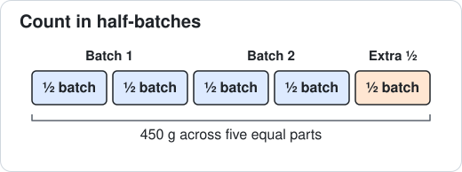

**Closest distractor.** E. This is the flour in a full batch.

### M3-Q30 solution

**Answer A.** 0 through 8

1. Divide the final score of 38 by 2 to find that the two kept marks must total 19.
2. The two known marks already total 19. A third mark at most 8 is a lowest mark and can be dropped, including a tie at 8.
3. Any third mark above 8 replaces the 8 and pushes the kept total above 19.

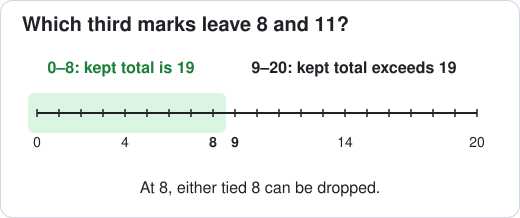

**Closest distractor.** D. A tie still allows one smallest mark to be dropped.
