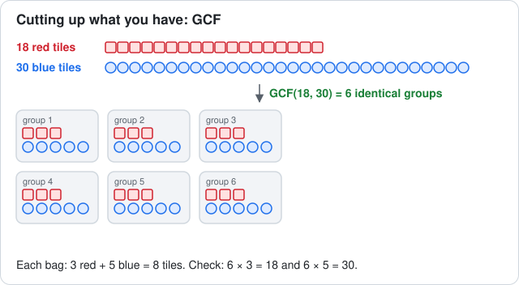
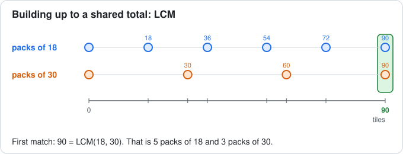
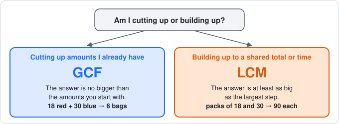
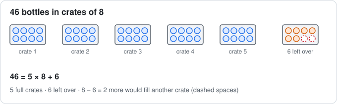
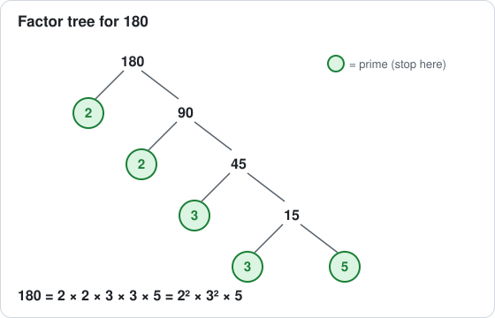
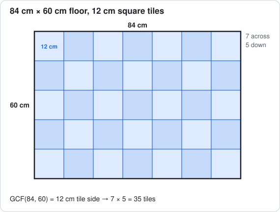

# Number theory

[Back to the Grade 9 index](../../README.md) · [Number theory practice questions](2.%20Doing.md)

## Rule summary

A **factor** divides a number evenly. A **multiple** is what you get when you multiply a number by a whole number. **Common** means shared by the numbers you are comparing.

- **Greatest common factor (GCF).** Find the largest number that divides each total evenly. Use it when you need the greatest number of identical groups from supplies you already have.
- **Least common multiple (LCM).** Find the smallest positive number that is a multiple of every step size. Use it when you need to build up to a shared total or find when events that started together will line up again.

Read $=$ as “is equal to,” $\times$ as “multiply,” and $\div$ as “divide.” A **remainder** is the amount left after you make all the full groups you can.

```math
\begin{aligned}
\text{Items per group} &= \text{total items of one kind} \div \text{number of groups} \\
\text{Packs needed} &= \text{shared total} \div \text{items per pack} \\
\text{Total} &= (\text{full groups} \times \text{group size}) + \text{remainder}
\end{aligned}
```

## 1. Split supplies into identical groups

Say you have **18 red tiles and 30 blue tiles**. You want the greatest possible number of identical bags, using every tile. Every bag must have the same number of red tiles, and every bag must have the same number of blue tiles.

The number of bags has to divide both 18 and 30 evenly. Start by listing the factors of 18. A **factor pair** is two numbers that multiply to give 18.

```math
18 = 1 \times 18 = 2 \times 9 = 3 \times 6
```

Test the factors from largest to smallest. Neither 18 nor 9 divides 30 evenly. The next factor is 6, and it does divide 30 evenly. That makes 6 the **greatest common factor**.



```math
\begin{aligned}
\text{Red tiles per bag} &= 18 \div 6 = 3 \\
\text{Blue tiles per bag} &= 30 \div 6 = 5
\end{aligned}
```

You can make **6 bags** with **8 tiles in each bag**. To check, multiply back. You get $6 \times 3 = 18$ red tiles and $6 \times 5 = 30$ blue tiles. If the question adds a condition such as “at least 4 red tiles per bag,” keep testing smaller common factors until the contents of every bag meet it.

## 2. Build up to a shared total

Now red tiles come in packs of 18 and blue tiles come in packs of 30. You want to buy the **same number of each colour**, with as few tiles as possible. Count by 18 for red and by 30 for blue. The first positive number on both lists is 90.

```math
\begin{aligned}
\text{Multiples of 18} &\colon 18,\ 36,\ 54,\ 72,\ 90,\ \ldots \\
\text{Multiples of 30} &\colon 30,\ 60,\ 90,\ \ldots
\end{aligned}
```



The **least common multiple** is 90. Buy $90 \div 18 = 5$ red packs and $90 \div 30 = 3$ blue packs. If you need at least 100 tiles of each colour, the next shared total is $2 \times 90 = 180$.



### Use the same idea for repeating events

If two lights flash together now, then flash every 4 and 6 seconds, the LCM is 12 seconds. They flash together again after 12 seconds, then 24, then 36. Include the starting flash if the question asks you to count it.

If the lights start at different times, write each list from its own start. If the 4-second light starts at 0 seconds and the 6-second light starts at 2 seconds, their first shared flash is at **8 seconds**. The lists start $0,\ 4,\ 8,\ 12,\ldots$ and $2,\ 8,\ 14,\ldots$.

## 3. Decide what to do with a leftover

You have 46 bottles and crates that each hold 8. Five full crates hold 40 bottles, with 6 left over. The remainder must be smaller than the crate size. If it were 8 or more, you could fill another crate.

```math
46 = (5 \times 8) + 6
```



- **How many full crates?** Five.
- **How many crates to carry all the bottles?** Six, with the last crate partly filled.
- **How many more bottles to fill that last crate?** $8 - 6 = 2$.

### Use remainders to find a total

If a total leaves **1 extra** in groups of 4 or in groups of 6, take away 1. The amount left is a multiple of both 4 and 6. For a total between 20 and 30, the only candidate is $24 + 1 = 25$. Check that 25 is one more than $6 \times 4$ and one more than $4 \times 6$.

If the total is **2 short** of a full group whether you pack it in 4s or 6s, add 2 to reach a common multiple. For example, $24 - 2 = 22$ leaves 2 in groups of 4 and 4 in groups of 6, so both partly filled groups need 2 more.

## 4. Break numbers into primes and check divisibility

A **prime number** has exactly two positive factors, 1 and itself. For example, 5 is prime. The number 1 has only one positive factor. The first few primes are 2, 3, 5 and 7.

To find a **prime factorization**, split the number into a factor pair. Keep splitting any factor that can be broken down further into factors greater than 1. Stop when all the factors are prime.



A raised 2 tells you to multiply that factor by itself. For example, $3^2$ means $3 \times 3$.

```math
180 = 2 \times 2 \times 3 \times 3 \times 5 = 2^2 \times 3^2 \times 5
```

### Find a GCF or an LCM using prime factors

Compare $18 = 2 \times 3^2$ with $30 = 2 \times 3 \times 5$.

- **GCF.** Keep only the factors you can match in both lists. Both numbers have a 2 and at least one 3, so the GCF is $2 \times 3 = 6$.
- **LCM.** Keep enough copies of every prime to build either number. One 2, two 3s, and one 5 give $2 \times 3^2 \times 5 = 90$.

### Work backward from a GCF and an LCM

For two positive whole numbers, multiplying the GCF by the LCM gives the same product as multiplying the two numbers. In the prime factor lists, the GCF takes the copies shared by both numbers. The LCM takes the rest needed to make up the two lists together.

```math
\text{First number} \times \text{second number} = \text{GCF} \times \text{LCM}
```

If one number is 12, the GCF is 4 and the LCM is 60, divide $4 \times 60$ by 12 to get 20. Check that 12 and 20 share 4 as their greatest factor and first share 60 as a multiple.

### Count factors in pairs

The factor pairs of 36 are $1 \times 36$, $2 \times 18$, $3 \times 12$, $4 \times 9$, and $6 \times 6$. Each of the first four pairs gives two factors. The last pair gives just one because both entries are 6. There are $4 \times 2 + 1 = 9$ factors.

A number with exactly three positive factors has one pair with different factors and one pair with a repeated factor. The different pair is 1 and the number itself, so the only factor between them is its square root. That root must be prime, since any additional factor of the root would also divide its square. For example, $25 = 5^2$ has the factors 1, 5 and 25.

### Check divisibility from the digits

A number is **divisible** by another number when the division leaves a remainder of zero.

| Divisible by | What to check |
| --- | --- |
| 2 | The last digit is even. |
| 3 | The sum of the digits is divisible by 3. |
| 4 | The number formed by the last two digits is divisible by 4. |
| 5 | The last digit is 0 or 5. |
| 6 | The number passes both the 2 and 3 rules. |
| 8 | The number formed by the last three digits is divisible by 8. |
| 9 | The sum of the digits is divisible by 9. |
| 10 | The last digit is 0. |
| 11 | Add and subtract the digits in turn, starting with addition. The result is 0 or a multiple of 11, including negative multiples. |

**Try it with $52\square$.** The first two digits add to 7. To pass the rule for 9, the digit sum must be a multiple of 9. Adding one digit from 0 to 9 gives a sum from 7 to 16. The only multiple of 9 in that range is 9, so the missing digit is $9 - 7 = 2$. Check that $522 = 9 \times 58$.

To test for 45, check both 5 and 9. Each divides 45, and they share only 1 as a factor. Passing both tests means the number is a multiple of their LCM, $5 \times 9 = 45$.

## 5. Worked example with square floor tiles

An **84 cm by 60 cm** floor will be covered exactly with identical square tiles, with no gaps, overlaps, or cutting. Use the largest square tiles that fit. **How many tiles do you need?**

A. 7 tiles

B. 12 tiles

C. 35 tiles

D. 140 tiles

E. 420 tiles

**1. Find the tile side length.** The same side length must divide 84 cm and 60 cm evenly. To make the tiles as large as possible, find the GCF. In the two prime factorizations, the shared factors are two 2s and one 3.

```math
\begin{aligned}
84 &= 2^2 \times 3 \times 7 \\
60 &= 2^2 \times 3 \times 5 \\
\text{Tile side length} &= 2^2 \times 3\ \mathrm{cm} = 12\ \mathrm{cm}
\end{aligned}
```

**2. Count the tiles along each edge.** Divide each floor measurement by 12 cm. A row has 7 tiles, and 5 rows cover the floor.



```math
\begin{aligned}
\text{Tiles per row} &= 84\ \mathrm{cm} \div 12\ \mathrm{cm} = 7 \\
\text{Rows} &= 60\ \mathrm{cm} \div 12\ \mathrm{cm} = 5 \\
\text{Tiles altogether} &= 7 \times 5 = 35
\end{aligned}
```

**Answer C.** You need **35 tiles**. The 12 you found in step 1 is the side length in centimetres.

**Check.** Seven 12 cm tiles stretch across 84 cm. Five rows of 12 cm tiles cover the other 60 cm exactly.

[Try the number theory practice questions](2.%20Doing.md)
