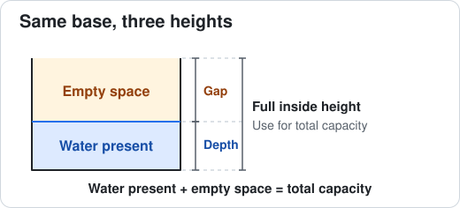
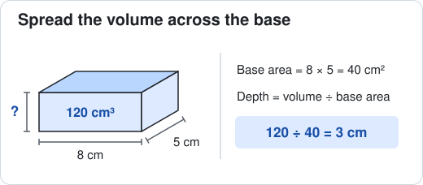
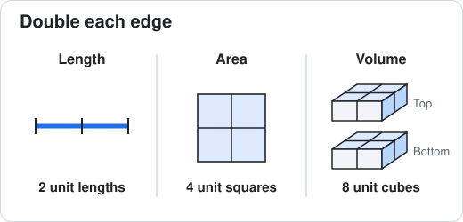
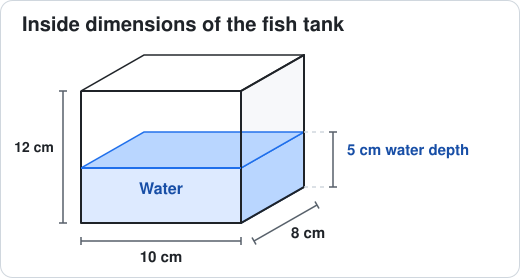
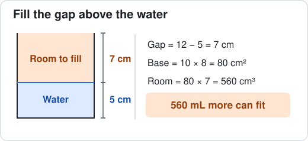

# Geometry and measurement

[Back to the Grade 9 index](../../README.md) · [Geometry practice questions](2.%20Doing.md)

## 1. Start with a circle and a piece of string

Take a round lid. Wrap a piece of string around its edge once, then straighten the string against a ruler. The length you measure is the **circumference**. Now measure straight across the widest part of the lid, passing through its centre. That length is the **diameter**. The **radius** runs from the centre to the edge, so it is half the diameter.


### What is pi?

Lay the straightened string beside the ruler. See how many diameter lengths fit along the string. Three fit, with a little string left over. That same comparison works for every circle. The number is called **pi**, pronounced “pie” and written as $\pi$. Its decimal starts with 3.14159, so 3.14 is a handy approximation.

```math
\pi = \frac{\text{circumference}}{\text{diameter}} \approx 3.14
```

The symbol $\approx$ means **approximately equal to**.

### How far around?

The string wrapped around the lid tells you how far around it is. To calculate that distance, multiply the diameter by pi. If you know the radius, double it first.

```math
\text{Circumference} = \pi \times \text{diameter}
```

```math
C = \pi d = 2\pi r
```

Here $C$ is circumference, $d$ is diameter, and $r$ is radius. When letters are written next to each other in a formula, multiply them. So $\pi d$ means $\pi \times d$.

**Try it with a lid 10 cm across.** The diameter is 10 cm and the radius is 5 cm.

```math
C = \pi \times 10\ \mathrm{cm} = 10\pi\ \mathrm{cm} \approx 31.4\ \mathrm{cm}
```

The string would be about **31.4 cm** long. Writing $10\pi\ \mathrm{cm}$ keeps the answer exact. A question that asks for an answer **in terms of pi** is asking you to leave pi in your answer. Use the value of pi the question gives when it asks you to calculate with an approximation.

### How much space inside?

Imagine covering the lid with tiny squares, each 1 cm on a side. The amount of surface you cover is the **area**, measured in square centimetres.

Now picture a square that just fits around the lid. Lines through the centre split the big square into four smaller squares, each one radius long and one radius wide. The lid covers about 3.14 small squares' worth of area. To find the area of one small square, multiply the radius by itself. Then multiply by pi.

```math
\text{Circle area} = \pi \times \text{radius} \times \text{radius}
```

```math
A = \pi r^2
```

Here $A$ is area and $r^2$ means $r \times r$. For the same 10 cm lid, use its **5 cm radius**.

```math
A = \pi \times (5\ \mathrm{cm})^2 = 25\pi\ \mathrm{cm}^2 \approx 78.5\ \mathrm{cm}^2
```

You can also work backward. If a circle measures about 31.4 cm around, divide 31.4 by 3.14 to get a diameter of about 10 cm. Its radius is about 5 cm.

## 2. Follow the edge or cover the inside

**Perimeter** is the distance around a shape. A fence goes along its perimeter. **Area** is the flat space inside. Paint covers its area.

### Rectangle and triangle

A rectangle has two sides of length $\ell$ and two sides of width $w$. Add those four sides for perimeter. For area, picture rows of square tiles. Multiply the tiles in each row by the number of rows.

```math
\text{Rectangle perimeter} = 2 \times (\ell + w)
```

```math
\text{Rectangle area} = \ell \times w
```

A diagonal cuts a rectangle into two equal triangles. More generally, a triangle has half the area of a rectangle with the same base and height. Choose a side as the base, then measure from the opposite corner at a right angle to the line that runs along the base.

```math
\text{Triangle area} = \frac{\text{base} \times \text{height}}{2}
```

### Shapes made of smaller pieces

For **area**, split the shape into pieces you recognize and add their areas. If a piece is cut out, subtract its area. A semicircle has half the area of a full circle, and a quarter circle has one quarter.

For **perimeter**, trace the outside edge with your finger. The curved edge of a semicircle is half the full circumference. The curved edge of a quarter circle is one quarter of the full circumference. For a semicircle on its own, add the straight edge across it. For a quarter circle on its own, add its two straight edges. If that edge is shared with an attached rectangle, it lies inside the combined shape.

## 3. Picture volume as layers

**Volume** tells you how much space is inside a three-dimensional shape. Picture a box packed with cubes, each 1 cm long, wide, and tall. Each cube takes up 1 cubic centimetre ($1\ \mathrm{cm}^3$). The base area tells you how many cubes fit in one layer and the height tells you how many layers fit. For a container with the same cross-section from bottom to top, multiply the area of one layer by the height.

```math
\text{Volume} = \text{base area} \times \text{height}
```

### Box-shaped container

The base is a rectangle. Multiply its inside length $\ell$ by its inside width $w$, then multiply by the height $h$ you want to measure.

```math
V = \ell \times w \times h
```

### Cylinder

A straight-sided can has a circular base. Find its area using the inside radius $r$, then multiply by the height $h$ you want to measure.

```math
V = \pi \times r^2 \times h
```

A cylindrical cup measures **8 cm across the inside** and the water is **5 cm deep**. The radius is 4 cm. Multiply 4 by itself and by 3.14 to find the base area, then multiply by the water depth. The cup contains about **251.2 mL** of water.

```math
3.14 \times 4 \times 4 \times 5 = 251.2
```

### Use the height that matches the question



- **How much water is already in the tank?** Use the water depth.
- **How much more water can fit?** Use the gap from the surface to the top.
- **How much can the full tank hold?** Use the full inside height. This is the tank’s **capacity**.

## 4. Work backward to find the water depth

In a container with straight vertical sides, every horizontal layer covers the same area. If you know the volume, divide it by that area to find the depth.

```math
\text{Water depth} = \frac{\text{water volume}}{\text{base area}}
```



An 8 cm by 5 cm base has an area of 40 cm². Every centimetre of depth takes 40 cm³ of water. So 120 cm³ of water fills three centimetres of depth.

```math
\text{Water depth} = \frac{120\ \mathrm{cm}^3}{40\ \mathrm{cm}^2} = 3\ \mathrm{cm}
```

If the tank already has water in it, divide the **added** volume by the base area to find how far the level would rise. Add that rise to the starting depth. If the result is above the top of the tank, the extra water spills.

## 5. Make sense of units and scale

A **length** in cm counts along one direction. An **area** in cm² counts square centimetres in two directions. A **volume** in cm³ counts cubic centimetres in three directions. Convert measurements to the same unit before multiplying or dividing them.

A 1 cm cube holds 1 mL of water, and 1,000 mL makes a litre.

```math
1\ \mathrm{mL} = 1\ \mathrm{cm}^3
```

```math
1\ \mathrm{L} = 1{,}000\ \mathrm{mL} = 1{,}000\ \mathrm{cm}^3
```

A metre is 100 cm. A square metre is a square with 100 cm on **each** side, so it contains 100 rows of 100 square centimetres.

```math
1\ \mathrm{m} = 100\ \mathrm{cm}
```

```math
1\ \mathrm{m}^2 = 100\ \mathrm{cm} \times 100\ \mathrm{cm} = 10{,}000\ \mathrm{cm}^2
```

### What happens when you double every length?



- **Length and perimeter** double. Every edge is twice as long.
- **Area** grows by a factor of $2 \times 2 = 4$. You double the rows and the squares in each row.
- **Volume** grows by a factor of $2 \times 2 \times 2 = 8$. You also double the number of layers.

For any scale factor, use it once for lengths, twice as a multiplier for areas, and three times as a multiplier for volumes.

## 6. Worked example with a fish tank

This tank is 12 cm tall on the inside. The water is 5 cm deep. **How many more millilitres can you pour in before the tank is full?**



**1. Find the gap.** Measure from the surface of the water to the top of the tank.

```math
\text{Gap} = 12\ \mathrm{cm} - 5\ \mathrm{cm} = 7\ \mathrm{cm}
```

**2. Find the area of one layer.** The inside base is 10 cm by 8 cm.

```math
\text{Base area} = 10\ \mathrm{cm} \times 8\ \mathrm{cm} = 80\ \mathrm{cm}^2
```

**3. Fill the seven layers above the water.** Each centimetre of height holds 80 cm³.

```math
\begin{aligned}
\text{Space left} &= 80\ \mathrm{cm}^2 \times 7\ \mathrm{cm} \\
&= 560\ \mathrm{cm}^3 \\
&= 560\ \mathrm{mL}
\end{aligned}
```

You can pour in **560 mL more**.



**Check.** The five layers of water hold 400 mL. All twelve layers hold 960 mL. The water already in the tank plus the room above it should add up to that full capacity.

```math
400\ \mathrm{mL} + 560\ \mathrm{mL} = 960\ \mathrm{mL}
```

[Try the geometry practice questions](2.%20Doing.md)
