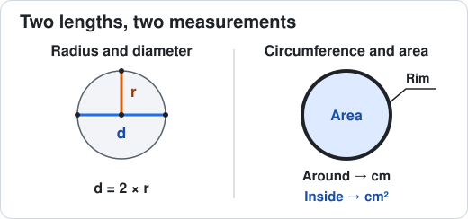

# Geometry and measurement

[Back to the Grade 9 index](../../README.md) · [Geometry practice questions](2.%20Doing.md)

## Formula summary

Read $=$ as **“exactly equal to”** and $\approx$ as **“about equal to.”** The sign $\times$ means multiply. A fraction bar means divide the top by the bottom.

### Circles

$r$ is the radius, $d$ is the diameter, and $\pi$ is pi. A raised 2 means multiply a number by itself, so $r^2$ means $r \times r$.

```math
\begin{aligned}
\pi &= \frac{\text{circumference}}{\text{diameter}} \approx 3.14 \\
\text{Diameter} &= 2 \times r = \frac{\text{circumference}}{\pi} \\
\text{Radius} &= \frac{d}{2} \\
\text{Circumference} &= \pi \times d = 2 \times \pi \times r \\
\text{Circle area} &= \pi \times r^2
\end{aligned}
```

### Rectangles and triangles

$\ell$ is length, $w$ is width, and $h$ is height. The letter $\ell$ is a lowercase L.

```math
\begin{aligned}
\text{Rectangle perimeter} &= 2 \times (\ell + w) \\
\text{Rectangle area} &= \ell \times w \\
\text{Triangle area} &= \frac{\text{base} \times h}{2}
\end{aligned}
```

### Volume and water depth

```math
\begin{aligned}
\text{Volume} &= \text{base area} \times h \\
\text{Box volume} &= \ell \times w \times h \\
\text{Cylinder volume} &= \pi \times r^2 \times h \\
\text{Water depth} &= \frac{\text{water volume}}{\text{base area}}
\end{aligned}
```

### Unit conversions

```math
\begin{aligned}
1\ \mathrm{m} &= 100\ \mathrm{cm} \\
1\ \mathrm{m}^2 &= 10{,}000\ \mathrm{cm}^2 \\
1\ \mathrm{mL} &= 1\ \mathrm{cm}^3 \\
1\ \mathrm{L} &= 1{,}000\ \mathrm{mL} = 1{,}000\ \mathrm{cm}^3
\end{aligned}
```

## 1. Start with a circle and a piece of string

Wrap a string around a round lid, then straighten it against a ruler. The string’s length is the **circumference**. Measure straight across through the centre for the **diameter**. The **radius** runs from the centre to the edge and is half the diameter.

On the diagram, $r$ stands for the radius and $d$ stands for the diameter. A letter is a short name for a measurement you can plug in. **cm** is short for centimetres.

The symbol $=$ means **“is exactly equal to.”** Both sides name the same amount. The symbol $\times$ means **“multiply.”** The diameter is two radii long.

```math
d = 2 \times r
```

You may also see $2r$. **A number written right next to a letter means multiply.** So $2r$ means $2 \times r$. If $r$ is 5 cm, then $2r$ means $2 \times 5\ \mathrm{cm}$, which is 10 cm.



### What is pi?

Three diameter lengths fit along the straightened string, with a little left over. This ratio is the same for every circle. It’s called **pi**, pronounced “pie” and written as $\pi$. Its decimal starts with 3.14159. We often round it to 3.14.

The wavy equals sign $\approx$ means **“is about equal to.”** Use it when you round. Read $\pi \approx 3.14$ as “pi is about 3.14.” Use the straight equals sign $=$ for quantities that are exactly the same.

```math
\pi \approx 3.14
```

A fraction bar means **divide**. Read the top number or amount first, then say “divided by,” then read the bottom. Here it tells you how many diameters fit around the lid.

```math
\pi = \frac{\text{circumference}}{\text{diameter}}
```

### How far around?

Multiply the diameter by pi. If you know the radius, double it first.

```math
\text{Circumference} = \pi \times \text{diameter}
```

Use $C$ as a short name for circumference. In the first line below, $\pi d$ means “pi times the diameter.” In the second, $2\pi r$ means “2 times pi times the radius.” When symbols for numbers are written side by side in a formula, the multiplication signs can be left out.

```math
\begin{aligned}
C &= \pi \times d = \pi d \\
C &= 2 \times \pi \times r = 2\pi r
\end{aligned}
```

**Try it with a lid 10 cm across.** The diameter is 10 cm and the radius is 5 cm.

```math
C = \pi \times 10\ \mathrm{cm} = 10\pi\ \mathrm{cm} \approx 31.4\ \mathrm{cm}
```

Read $10\pi\ \mathrm{cm}$ as “10 times pi centimetres.” The first two parts of the calculation use exact pi, so they use $=$. Using 3.14 for pi gives about **31.4 cm**, so the last part uses $\approx$. Writing $10\pi\ \mathrm{cm}$ keeps the answer exact. Leave pi in your answer when asked for an answer **in terms of pi**. For an approximation, use the value of pi given in the question.

### How much space inside?

Imagine covering the lid with tiny squares, each 1 cm on a side. The amount of surface you cover is the **area**, measured in **square centimetres**. We write that unit as $\mathrm{cm}^2$. One square centimetre is the area of a square that is 1 cm long and 1 cm wide.

Picture a square that just fits around the lid. Split it into four small squares, each one radius long and one radius wide. The lid covers about 3.14 of those small squares. Find one square’s area by multiplying the radius by itself, then multiply by pi.

```math
\text{Circle area} = \pi \times \text{radius} \times \text{radius}
```

Use $A$ as a short name for area. The small raised 2 is called an **exponent**. Read $r^2$ as “radius squared.” It means multiply the radius by itself. In the formula below, $\pi r^2$ means “pi times radius squared.”

```math
A = \pi \times r^2 = \pi r^2
```

For the same 10 cm lid, use its **5 cm radius**. The parentheses in $(5\ \mathrm{cm})^2$ group the whole measurement. Multiply 5 cm by 5 cm to get 25 cm², then multiply by pi.

```math
A = \pi \times (5\ \mathrm{cm})^2 = 25\pi\ \mathrm{cm}^2 \approx 78.5\ \mathrm{cm}^2
```

You can also work backward. If a circle measures about 31.4 cm around, divide 31.4 by 3.14 to get a diameter of about 10 cm. Its radius is about 5 cm.

## 2. Follow the edge or cover the inside

**Perimeter** is the distance around a shape. A fence goes along its perimeter. **Area** is the flat space inside. Paint covers its area.

### Rectangle and triangle

A rectangle has two sides of length $\ell$ (a lowercase L) and two sides of width $w$. For perimeter, the parentheses in $(\ell + w)$ tell you to add length and width first, then double. The plus sign $+$ means “add.” For area, multiply the square tiles in each row by the number of rows.

```math
\text{Rectangle perimeter} = 2 \times (\ell + w)
```

```math
\text{Rectangle area} = \ell \times w
```

A diagonal cuts a rectangle into two equal triangles. More generally, a triangle has half the area of a rectangle with the same base and height. Choose a side as the base, then measure from the opposite corner at a right angle to the line that runs along the base.

```math
\text{Triangle area} = \frac{\text{base} \times \text{height}}{2}
```

### Shapes made of smaller pieces

For **area**, split the shape into pieces you recognize and add their areas. If a piece is cut out, subtract its area. A semicircle has half the area of a full circle, and a quarter circle has one quarter.

For **perimeter**, trace the outside edge with your finger. The curved edge of a semicircle is half the full circumference. The curved edge of a quarter circle is one quarter of the full circumference. For a semicircle on its own, add the straight edge across it. For a quarter circle on its own, add its two straight edges. If that edge is shared with an attached rectangle, it lies inside the combined shape.

## 3. Picture volume as layers

**Volume** tells you how much space is inside a three-dimensional shape. Picture a box packed with cubes, each 1 cm long, wide, and tall. Each cube takes up 1 **cubic centimetre**, written $1\ \mathrm{cm}^3$. The raised 3 comes from multiplying three lengths measured in centimetres: length times width times height. In a straight-sided container, each layer covers the same area. Multiply that area by the height.

```math
\text{Volume} = \text{base area} \times \text{height}
```

### Box-shaped container

The base is a rectangle. Multiply its inside length $\ell$ by its inside width $w$, then multiply by the height $h$ you want to measure. The letter $V$ stands for volume. If you see $\ell wh$, read it as $\ell \times w \times h$.

```math
V = \ell \times w \times h
```

### Cylinder

A straight-sided can has a circular base. Find its area using the inside radius $r$, then multiply by the height $h$ you want to measure.

```math
V = \pi \times r^2 \times h
```

A cylindrical cup measures **8 cm across the inside** and the water is **5 cm deep**. The radius is 4 cm. Multiply 4 by itself and by 3.14 to find the base area, then multiply by the water depth. The result is about **251.2 cubic centimetres**, which is about **251.2 millilitres** (mL).

```math
\begin{aligned}
\text{Base area} &\approx 3.14 \times (4\ \mathrm{cm}) \times (4\ \mathrm{cm}) \\
&= 50.24\ \mathrm{cm}^2 \\
V &\approx 50.24\ \mathrm{cm}^2 \times 5\ \mathrm{cm} \\
&= 251.2\ \mathrm{cm}^3
\end{aligned}
```

### Use the height that matches the question


- **How much water is already in the tank?** Use the water depth.
- **How much more water can fit?** Use the gap from the surface to the top.
- **How much can the full tank hold?** Use the full inside height. This is the tank’s **capacity**.

## 4. Work backward to find the water depth

In a container with straight vertical sides, every horizontal layer covers the same area. If you know the volume, divide it by that area to find the depth.

```math
\text{Water depth} = \frac{\text{water volume}}{\text{base area}}
```


An 8 cm by 5 cm base covers 40 cm². Each centimetre of depth holds 40 cm³ of water, so 120 cm³ fills three layers.

```math
\text{Water depth} = \frac{120\ \mathrm{cm}^3}{40\ \mathrm{cm}^2} = 3\ \mathrm{cm}
```

If the tank already has water in it, divide the **added** volume by the base area to find how far the level would rise. Add that rise to the starting depth. If the result is above the top of the tank, the extra water spills.

## 5. Make sense of units and scale

A **length** in cm counts along one direction. An **area** in cm² counts square centimetres in two directions. A **volume** in cm³ counts cubic centimetres in three directions. Convert measurements to the same unit before multiplying or dividing them.

A 1 cm cube holds 1 millilitre (mL) of water, and 1,000 millilitres make 1 litre (L).

```math
1\ \mathrm{mL} = 1\ \mathrm{cm}^3
```

```math
1\ \mathrm{L} = 1{,}000\ \mathrm{mL} = 1{,}000\ \mathrm{cm}^3
```

A metre (m) is 100 cm. A square metre is a square with 100 cm on **each** side, so it contains 100 rows of 100 square centimetres.

```math
1\ \mathrm{m} = 100\ \mathrm{cm}
```

```math
1\ \mathrm{m}^2 = 100\ \mathrm{cm} \times 100\ \mathrm{cm} = 10{,}000\ \mathrm{cm}^2
```

### What happens when you double every length?


- **Length and perimeter** double. Every edge is twice as long.
- **Area** grows by a factor of $2 \times 2 = 4$. You double the rows and the squares in each row.
- **Volume** grows by a factor of $2 \times 2 \times 2 = 8$. You also double the number of layers.

A **scale factor** tells you what number to multiply each original length by. For example, doubling uses a scale factor of 2. Use the factor once for lengths, twice as a multiplier for areas, and three times as a multiplier for volumes.

## 6. Worked example with a fish tank

This tank is 12 cm tall on the inside. The water is 5 cm deep. **How many more millilitres can you pour in before the tank is full?**


**1. Find the gap.** Subtract the water depth from the total height. The minus sign $-$ means “subtract.”

```math
\text{Gap} = 12\ \mathrm{cm} - 5\ \mathrm{cm} = 7\ \mathrm{cm}
```

**2. Find the area of one layer.** The inside base is 10 cm by 8 cm.

```math
\text{Base area} = 10\ \mathrm{cm} \times 8\ \mathrm{cm} = 80\ \mathrm{cm}^2
```

**3. Fill the seven layers above the water.** Each centimetre of height holds 80 cm³.

```math
\begin{aligned}
\text{Space left} &= 80\ \mathrm{cm}^2 \times 7\ \mathrm{cm} \\
&= 560\ \mathrm{cm}^3 \\
&= 560\ \mathrm{mL}
\end{aligned}
```

Read the lines that start with $=$ as “the same amount is.” The last line uses the fact that 1 cm³ holds 1 mL, so you can pour in **560 mL more**.


**Check.** The tank already holds 400 mL. Add the 560 mL of room left to get the full capacity of 960 mL.

```math
400\ \mathrm{mL} + 560\ \mathrm{mL} = 960\ \mathrm{mL}
```

[Try the geometry practice questions](2.%20Doing.md)
