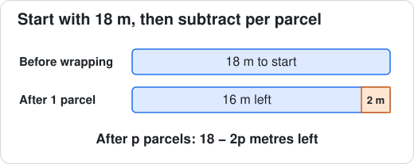
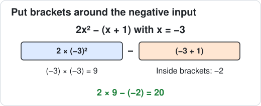
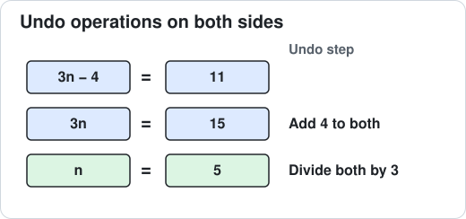
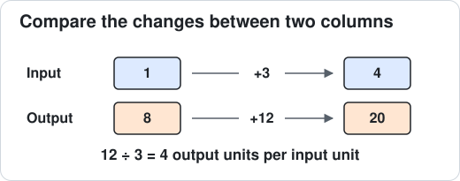
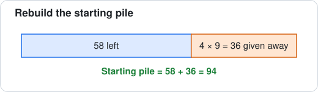

# Algebra

[Back to the Grade 9 index](../../README.md) · [Algebra practice questions](2.%20Doing.md)

## 1. Turn a story into an expression

A spool holds 18 m of ribbon. Each parcel uses 2 m. The picture shows what happens after wrapping one parcel.



One parcel leaves 16 m. Two parcels use $2 \times 2$ metres, leaving 14 m. To write the same rule for any number of parcels, let $p$ stand for the number wrapped. A letter that stands for a number is called a **variable**.

1. Multiply the number of parcels by 2 to find how much ribbon you use. Write $2 \times p$ or, more briefly, $2p$.
2. Subtract the amount used from the original 18 m. The **expression** $18-2p$ gives the amount left.

```math
\text{Ribbon left in metres} = 18 - 2 \times p = 18 - 2p
```

Read each equals sign as “has the same value as.” Check the rule with $p=0$. No ribbon has been used, so all 18 m should remain.

A game card with a 5-dollar fee and a 2-dollar charge for each round works the same way, with addition. If $r$ is the number of rounds, the cost in dollars is $5+2r$. You pay the 5-dollar fee once and the 2-dollar charge each round.

### Simplify by collecting like terms

A **term** is a piece of an expression that is added or subtracted. Think of $a$ as the number of cards in each pack. Four packs minus one pack leaves three packs, so $4a-a=3a$. Loose cards can be combined with other loose cards. A pack and a loose card stay separate because the cards per pack can vary.

```math
5a + 4 - 2a + 3 = 3a + 7
```

When a number multiplies parentheses, multiply **every** term inside. Three bundles of two packs and five loose cards give six packs and fifteen loose cards. The same idea works with subtraction. Three copies of “two packs minus four loose cards” gives six packs minus twelve loose cards.

```math
\begin{aligned}
3(2a+5) &= 6a+15 \\
3(2a-4) &= 6a-12
\end{aligned}
```

## 2. Substitute a number, then calculate

To **substitute** means to replace a letter with its value. Replace every copy of the letter. Put negative numbers in parentheses so the minus sign stays with the number. The raised 2 in $x^2$ means $x \times x$. For $x=-3$, squaring gives $(-3) \times (-3)=9$.

Find the value of $2x^2-(x+1)$ when $x=-3$. Evaluate the group in parentheses and the exponent, then multiply and subtract. Subtracting $-2$ is the same as adding 2.

```math
\begin{aligned}
2x^2-(x+1) &= 2 \times (-3)^2 - (-3+1) \\
&= 2 \times 9 - (-2) \\
&= 18+2 = 20
\end{aligned}
```



## 3. Work backward from a known result

An **equation** uses an equals sign to say that two quantities have the same value. Imagine the two sides of a balanced scale. If you add 4 to both sides or divide both by 3, the two results still match.

In $3n-4=11$, the rule multiplies $n$ by 3, then subtracts 4. Work backward. Undo the subtraction first by adding 4 to both sides. Then undo the multiplication by dividing both sides by 3. The fraction bar means divide the top number by the bottom number.

```math
\begin{aligned}
3n-4 &= 11 \\
3n-4+4 &= 11+4 \\
3n &= 15 \\
\frac{3n}{3} &= \frac{15}{3} \\
n &= 5
\end{aligned}
```



**Check.** Substitute 5 into the original equation. The left side becomes $3 \times 5-4=11$, which matches the right side. In a story, also check what the question asks for. If $n$ is the number of bags and each bag holds 6 apples, multiply 5 by 6 to find the number of apples.

### Find when two rules give the same result

One bike shop charges 6 dollars plus 2 dollars per hour. Another charges 3 dollars per hour. Let $h$ be the number of hours. Set the two costs equal and subtract $2h$ from both sides.

```math
\begin{aligned}
6+2h &= 3h \\
6 &= h
\end{aligned}
```

After 6 hours, each shop charges 18 dollars.

## 4. Read a rule from a table

Read the table one column at a time. The **input** $x$ is the number that goes into the rule. The **output** $y$ is what comes out. When the input is 1, the output is 8. A rule is **linear** when its output changes by the same amount for every step of 1 in the input. That change is its **rate**.

| Input $x$ | 1 | 4 | 6 |
|---|---:|---:|---:|
| Output $y$ | 8 | 20 | 28 |



**1. Find the rate.** From the first to the second column, the input rises by 3 and the output rises by 12. Divide by the input change to find the output change per step. If the output falls as the input rises, the rate is negative.

```math
\text{Rate} = \frac{20-8}{4-1} = \frac{12}{3} = 4
```

**2. Find the starting value.** The **starting value** is the output at input 0. At input 1, one increase of 4 has already happened. Subtract that increase from 8 to find the output at input 0.

```math
\begin{aligned}
\text{Starting value} &= 8-4 \times 1 = 4 \\
y &= 4 + 4x
\end{aligned}
```

**3. Check another column.** At input 6, the rule gives $4+4 \times 6=28$, as the table shows. One input-output pair can help you check a rule. It takes two different inputs and their outputs to work out a linear rule.

To build a table from a rule, substitute each input and write its output in the same column.

## 5. Worked example with library bookmarks

A library has 58 bookmarks left after giving 4 bookmarks to each of 9 classes. **How many bookmarks did the library start with?**

A. 13

B. 22

C. 49

D. 94

E. 130



**1. Write the equation.** Let $b$ be the starting number. Each of the 9 classes takes 4 bookmarks out of that starting pile.

```math
b - 4 \times 9 = 58
```

**2. Undo the subtraction.** The classes received 36 bookmarks altogether. Add those back to the 58 that remained. Choice B comes from subtracting the 36 a second time.

```math
\begin{aligned}
b-36 &= 58 \\
b &= 58+36 = 94
\end{aligned}
```

**3. Check.** Start with 94 and give away 36. That leaves $94-36=58$ bookmarks, as the question says. The answer is **D. 94 bookmarks**.

## Formula summary

### Rules with a constant rate

The **input** is the number you put into a rule. The **output** is the result. The **rate** tells you how much the output changes for each increase of 1 in the input. The **starting value** is the output when the input is 0.

```math
\begin{aligned}
\text{Output} &= \text{starting value} + \text{rate} \times \text{input} \\
\text{Rate} &= \frac{\text{change in output}}{\text{change in input}} \\
\text{Starting value} &= \text{output} - \text{rate} \times \text{input}
\end{aligned}
```

### Simplifying expressions

The letters $a$ and $b$ stand for numbers. The parentheses in $3(a+b)$ tell you to multiply the whole sum by 3.

```math
\begin{aligned}
4a - a &= 3a \\
3(a+b) &= 3a + 3b \\
3(a-b) &= 3a - 3b
\end{aligned}
```

[Try the algebra practice questions](2.%20Doing.md)
