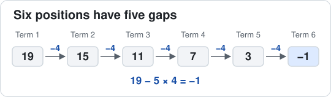
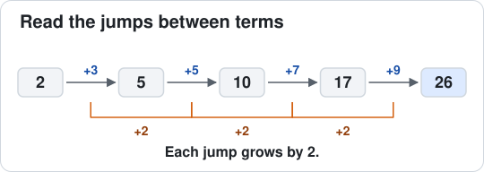
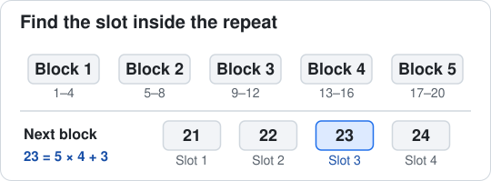
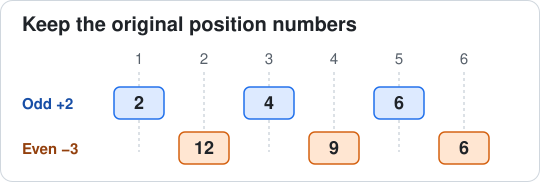
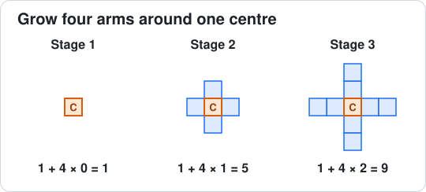
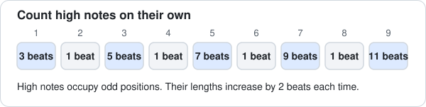

# Patterns and sequences

[Back to the Grade 9 index](../../README.md) · [Patterns and sequences practice questions](2.%20Doing.md)

## 1. Count the gaps between positions

Read the six boxes from left to right. Each box holds a number in an ordered list called a **sequence**. The value in a box is its **term**. The second box is at position 2, and its term is 15.



Think of the boxes as stepping stones. Start at 19. Jump once to reach 15, then again to reach 11. Each jump changes the value by $-4$. This change is called the **common difference**. A sequence with a common difference is an **arithmetic sequence**.

It takes five jumps to reach the sixth box. In general, to reach position $n$ from the first stone, make $n-1$ jumps. To find the sixth term, work out the parentheses first, then multiply to find the total change.

```math
\text{Term at position 6} = 19 + (6 - 1) \times (-4) = 19 - 20 = -1
```

**Check position 4.** Make three jumps from 19. You land on $19 + 3 \times (-4) = 7$, which matches the diagram.

### Find a missing term between two known terms

Suppose term 2 is 7 and term 5 is 19, with the same increase at every step. There are three gaps from position 2 to position 5. Divide the total increase by three. The fraction bar shows which value to divide by which.

```math
\begin{aligned}
\text{Common difference} &= \frac{19 - 7}{5 - 2} = 4 \\
\text{Term at position 3} &= 7 + 4 = 11
\end{aligned}
```

**Check.** Add 4 twice more. You reach 15 at position 4 and 19 at position 5.

### Check whether a number appears

Go back to the sequence that begins at 19 and goes down by 4 at each step. To find where 3 appears, divide the change from 19 to 3 by the common difference.

```math
\text{Steps to reach 3} = \frac{3 - 19}{-4} = 4
```

Four steps from position 1 land at position 5. Check by putting those four steps into the rule.

```math
\text{Term at position 5} = 19 + 4 \times (-4) = 3
```

For a sequence with a nonzero common difference, a target appears only if the step count is a whole number of zero or more. For example, 4 falls between 7 and 3, so this sequence skips it.

## 2. Look at what changes from one term to the next

### When the jumps change by the same amount

Write the amount added or subtracted in each gap. In $2, 5, 10, 17$, the jumps are 3, 5 and 7. Each jump grows by 2. This change from one jump to the next is called a **second difference**.



If the jumps keep growing by 2, add 2 to the last jump to find the next jump. Then add that jump to 17 to find the next term.

```math
\begin{aligned}
\text{Next jump} &= 7 + 2 = 9 \\
\text{Next term} &= 17 + 9 = 26
\end{aligned}
```

### When each term is multiplied by the same number

Imagine a message with two copies. In each round, every copy produces three new copies and only the new copies count for the next round. The counts go $2, 6, 18$. Dividing 6 by 2 gives 3. Dividing 18 by 6 also gives 3. A sequence with the same multiplier at every step is called a **geometric sequence**.

```math
\begin{aligned}
\text{Next term} &= 18 \times 3 = 54 \\
\text{Previous term before 18} &= 18 \div 3 = 6
\end{aligned}
```

The symbol $\div$ means divide. You can use the multiplier to go forward or divide by it to go backward, as long as it’s different from zero.

**Check the stated rule and all the terms.** A few terms can fit more than one rule. If a pattern begins $2, 4$, adding 2 would give 6 next, while doubling would give 8. Use the rule in the question or look for another term that helps you decide.

## 3. Track repeating blocks and alternating positions

### When a whole block repeats

When a block contains four symbols, five full blocks fill the first 20 positions. Position 23 is three places into the next block. The 3 places left after the full blocks are the **remainder**.



```math
23 = 5 \times 4 + 3
```

Imagine the four symbols are a leaf, a star, a wave and a dot, in that order. Position 23 holds a **wave**, the third symbol. Position 24 has a remainder of zero because it finishes the sixth block. It holds a **dot**, the last symbol. Positions four places apart always carry the same symbol, so position 27 also holds a wave.

### When two patterns take turns

In $2, 12, 4, 9, 6, 6$, write the terms in odd and even positions on separate lines. Keep their position numbers from the original sequence. The values at odd positions go up by 2. The values at even positions go down by 3.



Position 7 is odd. Use the previous odd position, 5, whose term is 6. Add 2 to get 8. At position 8, use the previous even position, 6, and subtract 3 from 6 to get 3.

## 4. Count a growing figure by its parts

These crosses start with one centre tile. Each new stage adds one tile to each of the four arms. The centre stays in place and counts once.



At stage 3, each arm has grown twice. Start with one centre tile, then add four arms of two tiles each.

```math
\text{Tiles at stage 3} = 1 + 4 \times 2 = 9
```

At stage $n$, each arm has grown $n - 1$ times. Check the rule with the first two drawings. At stage 1 it gives 1 tile, and at stage 2 it gives 5 tiles.

```math
\text{Tiles at stage } n = 1 + 4 \times (n - 1)
```

**When pieces share a side, count that side once.** To build a straight row of squares from sticks, start with four sticks for the first square. Each new square uses an existing side and adds only three sticks. For three squares, count $4 + 2 \times 3 = 10$ sticks.

## 5. Worked example with a music rehearsal

The conductor alternates high and low notes, starting with a high note. The first high note lasts 3 beats. Each later high note lasts 2 beats longer than the previous high note. Every low note lasts 1 beat. **How many beats does the note in position 9 last?**

A. 1 beat

B. 9 beats

C. 11 beats

D. 13 beats

E. 19 beats

**1. Identify the type of note.** High notes occupy the odd positions. Position 9 is odd, so it holds a high note.

**2. Count the jumps between high notes.** The high notes are at positions 1, 3, 5, 7 and 9. Position 9 is the fifth high note. It takes four jumps to reach it from the first high note.

**3. Add 2 beats for each jump.** Start with the first high note’s 3 beats.

```math
\text{Length of the fifth high note} = 3 + 4 \times 2 = 11\ \text{beats}
```

**Check.** The high note at position 7 lasts 9 beats. One more jump adds 2 beats, so the answer is **C, 11 beats**. Choice E comes from adding 2 beats at every position, including the low notes.



## Formula summary

### Add the same amount each step

The **common difference** is the amount added at each step. When the terms go down, this difference is negative.

```math
\begin{aligned}
\text{Number of steps from the first term} &= n - 1 \\
\text{Term at position } n &= \text{first term} + (n-1) \times \text{common difference}
\end{aligned}
```

### Multiply by the same number each step

The **common multiplier** is the number you multiply by at each step. Use two terms that are next to each other. The earlier term must be different from zero for this division.

```math
\text{Common multiplier} = \frac{\text{later term}}{\text{earlier term}}
```

### Find a place in a repeating block

Divide the position by the block size. The **remainder** is what’s left after you count the full blocks.

```math
\text{Position} = \text{full blocks} \times \text{block size} + \text{remainder}
```

A positive remainder gives the place within the next block. A remainder of zero means you’re at the last place of a full block.

[Try the patterns and sequences practice questions](2.%20Doing.md)
