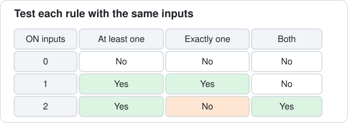

# Logic and constraints

[Back to the Grade 9 index](../../README.md) · [Logic practice questions](2.%20Doing.md)

## 1. Try a rule on a real choice

A school event accepts paper or digital tickets. Sam brings a paper ticket and Lee brings both kinds. Who can get in?

The rule is **at least one ticket type**, so both students can get in. If the rule changes to **exactly one ticket type**, Sam can still get in. Lee has two kinds, so Lee no longer fits the rule. A rule that every allowed answer must follow is a **constraint**.

Now look at two switches. Each switch has two possible states, ON and OFF. Use the same counting method as for the two ticket types. Read down the left column to find how many switches are ON. Then read across to see which rules that setting meets.

**Check one setting.** P is OFF and Q is ON. Move across the row for one switch on. The setting meets **at least one** and **exactly one**. For **both**, P and Q would each need to be ON.

### Read an if rule in the right direction

Suppose the teacher says, “If class starts late, I’ll send a message.” A late start guarantees a message. If you see a message, class could still start on time because the message might be about homework.

The words **exactly when** let you work in either direction. Imagine a light that turns on exactly when its switches match.

Follow the two arrows from the light. If it is on, keep ON–ON and OFF–OFF. If you then find out that P is OFF, cross out ON–ON. The only setting left is OFF–OFF. If the light were off, look for the settings where the switches differ.

## 2. Use boxes for places, slots and routes

Bea and Kai each take one skating turn. Look at where their names go in the boxes for the two versions of the clue.

If the clue says Bea goes **before** Kai, any earlier box works. If it says **immediately before**, use the box that touches Kai’s on the left.

**Try it with three turns.** Put Kai in the second box. Bea goes immediately before Kai, so put her in the first. The last skater, Noor, takes the third box.

For one-way routes, an arrow points from the starting place to the next place you can reach. If the map says Gate → Pond → Tower, the route takes two moves, one per arrow. To find the last stop before Tower, check the arrows that point into Tower.

On a grid, follow a **row** across and a **column** down. **Share an edge** means two cells touch on one side. If a token is in the middle of a three-by-three grid, it shares edges with its neighbours above, below, left and right. A corner cell touches it at a point only.

## 3. Compare all the possibilities that fit

Three friends line up. The only rule is that Bea goes before Kai. These are the three orders that fit.

| First | Second | Third |
|---|---|---|
| Ana | Bea | Kai |
| Bea | Ana | Kai |
| Bea | Kai | Ana |

- **Could Ana go last?** Yes. The third row gives one complete order.
- **Must Kai go last?** No. The third row is a **counterexample**, a working order that shows the claim can fail.
- **What if Kai goes last?** Cross out the third row. Two orders remain. You can now name the last person, and you would need another clue to name the first.

For a hidden item, write one row per possible location. Imagine an item in the gym, café or library. Check “It’s in the gym” and “It’s outside the library” against each location. The gym makes both statements true, the café makes exactly one true, and the library makes neither true. If exactly one statement is true, keep the café.

### Count each item once

Suppose 5 students play basketball, 4 play soccer, and 2 play both. Adding 5 and 4 gives 9, with the same 2 students counted twice. Subtract the extra count for those students. That gives **7 students** who play basketball or soccer.

### List valid pairs and test new clues

A badge can be a circle or star with a plain or striped border. Write both borders beside “circle,” then both beside “star.” You have four pairs. Cross out the striped circle if it is forbidden. Of the three pairs left, the clue “striped” leaves only the striped star. A clue identifies the answer when it leaves one option.

### Use a question to split candidates

Four clubs meet at school. Art and Music meet in the morning, and Drama and Chess meet in the afternoon. If you only need to separate the morning pair from the afternoon pair, ask “Does the club meet in the morning?” To name the club, you need a second question. Suppose Art and Drama meet upstairs, and Music and Chess meet downstairs. Asking “Does it meet upstairs?” works after either answer to the first question, because it separates both pairs.

## 4. Follow a rule one step at a time

Start a score at 0. The cards say “add 4,” “skip the next card,” “add 3,” and “add 2.” After the first card the score is 4. Skip “add 3,” then add 2 to get 6. Write the score as you go so you can see which instructions took effect.

For a chain of matches, record the current open end. If a domino with 3 and 7 connects to an open 3, the next domino must connect to 7. For a list of states such as OFF, ON, ON, OFF, compare each pair of neighbours. The first and last pairs change, so there are two changes.

When keeping totals, mark each event where it belongs. Give each game win to its winner. If two moves affect some of the same positions, mark the positions for each move separately. Any position marked on both lists was affected twice.

## 5. Worked example

Nora needs a free hour at the library. The hour must consist of **two consecutive free half-hour slots**, meaning the second slot starts as soon as the first ends. She needs to finish by noon. **When can she start?**

| Slot starts | 9:30 | 10:00 | 10:30 | 11:00 | 11:30 | 12:00 |
|---|---|---|---|---|---|---|
| Library room | Free | Booked | Free | Free | Booked | Free |

A. 9:30

B. 10:00

C. 10:30

D. 11:00

E. 12:00

1. **Check each pair of slots.** A 9:30 start fails because 10:00 is booked. A 10:00 start begins in a booked slot. An 11:00 start runs into the 11:30 booking.
2. **Check the finish time.** A 12:00 start finishes after noon. A 10:30 start uses the free slots starting at 10:30 and 11:00 and finishes at 11:30.
3. **Check both rules together.** The slots touch, both are free, and the session ends before noon. The answer is **C, 10:30**.

## Clue words at a glance

| Clue | What it asks you to check |
|---|---|
| Both | Each of the two conditions holds. |
| At least one | One or more conditions hold. |
| Exactly one | One condition holds and all the others fail. |
| Before | One event is earlier. There can be events in between. |
| Immediately before | One event is directly before the other, with nothing in between. |
| Could | At least one complete answer fits every rule. |
| Must | The fact holds in every answer that fits the rules. |
| Enough information | Every answer that fits the rules gives the same result for the part asked about. |

## Practice by skill

| Skill to review | Questions |
|---|---|
| Apply rule words, test whether a statement follows, and check possible states | [Q01](2.%20Doing.md#m5-q01), [Q03](2.%20Doing.md#m5-q03), [Q11](2.%20Doing.md#m5-q11), [Q14](2.%20Doing.md#m5-q14), [Q18](2.%20Doing.md#m5-q18), [Q21](2.%20Doing.md#m5-q21), [Q23](2.%20Doing.md#m5-q23) |
| Fit positions, dates, and directed routes to the clues | [Q02](2.%20Doing.md#m5-q02), [Q04](2.%20Doing.md#m5-q04), [Q06](2.%20Doing.md#m5-q06), [Q07](2.%20Doing.md#m5-q07), [Q09](2.%20Doing.md#m5-q09), [Q10](2.%20Doing.md#m5-q10), [Q12](2.%20Doing.md#m5-q12), [Q13](2.%20Doing.md#m5-q13), [Q16](2.%20Doing.md#m5-q16), [Q22](2.%20Doing.md#m5-q22) |
| List pairs, filter candidates, and choose an informative question | [Q05](2.%20Doing.md#m5-q05), [Q15](2.%20Doing.md#m5-q15), [Q17](2.%20Doing.md#m5-q17), [Q25](2.%20Doing.md#m5-q25), [Q29](2.%20Doing.md#m5-q29) |
| Read values, trace changes, keep totals, and count overlap once | [Q08](2.%20Doing.md#m5-q08), [Q19](2.%20Doing.md#m5-q19), [Q20](2.%20Doing.md#m5-q20), [Q24](2.%20Doing.md#m5-q24), [Q26](2.%20Doing.md#m5-q26), [Q27](2.%20Doing.md#m5-q27), [Q28](2.%20Doing.md#m5-q28), [Q30](2.%20Doing.md#m5-q30) |

[Try the logic practice questions](2.%20Doing.md)
