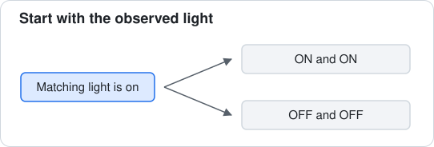
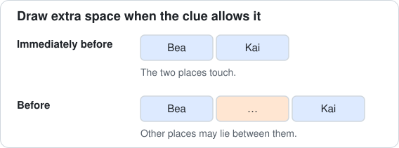

# Logic and constraints

[Back to the Grade 9 index](../../README.md) · [Logic practice questions](2.%20Doing.md)

## Clue words at a glance

A **constraint** is a rule every allowed answer has to follow. If a club meets on a weekday and needs a day that starts with T, both rules must hold. Tuesday and Thursday both fit.

| Clue | What it asks you to check |
|---|---|
| Both | Each of the two conditions holds. |
| At least one | One or more conditions hold. |
| Exactly one | One condition holds and all the others fail. |
| Before | One event is earlier. There can be events in between. |
| Immediately before | One event is directly before the other, with nothing in between. |
| Could | At least one complete answer fits every rule. |
| Must | The fact holds in every answer that fits the rules. |
| Enough information | Every answer that fits the rules gives the same result for the part asked about. |

## 1. Check each rule using the same starting information

Suppose a school event takes either a paper ticket or a digital ticket. **At least one** ticket type is enough. Someone who has both still gets in. At a different event, a group may choose **exactly one** of two activities. A group that chooses both goes over that limit.

You can use the same reasoning when something is ON or OFF. In the table below, P and Q are names for two switches. Start with one row, then check each rule separately using that row.

| P | Q | At least one is ON | Exactly one is ON | Both are ON |
|---|---|---|---|---|
| OFF | OFF | No | No | No |
| ON | OFF | Yes | Yes | No |
| OFF | ON | Yes | Yes | No |
| ON | ON | Yes | No | Yes |

### Check which way the rule works

If a class starts late, the teacher sends a message. A message alone tells you little about the class time because the teacher could also send one about homework. An **if** rule tells you what follows when its condition holds.

**Exactly when** gives a rule in both directions. Suppose a light turns on exactly when the switches match. If the light is on, that leaves two rows, ON and ON or OFF and OFF. If you also learn that P is OFF, only OFF and OFF remains.

### Update the result one step at a time

When the instructions say to follow a list in order, write down the result after each step. Suppose a score starts at 0 and the next instructions are “add 4,” “skip the next instruction,” “add 3,” and “add 2.” The score goes from 0 to 4, stays at 4 when “add 3” is skipped, then increases to 6.

## 2. Use boxes for places, slots and routes

For seats or time slots, draw one box per position. Fill in any fixed position first. If Bea goes **immediately before** Kai, keep them together in that order as you try different placements.

**Try it with three turns.** Kai goes second, and Bea goes immediately before Kai. Put Kai in the second box and Bea in the first. The last skater, Noor, takes the third box.

For one-way routes, an arrow points from the starting place to the next place you can reach. If the map says Gate → Pond → Tower, the route takes two moves, one per arrow. To find the last stop before Tower, check the arrows that point into Tower.

When two clues refer to a row or column, keep track of which direction to look. A **row** goes across a grid. A **column** goes down. Cells **share an edge** when they are next to each other in the same row or column, with no gap.

## 3. Compare all the possibilities that fit

Three friends line up. The only rule is that Bea goes before Kai. These are the three orders that fit.

| First | Second | Third |
|---|---|---|
| Ana | Bea | Kai |
| Bea | Ana | Kai |
| Bea | Kai | Ana |

- **Could Ana go last?** Yes. The third row gives one complete order.
- **Must Kai go last?** No. The third row is a **counterexample**, a working order that shows the claim can fail.
- **What if Kai goes last?** Cross out the third row. Two orders remain. You can now name the last person, and you would need another clue to name the first.

The same method works for statements about a hidden item. Try each possible location, then mark each statement true or false for that location. If a clue says exactly one statement is true, keep only the rows with one true statement.

### Count each item once

Suppose 5 students play basketball, 4 play soccer, and 2 play both. Adding 5 and 4 gives 9, with the same 2 students counted twice. Subtract the extra count for those students. That gives **7 students** who play basketball or soccer.

### List valid pairs and test new clues

For two choices, list one row per first choice and then try every allowable second choice. For example, pair each of two shapes with a plain or striped border. That gives four pairs. Cross out the striped circle if the rules forbid it. To see whether a new clue identifies one answer, apply it to the current candidates and count how many remain.

### Use a question to split candidates

A yes-or-no question settles whether an item is in a group when all the places in that group give “yes” and all the other places give “no.” For a two-question plan, write the candidates left after **each** possible first answer. For example, if morning leaves Art and Music, and afternoon leaves Drama and Chess, a second question about floor works only if the floor separates the two clubs in each time group.

### Track changes, matches, and totals

For a table read from top to bottom, compare each row with the one before it. In OFF, ON, ON, OFF the state changes twice. When a row adds points, include only the entries the rule says to count. For a chain of matches, write the open end after every move. If a domino with 3 and 7 connects to an open 3, the new open end is 7. For game results, keep a tally for each team and add one win only to the winner of each game. When two actions affect some of the same positions, mark each action on its own copy of the row. Any position marked on both copies was affected twice.

## 4. Worked example

Nora needs a free hour at the library. The hour must consist of **two consecutive free half-hour slots**, meaning the second slot starts as soon as the first ends. She needs to finish by noon. **When can she start?**

| Slot starts | 9:30 | 10:00 | 10:30 | 11:00 | 11:30 | 12:00 |
|---|---|---|---|---|---|---|
| Library room | Free | Booked | Free | Free | Booked | Free |

A. 9:30

B. 10:00

C. 10:30

D. 11:00

E. 12:00

1. **Check each pair of slots.** A 9:30 start fails because 10:00 is booked. A 10:00 start begins in a booked slot. An 11:00 start runs into the 11:30 booking.
2. **Check the finish time.** A 12:00 start finishes after noon. A 10:30 start uses the free slots starting at 10:30 and 11:00 and finishes at 11:30.
3. **Check both rules together.** The slots touch, both are free, and the session ends before noon. The answer is **C, 10:30**.

## Practice by skill

| Skill to review | Questions |
|---|---|
| Apply rule words, test whether a statement follows, and check possible states | [Q01](2.%20Doing.md#m5-q01), [Q03](2.%20Doing.md#m5-q03), [Q11](2.%20Doing.md#m5-q11), [Q14](2.%20Doing.md#m5-q14), [Q18](2.%20Doing.md#m5-q18), [Q21](2.%20Doing.md#m5-q21), [Q23](2.%20Doing.md#m5-q23) |
| Fit positions, dates, and directed routes to the clues | [Q02](2.%20Doing.md#m5-q02), [Q04](2.%20Doing.md#m5-q04), [Q06](2.%20Doing.md#m5-q06), [Q07](2.%20Doing.md#m5-q07), [Q09](2.%20Doing.md#m5-q09), [Q10](2.%20Doing.md#m5-q10), [Q12](2.%20Doing.md#m5-q12), [Q13](2.%20Doing.md#m5-q13), [Q16](2.%20Doing.md#m5-q16), [Q22](2.%20Doing.md#m5-q22) |
| List pairs, filter candidates, and choose an informative question | [Q05](2.%20Doing.md#m5-q05), [Q15](2.%20Doing.md#m5-q15), [Q17](2.%20Doing.md#m5-q17), [Q25](2.%20Doing.md#m5-q25), [Q29](2.%20Doing.md#m5-q29) |
| Read values, trace changes, keep totals, and count overlap once | [Q08](2.%20Doing.md#m5-q08), [Q19](2.%20Doing.md#m5-q19), [Q20](2.%20Doing.md#m5-q20), [Q24](2.%20Doing.md#m5-q24), [Q26](2.%20Doing.md#m5-q26), [Q27](2.%20Doing.md#m5-q27), [Q28](2.%20Doing.md#m5-q28), [Q30](2.%20Doing.md#m5-q30) |

[Try the logic practice questions](2.%20Doing.md)
