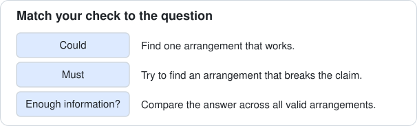

# Logic and constraints

[Back to the Grade 9 index](../../README.md) · [Logic practice questions](2.%20Doing.md)

## Rule summary

A **constraint** is a rule every allowed answer has to follow. An **input** is what you start with, such as a switch setting. An **output** is the result, such as a light turning on.

- **Both** means the two conditions have to hold. **At least one** allows one or both. **Exactly one** means a single condition holds.
- **Before** gives the order. **Immediately before** also means the two places touch.
- **Could** asks for one arrangement that fits all the clues. **Must** asks what is true in every arrangement that fits.
- You have **enough information** when every arrangement that fits gives the same answer to the question.

## 1. Follow the rule from the starting settings

Imagine two game controllers with a ready button on each. Each button is either ON or OFF. To find out whether the game starts, keep the same settings and test the rule as written.

If one button is ON, **at least one** and **exactly one** both pass. If both buttons are ON, **at least one** still passes, but **exactly one** fails. If both buttons are OFF, all three rules in the diagram fail.

Pay attention to which way an **if** rule runs. “If you return a book late, you get a reminder” tells you what happens after a late return. A reminder on its own could also be about a book coming due. The same result can have more than one cause.

When there are several outputs, check each output with the same inputs. If a question gives actions in order, write down what changes after each action and use that result for the next one.

## 2. Work backward from what you see

Suppose an indicator lights **exactly when** two switch settings match. “Exactly when” gives both directions of the rule. Matching settings make it light, and the light tells you the settings match.

If the indicator is lit, the switches could both be ON or both be OFF. If the indicator is dark, one must be ON and the other OFF, in either order.

To work backward, keep every starting setting that could produce what you saw. If another clue says the first switch is OFF and the indicator is lit, only OFF–OFF fits both clues. Check by running the settings forward. Two OFF settings match, so the indicator lights.

## 3. Put each clue on the page

Write positions in order from left to right. Fill in any fixed places first. If Bea goes **immediately before** Kai, move them together as a pair with Bea first. If the clue only says Bea goes **before** Kai, there may be someone in between.

Use the same idea with a schedule. If a booking needs two consecutive half-hour slots, check both the start slot and the slot right after it. On a map, follow the arrows in the direction shown. To find which stop could come right before your destination, look for arrows that end at the destination.

After building an arrangement, check each clue against it. An arrangement that breaks even one clue can be crossed out.

## 4. Match your check to the question

Imagine Ana, Bea and Kai line up. The only clue says Bea goes before Kai. The order **Bea, Kai, Ana** fits that clue, so Ana **could** go last. That same order shows that Kai does not **have to** go last. A valid case that breaks a claim is called a **counterexample**.

Now add the clue that Kai goes last. Two orders fit both clues, **Ana, Bea, Kai** and **Bea, Ana, Kai**. You have enough information to name the last person because both orders end with Kai. To name the first person, you would need another clue.

## 5. Worked example with two indicator lights

A game panel has three switches called P, Q and R. The circle lights exactly when P and Q match. The star lights exactly when R is OFF. **Which setting lights both indicators?**

| Setting | P | Q | R |
|---|---|---|---|
| 1 | ON | OFF | OFF |
| 2 | ON | ON | ON |
| 3 | OFF | ON | ON |
| 4 | OFF | OFF | OFF |
| 5 | OFF | ON | OFF |

A. Setting 1

B. Setting 2

C. Setting 3

D. Setting 4

E. Setting 5

**1. Use the star rule.** Keep settings 1, 4 and 5 because R is OFF in those rows.

**2. Use the circle rule.** Compare P and Q in each remaining row. They differ in settings 1 and 5. In setting 4 they are both OFF, which counts as a match.

**3. Check both lights.** In setting 4, matching P and Q light the circle, and R being OFF lights the star. The answer is **D, setting 4**. Setting 2 also lights the circle, but its star stays dark because R is ON.

[Try the logic practice questions](2.%20Doing.md)
