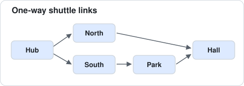
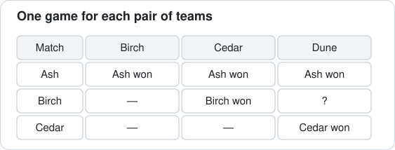
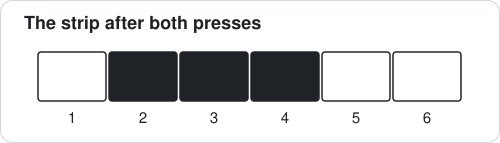
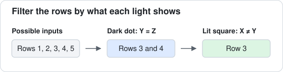
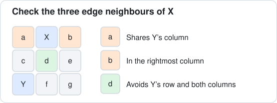
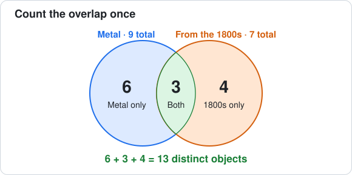
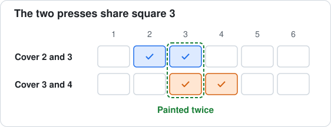
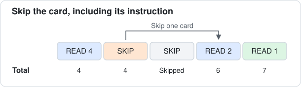

# M5 — Logic and constraints: Practice

[Back to the Grade 9 index](../../README.md) · [Review the logic lesson](1.%20Learning.md)

Solve each question on paper. Mark guesses and skips before checking the key, then mark the rest correct or wrong. Save Q26–Q30 for the final weekend.

## Q01–Q05

### M5-Q01

A shop gives a sticker for buying a pencil, an eraser, or both. Buying both earns a notebook as well. Buying a pencil also earns a bookmark. Ari buys one pencil and no eraser. What does Ari earn?

A. Notebook only

B. Sticker, notebook and bookmark

C. Sticker only

D. Sticker and bookmark

E. Notebook and bookmark

### M5-Q02

Four skaters make one run each. Jo goes immediately before Paz. Ali goes before Jo, and Ren goes last. Which order works from first to last?

A. Jo, Paz, Ali, Ren

B. Ali, Jo, Paz, Ren

C. Ren, Ali, Jo, Paz

D. Ali, Jo, Ren, Paz

E. Ali, Paz, Jo, Ren

### M5-Q03

A square lights exactly when X and Y differ. A dot lights exactly when Y and Z differ. The square is lit and the dot is dark. Which input setting could produce this?

| Row | X | Y | Z |
|---|---|---|---|
| 1 | ON | ON | OFF |
| 2 | OFF | ON | OFF |
| 3 | ON | OFF | OFF |
| 4 | OFF | OFF | OFF |
| 5 | ON | OFF | ON |

A. Row 3

B. Row 4

C. Row 2

D. Row 1

E. Row 5

### M5-Q04

Mira needs two consecutive free half-hour slots for a call. Her free slots start at 9:00, 10:00, 10:30 and 11:30. When can the call start?

A. 10:00

B. 9:30

C. 11:30

D. 10:30

E. 9:00

### M5-Q05

A token is in one of lockers 1 through 6. Its number is even and greater than 2. Which additional true clue, on its own, would identify the locker?

A. Its number exceeds 3.

B. Its number is a multiple of 3.

C. Its number is a multiple of 2.

D. Its number is even after adding 2.

E. Its number is less than 7.

## Q06–Q10

### M5-Q06

Five talks are given once each. Art comes before Coding and Drama. Coding and Drama both come before Music. Sport can go anywhere. Which statement must be true?

A. Art is first.

B. Coding comes before Drama.

C. Sport comes before Music.

D. Art comes before Music.

E. Drama comes immediately before Music.

### M5-Q07

The only paths in a garden are one-way. Gate leads to Pond or Oak. Pond leads to Elm. Oak leads to Elm. Elm leads to Tower. Which place must you visit immediately before reaching Tower from Gate?

A. Pond

B. Gate

C. Elm

D. Oak

E. Either Oak or Pond, with no other stop

### M5-Q08

Each ON tile adds its printed points. An OFF tile adds zero. What score is shown?

| Printed points | 8 | 4 | 2 | 1 |
|---|---|---|---|---|
| State | OFF | ON | OFF | ON |

A. 4

B. 5

C. 10

D. 2

E. 15

### M5-Q09

Five chairs in a row are numbered 1 to 5. Kai sits in the middle. Bea sits immediately left of Val. Noor sits at one end. Ivo takes the remaining chair. Which pair could be Bea's chair and Noor's chair, in that order?

A. 2 and 5

B. 1 and 2

C. 4 and 1

D. 4 and 5

E. 3 and 1

### M5-Q10

A studio offers clay on Monday or Thursday and printmaking on Tuesday or Thursday. Fay wants one clay session followed the very next day by one printmaking session. Which pair should she book, in order?

A. Tuesday and Thursday

B. Monday and Tuesday

C. Thursday and Friday

D. Thursday and Thursday

E. Monday and Thursday

## Q11–Q15

### M5-Q11

Every volunteer wearing a blue badge has completed orientation. Lin is a volunteer with a blue badge. Which conclusion follows?

A. Every volunteer who completed orientation wears a blue badge.

B. People without blue badges missed orientation.

C. A volunteer who missed orientation could still wear a blue badge.

D. Lin has completed orientation.

E. Lin is the only volunteer wearing a blue badge.

### M5-Q12

Five clubs can use the gym under one of the four plans below. The chosen plan gives the gym to Art before Chess and gives Drama the last slot. Which club must come third?

| Plan | First | Second | Third | Fourth | Fifth |
|---|---|---|---|---|---|
| 1 | Music | Art | Chess | Drama | Coding |
| 2 | Art | Chess | Coding | Music | Drama |
| 3 | Music | Art | Coding | Chess | Drama |
| 4 | Chess | Art | Music | Coding | Drama |

A. Art

B. Coding

C. Chess

D. Drama

E. Music

### M5-Q13

A shuttle must follow these one-way links, one link per move. Hub leads to North or South. North leads directly to Hall. South leads to Park, which leads to Hall. What is the fewest moves from Hub to Hall?

A. 2

B. 1

C. 5

D. 4

E. 3

### M5-Q14

A greenhouse log must include a humidity reading every time a tray is watered. Which entry proves this rule was broken?

A. Tray watered, humidity recorded

B. Tray dry, humidity missing

C. Humidity recorded, watering status unknown

D. Tray dry, humidity recorded

E. Tray watered, humidity missing

### M5-Q15

A parcel is in one of four rooms, Art, Band, Drama or Gym. The caretaker knows which room and answers truthfully. You want to find out if the parcel is in either Art or Band. Which one question settles this, whether the caretaker says yes or no?

A. Is the parcel in Art?

B. Is the parcel in Drama or Gym?

C. Is the parcel outside Drama?

D. Is the parcel in Band or Drama?

E. Is the parcel outside Gym?

## Q16–Q20

### M5-Q16

Three shows each run once, in slots 1, 2 and 3, one show per slot. Dance can use 1 or 2. Film can use only 2. Choir can use 2 or 3. Which show uses slot 1?

A. Film

B. Either Dance or Film

C. Choir

D. Either Dance or Choir

E. Dance

### M5-Q17

A badge has one shape (circle, square or star) and one border (plain or dotted). Dotted stars cannot be printed. How many different badges can be printed?

A. 6

B. 4

C. 2

D. 5

E. 3

### M5-Q18

A note is in one tin labelled Tea, Oats or Rice. Exactly one of these clues is true.

1. The note is in Tea.
2. The note is outside Oats.
3. The note is outside Tea.

Which location fits?

A. Tea alone

B. Either Oats or Rice

C. Oats alone

D. Either Tea or Rice

E. Rice alone

### M5-Q19

Maya plays five rounds of a game. A round is a tie when both players score the same number of points. Which round is the first tie?

| Round | Maya's score | Jo's score |
|---|---:|---:|
| 1 | 2 | 5 |
| 2 | 5 | 2 |
| 3 | 4 | 4 |
| 4 | 6 | 6 |
| 5 | 2 | 5 |

A. Round 4

B. Round 5

C. Round 2

D. Round 1

E. Round 3

### M5-Q20

Four teams each played every other team once, with one winner per game. Ash won all its games. Birch beat Cedar, and Cedar beat Dune. Which result would give Birch, Cedar and Dune exactly one win each?

A. Dune beats Birch.

B. Birch beats Dune.

C. Birch beats Ash.

D. Cedar beats Ash.

E. Dune beats Cedar.

## Q21–Q25

### M5-Q21

A photo folder accepts a file if its title starts with P or ends with 7, including files that do both. Which title would the folder reject?

A. R17

B. P71

C. Q77

D. P17

E. R71

### M5-Q22

Place a token next to X, sharing a side. The token must stay out of the right column and out of Y’s row and column. Where can it go?

|    | Left | Middle | Right |
|---|---|---|---|
| Top | a | X | b |
| Centre | c | d | e |
| Bottom | Y | f | g |

A. g

B. a

C. d

D. f

E. e

### M5-Q23

A sorting machine sends a parcel to bin 1 if it is fragile. Otherwise, it uses bin 2 for parcels heavier than 3 kg and bin 3 for all others. A plain, non-fragile parcel weighs exactly 3 kg. Where does it go?

A. Bin 2

B. Both bins 2 and 3

C. Bin 3

D. It stays unsorted.

E. Bin 1

### M5-Q24

A counter starts at zero. Reading the rows from top to bottom, add 1 each time the flag changes state from the previous row. What is the final count?

| Row | Flag |
|---|---|
| 1 | OFF |
| 2 | ON |
| 3 | ON |
| 4 | OFF |
| 5 | ON |

A. 4

B. 2

C. 1

D. 3

E. 5

### M5-Q25

A two-digit code uses two different digits from 1, 2, 3 and 4. Its first digit is greater than its second. Which additional clue leaves exactly one possible code?

A. The sum of its digits is 7.

B. Its second digit is 1.

C. The difference of its digits is 2.

D. Its first digit is 3.

E. The sum of its digits is 5.

## Q26–Q30 (final weekend)

### M5-Q26

A museum catalog records the material and century of each object. A search asks for metal objects OR objects from the 1800s, counting each object once. There are 9 metal objects and 7 objects from the 1800s. Three are in both groups. How many objects should the search return?

A. 13

B. 3

C. 19

D. 10

E. 16

### M5-Q27

A stamp colours two neighbouring squares black with each press. A strip starts with six white squares. After two presses, only squares 2, 3 and 4 are black. Which square was stamped twice?

A. 2

B. 4

C. No square was painted twice.

D. Any of 2, 3 or 4

E. 3

### M5-Q28

A domino chain ends in 5. Join a new domino by matching one of its numbers to the open end. The domino’s other number becomes the new open end. After joining 2–5, then 2–6, then 1–6, which domino fits next?

A. 3–6

B. 5–6

C. 2–3

D. 1–3

E. 4–5

### M5-Q29

One of the four clubs below booked a room. You can ask for the time or the floor of its booking. Which plan always identifies the club using at most two questions?

| Club | Time | Floor |
|---|---|---:|
| Art | Morning | 1 |
| Chess | Afternoon | 1 |
| Music | Morning | 2 |
| Robotics | Afternoon | 3 |

A. Ask only for the time.

B. Ask for the time twice if the first answer is morning.

C. Ask for the floor, then ask for the time only if it is floor 1.

D. Ask for the floor, then ask for the time only if it is floor 2.

E. Ask only for the floor.

### M5-Q30

Start a score at zero. Read the cards from left to right. READ adds the number on the card. SKIP means pass over the very next card without doing what it says.

| First | Second | Third | Fourth | Fifth |
|---|---|---|---|---|
| READ 4 | SKIP | SKIP | READ 2 | READ 1 |

What is the final score?

A. 5

B. 6

C. 4

D. 3

E. 7

## Answer key

[Go to the full solutions](#full-solutions)

| ID | Answer | Tier | Reasoning | Closest distractor ruled out by |
|---|---|---|---|---|
| M5-Q01 | D | Medium | A pencil earns the sticker and bookmark. The notebook requires both purchases. | B. Ari would need to buy an eraser as well to earn the notebook. |
| M5-Q02 | B | Medium | With Ren fourth, Ali must fit before the Jo–Paz pair in the first three places. | A. Keeping Jo and Paz together still leaves the requirement that Ali goes before Jo. |
| M5-Q03 | A | Challenge | A dark dot means Y and Z match. Among rows 3 and 4, only row 3 also has X different from Y. | E. Here Y and Z differ, so the dot would also light. |
| M5-Q04 | A | Medium | The 10:00 and 10:30 slots touch and are both free. | D. A 10:30 start would also require the 11:00 slot. |
| M5-Q05 | B | Challenge | Only 4 and 6 survive the first clues. Of those, only 6 is a multiple of 3. | C. Both remaining numbers are multiples of 2. |
| M5-Q06 | D | Challenge | Art is before Coding, which is before Music. | A. Sport can go first, followed by Art, Drama, Coding and Music. |
| M5-Q07 | C | Medium | The only path entering Tower starts at Elm. | D. The Oak branch takes you through Elm before Tower. |
| M5-Q08 | B | Medium | The ON tiles contribute 4 + 1 = 5. | C. Adding the OFF tiles would give 8 + 2. |
| M5-Q09 | C | Challenge | With Bea in 4, Val fits in 5. Noor can take 1 and Ivo 2. | A. Bea in 2 would put Val in Kai's chair. |
| M5-Q10 | B | Medium | Tuesday immediately follows Monday, and each class is offered on the chosen day. | D. Two sessions on Thursday would be on the same day. |
| M5-Q11 | D | Medium | Lin meets both conditions in the rule, being a volunteer and wearing a blue badge. | A. The clue gives a requirement for blue-badged volunteers. It leaves other badge colours open to people who completed orientation. |
| M5-Q12 | B | Challenge | The last slot rules out plan 1. Art before Chess rules out plan 4. Coding comes third in both remaining plans. | C. Chess is third only in plan 1, which puts Drama fourth. |
| M5-Q13 | A | Medium | Hub to North to Hall uses two links. No link goes directly from Hub to Hall. | E. The South route works but takes three moves. |
| M5-Q14 | E | Medium | Watering triggers the requirement, so missing humidity in that entry breaks it. | D. A reading is allowed even when a tray stays dry. |
| M5-Q15 | B | Challenge | Drama and Gym form the other pair. A yes rules out Art and Band, and a no guarantees one of them. | A. After a no to Art, Band, Drama and Gym would all remain possible. |
| M5-Q16 | E | Medium | Film needs 2, which leaves Dance in 1 and Choir in 3. | A. Putting Film in 1 contradicts its only available slot. |
| M5-Q17 | D | Medium | Three shapes with two borders give six pairs. Crossing out the dotted star leaves five. | A. Counting all six shape–border pairs includes the forbidden badge. |
| M5-Q18 | C | Challenge | Claims 1 and 3 always have opposite truth values. To have exactly one true claim overall, claim 2 must be false, placing the note in Oats. | E. Rice would make both claims 2 and 3 true. |
| M5-Q19 | E | Medium | Round 3 is the first row where the scores match. | A. Round 4 is a tie too, but it happens later. |
| M5-Q20 | A | Challenge | All three lost to Ash. Birch and Cedar already have a win each, so Dune must win the remaining Birch–Dune game. | B. A Birch win over Dune would give Birch two wins. |
| M5-Q21 | E | Medium | R71 starts with R and ends with 1, so it misses both conditions. | D. P17 passes both conditions, which the folder explicitly permits. |
| M5-Q22 | C | Challenge | The edge neighbours of X are a, b and d. Cell b is in the rightmost column and a shares a column with Y, leaving d. | B. Cell a touches X but shares the left column with Y. |
| M5-Q23 | C | Medium | Exactly 3 kg does not exceed the cutoff, so the final rule sends it to bin 3. | A. Bin 2 requires a weight above 3 kg. |
| M5-Q24 | D | Medium | The flag changes between rows 1–2, 3–4 and 4–5. | A. There are four comparisons, but one has identical settings. |
| M5-Q25 | A | Challenge | Only 4 and 3 sum to 7. Putting the larger digit first gives 43. | E. A sum of 5 leaves both 41 and 32. |
| M5-Q26 | A | Medium | Combining the counts gives 16 entries. The three objects in both groups have each been counted twice, so subtract three. | E. Simply adding the two group sizes counts the overlap twice. |
| M5-Q27 | E | Challenge | Only pairs 2–3 and 3–4 stay inside the black region. Both pairs are needed to reach its ends, so they overlap at 3. | A. Repeating a pair that contains 2 would leave square 4 white. |
| M5-Q28 | D | Medium | The open end changes to 2, then 6, then 1. Only tile 1–3 has a 1. | A. The 6 on the last tile was used to make the join. |
| M5-Q29 | C | Challenge | Floor 2 or 3 identifies the club. Floor 1 needs one more question to tell Art from Chess. | E. Floor 1 fits two clubs. |
| M5-Q30 | E | Medium | The first SKIP ignores the second SKIP. Both remaining READ cards count, giving 4 + 2 + 1. | A. A total of 5 would execute the skipped SKIP and lose the 2. |

## Full solutions

Solve and mark each question before opening its solution. For a guess or miss, try the steps again on paper before comparing.

### M5-Q01 solution

**Answer D.** Sticker and bookmark

1. A pencil is one of the two purchases that earns a sticker.
2. A pencil also earns a bookmark. The notebook requires a pencil and an eraser.

**Closest distractor.** B. Ari bought only one of the two items needed to earn the notebook.

### M5-Q02 solution

**Answer B.** Ali, Jo, Paz, Ren

1. Reserve fourth place for Ren.
2. Jo and Paz must form the consecutive Jo–Paz pair. Ali has to come before Jo.
3. Place Ali first and the pair second and third to satisfy both clues.

**Closest distractor.** A. Keeping Jo and Paz together still leaves the requirement that Ali goes before Jo.

### M5-Q03 solution

**Answer A.** Row 3

1. The dot stays dark only when Y and Z match. That keeps rows 3 and 4.
2. Among those two, check whether X differs from Y to light the square.
3. Only row 3 meets this second condition.

**Closest distractor.** E. Here Y and Z differ, so the dot would also light.

### M5-Q04 solution

**Answer A.** 10:00

1. A booking needs two free consecutive half-hour slots.
2. Starting at 10:00 uses 10:00 and 10:30, both free.
3. Check the next slot before accepting any later start.

**Closest distractor.** D. A 10:30 start would also require the 11:00 slot.

### M5-Q05 solution

**Answer B.** Its number is a multiple of 3.

1. The even locker numbers from 1 through 6 are 2, 4 and 6. Greater than 2 leaves 4 and 6.
2. Test the additional multiple-of-3 clue on each.
3. Only 6 is a multiple of 3, so this one additional clue identifies a unique locker.

**Closest distractor.** C. Both remaining numbers are multiples of 2.

### M5-Q06 solution

**Answer D.** Art comes before Music.

1. Art comes before Coding.
2. Coding comes before Music. Putting these clues together puts Art before Music, regardless of where Sport goes.

**Closest distractor.** A. Sport can go first in the order Sport, Art, Drama, Coding, Music.

### M5-Q07 solution

**Answer C.** Elm

1. Look for a directed link that ends at Tower.
2. Elm is the only station with a link entering it.
3. Regardless of earlier stops, the final step must be Elm → Tower.

**Closest distractor.** D. The Oak branch takes you through Elm before Tower.

### M5-Q08 solution

**Answer B.** 5

1. List the values of the ON tiles: 4 and 1.
2. Add only those contributions to get 4 + 1 = 5.
3. The OFF tiles contribute zero.

**Closest distractor.** C. Adding the OFF tiles would give 8 + 2.

### M5-Q09 solution

**Answer C.** 4 and 1

1. Place Bea in 4 and Val in 5, keeping their required order.
2. Try Noor in 1 and Ivo in 2. Kai occupies the middle place 3.
3. Check each condition against the completed line-up to see that Bea can take place 4.

**Closest distractor.** A. Bea in 2 would put Val in Kai's chair.

### M5-Q10 solution

**Answer B.** Monday and Tuesday

1. Start with a day on which the first class is offered. Monday is available.
2. The very next day is Tuesday, which offers the second class.
3. Check both the order of the classes and the one-day gap.

**Closest distractor.** D. Two sessions on Thursday would be on the same day.

### M5-Q11 solution

**Answer D.** Lin has completed orientation.

1. Read the two conditions separately: being a volunteer and having a blue badge.
2. Lin satisfies the volunteer condition and the badge condition.
3. Apply the rule to Lin because both conditions hold.

**Closest distractor.** A. The clue gives a requirement for blue-badged volunteers. It leaves other badge colours open to people who completed orientation.

### M5-Q12 solution

**Answer B.** Coding

1. Keep the plans with Drama last. Plans 2, 3 and 4 fit.
2. Cross out plan 4 because it puts Chess before Art.
3. Coding comes third in both plans that are left.

**Closest distractor.** C. Chess comes third in plan 1, but that plan puts Drama fourth.

### M5-Q13 solution

**Answer A.** 2

1. There is no direct link from Hub to Hall, so one step is impossible.
2. Find an intermediate point that Hub can reach and that connects onward to Hall: North.
3. Hub → North → Hall uses two links and meets the lower bound.

**Closest distractor.** E. The South route works but takes three moves.

### M5-Q14 solution

**Answer E.** Tray watered, humidity missing

1. The rule applies whenever watering happens.
2. Inspect the record for the watered entry and check its humidity field.
3. The missing humidity violates the requirement because the triggering event occurred.

**Closest distractor.** D. A reading is allowed even when a tray stays dry.

### M5-Q15 solution

**Answer B.** Is the parcel in Drama or Gym?

1. Split the four possibilities into the two pairs: Art or Band, and Drama or Gym.
2. A yes to Drama-or-Gym excludes Art and Band.
3. A no excludes Drama and Gym, leaving Art or Band. Either reply answers the original question.

**Closest distractor.** A. After a no to Art, Band, Drama and Gym would all remain possible.

### M5-Q16 solution

**Answer E.** Dance

1. Assign Film to 2, its required slot.
2. Place Dance in 1 and Choir in 3.
3. Check the resulting order Dance → Film → Choir against the remaining clues.

**Closest distractor.** A. Putting Film in 1 contradicts its only available slot.

### M5-Q17 solution

**Answer D.** 5

1. Pair each of the three shapes with each of the two borders: 3 × 2 = 6 possibilities.
2. Remove the one forbidden pair, the dotted star.
3. There are 6 − 1 = 5 allowed pairs.

**Closest distractor.** A. Counting all six shape–border pairs includes the forbidden badge.

### M5-Q18 solution

**Answer C.** Oats alone

| Location | Clue 1 | Clue 2 | Clue 3 | True clues |
|---|---|---|---|---|
| Tea | True | True | False | 2 |
| Oats | False | False | True | 1 |
| Rice | False | True | True | 2 |

Only Oats gives exactly one true clue. You can also notice that clues 1 and 3 are opposites, so one is always true. That means clue 2 must be false for the total to be one.

**Closest distractor.** E. Putting the note in Rice makes both clues 2 and 3 true.

### M5-Q19 solution

**Answer E.** Round 3

1. Read the table from round 1. The two scores differ in rounds 1 and 2.
2. In round 3, both players score 4, so that is the first tie.

**Closest distractor.** A. Round 4 is another tie, but it happens after round 3.

### M5-Q20 solution

**Answer A.** Dune beats Birch.

1. Record Ash's wins: each of the other three has already lost to Ash.
2. Birch and Cedar already have their required wins.
3. Dune still needs its win and must get it in the remaining Birch–Dune game.

**Closest distractor.** B. A Birch win over Dune would give Birch two wins.

### M5-Q21 solution

**Answer E.** R71

1. Read the first and final characters of R71. They are R and 1.
2. Compare them separately with the two permitted conditions.
3. Neither condition holds, so this is the code that fails both tests.

**Closest distractor.** D. P17 passes both conditions, which the folder explicitly permits.

### M5-Q22 solution

**Answer C.** d

1. List X's edge neighbours: a, b and d.
2. Eliminate b because it is in the rightmost column. Eliminate a because it shares a column with Y.
3. Cell d remains. It is in the centre row and middle column, so it avoids Y’s bottom row and left column.

**Closest distractor.** B. Cell a touches X but shares the left column with Y.

### M5-Q23 solution

**Answer C.** Bin 3

1. Compare 3 kg with the strict cutoff: 3 kg is equal to the cutoff.
2. The branch for weight above 3 kg does not apply.
3. Follow the remaining rule to bin 3.

**Closest distractor.** A. Bin 2 requires a weight above 3 kg.

### M5-Q24 solution

**Answer D.** 3

1. Compare adjacent flag states one pair at a time.
2. The changes occur from 1 to 2, 3 to 4, and 4 to 5.
3. Count those transitions to get three flips.

**Closest distractor.** A. There are four comparisons, but one has identical settings.

### M5-Q25 solution

**Answer A.** The sum of its digits is 7.

1. Find the allowed pair of digits with sum 7: 4 + 3 = 7.
2. The larger digit has to go first, so 4 is the tens digit.
3. Read the result as 43.

**Closest distractor.** E. A sum of 5 leaves both 41 and 32.

### M5-Q26 solution

**Answer A.** 13

1. Add the two group counts to get 16 memberships.
2. The three objects in the overlap each contribute twice to that sum.
3. Subtract one duplicate membership per shared object: 16 − 3 = 13 distinct objects.

**Closest distractor.** E. Simply adding the two group sizes counts the overlap twice.

### M5-Q27 solution

**Answer E.** 3

1. Both adjacent pairs must sit inside the black region. The allowed pairs are 2–3 and 3–4.
2. Reaching both ends, 2 and 4, requires using both of those pairs.
3. The common position is 3.

**Closest distractor.** A. Repeating a pair that contains 2 would leave square 4 white.

### M5-Q28 solution

**Answer D.** 1–3

1. Follow the stated operations in order, updating which end is exposed after each move.
2. The new end is 2 after the first move, 6 after the second, and 1 after the third.
3. Only tile 1–3 can join the exposed 1.

**Closest distractor.** A. The 6 on the last tile was used to make the join.

### M5-Q29 solution

**Answer C.** Ask for the floor, then ask for the time only if it is floor 1.

1. A floor of 2 identifies Music. A floor of 3 identifies Robotics.
2. Floor 1 leaves Art and Chess. Morning identifies Art, and afternoon identifies Chess.
3. The plan takes one or two questions. One question alone cannot always work. Both times appear twice, and floor 1 appears twice.

**Closest distractor.** E. If the answer is floor 1, you still have two possible clubs.

### M5-Q30 solution

**Answer E.** 7

1. READ 4 brings the score to 4.
2. The first SKIP skips the next card, so the second SKIP has no effect.
3. Add 2 and then 1 from the last two cards. The score is 7.

**Closest distractor.** A. Following the second SKIP would wrongly drop the 2 from the score.

