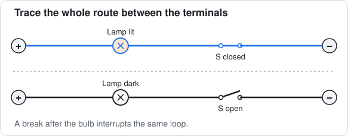
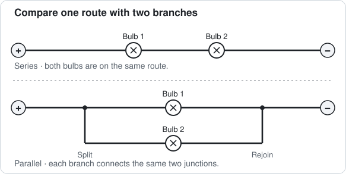
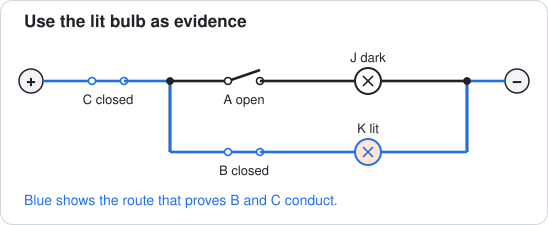
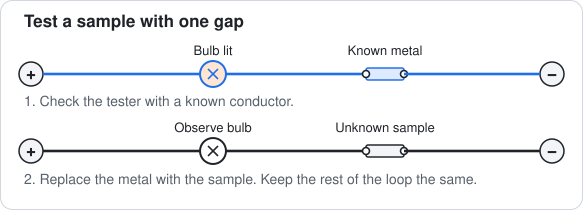
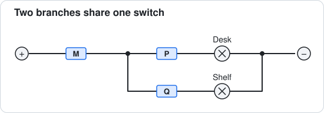

# S4 — Circuits and switches: Learning

[← Back to the index](../../README.md) · [Go to the S4 practice questions →](2.%20Practice.md)

## 1. What you remember

**From the test (your own recollection):**
- Nothing specific was recalled from the test for this category.

**Recognized later when topics were suggested:**
- Circuits and switches were recognized in follow-up. The original bulb diagram remains unknown (see the M5 recollection).

**Added for practice (not recalled from the test):**
- Series/parallel comparisons and conductor/insulator items are extensions.

All questions here are original practice. They are not copies of real test questions.

## 2. Four ways to trace a circuit

**Trace between terminals.** Start at one battery terminal and follow a wire through the bulb to the other terminal. A bulb needs a complete conducting path. Check beyond the bulb as well as before it. A break on either side interrupts the loop.

**Find the split and the reunion.** Two bulbs in a single row share the same current path. Parallel branches split at a junction and meet again at another junction. Trace each branch separately. To check whether a switch controls every branch, cover it with a finger and look for a way around your finger.

**Work backward from the lights.** A lit bulb proves its path conducts. A dark bulb may have several possible breaks. Mark everything a lit bulb proves is closed, then use the dark bulbs to narrow down the rest. If two settings still explain the same display, try drawing both.

**Test a material in a known loop.** A conductor bridges a gap if it touches both contacts. An insulator leaves the path broken. Before interpreting a dark bulb, bridge the gap with a known conductor and check that the bulb can light. Make sure there is no other route around the sample.

## 3. Worked example

The marks `(+)` and `(-)` are the two terminals of one battery. Lines are wires and each `*` in a diagram is a connected junction. Bulbs appear in parentheses, switches in square brackets and test gaps in braces. A closed switch conducts and an open switch breaks its path. Use the switch states in each question. Assume a working battery, intact bulbs and ideal contacts unless a question describes a break. Consider only whether bulbs light.

A reading lamp has two bulbs. Which switch settings light only the desk bulb?

Switch settings are listed in the order M, P, Q.

A. Open, closed, open

B. Closed, closed, closed

C. Closed, closed, open

D. Closed, open, closed

E. Open, closed, closed

**Answer C.** Trace from (+) through M and P, through Desk and back to (−). Opening Q breaks the Shelf branch alone. Choice A sets both branch switches correctly, but the open M breaks the shared wire before the split.

## 4. Practise

[Open the S4 circuits and switches drills](2.%20Practice.md).
