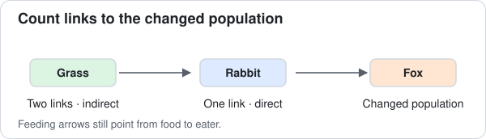
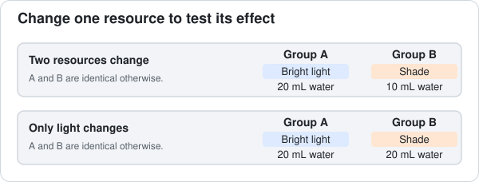
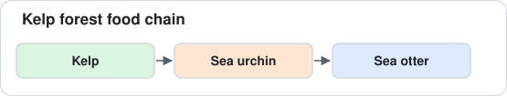

# S1 — Ecology and ecosystems: Learning

[Back to the Grade 9 index](../../README.md) · [Ecology practice questions](2.%20Doing.md)

## 1. Follow the energy through a meadow

Start on the left. **Grass** uses light to make its own food, so it is a **producer**. Grass is eaten by the **rabbit**, which gets energy from that food. The rabbit is eaten by the **fox**, which gets energy from the rabbit. The rabbit and fox are **consumers** because they get energy by eating other organisms.

This single path is a **food chain**. Read each arrow as **“is eaten by.”** If a mouse eats seeds and a hawk eats the mouse, draw seeds → mouse → hawk. A **food web** combines several paths. To see what one animal eats, follow the arrows pointing into it. To see what eats it, follow the arrows pointing out of it.

Some producers use energy from chemicals instead of sunlight. At a dark ocean vent, bacteria that make their own food are the producers. Other bacteria and fungi can be **decomposers**. For example, a mushroom growing on a fallen log breaks down dead wood and returns nutrients to the soil.

## 2. Tell an animal’s diet from its role in a pair

Read the diagram one arrow at a time. The frog eats the grasshopper, so the frog is its **predator**. The heron eats the frog, so the frog is the heron’s **prey**. The same frog has both roles because each role describes a different feeding relationship.

To name an animal’s diet, look at all the foods listed for it. A **herbivore** eats only plants or algae, a **carnivore** eats only animals, and an **omnivore** eats both plants and animals. In a question where a bird eats seeds and insects, the bird is an omnivore. Use the foods shown or named in the question.

## 3. Follow what changes, one link at a time

Suppose most foxes leave the meadow.

1. Start with the rabbits. Fewer foxes eat them, so the rabbit population may grow. The fox and rabbit share one feeding link, so this is a **direct** effect.
2. Move one link farther to the grass. More rabbits eat more grass, so the amount of grass may fall. The change reaches the grass through the rabbits, so it is **indirect**.

A lost food source can also have a direct effect. If a frog eats only grasshoppers in the web and they disappear, look first at the frog. If the question tracks a marker that spreads when marked food is eaten, follow the arrows from food to eater. In grass → rabbit → fox, a marked fox could have picked up the marker from a marked rabbit. To tell which of those two groups was marked first, test the rabbit.

## 4. Find what organisms need and what limits them

A **habitat** is the place where an organism lives and finds what it needs. At a pond edge, reeds give a bird a nest site and shelter, insects give it food, and the pond gives it water. Each thing the bird uses is a **resource**. Light, water, space, and mineral nutrients are examples of **non-living resources**.

When two species need the same resource and there is too little for both, they **compete**. If two kinds of shellfish attach to the same rocks and both have plenty of food, look at the bare rock they share. The scarce resource is space. If algae have plenty of light and grow rapidly after fertilizer adds minerals, the growth suggests that nutrients were scarce.

Which pair tells us more about light? In the upper pair, both light and water change, so either could explain a difference in growth. In the lower pair, only light changes. Keep the other conditions the same when testing one resource.

## 5. Read counts as evidence

A **population** is a group of organisms of one kind living in the same place. Compare two counts by subtracting. If a prey population goes from 60 to 42, the drop is 18. If the predators decline later, the order fits the idea that a loss of food affected them.

When two species are tested alone and together, compare each species with **its own** result alone. For example, if two kinds of beetles share a food source and each finishes with fewer beetles in the shared tank, that pattern supports competition for food. Look for an explanation that fits both the counts and the feeding relationships.

## Try it

Most sea otters leave this kelp forest. What might happen to the kelp, and is the effect direct or indirect?

**Check your thinking.** Fewer otters eat urchins, so urchin numbers may rise. More urchins eat more kelp, so kelp may decrease. The urchins are the link between the otters and kelp, which makes the effect on kelp indirect.

## Practice by skill

| Skill to review | Questions |
|---|---|
| Identify roles and read arrows in a food chain or web | [Q01](2.%20Doing.md#s1-q01), [Q02](2.%20Doing.md#s1-q02), [Q03](2.%20Doing.md#s1-q03), [Q04](2.%20Doing.md#s1-q04), [Q07](2.%20Doing.md#s1-q07), [Q11](2.%20Doing.md#s1-q11), [Q14](2.%20Doing.md#s1-q14), [Q16](2.%20Doing.md#s1-q16), [Q17](2.%20Doing.md#s1-q17), [Q23](2.%20Doing.md#s1-q23), [Q24](2.%20Doing.md#s1-q24), [Q26](2.%20Doing.md#s1-q26), [Q30](2.%20Doing.md#s1-q30) |
| Identify habitats, shared resources, and limits to growth | [Q05](2.%20Doing.md#s1-q05), [Q08](2.%20Doing.md#s1-q08), [Q10](2.%20Doing.md#s1-q10), [Q12](2.%20Doing.md#s1-q12), [Q18](2.%20Doing.md#s1-q18), [Q20](2.%20Doing.md#s1-q20), [Q22](2.%20Doing.md#s1-q22), [Q28](2.%20Doing.md#s1-q28) |
| Trace direct and indirect effects, or follow a marker through a web | [Q06](2.%20Doing.md#s1-q06), [Q13](2.%20Doing.md#s1-q13), [Q19](2.%20Doing.md#s1-q19), [Q27](2.%20Doing.md#s1-q27) |
| Compare population counts and evaluate the evidence | [Q09](2.%20Doing.md#s1-q09), [Q15](2.%20Doing.md#s1-q15), [Q21](2.%20Doing.md#s1-q21), [Q25](2.%20Doing.md#s1-q25), [Q29](2.%20Doing.md#s1-q29) |

## Practise

Go to [S1 practice questions (2. Doing.md)](2.%20Doing.md). Commit to an answer for each question before you open the answer key.
