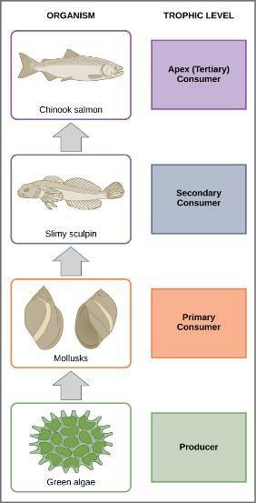
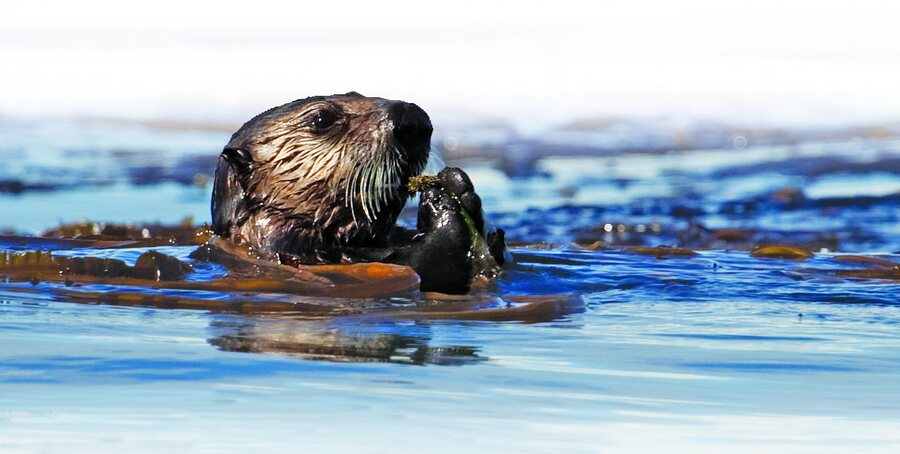

# S1 — Ecology and ecosystems: Learning

[Back to the Grade 9 index](../../README.md) · [Ecology practice questions](2.%20Doing.md)

## 1. Follow energy from algae to fish

*Lake Ontario food chain from [OpenStax, Rice University, Concepts of Biology, Figure 20.4](https://oercommons.s3.amazonaws.com/media/editor/220824/ConceptsofBiology-Ch20_with_notes.pdf#page=10), adapted by OpenStax from NOAA material. Figure extracted from the CC BY 4.0 teaching slides. [Licence](https://creativecommons.org/licenses/by/4.0/).*

Start at the bottom. A **producer** makes its own food. Here, green algae use light to make sugars. Follow the first arrow to the mollusks. They get energy by eating the algae, so they are **consumers**. Read the next arrow the same way. The slimy sculpin eats the mollusks, and the Chinook salmon eats the sculpin.

An arrow points from the **food to the eater**, in the direction energy moves. One path is a **food chain**. A **food web** joins several feeding paths. If another fish also eats the mollusks, there would be a second arrow pointing out of the mollusks. To find what an animal eats, look for arrows that end at that animal.

### Name the role or the diet

A **trophic level** is a feeding step. In this chain, the mollusks are **primary consumers** because they eat the producer. The sculpin eats those consumers, so it is a **secondary consumer**. The salmon is a **tertiary consumer**, one step higher.

The sculpin is a **predator** of mollusks and **prey** for the salmon. These roles describe a particular relationship. The same animal can have both roles.

A **herbivore** eats only plants or algae, a **carnivore** eats only animals, and an **omnivore** eats both plants and animals. A bird that eats seeds and insects is an omnivore. Use all the foods named in the question when identifying its diet.

**Decomposers**, such as fungi on a fallen log, break down dead material and release nutrients back into the environment. At a dark deep-sea vent, some bacteria make their own food using energy from chemicals. That makes them producers even where sunlight cannot reach.

## 2. Predict a direct or indirect change

*Photograph by the [U.S. Geological Survey](https://www.usgs.gov/media/images/alaskan-sea-otter-kelp), [public-domain source](https://commons.wikimedia.org/wiki/File:Alaskan_Sea_Otter.jpg). Resized for this page.*

Sea urchins eat kelp, and sea otters eat sea urchins. Suppose most otters leave.

1. Start with the animal joined to otters by one feeding link. Fewer otters eat the urchins, so urchin numbers may rise. This is a **direct effect**.
2. Keep following the feeding relationships. More urchins can eat more kelp, so kelp may decrease. The effect on kelp passes through the urchins, so it is **indirect**.

A predator can also directly lose a food source. If a frog eats only grasshoppers in the web and they disappear, the frog loses its food. In a marker question, follow the arrows from marked food to the animals that eat it. In algae → snails → fish, marked fish could have eaten marked snails. To separate the possibilities that snails or fish were marked first, test the snails.

## 3. Find what an organism needs

An organism’s **habitat** is the place where it lives and finds what it needs. A bird at a pond uses reeds for shelter and nesting, insects for food, and pond water to drink. Each is a **resource**. Water, light, mineral nutrients and space are **non-living resources**.

**Competition** occurs when organisms share a resource that is in short supply. Suppose two kinds of shellfish attach to the same rocks. Food is plentiful, but suitable bare rock is scarce. The shellfish are competing for **space**. If algae already have adequate light and grow much faster after fertilizer adds minerals, the result suggests mineral nutrients had limited their growth.

### Test one resource at a time

Two groups of seedlings grow differently. One gets more light and more water. Either change could help explain the difference. To test light, give both groups the same water, soil and temperature. Change only the light and measure growth in the same way.

## 4. Read population counts as evidence

A **population** is a group of organisms of one kind living in the same place. When a table gives several years, compare the counts in the order they were recorded.

| Year | Prey counted | Predators counted |
|---|---:|---:|
| 1 | 60 | 12 |
| 2 | 42 | 12 |
| 3 | 40 | 8 |

The biggest drop in prey is 60 − 42 = 18, from Year 1 to Year 2. The predators decline a year later. If these predators eat that prey, the timing supports the explanation that they had less food.

**Try a comparison.** Two kinds of beetles eat the same food. Each kind is counted when kept alone and when kept with the other kind. If each finishes with fewer beetles in the shared tank, this supports competition. Compare each kind with **its own** count when alone, since the two kinds may normally grow to different numbers.

## Practice by skill

| Skill to review | Questions |
|---|---|
| Identify roles and read arrows in a food chain or web | [Q01](2.%20Doing.md#s1-q01), [Q02](2.%20Doing.md#s1-q02), [Q03](2.%20Doing.md#s1-q03), [Q04](2.%20Doing.md#s1-q04), [Q07](2.%20Doing.md#s1-q07), [Q11](2.%20Doing.md#s1-q11), [Q14](2.%20Doing.md#s1-q14), [Q16](2.%20Doing.md#s1-q16), [Q17](2.%20Doing.md#s1-q17), [Q23](2.%20Doing.md#s1-q23), [Q24](2.%20Doing.md#s1-q24), [Q26](2.%20Doing.md#s1-q26), [Q30](2.%20Doing.md#s1-q30) |
| Identify habitats, shared resources, and limits to growth | [Q05](2.%20Doing.md#s1-q05), [Q08](2.%20Doing.md#s1-q08), [Q10](2.%20Doing.md#s1-q10), [Q12](2.%20Doing.md#s1-q12), [Q18](2.%20Doing.md#s1-q18), [Q20](2.%20Doing.md#s1-q20), [Q22](2.%20Doing.md#s1-q22), [Q28](2.%20Doing.md#s1-q28) |
| Trace direct and indirect effects, or follow a marker through a web | [Q06](2.%20Doing.md#s1-q06), [Q13](2.%20Doing.md#s1-q13), [Q19](2.%20Doing.md#s1-q19), [Q27](2.%20Doing.md#s1-q27) |
| Compare population counts and evaluate the evidence | [Q09](2.%20Doing.md#s1-q09), [Q15](2.%20Doing.md#s1-q15), [Q21](2.%20Doing.md#s1-q21), [Q25](2.%20Doing.md#s1-q25), [Q29](2.%20Doing.md#s1-q29) |

## Practise

Go to [S1 practice questions (2. Doing.md)](2.%20Doing.md). Commit to an answer for each question before you open the answer key.
