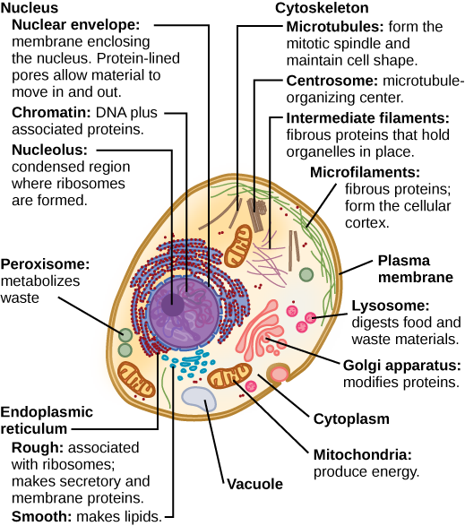
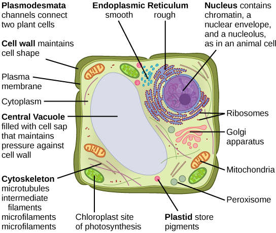
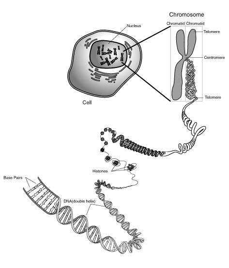
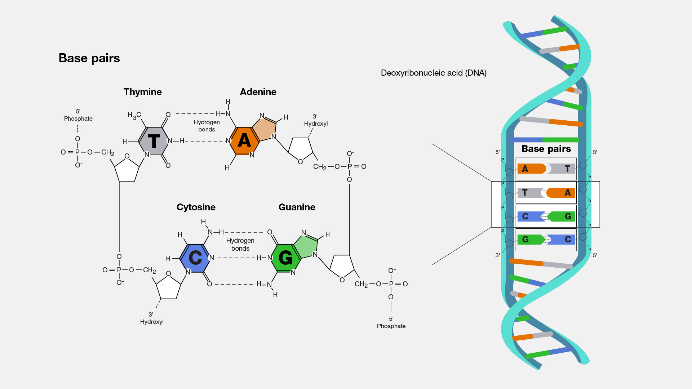

# Cells, DNA, and inheritance

[Back to the Grade 9 index](../../README.md) · [Cells and DNA practice questions](2.%20Doing.md)

## 1. Look inside a cell

A **cell** is the smallest unit of life. A leaf and the lining of your cheek are each made of many cells. These textbook diagrams show enlarged cutaway views of typical animal and plant cells. Start by finding the labels named in each step.

### Start at the edge of an animal cell

1. **Cell membrane.** Trace the thin boundary marked *plasma membrane*. It separates the inside of the cell from its surroundings. It controls which substances can cross, so the cell can take in materials it needs and get rid of wastes.
2. **Cytoplasm.** Look at the space inside the membrane and outside the nucleus. That region is the cytoplasm. It includes a mostly watery fluid and the structures suspended in it. Many of the cell’s chemical reactions happen here.
3. **Nucleus.** Find the large purple structure. It holds most of the cell’s DNA, the instructions the cell uses to grow and work. The **nuclear envelope** surrounds it. The darker spot inside is the **nucleolus**, where parts of ribosomes are assembled.

### Follow how the cell makes and uses materials

Find these structures in the animal cell, then look for the same labels in the plant cell below. An **organelle** is a structure inside a cell that carries out a particular job.

- **Mitochondria** are the bean-shaped structures with folded inner membranes. They use energy from food to make ATP, a molecule the cell can use to power its work. That process is part of **cellular respiration**.
- **Ribosomes** are the tiny dots that build proteins. Ribosomes on the **rough endoplasmic reticulum** (rough ER) make proteins that enter its network of membranes. The **Golgi apparatus**, shown as a stack of flattened sacs, modifies and sorts some of these proteins, then packages them for delivery. **Smooth ER** helps make lipids, such as the fats used to build membranes.
- **Lysosomes**, shown in the animal cell, contain substances that break down worn-out cell parts so their materials can be reused. The **cytoskeleton** is a network of fibres that helps support the cell and move material around inside it.

### Find three features of the green plant cell

1. **Cell wall.** Follow the thick outside layer. It is made mostly of cellulose and helps support the cell. Find the thinner membrane just inside it. Animal cells, including cheek cells, have a membrane and lack a cell wall.
2. **Central vacuole.** Find the large space taking up much of the plant cell. This storage compartment holds water and dissolved substances. When it fills with water, the cell presses against its wall and becomes firmer. Loss of water can make a plant wilt.
3. **Chloroplasts.** Find the green ovals. They contain **chlorophyll**, a pigment that absorbs light. During **photosynthesis**, the cell uses light energy, water and carbon dioxide to make sugars, releasing oxygen. Plant cells also have mitochondria, which help release usable energy from sugars.

*Cell diagrams by OpenStax, Rice University, from the 2016 edition of Biology. [Animal cell source](https://commons.wikimedia.org/wiki/File:Figure_04_03_01a.png) and [plant cell source](https://commons.wikimedia.org/wiki/File:Figure_04_03_01b.png), both [CC BY 4.0](https://creativecommons.org/licenses/by/4.0/). A white background was added so labels are readable in light and dark themes.*

**Check your observations.** One sample has a membrane, a nucleus and mitochondria. Those features fit either a typical plant cell or an animal cell. A second sample has a wall and large central vacuole, but no visible chloroplasts. In a comparison between plant and animal cells, this points to a plant cell. An underground root cell is one possibility because it usually lacks chloroplasts. If your notes simply leave a part out, you need another observation to tell whether it is present.

## 2. Zoom in on DNA

*Chromosome illustration courtesy of the [National Human Genome Research Institute](https://www.genome.gov/), [public-domain source](https://commons.wikimedia.org/wiki/File:Chromosome.gif).*

Start at the cell in the upper left and find the **nucleus**. The nucleus contains **chromosomes**, packages of long DNA molecules wrapped around proteins. Follow the zoom along the chromosome until you reach the DNA double helix. A **gene** is a stretch of DNA that contains instructions for making a product the cell uses, often a protein. One chromosome can carry many genes.

### Read the DNA ladder

**DNA** stands for **deoxyribonucleic acid**. It has two strands that twist around each other. Each rung joins two chemical parts called **bases**. These bases are represented by four letters, and their order carries information.

*Base-pair illustration by Darryl Leja for the [National Human Genome Research Institute](https://www.genome.gov/genetics-glossary/Base-Pair), [public-domain source](https://commons.wikimedia.org/wiki/File:DNA_base-pair_diagram.jpg).*

Find the enlarged part of the ladder on the right. **A** (adenine) pairs with **T** (thymine). **C** (cytosine) pairs with **G** (guanine). The same rules apply when a question lays the ladder flat in two rows. Match each letter with its partner directly across the rung.

### Worked example

A model has six rungs. Its top strand reads A–G–C–T–G–A.

1. Pair one column at a time. Under A goes T. Under G goes C. Continue across to get **T–C–G–A–C–T**.
2. For the number of C–G pairs, count columns with either C or G on top. There are **three**.
3. For the total number of G bases, count both rows. There are two on top and one below the top C, for **three Gs**.

### Tell DNA and RNA apart

**DNA** and **RNA** are both kinds of molecules called **nucleic acids**. RNA stands for **ribonucleic acid** and helps the cell use the information in DNA. DNA and RNA both use A, C and G. DNA’s fourth base is T. RNA’s fourth base is **U** (uracil).

## 3. Follow a trait from parent to offspring

A **trait** is a feature such as flower colour. DNA passed down from parents can influence an **inherited** trait. An **acquired** feature develops during life, like a scar after a fall. Both inherited information and the environment can affect some traits, such as how tall a plant grows.

In the simple model used here, an offspring gets one **copy** of a gene from each parent. Copies can come in different versions, written with letters like R and r. Suppose R is **dominant**, so RR and Rr plants have red flowers. Plants with rr have white flowers.

| Copy from the Rr parent | Copy from the rr parent | Offspring’s copies | Flower colour |
|---|---|---|---|
| R | r | Rr | Red |
| r | r | rr | White |

Read each row by picking one letter from each parent. If R and r are equally likely from the first parent, each outcome has a one-in-two chance. To work backwards from a white offspring, start with rr. It received an r from each parent, so each parent must carry at least one r. Use the trait and copy rules given in each question.

## 4. Test an explanation

To test whether water affects seedling height, start with the same kind of seed, assign seeds to groups by chance, and keep soil, light and temperature the same. Change the water amount and measure both groups in the same way. A difference in average height supports an effect of water in that test.

**Fix a comparison.** Group A gets 5 mL of water and 6 hours of light. Group B gets 10 mL and 9 hours of light. Water and light both changed, so the two groups alone cannot tell you which mattered. Add a group with 10 mL and 6 hours of light. Compare it with A to test water while keeping light the same.

**Use what stays the same.** If two plants grown from pieces of the same parent have the same inherited information and only their water differs, water can explain a difference in how they grow. If parent and offspring keep the same pattern on their seeds in different soils, that supports a role for inheritance.

## Practice by skill

| Skill to review | Questions |
|---|---|
| Identify cell parts, their jobs, and what they can tell you | [Q03](2.%20Doing.md#s2-q03), [Q09](2.%20Doing.md#s2-q09), [Q13](2.%20Doing.md#s2-q13), [Q18](2.%20Doing.md#s2-q18), [Q20](2.%20Doing.md#s2-q20), [Q26](2.%20Doing.md#s2-q26), [Q30](2.%20Doing.md#s2-q30) |
| Connect cells, nuclei, chromosomes, and genes | [Q01](2.%20Doing.md#s2-q01), [Q10](2.%20Doing.md#s2-q10) |
| Use base-pair rules to fill gaps, check pairs, and count bases | [Q02](2.%20Doing.md#s2-q02), [Q07](2.%20Doing.md#s2-q07), [Q11](2.%20Doing.md#s2-q11), [Q17](2.%20Doing.md#s2-q17), [Q27](2.%20Doing.md#s2-q27) |
| Distinguish DNA and RNA by their names and bases | [Q06](2.%20Doing.md#s2-q06), [Q08](2.%20Doing.md#s2-q08), [Q15](2.%20Doing.md#s2-q15), [Q22](2.%20Doing.md#s2-q22), [Q23](2.%20Doing.md#s2-q23) |
| Distinguish inherited and acquired traits, and trace gene copies | [Q04](2.%20Doing.md#s2-q04), [Q12](2.%20Doing.md#s2-q12), [Q16](2.%20Doing.md#s2-q16), [Q21](2.%20Doing.md#s2-q21), [Q25](2.%20Doing.md#s2-q25), [Q29](2.%20Doing.md#s2-q29) |
| Set up a fair comparison and interpret the result | [Q05](2.%20Doing.md#s2-q05), [Q14](2.%20Doing.md#s2-q14), [Q19](2.%20Doing.md#s2-q19), [Q24](2.%20Doing.md#s2-q24), [Q28](2.%20Doing.md#s2-q28) |

## Practice

Try the [cells and DNA practice questions](2.%20Doing.md) and use the answer key to check each step.
