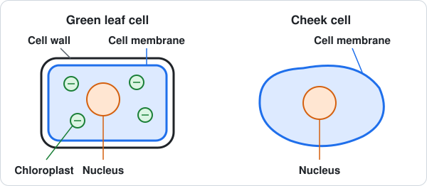
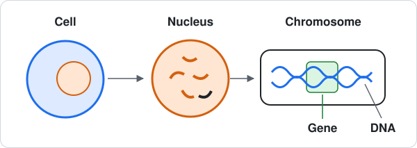

# Cells, DNA, and inheritance

[Back to the Grade 9 index](../../README.md) · [Cells and DNA practice questions](2.%20Doing.md)

## Quick reference

| Idea | What to know |
|---|---|
| Cell parts | The **membrane** controls what enters and leaves. The **nucleus** holds chromosomes. A plant cell’s **wall** gives support, and **chloroplasts** use light to make sugars. |
| DNA and genes | A **chromosome** contains a long, packed DNA molecule. A **gene** is a stretch of DNA with instructions that help shape a trait. |
| DNA bases | DNA stands for **deoxyribonucleic acid**. Its four bases are **A** (adenine), **T** (thymine), **C** (cytosine) and **G** (guanine). **A pairs with T. C pairs with G.** |
| DNA and RNA | DNA and RNA are two kinds of **nucleic acid**. RNA stands for **ribonucleic acid** and uses **U** (uracil) in place of T in its set of bases. |
| Inheritance | For the one-gene examples here, an offspring gets one gene copy from each parent. Use the rule in the question to decide what trait the pair produces. |
| Fair tests | Change one condition at a time and measure the outcome the same way in each group. |

## 1. Start with a cell

A **cell** is the smallest unit of a living thing. A leaf and the inside of a cheek are each made of many cells. A thin **cell membrane** surrounds each cell and controls what can go in or out. A **nucleus** is a compartment inside a typical plant or animal cell. It holds the cell's chromosomes.

The **cell wall** surrounds the plant cell membrane like a sturdy outer layer. It supports the cell and helps it keep its shape. A **chloroplast** uses light energy to make sugars. This process is called **photosynthesis**. Green leaf cells often have chloroplasts. Underground root cells usually have no chloroplasts, but they still have walls. When choosing between leaf, root and cheek cells, use the wall to identify a plant cell and the chloroplasts to distinguish a green leaf cell from a typical underground root cell.

## 2. Find DNA and read its bases

Inside the nucleus, long DNA molecules are packed into structures called **chromosomes**. DNA carries information in the order of its bases, like words carry information in the order of letters. A **gene** is one stretch of DNA that carries instructions. A single chromosome can hold many genes. When a diagram points to one short stretch along the DNA, look for a gene. When it points to the whole packed structure, look for a chromosome.

A **base** is one of the chemical parts represented by a letter in DNA. The four DNA bases have full names. Adenine is A, thymine is T, cytosine is C and guanine is G. **Nucleic acid** is the name for the family of molecules that includes DNA and RNA. DNA and RNA are the nucleic acids, and A, T, C and G are the bases shown in DNA diagrams.

DNA has two strands that twist around each other. A simple drawing often straightens the strands out so the pairs are easy to see. Each base faces its partner across the strands. **A and T always pair in this model, as do C and G.** If a diagram shows A–C–G on the top row, read across each rung to get T–G–C on the bottom row. Both rows are read left to right in these diagrams.

**RNA** is another nucleic acid that helps a cell use the information stored in DNA. Its four bases are A, C, G and **U** (uracil). A list with A, C, G and U describes the RNA bases. A list with A, C, G and T describes the DNA bases.

## 3. Work out what can be inherited

A **trait** is a feature of a living thing, such as a pea plant's flower colour. An **inherited** trait is influenced by DNA passed down from parents. An **acquired** feature develops during life, such as a scar from a fall. Sometimes DNA and surroundings both influence a feature. For example, genes can affect how tall a plant can grow, and water can affect how tall it actually grows.

A **gene copy** in these questions means one version of a gene carried by a parent or offspring. In the simple rules used here, each offspring gets **one copy from each parent**. For a plant with copies R and r, write **Rr**. An uppercase R and a lowercase r stand for different versions. If a question says R is **dominant**, one R is enough to give the stated trait. For example, if R gives red flowers and only rr gives white flowers, RR and Rr give red.

| Copy from the Rr parent | Copy from the rr parent | Offspring's copies | Flower colour |
|---|---|---|---|
| R | r | Rr | Red |
| r | r | rr | White |

If the Rr parent is equally likely to pass R or r, the two outcomes each have a chance of one in two. To work backwards from a white offspring, start with rr. Each parent had to supply one r, so each must have at least one r. **All colour and copy rules needed for these examples are supplied in the questions.**

## 4. Use an experiment to check an explanation

Suppose two groups of seedlings grow differently. If one group got more water **and** more light, either difference could help explain the result. A **fair test** of water uses the same kind of seed, the same soil, light and temperature, and the same measuring method. It changes only the amount of water being tested.

If different seeds could start out with different growth potential, mix the seeds and assign them to groups by chance. This makes it less likely that one group starts out with all the stronger seedlings. A difference in average height then supports an effect of the condition being tested. The evidence comes from the groups in that experiment.

## Worked example

A table shows three DNA base pairs. Two letters are missing. Which letters fill blanks 1 and 2, in that order?

| Top strand | A | C | 2 |
|---|---|---|---|
| Bottom strand | 1 | G | T |

A. A, T

B. T, A

C. T, G

D. G, A

E. A, C

**Answer B.**

1. In the first column, blank 1 is opposite A. A pairs with T, so write **T**.
2. In the last column, blank 2 is opposite T. T pairs with A, so write **A**.
3. Check all three columns from left to right: A–T, C–G and A–T.

**Why A is tempting.** A and T do go together, but A and T are the letters already given in those columns. Each blank needs the partner of the letter straight across from it.

## Practice

Try the [cells and DNA practice questions](2.%20Doing.md) and use the answer key to check each step.
