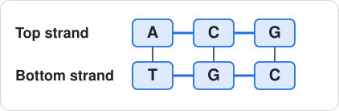

# Cells, DNA, and inheritance

[Back to the Grade 9 index](../../README.md) · [Cells and DNA practice questions](2.%20Doing.md)

## 1. Start with a cell

Cells are the smallest units of living things. Look at these two cells as if you were seeing them under a microscope.

Start at the edge of the leaf cell and work your way in.

1. **Cell wall.** Find the stiff outer edge on the leaf cell. It supports the cell and helps it hold its shape. A cheek cell has no wall.
2. **Cell membrane.** Follow the blue line just inside the leaf cell’s wall. In the cheek cell it is the outside edge. This thin layer controls what can enter and leave.
3. **Nucleus.** Find the orange circle inside each cell. This space holds the chromosomes, which carry the cell’s instructions.
4. **Chloroplasts.** Find the small green circles in the leaf cell. They use energy from light to make sugars. That process is called **photosynthesis**. Cheek cells have no chloroplasts.

**Try reading a microscope note.** “It has a wall, but I see no chloroplasts.” The wall tells you it can be a plant cell. A typical underground root cell fits because it needs the wall for support and usually has no chloroplasts. A note that lists only a nucleus and membrane could describe a plant cell or an animal cell. An unlisted part may still be there.

## 2. Zoom in on DNA

Follow the picture from left to right. Inside the **cell** is the **nucleus**. Inside the nucleus are **chromosomes**, which are tightly packed lengths of **DNA**. A **gene** is one stretch of DNA that carries instructions. One chromosome can contain many genes.

### Read the DNA ladder

DNA stands for **deoxyribonucleic acid**. Its two strands twist around each other. The diagram lays them flat so you can read the pairs. Each letter represents a chemical part called a **base**. Like letters in a word, the order of the bases carries information.

Read straight across each rung. **A** (adenine) pairs with **T** (thymine). **C** (cytosine) pairs with **G** (guanine). Either base can be on top.

### Worked example

A model has six rungs. Its top strand reads A–G–C–T–G–A.

1. Pair one column at a time. Under A goes T. Under G goes C. Continue across to get **T–C–G–A–C–T**.
2. For the number of C–G pairs, count columns with either C or G on top. There are **three**.
3. For the total number of G bases, count both rows. There are two on top and one below the top C, for **three Gs**.

### Tell DNA and RNA apart

**DNA** and **RNA** are both kinds of molecules called **nucleic acids**. RNA stands for **ribonucleic acid** and helps the cell use the information in DNA. DNA and RNA both use A, C and G. DNA’s fourth base is T. RNA’s fourth base is **U** (uracil).

## 3. Follow a trait from parent to offspring

A **trait** is a feature such as flower colour. DNA passed down from parents can influence an **inherited** trait. An **acquired** feature develops during life, like a scar after a fall. Both inherited information and the environment can affect some traits, such as how tall a plant grows.

In the simple model used here, an offspring gets one **copy** of a gene from each parent. Copies can come in different versions, written with letters like R and r. Suppose R is **dominant**, so RR and Rr plants have red flowers. Plants with rr have white flowers.

| Copy from the Rr parent | Copy from the rr parent | Offspring’s copies | Flower colour |
|---|---|---|---|
| R | r | Rr | Red |
| r | r | rr | White |

Read each row by picking one letter from each parent. If R and r are equally likely from the first parent, each outcome has a one-in-two chance. To work backwards from a white offspring, start with rr. It received an r from each parent, so each parent must carry at least one r. Use the trait and copy rules given in each question.

## 4. Test an explanation

To test whether water affects seedling height, start with the same kind of seed, assign seeds to groups by chance, and keep soil, light and temperature the same. Change the water amount and measure both groups in the same way. A difference in average height supports an effect of water in that test.

**Fix a comparison.** Group A gets 5 mL of water and 6 hours of light. Group B gets 10 mL and 9 hours of light. Water and light both changed, so the two groups alone cannot tell you which mattered. Add a group with 10 mL and 6 hours of light. Compare it with A to test water while keeping light the same.

**Use what stays the same.** If two plants grown from pieces of the same parent have the same inherited information and only their water differs, water can explain a difference in how they grow. If parent and offspring keep the same pattern on their seeds in different soils, that supports a role for inheritance.

## Practice by skill

| Skill to review | Questions |
|---|---|
| Identify cell parts, their jobs, and what they can tell you | [Q03](2.%20Doing.md#s2-q03), [Q09](2.%20Doing.md#s2-q09), [Q13](2.%20Doing.md#s2-q13), [Q18](2.%20Doing.md#s2-q18), [Q20](2.%20Doing.md#s2-q20), [Q26](2.%20Doing.md#s2-q26), [Q30](2.%20Doing.md#s2-q30) |
| Connect cells, nuclei, chromosomes, and genes | [Q01](2.%20Doing.md#s2-q01), [Q10](2.%20Doing.md#s2-q10) |
| Use base-pair rules to fill gaps, check pairs, and count bases | [Q02](2.%20Doing.md#s2-q02), [Q07](2.%20Doing.md#s2-q07), [Q11](2.%20Doing.md#s2-q11), [Q17](2.%20Doing.md#s2-q17), [Q27](2.%20Doing.md#s2-q27) |
| Distinguish DNA and RNA by their names and bases | [Q06](2.%20Doing.md#s2-q06), [Q08](2.%20Doing.md#s2-q08), [Q15](2.%20Doing.md#s2-q15), [Q22](2.%20Doing.md#s2-q22), [Q23](2.%20Doing.md#s2-q23) |
| Distinguish inherited and acquired traits, and trace gene copies | [Q04](2.%20Doing.md#s2-q04), [Q12](2.%20Doing.md#s2-q12), [Q16](2.%20Doing.md#s2-q16), [Q21](2.%20Doing.md#s2-q21), [Q25](2.%20Doing.md#s2-q25), [Q29](2.%20Doing.md#s2-q29) |
| Set up a fair comparison and interpret the result | [Q05](2.%20Doing.md#s2-q05), [Q14](2.%20Doing.md#s2-q14), [Q19](2.%20Doing.md#s2-q19), [Q24](2.%20Doing.md#s2-q24), [Q28](2.%20Doing.md#s2-q28) |

## Practice

Try the [cells and DNA practice questions](2.%20Doing.md) and use the answer key to check each step.
