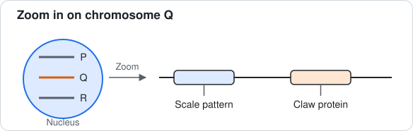
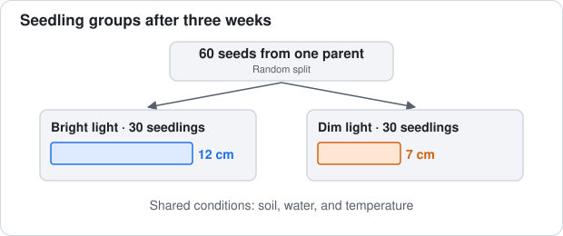
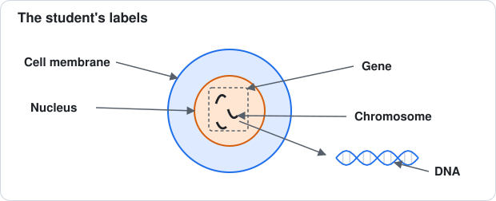
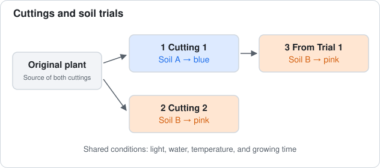
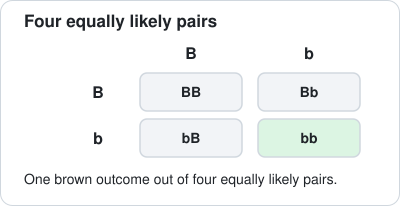
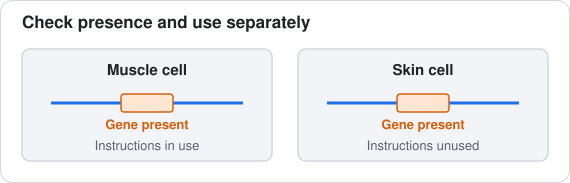
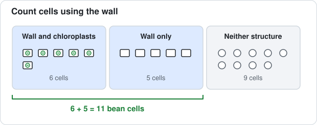

# S2 — Cells, DNA, and inheritance: Doing

[← Back to the index](../../README.md) · [Review the S2 learning page](1.%20Learning.md)

## How to use this page

1. Answer each question on paper **before** looking at the key.
2. Mark each attempt: ✅ correct, 🤔 guessed (even if right), ❌ wrong, ⏭️ skipped.
3. Review guesses as carefully as misses.
4. Questions S2-Q26 to S2-Q30 are saved for the final weekend. Do not open them early.

All questions are original practice, not copies of real test questions. Every inheritance rule you need is stated in the question.

## Questions

### S2-Q01

Which list puts these structures in order from **largest to smallest**?

A. gene, chromosome, nucleus, cell

B. cell, chromosome, nucleus, gene

C. cell, nucleus, gene, chromosome

D. nucleus, cell, chromosome, gene

E. cell, nucleus, chromosome, gene

### S2-Q02

Two drawings show part of the same animal cell. In the first, a nucleus contains three chromosomes labelled P, Q and R. The second drawing zooms in on Q and marks two different genes along its DNA, one for a scale pattern and one for a claw protein. Which change to the drawings would remove the scale-pattern gene while keeping the claw gene and the other two chromosomes?

A. Erase the entire chromosome Q.

B. Erase just the DNA segment marked for the scale pattern on Q.

C. Erase the nucleus but keep Q in its original place.

D. Erase chromosomes P and R while leaving Q intact.

E. Erase both marked segments on Q.

### S2-Q03

A student compares a photosynthetic cell from a green leaf with a cell from the inside of a human cheek. Which structure would the student find in the leaf cell but **not** in the cheek cell?

A. nucleus

B. cell membrane

C. chloroplast

D. chromosome

E. cytoplasm

### S2-Q04

Which of these traits is **inherited**?

A. natural eye colour

B. a scar on the knee from a fall

C. being able to speak French

D. strong arm muscles from lifting weights

E. a suntan from a summer outdoors

### S2-Q05

In a flowering plant, every plant has two copies of the flower-colour gene and passes **one** of its two copies to each offspring. Copy R gives red; copy r gives white. R is dominant: any plant with at least one R copy has red flowers. Only a plant with two r copies (rr) has white flowers.

A red-flowered plant is crossed with a white-flowered plant. **Some** of their offspring have white flowers. What must be true about the red parent?

A. It is RR.

B. It is rr.

C. It cannot be determined from this information.

D. It is Rr.

E. It is RR, and the white offspring received both of their white copies from the white parent.

### S2-Q06

Which statement about a **gene** is correct?

A. A gene is a structure that contains many chromosomes.

B. A gene is a segment of DNA that carries instructions affecting a trait.

C. A gene is found only in plant cells.

D. A gene is the membrane that surrounds the nucleus.

E. A gene is a trait an organism gains during its life, such as a skill.

### S2-Q07

A student collects 60 seeds from one parent plant and **randomly** splits them into two groups of 30. Both groups get the same soil, water, and temperature.

| Group | Light | Average height after 3 weeks |
|---|---|---|
| 1 | Bright | 12 cm |
| 2 | Dim | 7 cm |

What does this experiment best support?

A. The Group 1 seedlings inherited genes for tallness that the Group 2 seedlings did not.

B. Height is controlled only by genes, so the light made no difference.

C. Dim light changed the seedlings' DNA, so their offspring will also be short.

D. Height is controlled only by the environment and never by genes.

E. The amount of light affected height; the experiment gives no evidence that the difference was inherited.

### S2-Q08

Which structure is found in **both** plant and animal cells and controls what substances enter and leave the cell?

A. cell membrane

B. cell wall

C. chloroplast

D. nucleus

E. chromosome

### S2-Q09

In guinea pigs, every animal has two copies of the coat-colour gene. Each parent passes **one** of its two copies to each offspring, and each of the parent's two copies is equally likely to be passed. Copy B gives black fur and copy b gives brown fur. B is dominant: any guinea pig with at least one B is black. Only bb guinea pigs are brown.

Two **black** guinea pigs have a **brown** pup. If the same two parents have another pup, what is the chance that it is brown?

A. 0

B. 1/2

C. 3/4

D. 1/4

E. 1

### S2-Q10

A dog has these four traits:

1. a curly coat like its mother's
2. a torn ear from a fight with another dog
3. it sits when its owner says "sit"
4. brown eyes like its father's

Which traits are **inherited**?

A. 1, 2, and 4

B. all four

C. 1 and 4 only

D. 3 and 4 only

E. 2 and 3 only

### S2-Q11

A table describes the genetic material in a cell, by where it is found and what it is made of. One name is missing.

| Level | Name | Description |
|---|---|---|
| 1 | Cell | basic unit of a living thing |
| 2 | Nucleus | control centre that holds the genetic material |
| 3 | ? | thread-like structure containing long DNA packaged with proteins |
| 4 | DNA | the chemical that stores the instructions |
| 5 | Gene | short segment of DNA with the instructions for one product |

What is the missing name in Level 3?

A. chromosome

B. chloroplast

C. cell membrane

D. protein

E. gene

### S2-Q12

Identical twins develop from one fertilized egg, so they start life with the same DNA. Two identical twins were raised in different homes. As adults, one twin is 8 cm taller than the other. The taller twin had a much better diet as a child.

Which explanation is best supported?

A. The twins have different genes for height.

B. Height is not affected by genes at all.

C. The taller twin gained extra chromosomes from eating more food.

D. Different childhood environments could contribute to the height difference even though the twins started with the same DNA.

E. The shorter twin's DNA changed, so the shorter twin's children will be short.

### S2-Q13

Under a microscope, a cell shows a nucleus, a cell membrane, and a cell wall, but **no** chloroplasts. Which cell could it be?

A. a cell from the inside of a human cheek

B. a muscle cell from a dog

C. a leaf cell that is busy making food by photosynthesis

D. none, because every cell with a cell wall must also have chloroplasts

E. a cell from the underground root of a bean plant

### S2-Q14

A gardener trims a hedge into the shape of a cube every month for five years. Seeds from this hedge are planted in a new garden and are never trimmed. How will the new plants most likely grow?

A. into cubes, because the parent hedge was a cube

B. into half-cubes, because the shape is only partly passed on

C. into the natural shape of their species, because the cube shape was acquired, not inherited

D. into cubes only if they are planted in the same soil as the parent

E. they will not grow, because trimming damaged the parent's DNA

### S2-Q15

At a crime scene, investigators find a hair with its root still attached. The root contains cells with nuclei. They compare DNA from the hair root with DNA from a suspect's cheek cells. Why is this a fair comparison?

A. It is not fair: hair cells and cheek cells do different jobs, so they contain completely different DNA.

B. Almost every body cell in one person that has a nucleus contains the same full set of DNA.

C. DNA is found only in blood, so neither sample really contains DNA.

D. Hair root cells have no nucleus, so their DNA comes from the cheek.

E. Cheek cells get their DNA from food, so they match whatever the suspect ate.

### S2-Q16

In one family, both parents and all three children speak English with the same regional accent. A student concludes: "The accent must be inherited, because everyone in the family has it."

Which response is best?

A. The conclusion is correct, because traits shared by a whole family are always inherited.

B. The conclusion is not supported, because the family members also share an environment, so the accent could be learned.

C. The conclusion is correct, because an accent is stored in the chromosomes of the voice-box cells.

D. The conclusion is correct only if the accent comes from the father.

E. The conclusion would be proved if a fourth child also had the accent.

### S2-Q17

A teacher uses an analogy: the **cell** is a library building, and each **chromosome** is one book of instructions kept in a locked room inside the library. Which part of the analogy best matches a **gene**?

A. the library building

B. the locked room that holds all the books

C. a single book

D. one recipe written inside one of the books

E. the whole collection of every book in the room

### S2-Q18

A stalk of celery stays stiff and keeps its shape. Which structure, found in plant cells but **not** in animal cells, forms a rigid layer outside each cell's membrane and helps give this support?

A. cell membrane

B. chloroplast

C. nucleus

D. chromosome

E. cell wall

### S2-Q19

In a flowering plant, every plant has two copies of the flower-colour gene and passes **one** of its two copies to each offspring. For this gene, **neither copy is dominant**:

| Copies | Flower colour |
|---|---|
| RR | red |
| WW | white |
| RW | pink |

Two parent plants produce many offspring. Some offspring are **red** and some are **white**. What colour were the two parents?

A. both red

B. both white

C. both pink

D. one red and one white

E. one pink and one white

### S2-Q20

Which trait of a sunflower is most likely **inherited** rather than acquired?

A. the striped pattern on its seeds, which matches the parent plant whatever soil it grows in

B. a stem bent sideways by strong wind

C. leaves with holes chewed by insects

D. yellowing leaves during a dry month

E. a broken flower head from a hailstorm

### S2-Q21

In pea plants, every plant has two copies of the seed-colour gene and passes **one** of its two copies to each offspring. Copy Y gives yellow seeds and copy y gives green seeds. Y is dominant: any plant with at least one Y has yellow seeds. Only yy plants have green seeds.

A YY plant is crossed with a yy plant. What colour seeds will their offspring have?

A. half yellow and half green

B. all green

C. three-quarters yellow and one-quarter green

D. all yellow

E. one-quarter yellow and three-quarters green

### S2-Q22

A student labels a sketch of an animal cell. Exactly **one** label describes the wrong part.

| Label | What the student says it points to |
|---|---|
| Gene | the whole set of chromosomes inside the nucleus |
| Nucleus | the round structure that holds the chromosomes |
| Chromosome | one of the thread-like structures inside the nucleus |
| Cell membrane | the thin outer boundary of the cell |
| DNA | the material that the chromosomes are made of |

Which label is wrong?

A. Gene

B. Nucleus

C. Chromosome

D. Cell membrane

E. DNA

### S2-Q23

A farmer has two fields of cows.

| Field | Breed | Food | Average milk per cow per day |
|---|---|---|---|
| North | Breed X | lots of fresh grass | 30 L |
| South | Breed Y | dry hay only | 20 L |

The farmer says: "Breed X produces more milk because of its genes." Do these data support that conclusion?

A. Yes, because breed is inherited, so the extra milk must be inherited too.

B. Yes, but the cause is the grass, not the breed.

C. No, because milk production is never affected by genes.

D. Yes, because a 10 L difference is too large to be caused by food.

E. No, because both breed and food differ between the fields, so the data cannot show which one caused the difference.

### S2-Q24

A student compares a photosynthetic cell from a green leaf with a human cheek cell. Which row is correct?

| Row | Structure | Leaf cell | Cheek cell |
|---|---|---|---|
| A | Cell wall | yes | yes |
| B | Nucleus | no | yes |
| C | Chloroplast | yes | no |
| D | Cell membrane | no | yes |
| E | Chromosomes | no | yes |

A. Row A

B. Row B

C. Row C

D. Row D

E. Row E

### S2-Q25

A muscle cell and a skin cell from one person have the same chromosomes. A gene can be present in a cell even when the cell is not using its instructions. Two students make predictions about a gene whose instructions the muscle cell uses. Lea predicts that the skin cell lacks the gene. Omar predicts that the skin cell has the gene but does not use it. Which result from the skin cell supports Omar and rules out Lea?

A. The gene is absent and its instructions are unused.

B. The gene is present and its instructions are unused.

C. The gene is present and its instructions are being used.

D. The skin cell has a nucleus, but this particular gene has not been checked.

E. The muscle cell uses the instructions, but the skin cell has not been tested.

### S2-Q26

In a fictional beetle, each parent passes one of its two shell-colour copies to each offspring. GG and Gg beetles have green shells, and gg beetles have gold shells. A museum sorts three parent-pair records by the colours their young **could** have. Which pair of records belongs in the same group?

| Record | Parent pair |
|---|---|
| 1 | GG and gg |
| 2 | Gg and GG |
| 3 | Gg and gg |

A. Records 1 and 3, because each pair includes a gold parent.

B. Records 2 and 3, because each pair includes a Gg parent.

C. All three records, because every pair can produce green young.

D. None of the records, because all three parent pairs differ.

E. Records 1 and 2, because both pairs can produce only green young.

### S2-Q27

A class counts 20 intact cells from a mixture of bean and mouse samples. In these samples, every bean cell has a wall and every mouse cell lacks one. Only some bean cells contain chloroplasts.

| Observed structures | Number of cells |
|---|---:|
| Wall and chloroplasts | 6 |
| Wall without chloroplasts | 5 |
| Neither structure | 9 |

A student counts only cells with chloroplasts and reports 6 bean cells. Which correction should the class make?

A. Add 5 to include bean cells that had a wall without chloroplasts.

B. Add 9 to include every cell with neither structure.

C. Keep 6 because every bean cell must have chloroplasts.

D. Subtract 5 because only chloroplasts without a wall identify a bean cell.

E. Report all 20 because both species have cell membranes.

### S2-Q28

A gardener cuts two pieces from one plant and grows each into a new plant. Plants grown from cuttings of one plant have the same DNA as that plant. The gardener keeps light, water, temperature and growing time the same in each trial.

| Step | What was planted | Soil | Flower colour |
|---|---|---|---|
| 1 | Cutting 1 from the original plant | Soil A | blue |
| 2 | Cutting 2 from the original plant | Soil B | pink |
| 3 | A cutting taken from the **blue** plant in Step 1 | Soil B | pink |

Which conclusion is best supported?

A. The blue plant has genes for blue flowers and the pink plant has genes for pink flowers.

B. Soil A permanently changed the DNA of Cutting 1 so that its flowers would always be blue.

C. Flower colour is controlled only by genes, so the soil had no effect.

D. The results support an effect of soil on colour in plants with the same DNA.

E. Nothing can be concluded, because only the flowers were observed.

### S2-Q29

For a fictional animal, an egg and a sperm each contribute one complete set of chromosomes to the offspring's first cell. The two sets have the same number of chromosomes. A normal first cell contains 12 chromosomes altogether. How many chromosomes came from each parent?

A. 12 from the egg and none from the sperm

B. 6 from the egg and 6 from the sperm

C. 12 from the egg and 12 from the sperm

D. 1 from the egg and 11 from the sperm

E. None from the egg and 12 from the sperm

### S2-Q30

In a fictional lizard, two parents can have either spotted or plain young. Each hatchling independently has a one-in-two chance of being plain. The first four hatchlings are all spotted. A keeper expects the fifth to be plain to even out the numbers. What is the chance the fifth hatchling will be plain?

A. Zero, because all the hatchlings so far are spotted

B. One in four, because there have been four spotted hatchlings

C. One in two, because the fifth hatchling follows the same independent rule

D. Four in five, because four of the five would then be spotted

E. Certain, because the next hatchling must even out the colours

## Answer key

[Go to the full solutions](#full-solutions)

| ID | Answer | Tier | Reasoning | Closest distractor ruled out by |
|---|---|---|---|---|
| S2-Q01 | E | Medium | The cell contains the nucleus, the nucleus contains chromosomes, and each chromosome carries many genes. | A is the same order reversed (smallest to largest); the question asks for largest first. |
| S2-Q02 | B | Challenge | Both genes lie on Q, so the change has to spare the rest of Q as well as P and R. Only the marked scale-pattern segment meets those conditions. | A would remove the claw gene along with the scale-pattern gene. |
| S2-Q03 | C | Medium | Chloroplasts, which capture light to make food, occur in green plant cells but not in animal cells. | A, B, D, and E are all present in both cell types, so they do not separate the two cells. |
| S2-Q04 | A | Medium | Natural eye colour is set by genes passed from the parents. | C (speaking French) feels "natural" to a fluent speaker but is learned during life, so it is acquired. |
| S2-Q05 | D | Challenge | A white offspring is rr, so it got one r from each parent. The red parent therefore carries an r, and because it is red it also has an R: Rr. | E: by the stated rule each parent passes only one copy, so the white parent cannot supply both r copies. |
| S2-Q06 | B | Medium | A gene is a segment of DNA carrying instructions that affect a trait. | A reverses the hierarchy: a chromosome contains many genes, not the other way round. |
| S2-Q07 | E | Challenge | The seeds were split randomly and only light differed, so the observed difference supports an effect of light, an environmental factor. Nothing in the design compares inherited differences. | A treats a difference between groups as inherited, but random assignment makes systematic genetic differences between groups less likely. It does not guarantee identical mixes. |
| S2-Q08 | A | Medium | The cell membrane controls what enters and leaves, and every plant and animal cell has one. | D: the nucleus controls the cell's activities, not the movement of substances across its boundary. |
| S2-Q09 | D | Challenge | A brown pup is bb, so each black parent must carry b: both are Bb. Bb × Bb gives BB, Bb, bB, bb, so the chance of bb is 1 in 4. | C (3/4) is the chance of a black pup, not a brown one; A assumes black parents can never have brown pups, which the first pup disproves. |
| S2-Q10 | C | Medium | The coat and eye colour match a parent and come from genes; the torn ear (injury) and sitting on command (training) were acquired during life. | A includes the torn ear, an injury that does not change the dog's genes. |
| S2-Q11 | A | Medium | A thread-like structure in the nucleus containing long DNA packaged with proteins is a chromosome. | E (gene) is a short segment of DNA, which is Level 5, not the whole thread. |
| S2-Q12 | D | Challenge | The twins began with the same DNA but grew up in different homes. Diet is one possible influence. This observation alone cannot isolate its effect. | A could explain a height gap between unrelated people, but the stem states the twins have the same DNA. |
| S2-Q13 | E | Challenge | The wall rules out the two animal choices. The absence of chloroplasts rules out the photosynthetic leaf cell. A typical underground bean root cell fits both clues. | D: an underground bean root cell can have a wall without chloroplasts, so the "rule" in D is false. A and B have no cell wall. |
| S2-Q14 | C | Medium | Trimming changed the hedge's shape but not its genes, so the cube shape is acquired and is not passed on through seeds. | A treats an acquired shape as if it were inherited. |
| S2-Q15 | B | Medium | Almost every body cell with a nucleus in one person carries the same full set of DNA, so cells of different types can be compared. | A confuses different jobs with different DNA; the cells use different genes, but the DNA is the same. |
| S2-Q16 | B | Challenge | Family members share both genes and an environment; an accent is learned from the people around you, so a shared accent does not show an inherited cause. | E: another child raised in the same home would share the same environment, so it still could not separate learning from inheritance. |
| S2-Q17 | D | Medium | A gene is one short set of instructions within a chromosome, like one recipe inside a book. | C (a single book) is the chromosome itself; a gene is only one part of it. |
| S2-Q18 | E | Medium | The cell wall is a rigid layer outside the membrane in plant cells; it gives support and shape. | B is also plant-only, but chloroplasts make food; they do not form a rigid outer layer. |
| S2-Q19 | C | Challenge | A red offspring (RR) needs an R from each parent; a white offspring (WW) needs a W from each parent. So each parent carries both R and W: RW, which is pink. | D (red × white) gives only RW, so every offspring would be pink; E gives pink and white but never red. |
| S2-Q20 | A | Medium | A seed pattern that matches the parent across different soils supports an inherited explanation. | D: yellowing in a dry month depends on the weather, an environmental condition, so it is acquired. |
| S2-Q21 | D | Medium | Each offspring gets Y from the YY parent and y from the yy parent, so all are Yy, which is yellow. | C (3/4 yellow) is the result of a Yy × Yy cross, not YY × yy. |
| S2-Q22 | A | Medium | A gene is a short segment of one DNA molecule, not the whole set of chromosomes. | B, C, D, and E each match the correct structure, so only A is wrong. |
| S2-Q23 | E | Challenge | Two factors (breed and food) differ, so the data cannot separate their effects. A fair test would feed both breeds the same food. | A assumes that because breed is inherited, every difference between the breeds is inherited; B picks the other cause, which the data cannot prove either. |
| S2-Q24 | C | Medium | Photosynthetic leaf cells have chloroplasts; animal cells do not. | A: animal cells such as cheek cells have no cell wall. B, D, and E list structures that both cells have. |
| S2-Q25 | B | Challenge | Omar predicts two observations in skin cells: the gene is present and the instructions are unused. Seeing the gene also contradicts Lea's prediction. | C would contradict Lea, but it would also contradict Omar's prediction that the instructions are unused. |
| S2-Q26 | E | Challenge | Every offspring in records 1 and 2 gets G from a GG parent. Record 3 allows either Gg or gg. Grouping by possible colours puts 1 and 2 together. | C checks that green is possible but overlooks the additional gold outcome in record 3. |
| S2-Q27 | A | Medium | The wall identifies 6 + 5 = 11 bean cells. Counting only chloroplasts misses five. | C overlooks the five cells in the middle row. Those have the wall that identifies bean cells in these samples. |
| S2-Q28 | D | Challenge | The plants have the same DNA, and the same genes give blue in Soil A but pink in Soil B; Step 3 shows a cutting from the blue plant turns pink in Soil B. The colour follows the soil across the trials. | B: if Soil A had permanently changed the DNA, the Step 3 cutting would have stayed blue in Soil B; it turned pink. |
| S2-Q29 | B | Medium | The first cell contains two complete sets of the same size. Each set contains 12 ÷ 2 = 6 chromosomes. | C counts all 12 chromosomes as one set and would give the first cell 24 chromosomes. |
| S2-Q30 | C | Medium | The passage gives the chance for each independent hatchling. Earlier colours leave that chance at one in two. | E treats equal chances as a guarantee that a short run must balance out. |

## Full solutions

Solve and mark each question before opening its solution. For a guess or miss, try the steps again on paper before comparing.

### S2-Q01 solution

**Answer E.** cell, nucleus, chromosome, gene

1. Start at the outside with the cell.
2. Move inward to its nucleus, then to a chromosome inside the nucleus.
3. A gene is one of many segments carried on that chromosome.

**Closest distractor.** A is the same order reversed (smallest to largest); the question asks for largest first.

### S2-Q02 solution

**Answer B.** Erase just the DNA segment marked for the scale pattern on Q.

1. Locate the two marked genes on chromosome Q.
2. Find the choice that identifies only the segment labelled for scale pattern.
3. Check that the claw segment lies outside this marked region.

**Closest distractor.** A would remove the claw gene along with the scale-pattern gene.

### S2-Q03 solution

**Answer C.** chloroplast

1. Identify the job that differs between the two cells: photosynthesis.
2. Chloroplasts capture light for photosynthesis in green plant cells.
3. Animal cells lack chloroplasts.

**Closest distractor.** A, B, D, and E are all present in both cell types, so they do not separate the two cells.

### S2-Q04 solution

**Answer A.** natural eye colour

1. Sort the traits by when and how they arise.
2. Natural eye colour is influenced by genes inherited from parents.
3. Skills learned during life are acquired.

**Closest distractor.** C (speaking French) feels "natural" to a fluent speaker but is learned during life, so it is acquired.

### S2-Q05 solution

**Answer D.** It is Rr.

1. White offspring have rr under the stated rule.
2. One r must come from the red parent, which also needs R to appear red.
3. Its pair is therefore Rr.

**Closest distractor.** E: by the stated rule each parent passes only one copy, so the white parent cannot supply both r copies.

### S2-Q06 solution

**Answer B.** A gene is a segment of DNA that carries instructions affecting a trait.

1. Find the biological unit that carries instructions affecting a trait.
2. It occupies one segment of DNA, so it is a gene.
3. Many such segments fit on one chromosome.

**Closest distractor.** A reverses the hierarchy: a chromosome contains many genes, not the other way round.

### S2-Q07 solution

**Answer E.** The amount of light affected height; the experiment gives no evidence that the difference was inherited.

1. Identify what differed: the amount of light after random assignment.
2. The outcome supports a light effect.
3. The study did not compare groups with known inherited differences.

**Closest distractor.** A treats a difference between groups as inherited, but random assignment makes systematic genetic differences between groups less likely. It does not guarantee identical mixes.

### S2-Q08 solution

**Answer A.** cell membrane

1. Look for a boundary that controls entry and exit.
2. Both cell types have a cell membrane.
3. In a plant cell the membrane is inside the cell wall.

**Closest distractor.** D: the nucleus controls the cell's activities, not the movement of substances across its boundary.

### S2-Q09 solution

**Answer D.** 1/4

1. A brown pup is bb, so each black parent passed b and must be Bb.
2. List the equally likely pairs BB, Bb, bB and bb.
3. Only bb gives brown, a 1-in-4 chance.

**Closest distractor.** C (3/4) is the chance of a black pup, not a brown one; A assumes black parents can never have brown pups, which the first pup disproves.

### S2-Q10 solution

**Answer C.** 1 and 4 only

1. Coat and eye colour fit traits inherited through genes.
2. The torn ear came from injury, and the response to a command came from training.
3. Select the two inherited traits together.

**Closest distractor.** A includes the torn ear, an injury that does not change the dog's genes.

### S2-Q11 solution

**Answer A.** chromosome

1. Locate the clue in the nucleus.
2. Long DNA is packaged with proteins there into a chromosome.
3. A chromosome fits both the location and the thread-like description.

**Closest distractor.** E (gene) is a short segment of DNA, which is Level 5, not the whole thread.

### S2-Q12 solution

**Answer D.** Different childhood environments could contribute to the height difference even though the twins started with the same DNA.

1. The twins began with the same DNA, but their surroundings differed.
2. Diet is one possible environmental explanation.
3. Other conditions differed too, so this comparison cannot isolate the effect of diet.

**Closest distractor.** A could explain a height gap between unrelated people, but the stem states the twins have the same DNA.

### S2-Q13 solution

**Answer E.** a cell from the underground root of a bean plant

1. A cell wall rules out the animal choices.
2. The lack of chloroplasts rules out the photosynthetic leaf cell.
3. A typical underground bean root cell has a wall and lacks chloroplasts.

**Closest distractor.** D: an underground bean root cell can have a wall without chloroplasts, so the "rule" in D is false. A and B have no cell wall.

### S2-Q14 solution

**Answer C.** into the natural shape of their species, because the cube shape was acquired, not inherited

1. The hedge got its shape through repeated trimming.
2. That changes its shape during growth.
3. Descendants do not inherit the effect of being trimmed.

**Closest distractor.** A treats an acquired shape as if it were inherited.

### S2-Q15 solution

**Answer B.** Almost every body cell in one person that has a nucleus contains the same full set of DNA.

1. Separate cell function from the DNA stored in the nucleus.
2. Nearly all nucleated body cells in the same person carry the same full DNA set.
3. Compare the DNA even when the sampled body cells are different types.

**Closest distractor.** A confuses different jobs with different DNA; the cells use different genes, but the DNA is the same.

### S2-Q16 solution

**Answer B.** The conclusion is not supported, because the family members also share an environment, so the accent could be learned.

1. Family members share surroundings as well as genes.
2. An accent develops through exposure to spoken language.
3. A similar accent therefore does not establish inheritance through DNA.

**Closest distractor.** E: another child raised in the same home would share the same environment, so it still could not separate learning from inheritance.

### S2-Q17 solution

**Answer D.** one recipe written inside one of the books

1. Think of the chromosome as a book of many instructions.
2. A gene is one set of instructions within it, like a recipe in that book.

**Closest distractor.** C (a single book) is the chromosome itself; a gene is only one part of it.

### S2-Q18 solution

**Answer E.** cell wall

1. Find the rigid layer outside the plant cell membrane.
2. That layer is the cell wall, which supports the cell and helps maintain its shape.

**Closest distractor.** B is also plant-only, but chloroplasts make food; they do not form a rigid outer layer.

### S2-Q19 solution

**Answer C.** both pink

1. Red RR requires an R from each parent.
2. White WW requires a W from each.
3. Each parent must carry RW, which the given rule describes as pink.

**Closest distractor.** D (red × white) gives only RW, so every offspring would be pink; E gives pink and white but never red.

### S2-Q20 solution

**Answer A.** the striped pattern on its seeds, which matches the parent plant whatever soil it grows in

1. Compare the seed pattern across different soils.
2. Persistence across soil changes makes soil alone a weaker explanation.
3. A match to the parent under these different conditions supports inheritance.

**Closest distractor.** D: yellowing in a dry month depends on the weather, an environmental condition, so it is acquired.

### S2-Q21 solution

**Answer D.** all yellow

1. The YY parent can pass only Y, and the yy parent can pass only y.
2. All pairings are Yy.
3. Under the stated rule each Yy offspring is yellow.

**Closest distractor.** C (3/4 yellow) is the result of a Yy × Yy cross, not YY × yy.

### S2-Q22 solution

**Answer A.** Gene

1. Trace the organization from chromosome to DNA to gene.
2. One gene occupies a short stretch of one DNA molecule.
3. It is smaller than the full molecule or chromosome set.

**Closest distractor.** B, C, D, and E each match the correct structure, so only A is wrong.

### S2-Q23 solution

**Answer E.** No, because both breed and food differ between the fields, so the data cannot show which one caused the difference.

1. Breed and food changed together.
2. The observation cannot separate the two effects.
3. Give both breeds the same food so a comparison can focus on breed.

**Closest distractor.** A assumes that because breed is inherited, every difference between the breeds is inherited; B picks the other cause, which the data cannot prove either.

### S2-Q24 solution

**Answer C.** Row C

1. Find which structure is involved in photosynthesis.
2. Photosynthetic leaf cells contain chloroplasts for this job.
3. Animal cells lack them.

**Closest distractor.** A: animal cells such as cheek cells have no cell wall. B, D, and E list structures that both cells have.

### S2-Q25 solution

**Answer B.** The gene is present and its instructions are unused.

1. Separate the presence of the gene from whether it is used.
2. Omar predicts that skin cells have the gene without using its instructions.
3. Finding both supports Omar and contradicts Lea's prediction of absence.

**Closest distractor.** C would contradict Lea, but it would also contradict Omar's prediction that the instructions are unused.

### S2-Q26 solution

**Answer E.** Records 1 and 2, because both pairs can produce only green young.

1. Records 1 and 2 have a GG parent, so every offspring in those records gets G.
2. Record 3 can produce either Gg or gg and therefore both colours.
3. Records 1 and 2 share the same possible colours.

**Closest distractor.** C checks that green is possible but overlooks the additional gold outcome in record 3.

### S2-Q27 solution

**Answer A.** Add 5 to include bean cells that had a wall without chloroplasts.

1. Use the wall to identify bean cells.
2. Add the 6 wall-bearing cells with chloroplasts to the 5 without.
3. The total is 11.

**Closest distractor.** C overlooks the five cells in the middle row. Those have the wall that identifies bean cells in these samples.

### S2-Q28 solution

**Answer D.** The results support an effect of soil on colour in plants with the same DNA.

1. The plants have the same DNA, so compare where each colour occurs.
2. A cutting from the blue plant turns pink in Soil B.
3. Across the trials colour follows the soil, supporting an environmental effect.

**Closest distractor.** B: if Soil A had permanently changed the DNA, the Step 3 cutting would have stayed blue in Soil B; it turned pink.

### S2-Q29 solution

**Answer B.** 6 from the egg and 6 from the sperm

1. There are two complete equal-sized sets among the 12 chromosomes.
2. Divide by 2 to get 6 per set.
3. Two groups of 6 account for all 12.

**Closest distractor.** C counts all 12 chromosomes as one set and would give the first cell 24 chromosomes.

### S2-Q30 solution

**Answer C.** One in two, because the fifth hatchling follows the same independent rule

1. The passage gives the probability for each independent hatchling.
2. The earlier colours do not affect the next draw.
3. Its chance remains 1 in 2.

**Closest distractor.** E treats equal chances as a guarantee that a short run must balance out.

