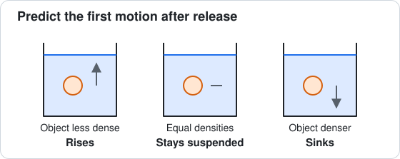

# S3 — Matter, fluids, and temperature: Learning

[Back to the Grade 9 index](../../README.md) · [Matter and fluids practice questions](2.%20Doing.md)

## 1. Use water to measure how much space an object takes up

The cylinder starts with 35 mL of water. When the cube goes fully under, it pushes water out of the space it now occupies and the level rises to 50 mL. This is **displacement**.

1. Read the water level before the cube goes in.
2. Read it again once the cube is fully under water, with no water spilled.
3. Subtract the first reading from the second. The rise is 50 − 35 = 15 mL, so the cube’s **volume** is 15 cm³. A cube 1 cm on each side takes up 1 cm³, the same space as 1 mL.

Look at what changed between readings. If a metal weight holds a cork fully under water, measure with the weight alone first. Then measure with both the weight and cork. The rise gives the cork’s volume. A trapped air bubble also pushes water aside, so it makes the measured volume too large.

- **Reading backwards.** If the reading with an object is 40 mL and you know its volume is 12 cm³, the water alone was at 40 − 12 = 28 mL. Removing the object brings the reading back down by the same amount.
- **Overflow.** If a full container spills 9 mL when an object goes fully under, that overflow gives a volume of 9 cm³.
- **Several identical objects.** If the reading rises 12 mL when you go from one marble to four, the three extra marbles displaced 12 mL. Each marble takes up 4 cm³.

## 2. Compare how much mass fits in the same space

The cubes are the same size. The scale shows that one has 20 g of **mass** and the other has 30 g. Mass describes how much matter, or material, is in a sample. **Density** compares how much mass is packed into the same amount of space.

Divide the mass by the volume. The first cube has 20 ÷ 10 = 2 grams in each cubic centimetre. The second has 30 ÷ 10 = 3 grams in each cubic centimetre. We write these as **2 g/cm³** and **3 g/cm³**. If you measure volume in millilitres, write **g/mL**.

Once you know a material’s density, you can work both ways. With 3 g in each cubic centimetre, 4 cm³ has 3 × 4 = 12 g of mass. If you start with 12 g instead, divide by 3 g/cm³ to get 4 cm³. If the material is liquid in a jar, subtract the empty jar’s mass from the filled jar’s mass before using the formula.

For equal masses, the smaller volume gives a higher density. If you halve a uniform block, you halve both its mass and its volume, so its density stays the same. If you divide a correct mass by a volume made too large by a bubble, the calculated density is too low.

**Make room in the cylinder.** If it starts at 31 mL and can hold up to 50 mL, there is room for 19 mL of displacement. An object of volume 22 cm³ needs 22 mL of room, so remove at least 3 mL of water.

## 3. Predict what an object does under water

Compare the object’s density with the liquid’s. An object released fully under the surface rises when it is less dense, sinks when it is denser, and can stay suspended when the densities match. Fresh water is about 1 g/cm³ in these questions.

For a sealed bottle, use its whole mass and full outside volume, including the space inside taken up by air. This gives its **average density**. If the object consists of two sealed parts, add the masses and add the volumes before dividing. To make a sealed object stay suspended, multiply the liquid’s density by the object’s full volume. That gives the total mass it needs.

**Try it.** The water in a cylinder rises from 42 mL to 66 mL when an 18 g sealed plastic counter is held under. Will it rise or sink when released?

**Check your thinking.** The counter takes up 66 − 42 = 24 cm³. Its density is 18 ÷ 24 = 0.75 g/cm³. It is less dense than water, so it rises.

## 4. Read temperatures and follow heat

In the first panel, the **thermometer** readings show how warm one sample is at two times. To find the drop, subtract the later reading from the earlier one. Here, 47 − 32 gives a drop of 15 °C. A temperature can start below zero. If it starts at −6 °C and warms by 11 °C, it reaches 5 °C.

Look at the second panel. At the same instant, two objects are touching. Energy moves from the warmer object to the cooler one. This transfer is **heat**. At the same temperature there is no overall heat transfer between them. If a thermometer reaches 32 °C in one cup, then moves to an 18 °C cup, energy initially moves from the thermometer to the cooler water.

Ice can stay at the same temperature while it **melts**. The energy added during melting changes solid ice into liquid water. Melting finishes when all the ice has become liquid.

## 5. Check what temperature readings can tell you

On a graph, find the readings at the requested times. For the greatest drop, compare the differences between each pair of neighbouring readings. Two samples that start at the same temperature can be compared by their final readings. The one that finishes higher warmed more.

- **Correct a steady error.** If a thermometer always reads 2 °C high, subtract 2 °C from each reading. Displayed readings of 20 °C and 25 °C become 18 °C and 23 °C. Both pairs show a rise of 5 °C.
- **Check a limit or a gap.** To test a promise about every recorded reading, compare each reading with the limit. Two recorded points tell you the change between those times, but several different paths can fit the same endpoints.

## Practice by skill

| Skill to review | Questions |
|---|---|
| Use displacement, overflow, and changes in water level | [Q01](2.%20Doing.md#s3-q01), [Q03](2.%20Doing.md#s3-q03), [Q08](2.%20Doing.md#s3-q08), [Q20](2.%20Doing.md#s3-q20), [Q26](2.%20Doing.md#s3-q26), [Q28](2.%20Doing.md#s3-q28) |
| Calculate and compare mass, volume, and density | [Q02](2.%20Doing.md#s3-q02), [Q06](2.%20Doing.md#s3-q06), [Q10](2.%20Doing.md#s3-q10), [Q12](2.%20Doing.md#s3-q12), [Q15](2.%20Doing.md#s3-q15), [Q16](2.%20Doing.md#s3-q16), [Q19](2.%20Doing.md#s3-q19), [Q22](2.%20Doing.md#s3-q22) |
| Use density to predict floating, sinking, or staying suspended | [Q07](2.%20Doing.md#s3-q07), [Q14](2.%20Doing.md#s3-q14), [Q25](2.%20Doing.md#s3-q25), [Q29](2.%20Doing.md#s3-q29) |
| Read temperatures, compare changes, and identify gaps in the record | [Q05](2.%20Doing.md#s3-q05), [Q09](2.%20Doing.md#s3-q09), [Q13](2.%20Doing.md#s3-q13), [Q18](2.%20Doing.md#s3-q18), [Q21](2.%20Doing.md#s3-q21), [Q27](2.%20Doing.md#s3-q27), [Q30](2.%20Doing.md#s3-q30) |
| Follow heat transfer and explain melting | [Q04](2.%20Doing.md#s3-q04), [Q11](2.%20Doing.md#s3-q11), [Q17](2.%20Doing.md#s3-q17), [Q23](2.%20Doing.md#s3-q23), [Q24](2.%20Doing.md#s3-q24) |

[Matter and fluids practice questions](2.%20Doing.md)
