# S3 — Matter, fluids, and temperature: Doing

[← Back to the index](../../README.md) · [Review the S3 learning page](1.%20Learning.md)

These are original practice questions. Answer on paper and mark guesses and skips before checking the key. Then record which answers were correct or wrong. Review guesses as well as misses. Save Q26–Q30 for the final weekend.

## Q01–Q05

### S3-Q01

A measuring cylinder contains 26 mL of water. Its reading rises to 39 mL when a pebble is fully under water. No water spills. What is the pebble's volume? Use 1 mL = 1 cm³.

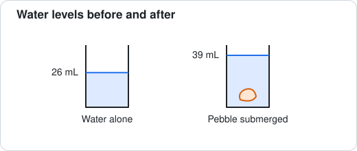

A. 65 cm³

B. 26 cm³

C. 39 cm³

D. 32.5 cm³

E. 13 cm³

### S3-Q02

Blocks H and J each have a volume of 12 cm³. H has a mass of 42 g and J has a mass of 30 g. How much denser is H?

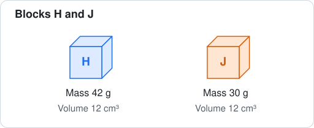

A. 12 g/cm³

B. 6 g/cm³

C. 1 g/cm³

D. 3.5 g/cm³

E. 2.5 g/cm³

### S3-Q03

A metal weight holds a cork fully under water. No water spills, and the thread is too thin to affect the readings. What is the cork’s volume? Use 1 mL = 1 cm³.

| Objects below the surface | Reading (mL) |
|---|---:|
| None | 35 |
| Weight | 46 |
| Weight and cork | 62 |

A. 46 cm³

B. 16 cm³

C. 11 cm³

D. 62 cm³

E. 27 cm³

### S3-Q04

A metal clip at 12 °C touches a dry tile at 19 °C. Which way does heat flow between them at first?

A. From the larger object regardless of temperature

B. Only from the object with more mass

C. From clip to tile

D. From tile to clip

E. Neither way until both reach 19 °C

### S3-Q05

Two samples cool for the same time. Which sample has the lower ending temperature, and which shows the greater drop?

| Sample | Start (°C) | End (°C) |
|---|---:|---:|
| K | 68 | 45 |
| L | 44 | 31 |

A. L ends lower and both drop equally.

B. L ends lower and L drops more.

C. K ends lower and L drops more.

D. L ends lower and K drops more.

E. K ends lower and K drops more.

## Q06–Q10

### S3-Q06

A 60 g mineral occupies 20 cm³. What mass would 7 cm³ of the same uniform mineral have?

A. 3 g

B. 47 g

C. 21 g

D. 7 g

E. 140 g

### S3-Q07

An object sinks in liquid X of density 0.80 g/cm³ but rises in liquid Y of density 1.20 g/cm³. Which value could be the object’s density?

A. 1.25 g/cm³

B. 0.70 g/cm³

C. 1.20 g/cm³

D. 0.80 g/cm³

E. 0.95 g/cm³

### S3-Q08

A fully submerged object occupies 18 cm³. The cylinder reading with the object present is 73 mL. No water spilled. What was the initial water reading? Use 1 mL = 1 cm³.

A. 36.5 mL

B. 18 mL

C. 55 mL

D. 91 mL

E. 73 mL

### S3-Q09

A thermometer always reads 3 °C too high. It reads 24 °C before a sample is heated and 38 °C afterward. Which pair gives the actual final temperature and the temperature rise?

A. 35 °C final, 17 °C rise

B. 35 °C final, 14 °C rise

C. 38 °C final, 14 °C rise

D. 35 °C final, 11 °C rise

E. 41 °C final, 14 °C rise

### S3-Q10

Two beads each have a mass of 8 g. The glass bead occupies 4 cm³, and the other bead occupies 10 cm³. Which has greater average density?

A. The bead with the greater surface area

B. More temperature data are needed.

C. They have equal density because their masses match.

D. The 10 cm³ bead

E. The glass bead

## Q11–Q15

### S3-Q11

A warm stone is surrounded by cooler air. Both eventually reach 22 °C. Which way, if any, is heat transferred overall between the stone and the air at that point?

A. Zero

B. From the stone to the air

C. Toward the object with smaller volume

D. From the air to the stone

E. Toward the object with greater density

### S3-Q12

A cylinder reads 22 mL initially and 38 mL with a bead fully underwater. A large air bubble is stuck to the bead. Mia uses the 16 mL rise as the bead's volume and divides its measured mass by that volume. Compared with the bead's true density, what does she get?

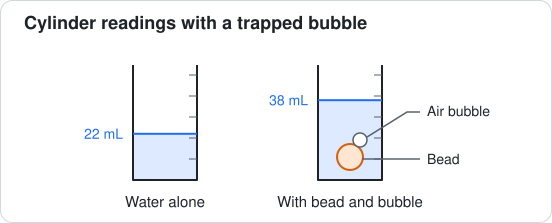

A. Too low because the measured volume includes the bubble

B. Correct because air has little mass

C. Correct because the bead is fully underwater

D. Too low because the bubble lowers the measured mass

E. Too high because the measured volume includes the bubble

### S3-Q13

A sample starts at −6 °C and warms by 11 °C. What is its final temperature?

A. −17 °C

B. 11 °C

C. 5 °C

D. 17 °C

E. −5 °C

### S3-Q14

A plastic block has a density of 1.1 g/cm³. In which liquid would it sink after being released under the surface?

A. A liquid of density 0.9 g/cm³

B. A liquid of density 1.2 g/cm³

C. A liquid of density 1.1 g/cm³

D. A liquid of density 1.4 g/cm³

E. A liquid of density 1.3 g/cm³

### S3-Q15

A measuring cylinder holds 28 mL of water and can be read up to 50 mL. A solid has a mass of 60 g and a density of 2.5 g/cm³. What is the smallest amount of water to pour out so the reading is at most 50 mL when the solid is fully under water? The solid fits and enough water remains to cover it. Use 1 mL = 1 cm³.

A. 2 mL

B. 0 mL

C. 22 mL

D. 4 mL

E. 24 mL

## Q16–Q20

### S3-Q16

A bottle and its liquid together have a mass of 140 g. The empty bottle has a mass of 35 g. The liquid occupies 70 mL. What is the liquid's density?

A. 3.0 g/mL

B. 1.5 g/mL

C. 0.5 g/mL

D. 0.67 g/mL

E. 2.0 g/mL

### S3-Q17

Three separate cups hold water at 8 °C, 18 °C and 32 °C. The same thermometer is moved directly from the 8 °C cup to the 32 °C cup. It reaches the cup's temperature at each stop. It is then moved to the 18 °C cup. Which way does heat initially flow at each move?

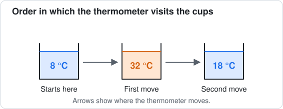

A. Into the thermometer, then out of it

B. Into the thermometer both times

C. Out of the thermometer, then into it

D. Out of the thermometer both times

E. Into the thermometer, then no net flow

### S3-Q18

A cooling sample is measured every two minutes. In which interval is the temperature drop greatest?

| Time (min) | 0 | 2 | 4 | 6 | 8 | 10 |
|---|---:|---:|---:|---:|---:|---:|
| Temperature (°C) | 76 | 70 | 58 | 50 | 45 | 42 |

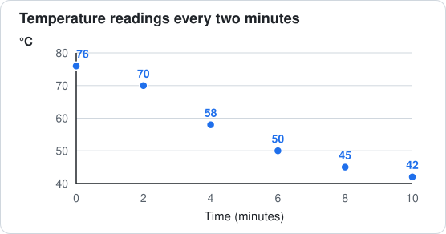

A. 4–6 min

B. 2–4 min

C. 0–2 min

D. 6–8 min

E. 8–10 min

### S3-Q19

A metal sample has density 4 g/cm³ and occupies 9 cm³. A wooden sample has density 0.8 g/cm³. What volume of wood would have the same mass as the metal?

A. 7.2 cm³

B. 36 cm³

C. 11.25 cm³

D. 45 cm³

E. 1.8 cm³

### S3-Q20

A chain is lowered completely into a container already full of water. A measuring cup catches 12 mL of spilled water. What is the chain’s volume? Use 1 mL = 1 cm³.

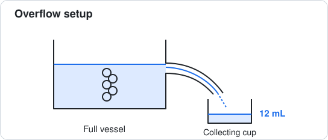

A. 24 cm³

B. The volume of water left in the vessel

C. 12 cm³

D. The vessel's full capacity

E. 6 cm³

## Q21–Q25

### S3-Q21

Two insulated containers start at the same temperature. A lamp warms each for four minutes. A rises by 8 °C and B reaches 34 °C. Which single extra observation is enough to decide which rose more?

A. The colour of container A

B. A's warming time

C. B's volume

D. B's starting temperature

E. The mass of container B

### S3-Q22

A 90 g piece of uniform clay is divided into three equal pieces with no air gaps added. The original clay density is 1.8 g/cm³. What is the density of one piece?

A. 5.4 g/cm³

B. 0.6 g/cm³

C. 1.8 g/cm³

D. 3.0 g/cm³

E. 30 g/cm³

### S3-Q23

A student sets a 24 °C spoon against a 30 °C plate. The spoon gains energy from the plate. Which observation would show that the direction of net heat transfer has reversed later?

A. The spoon is at 29 °C and the plate is at 26 °C.

B. The plate is now at 29 °C and the spoon remains at 24 °C.

C. The plate has a larger area than the spoon.

D. The spoon and plate are both at 27 °C.

E. The spoon has warmed to 25 °C and the plate is at 28 °C.

### S3-Q24

A chunk of ice at its melting temperature is heated steadily at ordinary air pressure. Its temperature stays level while some ice turns to liquid. Which explanation fits?

A. The thermometer must be broken.

B. The liquid is changing into ice.

C. No energy enters the sample during the level interval.

D. The sample is losing all its mass.

E. Energy is going into the change of state.

### S3-Q25

A sealed container has an outside volume of 25 cm³ and an empty mass of 12 g. How much mass should you add inside so it stays in place when released under a liquid with a density of 1.2 g/cm³?

A. 20.8 g

B. 18 g

C. 42 g

D. 30 g

E. 13 g

## Q26–Q30 · Final weekend

### S3-Q26

A measuring cylinder reads 41 mL with one marble under water and 56 mL with four identical marbles under the same water. No water spills. What was the reading before any marbles were added? Use 1 mL = 1 cm³.

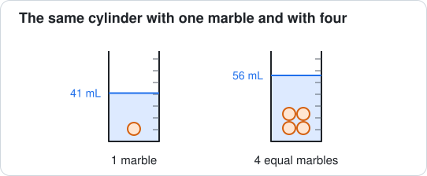

A. 21 mL

B. 26 mL

C. 37.25 mL

D. 36 mL

E. 41 mL

### S3-Q27

A cooler's label promises to keep a sample at or below 8 °C for every recorded reading on a trip. At departure the sample reads 5 °C. At the next three checks it reads 7, 9 and 6 °C. Which statement correctly evaluates the record?

A. The promise held because the average reading was below 8 °C.

B. The promise failed as soon as the sample reached 7 °C.

C. The promise held because the final reading was 6 °C.

D. The promise failed only if two consecutive readings exceeded 8 °C.

E. The promise failed at the 9 °C check.

### S3-Q28

The water in a tank reaches the 100 cm³ line while a solid of volume 15 cm³ is fully under water. You lift out the solid without taking out any water. How much water brings the level back to the line? Use 1 mL = 1 cm³.

A. 115 mL

B. 85 mL

C. 7.5 mL

D. 100 mL

E. 15 mL

### S3-Q29

A sealed two-part float has a 30 cm³ compartment of mass 36 g and a 70 cm³ compartment of mass 49 g. These volumes add to the whole outside volume. The float is released beneath a liquid of density 0.90 g/cm³. What happens?

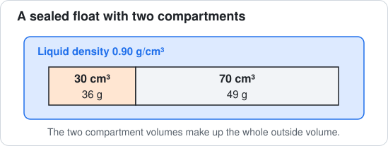

A. It sinks because the two compartment densities average to 0.95 g/cm³.

B. It rises because its overall density is 0.85 g/cm³.

C. It rises because the entire float's density is 0.70 g/cm³.

D. It sinks because the first compartment has density 1.20 g/cm³.

E. It stays suspended because one compartment would rise and the other would sink.

### S3-Q30

A thermometer records 19 °C at minute 2 and 25 °C at minute 6. What can you conclude about the temperature at minute 4 from these two readings alone?

A. It must have been below 22 °C.

B. It must have been 25 °C.

C. It must have been above 25 °C.

D. The exact temperature at minute 4 cannot be determined.

E. It must have been 22 °C.

## Answer key

[Go to the full solutions](#full-solutions)

| ID | Answer | Tier | Reasoning | Closest distractor ruled out by |
|---|---|---|---|---|
| S3-Q01 | E | Medium | The pebble raises the reading by 39 − 26 = 13 mL. | C. 39 mL includes the starting water. |
| S3-Q02 | C | Medium | The extra 12 g is spread over the same 12 cm³, giving 1 extra gram per cubic centimetre. | A. 12 g is the mass difference before dividing by volume. |
| S3-Q03 | B | Challenge | With the weight already in place, adding the cork raises the level from 46 to 62 mL. | E. The 27 mL total rise includes both objects. |
| S3-Q04 | D | Medium | The tile is warmer, so net heat flows to the cooler clip. | C. Metal can feel cold, but the measured temperatures determine the direction. |
| S3-Q05 | D | Challenge | L ends at 31 °C. K drops 23 °C and L drops 13 °C. | B. The colder ending reading alone cannot identify the larger drop. |
| S3-Q06 | C | Medium | Each cubic centimetre has mass 60 ÷ 20 = 3 g. Seven occupy 7 × 3 = 21 g. | A. 3 g is the mass of just one cubic centimetre. |
| S3-Q07 | E | Challenge | It must be denser than X and less dense than Y. Only 0.95 falls strictly between the two. | C. Equal density in Y would allow suspension rather than rising. |
| S3-Q08 | C | Medium | The original water accounts for 73 − 18 = 55 mL. | D. Adding 18 would count the object twice. |
| S3-Q09 | B | Challenge | Subtract 3 from each reading. The sample moves from 21 to 35 °C, a 14 °C rise. | D. The same offset cancels when the two readings are subtracted. |
| S3-Q10 | E | Medium | The same mass is packed into less volume in the glass bead. | C. Matching mass alone cannot establish matching density. |
| S3-Q11 | A | Medium | Equal temperatures give no net heat transfer. | B. The initial temperature difference has disappeared. |
| S3-Q12 | A | Challenge | The bubble displaces water alongside the bead. Dividing the same bead mass by an inflated volume gives too small a density. | E. Increasing the denominator lowers the quotient. |
| S3-Q13 | C | Medium | Six degrees of warming reach zero and the remaining five reach 5 °C. | D. Adding the magnitudes ignores the below-zero start. |
| S3-Q14 | A | Medium | The block sinks when it is denser than the surrounding liquid. | C. With equal densities the block can stay suspended. |
| S3-Q15 | A | Challenge | The solid occupies 60 ÷ 2.5 = 24 cm³. The predicted reading of 52 mL exceeds the limit by 2 mL. | E. 24 mL is the entire solid volume. The cylinder already has 22 mL of headroom. |
| S3-Q16 | B | Medium | The liquid has mass 105 g. Dividing by 70 mL gives 1.5 g/mL. | E. The full bottle mass includes the container. |
| S3-Q17 | A | Challenge | At 8 °C the thermometer gains energy from 32 °C water. At 32 °C it transfers energy to 18 °C water. | B. The thermometer enters the last cup at 32 °C, even though the first cup was colder than 18 °C. |
| S3-Q18 | B | Medium | The successive drops are 6, 12, 8, 5 and 3 °C. The largest is 12 °C. | C. The highest starting temperature does not guarantee the largest measured drop. |
| S3-Q19 | D | Challenge | The metal has mass 4 × 9 = 36 g. At 0.8 g per cm³, 36 g of wood fills 45 cm³. | A. Multiplying the wooden density by the metal volume compares equal volumes, not equal masses. |
| S3-Q20 | C | Medium | The vessel started full, so every cubic centimetre of chain pushed a matching volume out. | D. The capacity includes the water that remained behind. |
| S3-Q21 | D | Challenge | Subtract B's start from 34 °C and compare the resulting rise with 8 °C. | C. Volume alone gives no starting temperature. |
| S3-Q22 | C | Medium | Both mass and volume are divided by three, leaving their ratio unchanged. | B. Dividing only density by three treats volume as unchanged. |
| S3-Q23 | A | Medium | Heat flows to the plate only once its temperature is below the spoon's. | D. Equal readings mean zero net transfer, not a reversal. |
| S3-Q24 | E | Medium | Melting can absorb energy while temperature holds steady. | C. A level temperature reading does not imply zero energy input. |
| S3-Q25 | B | Challenge | For equal density the total mass must be 25 × 1.2 = 30 g. Subtract the empty 12 g. | D. 30 g is the loaded capsule's total mass. |
| S3-Q26 | D | Challenge | Three additional marbles account for 15 mL. One marble occupies 5 mL, so the original water reads 41 − 5 = 36 mL. | B. Subtracting all 15 mL from 41 removes three marbles when only one is present. |
| S3-Q27 | E | Medium | Each individual reading must meet the limit. The 9 °C reading exceeds it. | C. Ending below the limit cannot erase an earlier exceedance. |
| S3-Q28 | E | Medium | The added liquid fills the space vacated by the solid, equal to 15 cm³. | B. 85 mL describes the water originally sharing the volume under the line. |
| S3-Q29 | B | Challenge | The float has mass 85 g and volume 100 cm³. Its overall density is below the liquid's. | A. A simple average weights unequal-volume compartments equally. |
| S3-Q30 | D | Medium | The readings give no record of how fast the temperature changed within the interval. | E. The midpoint value 22 °C assumes a steady rate that was never stated. |

## Full solutions

Solve and mark each question before opening its solution. For a guess or miss, try the steps again on paper before comparing.

### S3-Q01 solution

**Answer E.** 13 cm³

1. Read the start and end: 26 and 39 mL.
2. Subtract 26 from 39 to get 13 mL displaced, or 13 cm³ of pebble volume.

**Closest distractor.** C. 39 mL includes the starting water.

### S3-Q02 solution

**Answer C.** 1 g/cm³

1. Compare the masses over the same volume: the difference is 12 g for 12 cm³.
2. Divide 12 by 12 to get a density difference of 1 g/cm³.

**Closest distractor.** A. 12 g is the mass difference before dividing by volume.

### S3-Q03 solution

**Answer B.** 16 cm³

1. Use 46 mL as the baseline because the weight is already submerged.
2. The cork raises the reading to 62 mL.
3. The cork alone displaces 62 − 46 = 16 mL.

**Closest distractor.** E. The 27 mL total rise includes both objects.

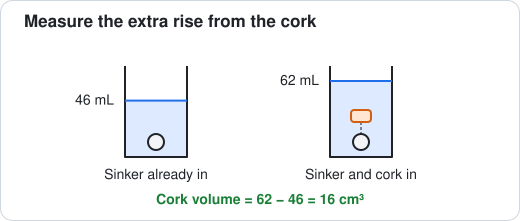

### S3-Q04 solution

**Answer D.** From tile to clip

1. Compare measured temperatures: the tile is warmer.
2. Net heat flows from warmer to cooler, so the tile initially transfers energy to the clip.

**Closest distractor.** C. Metal can feel cold, but the measured temperatures determine the direction.

### S3-Q05 solution

**Answer D.** L ends lower and K drops more.

1. Compute the drop for K to get 23 °C.
2. Use L's 31 °C finish to find its drop of 13 °C.
3. K's drop is greater by 10 °C.

**Closest distractor.** B. The colder ending reading alone cannot identify the larger drop.

### S3-Q06 solution

**Answer C.** 21 g

1. Find the density: 60 ÷ 20 = 3 g/cm³.
2. Multiply by the desired volume: 3 × 7 = 21 g.

**Closest distractor.** A. 3 g is the mass of just one cubic centimetre.

### S3-Q07 solution

**Answer E.** 0.95 g/cm³

1. Sinking in X requires density above X's.
2. Rising in Y requires density below Y's.
3. The option strictly between them is 0.95.

**Closest distractor.** C. Equal density in Y would allow suspension rather than rising.

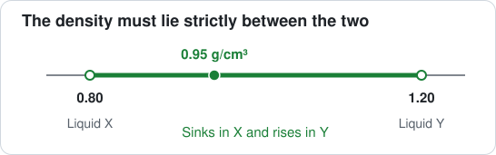

### S3-Q08 solution

**Answer C.** 55 mL

1. The final reading includes the original water and 18 mL displaced by the object.
2. Undo that rise: 73 − 18 = 55 mL.

**Closest distractor.** D. Adding 18 would count the object twice.

### S3-Q09 solution

**Answer B.** 35 °C final, 14 °C rise

1. Subtract the 3 °C error from each reading, obtaining 21 and 35 °C.
2. The increase is 35 − 21 = 14 °C. The equal correction cancels in the difference.

**Closest distractor.** D. The same offset cancels when the two readings are subtracted.

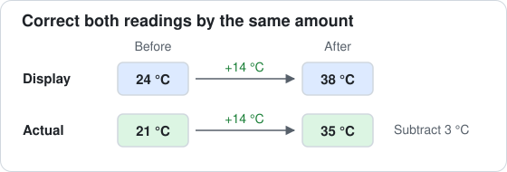

### S3-Q10 solution

**Answer E.** The glass bead

1. The objects have equal masses.
2. The glass bead packs that mass into less volume.
3. Dividing the same mass by a smaller volume gives higher density.

**Closest distractor.** C. Matching mass alone cannot establish matching density.

### S3-Q11 solution

**Answer A.** Zero

1. Check the temperatures at contact. They are equal.
2. Without a difference in temperature there is no net heat transfer.

**Closest distractor.** B. The initial temperature difference has disappeared.

### S3-Q12 solution

**Answer A.** Too low because the measured volume includes the bubble

1. The bubble raises the water reading along with the bead.
2. This inflates the calculated volume while the measured bead mass stays the same.
3. Dividing by too large a volume makes the calculated density too low.

**Closest distractor.** E. Increasing the denominator lowers the quotient.

### S3-Q13 solution

**Answer C.** 5 °C

1. Start at −6 °C and add 6 degrees to reach zero.
2. Use the remaining 5 of the 11 degrees gained to reach 5 °C.

**Closest distractor.** D. Adding the magnitudes ignores the below-zero start.

### S3-Q14 solution

**Answer A.** A liquid of density 0.9 g/cm³

1. A submerged block sinks if its density exceeds the liquid's density in this situation.
2. Look for the liquid whose density is lower than the block's.

**Closest distractor.** C. With equal densities the block can stay suspended.

### S3-Q15 solution

**Answer A.** 2 mL

1. Calculate the solid volume: 60 ÷ 2.5 = 24 cm³.
2. Add 24 mL to the initial 28 mL to predict 52 mL.
3. The predicted reading is 2 mL above the limit. Remove exactly 2 mL first to end at 50 mL.

**Closest distractor.** E. 24 mL is the entire solid volume. The cylinder already has 22 mL of headroom.

### S3-Q16 solution

**Answer B.** 1.5 g/mL

1. Subtract the empty container's mass to find 105 g of liquid.
2. Divide by its volume, 70 mL, to get 1.5 g/mL.

**Closest distractor.** E. The full bottle mass includes the container.

### S3-Q17 solution

**Answer A.** Into the thermometer, then out of it

1. Initially the thermometer at 8 °C is cooler than the 32 °C water and gains heat.
2. In the next contact the thermometer is at 32 °C and the water is at 18 °C.
3. Heat now transfers from the thermometer to the water.

**Closest distractor.** B. The thermometer enters the last cup at 32 °C, even though the first cup was colder than 18 °C.

### S3-Q18 solution

**Answer B.** 2–4 min

1. Subtract each later reading from its preceding reading.
2. The successive drops are 6, 12, 8, 5 and 3 °C.
3. The second drop is largest, at 12 °C.

**Closest distractor.** C. The highest starting temperature does not guarantee the largest measured drop.

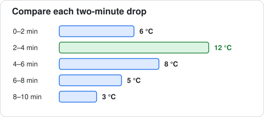

### S3-Q19 solution

**Answer D.** 45 cm³

1. The metal mass is 4 × 9 = 36 g.
2. The wood has that same mass and a density of 0.8 g/cm³.
3. Its volume is 36 ÷ 0.8 = 45 cm³.

**Closest distractor.** A. Multiplying the wooden density by the metal volume compares equal volumes, not equal masses.

### S3-Q20 solution

**Answer C.** 12 cm³

1. The vessel began full, leaving no spare room.
2. Each cubic centimetre of submerged chain pushes out the same volume of water.
3. Use the overflow to find the chain's submerged volume.

**Closest distractor.** D. The capacity includes the water that remained behind.

### S3-Q21 solution

**Answer D.** B's starting temperature

1. Subtract B's starting temperature from its final 34 °C.
2. Compare this change with the 8 °C rise for A.
3. The higher final temperature alone cannot tell which rise was larger.

**Closest distractor.** C. Volume alone gives no starting temperature.

### S3-Q22 solution

**Answer C.** 1.8 g/cm³

1. A third of the uniform sample has one third of the mass and one third of the volume.
2. In mass divided by volume, the factors of one third cancel.
3. The density is unchanged.

**Closest distractor.** B. Dividing only density by three treats volume as unchanged.

### S3-Q23 solution

**Answer A.** The spoon is at 29 °C and the plate is at 26 °C.

1. Find the first reading when the plate is strictly cooler than the spoon.
2. Net heat then flows from the warmer spoon to the cooler plate.
3. Equal temperatures give no net transfer.

**Closest distractor.** D. Equal readings mean zero net transfer, not a reversal.

### S3-Q24 solution

**Answer E.** Energy is going into the change of state.

1. The substance still receives energy during the flat portion.
2. While it melts, that energy changes its state while the temperature stays steady.

**Closest distractor.** C. A level temperature reading does not imply zero energy input.

### S3-Q25 solution

**Answer B.** 18 g

1. Find the target total mass: 25 × 1.2 = 30 g.
2. The empty object contributes 12 g.
3. Add the difference, 18 g.

**Closest distractor.** D. 30 g is the loaded capsule's total mass.

### S3-Q26 solution

**Answer D.** 36 mL

1. Three extra marbles raise the reading by 15 mL.
2. One marble accounts for 5 mL.
3. Subtract that from the 41 mL reading to recover 36 mL of original water.

**Closest distractor.** B. Subtracting all 15 mL from 41 removes three marbles when only one is present.

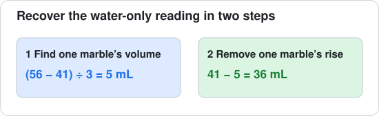

### S3-Q27 solution

**Answer E.** The promise failed at the 9 °C check.

1. Apply the limit to each reading individually.
2. The 9 °C reading exceeds the limit.
3. A lower average cannot erase that violation.

**Closest distractor.** C. Ending below the limit cannot erase an earlier exceedance.

### S3-Q28 solution

**Answer E.** 15 mL

1. The water level must be restored after the solid is removed.
2. The added liquid fills the 15 cm³ the object used to occupy.
3. That is 15 mL.

**Closest distractor.** B. 85 mL describes the water originally sharing the volume under the line.

### S3-Q29 solution

**Answer B.** It rises because its overall density is 0.85 g/cm³.

1. Use total mass and volume: 85 g ÷ 100 cm³ = 0.85 g/cm³.
2. Compare this overall density to the liquid's.
3. The float is less dense, so it floats.

**Closest distractor.** A. A simple average weights unequal-volume compartments equally.

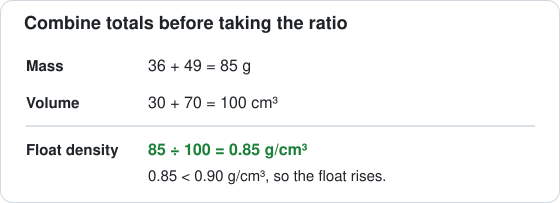

### S3-Q30 solution

**Answer D.** The exact temperature at minute 4 cannot be determined.

1. The endpoints give just the total change.
2. Several paths with different rates can join those two readings.
3. The rate within the interval cannot be determined without more measurements.

**Closest distractor.** E. The midpoint value 22 °C assumes a steady rate that was never stated.

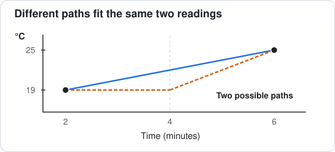
