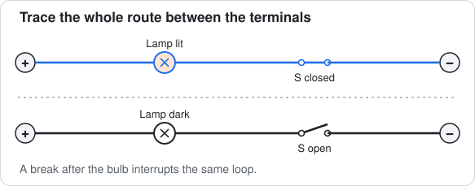
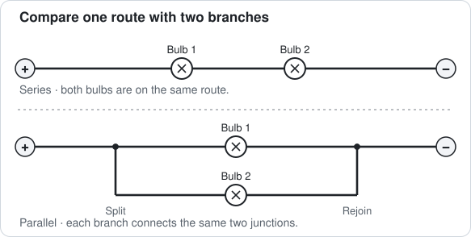
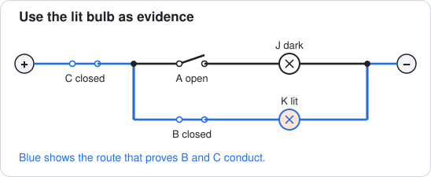
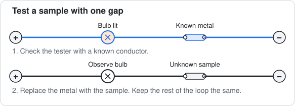
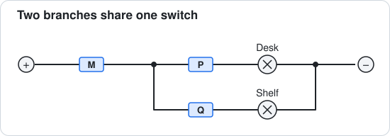

# Circuits and switches

[Back to the Grade 9 index](../../README.md) · [Circuit practice questions](2.%20Doing.md)

## 1. Follow one loop

Why does the lamp go dark when the gap comes **after** it? Compare these two versions of the same circuit.

1. **Start at the battery.** Its two connection points, or **terminals**, are marked (+) and (−). The lines are wires. The circle with an X is the lamp.
2. **Trace through the lamp.** In the upper drawing, you can go from (+) along the wire, through the lamp, across switch S, and back to (−). This completes a loop through the battery. Electric charge can flow around the loop. This flow is called **current**, and the current through the lamp lights it.
3. **Look for a gap.** In the lower drawing, the switch arm touches only one of its two contacts. The switch is **open**, so the path stops there. **Closing** the switch joins its contacts again.

A broken wire, a broken wire inside a bulb, and an empty bulb socket can all interrupt a loop. In a diagram, drawing a wire across both contacts of an open switch gives current a way around that gap. A labelled switch box means you need to read or work out its state. Assume the battery, bulbs, and wires work unless the question describes a fault.

## 2. Trace one path at a time

Follow the path through Bulb 1 in each drawing. At a filled dot called a **junction**, the wires split or rejoin.

- **Top, one path in series.** The route passes through Bulb 1 and Bulb 2. Removing either bulb leaves a gap in the only route, so both go dark.
- **Bottom, two paths in parallel.** Each bulb has its own **branch** between the split and the rejoin. If Bulb 1 is removed, Bulb 2 still has a complete path. A break on the wire before the split or after the rejoin interrupts both paths.

Use the same idea with switches. Two switches in series must **both** close to complete that route. With a switch on each of two parallel routes leading to the same lamp, **either** closed switch can provide a path. A **selector** connects only to the route it touches. If two selectors sit at opposite ends of two separate tracks, they complete the circuit by touching the same track.

**Check one change at a time.** If you may flip exactly one switch, start from the original settings for every trial. If two switches in series close at different times, find the times on both lists. For example, if one closes in seconds 1 and 3 and the other in seconds 2 and 3, their route is complete in second 3.

## 3. Use a lit bulb to find the gap

Bulb K is lit, and bulb J is dark. Look at what the two paths share.

1. Follow the lit path through C and B to bulb K. Both switches have to conduct.
2. The dark path to J uses C too. With C already working, look for a break on J’s branch. The drawing shows open switch A there.

If the dark branch had two switches whose states you could not see, you could tell at least one was open. To identify which one, you would need another observation.

## 4. Test whether a material conducts

A **conductor**, such as copper, lets current pass. An **insulator**, such as dry plastic, blocks current in these circuits. The tester below has one deliberate gap in the wire.

1. Bridge both contacts with a known conductor. The bulb lights, showing the tester works.
2. Put the sample in the same place. If its two contacts are connected through conducting material, the bulb lights. An unbroken copper strip with a plastic sleeve in the middle can still light it if its bare metal ends touch both contacts.

With two test gaps, fill one with known metal while you test a sample in the other. Use the same idea to trace connections. Clip onto just one unknown wire and see which bulb lights. To find a joined pair of pins, test two pins at a time and cross off each pair that leaves the bulb dark in a working tester.

## 5. Worked example

A reading lamp has a desk bulb and a shelf bulb. Which switch settings light only the desk bulb?

The settings are listed in the order M, P, Q.

A. Open, closed, open

B. Closed, closed, closed

C. Closed, closed, open

D. Closed, open, closed

E. Open, closed, closed

**Answer C.**

1. Trace the desk route from (+) through M and P, then Desk, and back to (−). Both M and P must be closed.
2. Trace the shelf route through M and Q. Open Q to leave this route broken.
3. Check the shared wire. Opening Q leaves the desk route complete. In choice A, opening M breaks both routes before they split.

## Practice by skill

| Skill to review | Questions |
|---|---|
| Trace complete routes through switches, gaps, and bulbs | [Q01](2.%20Doing.md#s4-q01), [Q02](2.%20Doing.md#s4-q02), [Q06](2.%20Doing.md#s4-q06), [Q08](2.%20Doing.md#s4-q08), [Q09](2.%20Doing.md#s4-q09), [Q11](2.%20Doing.md#s4-q11), [Q13](2.%20Doing.md#s4-q13), [Q14](2.%20Doing.md#s4-q14), [Q16](2.%20Doing.md#s4-q16), [Q17](2.%20Doing.md#s4-q17), [Q18](2.%20Doing.md#s4-q18), [Q22](2.%20Doing.md#s4-q22), [Q28](2.%20Doing.md#s4-q28), [Q29](2.%20Doing.md#s4-q29) |
| Use observations to narrow down the possible switch or wire states | [Q03](2.%20Doing.md#s4-q03), [Q05](2.%20Doing.md#s4-q05), [Q10](2.%20Doing.md#s4-q10), [Q12](2.%20Doing.md#s4-q12), [Q19](2.%20Doing.md#s4-q19), [Q21](2.%20Doing.md#s4-q21), [Q25](2.%20Doing.md#s4-q25) |
| Test one connection or material at a time | [Q04](2.%20Doing.md#s4-q04), [Q07](2.%20Doing.md#s4-q07), [Q15](2.%20Doing.md#s4-q15), [Q20](2.%20Doing.md#s4-q20), [Q24](2.%20Doing.md#s4-q24), [Q27](2.%20Doing.md#s4-q27), [Q30](2.%20Doing.md#s4-q30) |
| Check one switch change or time interval at a time | [Q23](2.%20Doing.md#s4-q23), [Q26](2.%20Doing.md#s4-q26) |

[Circuit practice questions](2.%20Doing.md)
