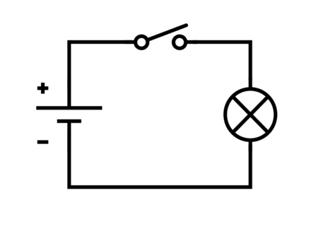
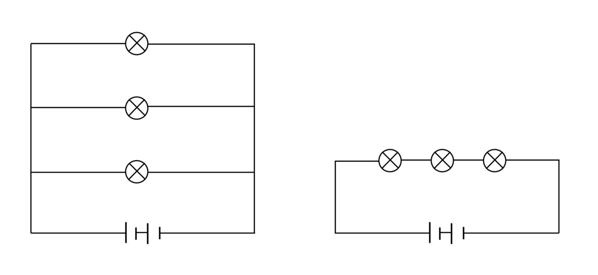

# Circuits and switches

[Back to the Grade 9 index](../../README.md) · [Circuit practice questions](2.%20Doing.md)

## 1. Read a circuit from the battery

*[Cell, switch and incandescent bulb](https://commons.wikimedia.org/wiki/File:Cell,_switch_and_incandescent_bulb.svg) by Rob Kam, [CC BY 4.0](https://creativecommons.org/licenses/by/4.0/). Rendered on white.*

1. Find the **cell**, the electricity source. Its two ends are called **terminals**. The long line marks positive (+), and the short line marks negative (−). A battery supplies energy to the circuit.
2. Follow the straight lines, which stand for wires. The circle with an X stands for the **lamp**. A complete route from one terminal through the lamp to the other terminal lets electric charge flow. This flow is called **current**.
3. At the top, the angled arm leaves a gap. That is an **open switch**. There is no complete loop, so the lamp is off. A **closed switch** joins both contacts and completes this part of the route.

A broken wire, a break inside the bulb or an empty bulb socket can interrupt a route too. If a wire joins both contacts of an open switch, it provides a way around that gap. In the practice diagrams a labelled switch box asks you to read or infer the switch state. Assume the battery, lamp and wires work unless a fault is described.

## 2. Compare one path with several paths

*[Series and Parallel Circuit](https://commons.wikimedia.org/wiki/File:Series_and_Parallel_Circuit.jpg) by Brightyellowjeans, [CC BY-SA 4.0](https://creativecommons.org/licenses/by-sa/4.0/). Resized for this page.*

- **Right, series.** Start at the battery and follow the single route. It passes through all three lamps in order. Removing one leaves a gap, so there is no complete route through any of them.
- **Left, parallel.** At a **junction**, the route splits into separate **branches**. Each branch has a lamp. The branches join again before the terminal. Removing one lamp breaks its branch only. The other lamps still have complete paths. A break on wire shared by every branch interrupts all those paths.

Two switches in series must **both** close to complete the route. If two separate switch branches rejoin before the same lamp, **either** branch can provide a complete route. A **selector** connects only to the track it touches. If two selectors sit at opposite ends of two separate tracks, both must touch the same track to complete the route.

**Try it over time.** One switch in a series route is closed in seconds 1 and 3. The other is closed in seconds 2 and 3. The route works in second 3, the only time on both lists. If the question instead lets you flip exactly one switch, start each trial from the original settings.

## 3. Use a lit lamp to find a break

Imagine two parallel lamp branches. Each lamp has its own switch, and a third switch is on the wire shared by both. The desk lamp is lit and the shelf lamp is dark.

1. Trace the route through the desk lamp. The shared switch and the desk switch must both be closed.
2. The shelf branch uses the same shared switch. Since the shared part works, look for the gap on the shelf branch. If that branch has just one switch and the lamp and wires work, its switch is open.
3. If there are two unknown switches on the dark branch, one or both could be open. You would need another observation to tell which one.

## 4. Test what lets current pass

A **conductor** lets current pass, as copper does. An **insulator**, such as dry plastic, blocks current in these circuits. To test a material, use one gap in a working battery-and-lamp loop.

1. Bridge the gap with known metal. A lit lamp confirms that the tester works.
2. Place the sample across the same contacts. The lamp lights if those contacts are joined through conducting material. A copper strip with a plastic sleeve can still conduct if bare copper at both ends touches the two contacts.
3. For a tester with two gaps, bridge one with known metal and test the sample at the other. To identify a wire, clip onto **one** wire and see which lamp lights. To find which two pins are joined, test one pair at a time and rule out the pairs that leave a working tester dark.

## Practice by skill

| Skill to review | Questions |
|---|---|
| Trace complete routes through switches, gaps, and bulbs | [Q01](2.%20Doing.md#s4-q01), [Q02](2.%20Doing.md#s4-q02), [Q06](2.%20Doing.md#s4-q06), [Q08](2.%20Doing.md#s4-q08), [Q09](2.%20Doing.md#s4-q09), [Q11](2.%20Doing.md#s4-q11), [Q13](2.%20Doing.md#s4-q13), [Q14](2.%20Doing.md#s4-q14), [Q16](2.%20Doing.md#s4-q16), [Q17](2.%20Doing.md#s4-q17), [Q18](2.%20Doing.md#s4-q18), [Q22](2.%20Doing.md#s4-q22), [Q28](2.%20Doing.md#s4-q28), [Q29](2.%20Doing.md#s4-q29) |
| Use observations to narrow down the possible switch or wire states | [Q03](2.%20Doing.md#s4-q03), [Q05](2.%20Doing.md#s4-q05), [Q10](2.%20Doing.md#s4-q10), [Q12](2.%20Doing.md#s4-q12), [Q19](2.%20Doing.md#s4-q19), [Q21](2.%20Doing.md#s4-q21), [Q25](2.%20Doing.md#s4-q25) |
| Test one connection or material at a time | [Q04](2.%20Doing.md#s4-q04), [Q07](2.%20Doing.md#s4-q07), [Q15](2.%20Doing.md#s4-q15), [Q20](2.%20Doing.md#s4-q20), [Q24](2.%20Doing.md#s4-q24), [Q27](2.%20Doing.md#s4-q27), [Q30](2.%20Doing.md#s4-q30) |
| Check one switch change or time interval at a time | [Q23](2.%20Doing.md#s4-q23), [Q26](2.%20Doing.md#s4-q26) |

[Circuit practice questions](2.%20Doing.md)
