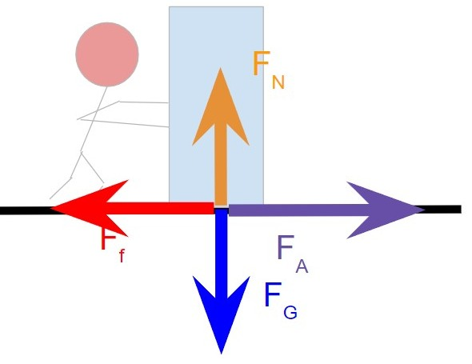
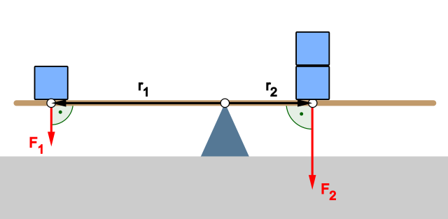

# Forces and balance

[Back to the Grade 9 index](../../README.md) · [Forces and balance practice questions](2.%20Doing.md)

## 1. Follow the pushes and pulls on one object

*[Freebodydiagram](https://commons.wikimedia.org/wiki/File:Freebodydiagram.jpg) by Hkakanis, [CC BY-SA 4.0](https://creativecommons.org/licenses/by-sa/4.0/). Cropped to show the illustrated forces.*

A **force** is a push or pull. It has a size, measured in **newtons** (N), and a direction, shown by an arrow. Look at the fridge.

1. **Up and down.** Gravity pulls it downward. This force is its **weight**. The floor pushes upward with a **support force**. The fridge stays on the floor, so the upward and downward forces balance.
2. **Left and right.** The person pushes it right. **Friction** from the floor resists sliding and acts left. Add forces in each direction before comparing the two totals. If the push is 12 N right and friction is 8 N left, the **net force** is 4 N right.
3. **Force and motion.** A fridge already moving right speeds up with a rightward net force. A leftward net force makes it slow down while it is still moving right. With zero net force, an object at rest stays at rest and a moving object keeps its speed and direction.

The same method works vertically. If two straps pull up with 4 N and 7 N and hold a bag still, the total upward force is 11 N and balances 11 N of weight. If a shelf is removed from under a book and air resistance is ignored, the upward support is gone and the net force is the book’s downward weight.

## 2. Find the pivot and measure from it

*[Seesaw torque equilibrium](https://commons.wikimedia.org/wiki/File:Seesaw-torque-equilibrium.svg) by MikeRun, [CC BY-SA 4.0](https://creativecommons.org/licenses/by-sa/4.0/).*

A **lever** is a rigid part that turns around a point called a **pivot**. Find the triangular support in the seesaw. It marks the pivot. In scissors, the screw is the pivot, your fingers supply the **effort** at the handles, and the material at the blades is the **load** the tool acts against. In a wheelbarrow, use the wheel axle as the pivot when the handles rise.

The red arrows show the downward forces from the blocks. The distances from the pivot are labelled r₁ and r₂. The left load is smaller but farther away. For a push at a right angle to a lever, calculate its **turning effect** (also called **torque**) by multiplying **force × distance from the pivot**.

- At 3 cm from the pivot, a 4 N force produces 12 newton-centimetres (N·cm). At twice the distance the same force produces twice the turn. A push straight toward the pivot, or a force acting at the pivot, gives zero turning effect.
- If a pivot is at mark 5 and a force acts at mark 2, count 5 − 2 = 3 spaces. On diagrams that label positions relative to the pivot, **L3** means three marks left and **R2** means two marks right. When distance is measured in marks, these exercises use **N-marks**. For centimetres to metres, divide by 100.
- Looking down at a handle, pushing its right end toward the top of the page turns it anticlockwise. The same push at the same distance on the left turns it clockwise.

## 3. Match the turning effects

The left block tips the seesaw one way and the two right blocks tip it the other way. The beam balances when the total turns in opposite directions match. Add all turns on each side. If a load moves or the pivot moves, measure the affected distances again. To keep the same turn at half the distance, you need twice the force.

**Try it.** A level beam has a 6 N load two marks left of the pivot and a 2 N load three marks right. You can add a 3 N load. Where should it hang to balance the beam?

1. The left turn is 6 × 2 = 12 N-marks. The right turn starts at 2 × 3 = 6 N-marks.
2. The right side needs another 6 N-marks. Divide that missing turn by the new 3 N force. The distance is 6 ÷ 3 = 2 marks.
3. Hang the new load at **R2**. The right turn becomes 6 + 3 × 2 = 12 N-marks, matching the left turn.

## Practice by skill

| Skill to review | Questions |
|---|---|
| Identify the pivot, load, and effort on a lever | [Q02](2.%20Doing.md#s5-q02), [Q17](2.%20Doing.md#s5-q17), [Q21](2.%20Doing.md#s5-q21) |
| Combine forces and explain what happens to motion | [Q04](2.%20Doing.md#s5-q04), [Q07](2.%20Doing.md#s5-q07), [Q12](2.%20Doing.md#s5-q12), [Q15](2.%20Doing.md#s5-q15), [Q19](2.%20Doing.md#s5-q19), [Q23](2.%20Doing.md#s5-q23), [Q27](2.%20Doing.md#s5-q27), [Q29](2.%20Doing.md#s5-q29) |
| Use force and distance to find or compare turning effects | [Q08](2.%20Doing.md#s5-q08), [Q09](2.%20Doing.md#s5-q09), [Q11](2.%20Doing.md#s5-q11), [Q13](2.%20Doing.md#s5-q13), [Q14](2.%20Doing.md#s5-q14), [Q16](2.%20Doing.md#s5-q16), [Q22](2.%20Doing.md#s5-q22), [Q24](2.%20Doing.md#s5-q24), [Q28](2.%20Doing.md#s5-q28), [Q30](2.%20Doing.md#s5-q30) |
| Balance a beam and recalculate when a load or pivot moves | [Q01](2.%20Doing.md#s5-q01), [Q03](2.%20Doing.md#s5-q03), [Q05](2.%20Doing.md#s5-q05), [Q06](2.%20Doing.md#s5-q06), [Q10](2.%20Doing.md#s5-q10), [Q18](2.%20Doing.md#s5-q18), [Q20](2.%20Doing.md#s5-q20), [Q25](2.%20Doing.md#s5-q25), [Q26](2.%20Doing.md#s5-q26) |

[Forces and balance practice questions](2.%20Doing.md)
