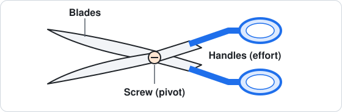
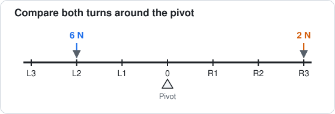

# Forces and balance

[Back to the Grade 9 index](../../README.md) · [Forces and balance practice questions](2.%20Doing.md)

## 1. Separate the forces from the motion

The cart is rolling to the right. The arrows on either side show the only horizontal pushes or pulls on it. Each push or pull is a **force**, measured in **newtons** (N).

1. **Combine the forces.** Add the forces pointing in each direction, then subtract the smaller total from the larger one. The result is the **net force**. Here it is 6 − 3 = 3 N left.
2. **Compare with the motion.** The cart is already moving right. The leftward force slows it down while it is still moving right. If the net force pointed right, the cart would speed up. With zero net force, an object at rest stays at rest and a moving object keeps its speed and direction.

**Try pulling up and down.** A bag’s **weight** is the downward force of gravity. If two straps hold a bag still and pull up with 4 N and 7 N, together they balance 11 N of weight. If the bag holds 2 N of gear, the empty bag weighs 11 − 2 = 9 N. A shelf pushes up on a book while they touch. If the shelf is removed and air resistance is ignored, the book is left with a net downward force equal to its weight.

## 2. Find the part that stays in place

Open a pair of scissors and watch the handles, the screw, and the blades.

- The rigid parts that turn are **levers**. The screw is the **pivot**, the point they turn around.
- Your fingers apply the **effort**, the push or pull that makes the levers move.
- The material at the blades is the **load**, what the levers work against. For a wheelbarrow, find what stays in place while the handles and the load rise. The barrow turns about the wheel’s axle.

## 3. Measure how far the force is from the pivot

Push a door at a right angle to its face. With the same push, the handle turns the door more easily than a point near the hinge. Pushing straight toward the hinge gives zero turning effect.

1. Find the pivot. Here it is at mark 5. Count spaces from there to each load. The distances are 5 − 2 = 3 marks and 7 − 5 = 2 marks.
2. For a force at a right angle to a lever, multiply **force × distance from the pivot**. Downward loads act at a right angle to a level beam. The left load gives 4 × 3 = 12 N-marks. The right load gives 3 × 2 = 6 N-marks.
3. The left load has the larger turning effect, so the left end starts to drop. A load at the pivot gives zero turning effect because its distance is zero.

When the distance is measured in centimetres, the turning effect is in **newton-centimetres** (N·cm). For example, 4 N at 3 cm gives 12 N·cm. To find an unknown distance, divide the turning effect by the force. Divide centimetres by 100 if the answer is needed in metres. In diagrams with equally spaced marks, **L3** means three marks left of the pivot and **R2** means two marks right.

**From above.** Imagine a handle pointing right from a central pivot. Push its right end toward the top of the page and it turns anticlockwise. An equal push towards the top at the same distance on the left turns it clockwise by the same amount.

## 4. Compare the total turns

Several loads can pull down on one side of a beam. Find the turning effect of each load, then add the effects on that side.

The left total is 9 + 3 = 12 N-marks. The right total is also 12 N-marks. These turns act in opposite directions, so the beam stays level.

**What changes when something moves?** Halving a load’s distance halves its turning effect. To match the same turn at half the distance, double the force. If the pivot itself moves, measure the distance to **each** load from the new pivot. When a load is missing, find the turning effect its side needs, then divide by its distance to find the force.

## 5. Worked example

A beam rests level on a pivot at 0. The marks are evenly spaced, and the beam’s own weight can be ignored. A 6 N load hangs at L2 and a 2 N load hangs at R3. Where should a 3 N load hang to keep the beam level?

A. L2

B. R1

C. R2

D. R3

E. R4

**Answer C.**

1. Find the current turning effects. Left is 6 × 2 = 12 N-marks. Right is 2 × 3 = 6 N-marks.
2. The right side needs 12 − 6 = 6 more N-marks. A 3 N load needs to hang 6 ÷ 3 = 2 marks from the pivot.
3. Check R2. The right side now adds up to 6 + (3 × 2) = 12 N-marks, equal to the left. Choice E adds 12 N-marks to the right side, which already has 6.

## Practice by skill

| Skill to review | Questions |
|---|---|
| Identify the pivot, load, and effort on a lever | [Q02](2.%20Doing.md#s5-q02), [Q17](2.%20Doing.md#s5-q17), [Q21](2.%20Doing.md#s5-q21) |
| Combine forces and explain what happens to motion | [Q04](2.%20Doing.md#s5-q04), [Q07](2.%20Doing.md#s5-q07), [Q12](2.%20Doing.md#s5-q12), [Q15](2.%20Doing.md#s5-q15), [Q19](2.%20Doing.md#s5-q19), [Q23](2.%20Doing.md#s5-q23), [Q27](2.%20Doing.md#s5-q27), [Q29](2.%20Doing.md#s5-q29) |
| Use force and distance to find or compare turning effects | [Q08](2.%20Doing.md#s5-q08), [Q09](2.%20Doing.md#s5-q09), [Q11](2.%20Doing.md#s5-q11), [Q13](2.%20Doing.md#s5-q13), [Q14](2.%20Doing.md#s5-q14), [Q16](2.%20Doing.md#s5-q16), [Q22](2.%20Doing.md#s5-q22), [Q24](2.%20Doing.md#s5-q24), [Q28](2.%20Doing.md#s5-q28), [Q30](2.%20Doing.md#s5-q30) |
| Balance a beam and recalculate when a load or pivot moves | [Q01](2.%20Doing.md#s5-q01), [Q03](2.%20Doing.md#s5-q03), [Q05](2.%20Doing.md#s5-q05), [Q06](2.%20Doing.md#s5-q06), [Q10](2.%20Doing.md#s5-q10), [Q18](2.%20Doing.md#s5-q18), [Q20](2.%20Doing.md#s5-q20), [Q25](2.%20Doing.md#s5-q25), [Q26](2.%20Doing.md#s5-q26) |

[Forces and balance practice questions](2.%20Doing.md)
