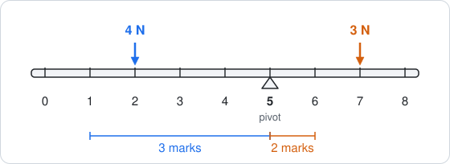
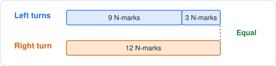

# Forces and balance

[Back to the Grade 9 index](../../README.md) · [Forces and balance practice questions](2.%20Doing.md)

## Rules at a glance

| If the question asks… | What to do |
|---|---|
| Which way will the motion change? | Add forces in each direction and subtract the smaller total from the larger. The difference acts toward the larger total. |
| How strongly does a push turn something? | For a push at a right angle to the handle or beam, multiply the force by its distance from the pivot. |
| Will the beam balance? | Add the turning effects that lower each side. The beam balances when the totals match. |

## 1. A force is a push or a pull

A **force** is a push or a pull. Its strength is measured in **newtons** (N). A force arrow points in the direction of the push or pull. **Net force** means the overall force after combining the pushes and pulls. Pull a sled 8 N left and 5 N right along the same line. The net force is 8 − 5 = 3 N left.

If the forces along a line cancel, the net force along that line is zero. A resting object stays still if its total net force is zero. An object already moving keeps going at the same speed in the same direction. For example, when a book rests on a shelf, gravity pulls it down and the shelf pushes it up with an equal force.

The cart shown is moving right and has a net force to the left. It slows down before it can change direction. Read the motion arrow and force arrows separately.

**Weight** is the downward force of gravity on an object. A table can push back on a book only while they touch. When the table is removed and air resistance is ignored, the book’s net force is its downward weight. If two straps hold a bag still, add both upward pulls. Their sum equals the downward weight of everything the straps support.

## 2. Find the pivot and the load

A **lever** is a rigid part that can turn around a point called a **pivot**. The screw in a pair of scissors and the hinge of a door are pivots. The **effort** is the push or pull someone supplies. The **load** is what the lever moves or works against.

## 3. Compare turning effects

Try opening a door by pushing straight across its edge, first near the hinge and then at the handle. The same push turns the door more strongly at the handle because the handle is farther from the hinge. A push directly toward the hinge gives zero turning effect.

For a vertical pull on a level beam, multiply the force by its **horizontal distance from the pivot**. If a 4 N weight hangs 3 cm from the pivot, its turning effect is 4 × 3 = 12 N·cm, or 12 newton-centimetres. When a diagram shows evenly spaced marks without centimetres, count the marks from the pivot. Multiply newtons by marks to get **N-marks**. L3 means three marks left of the pivot and R2 means two marks right. When an answer asks for metres, divide centimetres by 100 because 1 m = 100 cm.

### Keep a beam level

Downward loads to the left of a pivot try to lower the left end. Downward loads to the right try to lower the right end. Calculate each load’s turning effect and add the contributions on the same side. The beam balances if both totals match. A load directly over the pivot has zero distance, so it adds zero turning effect.

**Match the turns.** The same load produces half the turn if its distance from the pivot is halved. If one load hangs twice as far from the pivot as another, the nearer load must be twice as heavy for balance. When the pivot moves, measure both distances again before multiplying.

**Read a top view.** Imagine a horizontal handle pointing right from a central pivot. Pushing its right end up the page turns it anticlockwise. An equal push up the page at the same distance on the left turns it clockwise. A push straight toward the centre has zero turning effect.

## 4. Worked example

A beam rests level on a pivot at 0. The marks are evenly spaced, and the beam’s own weight can be ignored. A 6 N load hangs at L2 and a 2 N load hangs at R3. Where should a 3 N load hang to keep the beam level?

A. L2

B. R1

C. R2

D. R3

E. R4

**Answer C.**

1. Find the current turning effects. Left is 6 × 2 = 12 N-marks. Right is 2 × 3 = 6 N-marks.
2. The right side needs 12 − 6 = 6 more N-marks. A 3 N load needs to hang 6 ÷ 3 = 2 marks from the pivot.
3. Check R2. The right side now adds up to 6 + (3 × 2) = 12 N-marks, equal to the left. Choice E adds 12 N-marks to the right side, which already has 6.

## Practice by skill

| Skill to review | Questions |
|---|---|
| Identify the pivot, load, and effort on a lever | [Q02](2.%20Doing.md#s5-q02), [Q17](2.%20Doing.md#s5-q17), [Q21](2.%20Doing.md#s5-q21) |
| Combine forces and explain what happens to motion | [Q04](2.%20Doing.md#s5-q04), [Q07](2.%20Doing.md#s5-q07), [Q12](2.%20Doing.md#s5-q12), [Q15](2.%20Doing.md#s5-q15), [Q19](2.%20Doing.md#s5-q19), [Q23](2.%20Doing.md#s5-q23), [Q27](2.%20Doing.md#s5-q27), [Q29](2.%20Doing.md#s5-q29) |
| Use force and distance to find or compare turning effects | [Q08](2.%20Doing.md#s5-q08), [Q09](2.%20Doing.md#s5-q09), [Q11](2.%20Doing.md#s5-q11), [Q13](2.%20Doing.md#s5-q13), [Q14](2.%20Doing.md#s5-q14), [Q16](2.%20Doing.md#s5-q16), [Q22](2.%20Doing.md#s5-q22), [Q24](2.%20Doing.md#s5-q24), [Q28](2.%20Doing.md#s5-q28), [Q30](2.%20Doing.md#s5-q30) |
| Balance a beam and recalculate when a load or pivot moves | [Q01](2.%20Doing.md#s5-q01), [Q03](2.%20Doing.md#s5-q03), [Q05](2.%20Doing.md#s5-q05), [Q06](2.%20Doing.md#s5-q06), [Q10](2.%20Doing.md#s5-q10), [Q18](2.%20Doing.md#s5-q18), [Q20](2.%20Doing.md#s5-q20), [Q25](2.%20Doing.md#s5-q25), [Q26](2.%20Doing.md#s5-q26) |

[Forces and balance practice questions](2.%20Doing.md)
