# M1 — Number theory: Doing

[← Back to the index](../../README.md) · [Review the M1 learning page](learning.md)

## How to use this page

1. Answer each question on paper **before** looking at the key.
2. Mark each attempt: ✅ correct, 🤔 guessed (even if right), ❌ wrong, ⏭️ skipped.
3. Review guesses as carefully as misses.
4. Questions M1-Q26 to M1-Q30 are saved for the final weekend. Do not open them early.

All questions are original practice, not real test questions. Use whole numbers only; no calculator is needed.

## Questions

### M1-Q01

A florist has 28 roses and 42 tulips. She wants to make the greatest possible number of identical bouquets and use every flower. (Identical means every bouquet has the same number of roses and the same number of tulips.) How many bouquets can she make?

A. 2

B. 5

C. 7

D. 14

E. 84

### M1-Q02

Hot dogs are sold in packages of 8, and buns are sold in packages of 12. Sam wants to buy exactly the same number of hot dogs as buns, and he needs at least 50 of each. What is the smallest total number of packages (hot-dog packages plus bun packages) he can buy?

A. 5

B. 6

C. 9

D. 10

E. 15

### M1-Q03

Light P flashes every 6 seconds and light Q flashes every 15 seconds. Both lights flash together at 0 seconds. From 0 seconds to 120 seconds, counting both of those moments, how many times do the two lights flash at the same moment?

A. 2

B. 4

C. 5

D. 8

E. 20

### M1-Q04

The five-digit number 47□12 is divisible by 9. What digit goes in the box?

A. 1

B. 4

C. 5

D. 7

E. 9

### M1-Q05

Two whole numbers have a greatest common factor of 6 and a least common multiple of 72. One of the numbers is 18. What is the other number?

A. 24

B. 36

C. 54

D. 72

E. 432

### M1-Q06

A teacher shares 50 pencils and 38 erasers equally among the students in her class. Every student gets the same number of pencils and the same number of erasers. Afterwards, exactly 2 pencils and 2 erasers are left over. What is the greatest number of students the class could have?

A. 2

B. 7

C. 12

D. 24

E. 88

### M1-Q07

Which of the following writes 360 as a product of prime numbers only?

A. 2² × 3² × 10

B. 2³ × 3² × 5

C. 2³ × 3 × 15

D. 2² × 3³ × 5

E. 2⁴ × 3² × 5

### M1-Q08

Maya swims every 4 days and Leo swims every 6 days. They both swam on Monday, March 3. On what date will they next swim on the same day?

A. March 9

B. March 12

C. March 14

D. March 15

E. March 27

### M1-Q09

How many whole numbers from 1 to 50 (including 1 and 50) have exactly three factors?

A. 4

B. 5

C. 6

D. 7

E. 15

### M1-Q10

A farm packs eggs in cartons of 12. Today it collected 250 eggs and filled as many cartons as it could. How many more eggs would it need to fill one more carton?

A. 2

B. 10

C. 12

D. 20

E. 21

### M1-Q11

Paper plates are sold in packs of 20 and paper cups are sold in packs of 15. Jo needs at least one pack of each and wants exactly the same number of plates and cups, and she wants to buy as few packs as possible. How many cups will she buy?

A. 5

B. 7

C. 35

D. 60

E. 300

### M1-Q12

Which of these numbers is divisible by 8?

A. 2316

B. 7124

C. 6412

D. 9180

E. 4520

### M1-Q13

Bus A leaves the station every 8 minutes, starting at 6:00 a.m. Bus B leaves the same station every 12 minutes, starting at 6:04 a.m. What is the first time after 6:00 a.m. that both buses leave at the same moment?

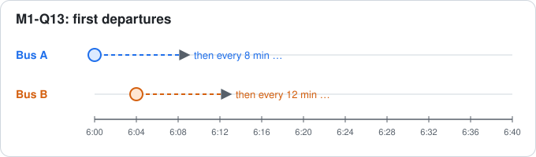

A. 6:16 a.m.

B. 6:20 a.m.

C. 6:24 a.m.

D. 6:28 a.m.

E. 7:36 a.m.

### M1-Q14

How many factors does 36 have?

A. 4

B. 7

C. 9

D. 10

E. 18

### M1-Q15

In the four-digit number 3A6B, the letters A and B each stand for a single digit. The number is odd and divisible by 45. What is the number?

A. 3060

B. 3165

C. 3360

D. 3365

E. 3465

### M1-Q16

A coach splits 48 balls and 72 cones into identical sets. Every set gets the same number of balls and the same number of cones, and nothing is left over. Each set must contain at least 5 balls. What is the greatest number of sets she can make?

A. 6

B. 8

C. 9

D. 12

E. 24

### M1-Q17

A hall has rows of 8 chairs. 135 students need seats. What is the smallest number of rows needed so that every student has a seat?

A. 1

B. 7

C. 16

D. 17

E. 18

### M1-Q18

Ravi has between 50 and 100 marbles. When he puts them in groups of 4, 1 marble is left over. When he puts them in groups of 6, 1 marble is left over. When he puts them in groups of 9, 1 marble is left over. How many marbles does he have?

A. 37

B. 49

C. 61

D. 72

E. 73

### M1-Q19

Two numbers are written as products of primes:

| Number | Prime factorization |
|---|---|
| P | 2³ × 3 × 5² |
| Q | 2² × 3³ × 7 |

What is the greatest common factor of P and Q?

A. 2 × 3

B. 2² × 3

C. 2³ × 3³

D. 2² × 3 × 5 × 7

E. 2³ × 3³ × 5² × 7

### M1-Q20

A red light blinks every 45 seconds and a green light blinks every 1 minute. Both blink at exactly 3:00:00 p.m. When will they next blink at the same moment?

A. 3:00:15 p.m.

B. 3:01:00 p.m.

C. 3:01:45 p.m.

D. 3:03:00 p.m.

E. 3:45:00 p.m.

### M1-Q21

Which digit in the box makes the four-digit number 6□05 divisible by 11?

A. 1

B. 4

C. 6

D. 7

E. 9

### M1-Q22

A box of chocolates is not empty. Its chocolates can be shared equally among 4 children, or among 6 children, or among 10 children, with none left over each time. Which one extra fact would be enough, on its own, to tell exactly how many chocolates are in the box?

A. The number of chocolates is even.

B. The box holds fewer than 100 chocolates.

C. The box holds fewer than 150 chocolates.

D. The number of chocolates is a multiple of 12.

E. The number of chocolates is divisible by 3.

### M1-Q23

What is the smallest positive whole number that 72 can be multiplied by to give a perfect square? (A perfect square is a number such as 49 = 7 × 7.)

A. 2

B. 3

C. 4

D. 6

E. 8

### M1-Q24

A gym class has fewer than 40 students. When they line up in rows of 6, there are 4 students left over. When they line up in rows of 8, there are 6 students left over. How many students are in the class?

A. 10

B. 16

C. 22

D. 24

E. 46

### M1-Q25

A baker has 54 muffins and 72 cookies. She packs all of them into the greatest possible number of identical gift boxes, with nothing left over. How many cookies are in each box?

A. 3

B. 4

C. 7

D. 18

E. 216

### M1-Q26

Two gears are meshed together. Gear A has 12 teeth and gear B has 18 teeth. A chalk mark is drawn on each gear at the point where they touch. The gears turn. How many full turns does gear A make before the two chalk marks are touching each other again for the first time?

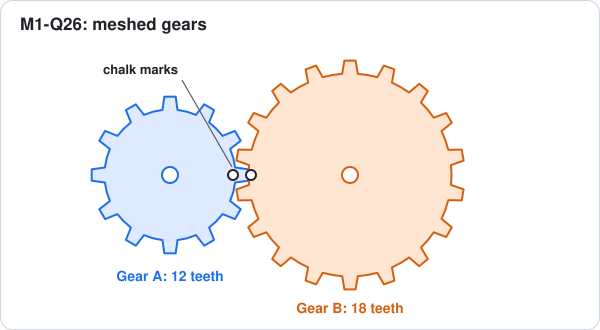

A. 3

B. 5

C. 6

D. 18

E. 36

### M1-Q27

Identical rectangular cards measure 6 cm by 10 cm. They are placed side by side, all facing the same way, with no gaps or overlaps, to form the smallest possible square. How many cards are used?

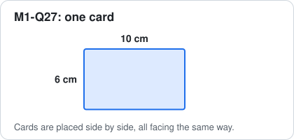

A. 2

B. 8

C. 15

D. 30

E. 60

### M1-Q28

A hallway has 100 lockers, numbered 1 to 100, and all of them start closed. Student 1 opens every locker. Student 2 changes every 2nd locker (2, 4, 6, …), student 3 changes every 3rd locker (3, 6, 9, …), and so on, until student 100 changes only locker 100. To "change" a locker means to open it if it is closed, or close it if it is open. When all 100 students are done, which of these lockers is open?

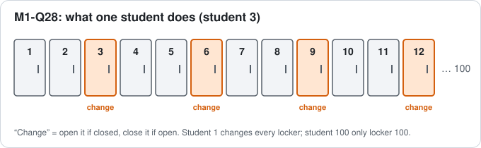

A. 24

B. 45

C. 50

D. 72

E. 81

### M1-Q29

A clockmaker finds a repeating chime on a recording. The chime sounds at a fixed interval of at least 2 whole minutes. She hears it at minute 0, minute 36 and minute 60, but parts of the recording are missing. A clear section confirms that it did **not** sound at minute 18. Which pair lists all intervals still possible?

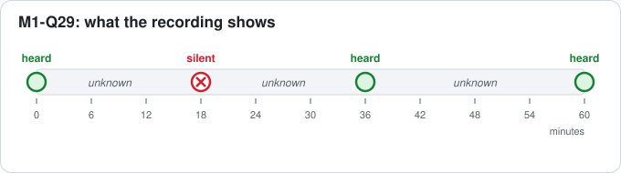

A. 2 and 6 minutes

B. 3 and 12 minutes

C. 4 and 12 minutes

D. 4 and 6 minutes

E. 6 and 12 minutes

### M1-Q30

At a school fair, a machine exchanges a quarter (25¢) for two 10¢ tokens and one 5¢ token. Lena puts in five quarters. A game costs 20¢ and takes **only** 10¢ tokens. How many games can she play using the tokens she receives?

A. 2

B. 3

C. 6

D. 10

E. 5

## Answer key

Use this table to mark your answers quickly. Step-by-step [full solutions](#full-solutions) with pictures follow the table.

| ID | Answer | Tier | Reasoning | Closest distractor ruled out by |
|---|---|---|---|---|
| M1-Q01 | D | Medium | Cutting existing totals into the greatest number of identical groups: GCF(28, 42) = 14 bouquets (2 roses + 3 tulips each). | C (7) divides both, but it is not the *greatest*; 14 also works. B (5) is flowers per bouquet, not bouquets. |
| M1-Q02 | E | Challenge | Equal totals are multiples of LCM(8, 12) = 24. The first one that is at least 50 is 72, so 72 ÷ 8 = 9 hot-dog packs and 72 ÷ 12 = 6 bun packs: 9 + 6 = 15. | D (10) uses 48 of each, which is fewer than 50. A (5) uses the LCM itself (24) and ignores the "at least 50" condition. |
| M1-Q03 | C | Medium | They flash together every LCM(6, 15) = 30 s: at 0, 30, 60, 90, 120 s, which is 5 times. | B (4) forgets to count either 0 s or 120 s. A (2) uses the product 90 instead of the LCM. |
| M1-Q04 | B | Medium | Known digits sum to 4 + 7 + 1 + 2 = 14. The digit sum must be a multiple of 9, so it must be 18 and the digit is 4 (27 would need 13). | A (1) and D (7) make the number divisible by 3 (sums 15 and 21) but not by 9. |
| M1-Q05 | A | Challenge | Work backward with primes: 72 = 2³ × 3², 18 = 2 × 3². The other number needs 2³ (to reach the LCM) and only 3¹ (to keep the GCF at 6), so it is 2³ × 3 = 24. Check: GCF(18, 24) = 6, LCM = 72. | D (72) assumes the other number is the LCM; GCF(18, 72) = 18, not 6. B (36) also gives GCF 18. |
| M1-Q06 | C | Challenge | Remove the leftovers first: 48 pencils and 36 erasers were shared exactly, so the number of students divides both. Greatest is GCF(48, 36) = 12 (4 pencils and 3 erasers each). | A (2) is GCF(50, 38), which uses the totals before removing the leftovers. D (24) does not divide 36. |
| M1-Q07 | B | Medium | 360 = 8 × 45 = 2³ × 3² × 5, and every factor is prime. | A and C both multiply to 360, but 10 and 15 are not prime. D is 540 and E is 720. |
| M1-Q08 | D | Medium | They meet again after LCM(4, 6) = 12 days. March 3 + 12 days = March 15. | C (March 14) counts March 3 as day 1. E (March 27) adds the product 24 instead of the LCM. |
| M1-Q09 | A | Challenge | A number has exactly three factors only if it is a prime squared (1, p, p²). Up to 50: 4, 9, 25, 49, so 4 numbers. | C (6) counts every square from 4 to 49, but 16 and 36 have more than three factors. B (5) wrongly includes 1, which has only one factor. |
| M1-Q10 | A | Medium | 250 = 20 × 12 + 10, so 10 eggs are left over; 12 − 10 = 2 more eggs fill another carton. | B (10) is the leftover, not the number still needed. D (20) is the number of full cartons. |
| M1-Q11 | D | Medium | Building up to equal totals: LCM(20, 15) = 60 plates and 60 cups (3 packs of plates, 4 packs of cups). The question asks for cups: 60. | B (7) is the number of packs. A (5) is the GCF, which would mean fewer cups than one pack. |
| M1-Q12 | E | Medium | Test the last three digits: 520 ÷ 8 = 65. The others' last three digits (316, 124, 412, 180) are not multiples of 8. | A (2316) passes the "last two digits" test (16 ÷ 8 = 2), but the rule for 8 uses three digits: 316 ÷ 8 is not whole. |
| M1-Q13 | A | Challenge | The buses start at different times, so the LCM alone is not enough. List them: A at 6:00, 6:08, 6:16, …; B at 6:04, 6:16, … First match: 6:16. | C (6:24) assumes both start at 6:00 and adds LCM(8, 12) = 24, but bus B does not leave at 6:24. D (6:28) adds 24 to 6:04, but bus A does not leave at 6:28. |
| M1-Q14 | C | Medium | Factor pairs: 1 × 36, 2 × 18, 3 × 12, 4 × 9, 6 × 6. Factors: 1, 2, 3, 4, 6, 9, 12, 18, 36, which is 9. | D (10) counts the 6 in 6 × 6 twice. B (7) leaves out 1 and 36. |
| M1-Q15 | E | Challenge | Divisible by 45 means divisible by 5 and by 9. Odd and divisible by 5 → B = 5. Digit sum 3 + A + 6 + 5 = 14 + A must be a multiple of 9, so A = 4: 3465. | A (3060) is divisible by 45 but is even. B (3165) has digit sum 15, so it is divisible by 3 and 5, not 9. |
| M1-Q16 | B | Challenge | The number of sets must divide 48 and 72 (common factors 1, 2, 3, 4, 6, 8, 12, 24). At least 5 balls each means 48 ÷ sets ≥ 5, so sets ≤ 9. The greatest allowed is 8 (6 balls, 9 cones per set). | D (12) divides both totals, but it gives only 4 balls per set. E (24) is the GCF and gives only 2 balls per set. C (9) is cones per set, and 9 does not divide 48. |
| M1-Q17 | D | Medium | 135 = 16 × 8 + 7. Sixteen full rows seat 128; the other 7 students need one more row: 17 rows. | C (16) ignores the 7 students still standing. B (7) is the remainder. |
| M1-Q18 | E | Challenge | One left over each time means (marbles − 1) must be a common multiple of 4, 6 and 9. The least positive common multiple is 36. So marbles = 37, 73, 109, …; only 73 is between 50 and 100. | A (37) fits every remainder but is not between 50 and 100. D (72) is the common multiple itself, so it leaves 0 left over, not 1. |
| M1-Q19 | B | Medium | GCF uses only shared primes, each with its smaller power: 2² and 3¹, so 2² × 3 = 12. | E is the LCM (every prime, larger powers). C takes the larger powers of the shared primes. |
| M1-Q20 | D | Medium | Change to seconds: LCM(45, 60) = 180 s = 3 minutes, so 3:03:00 p.m. | C (3:01:45) adds 45 + 60 seconds instead of finding a common multiple. E (3:45:00) uses the product 2700 s = 45 minutes. |
| M1-Q21 | A | Medium | Alternating sum 6 − □ + 0 − 5 = 1 − □ must be 0 or a multiple of 11, so □ = 1: 6105 = 11 × 555. | D (7) makes the digit sum 18 (a test for 9, not 11). B (4) makes the digit sum 15 (a test for 3). |
| M1-Q22 | B | Challenge | The count is a multiple of LCM(4, 6, 10) = 60: 60, 120, 180, … "Fewer than 100" leaves only 60, so it decides the count. | C (fewer than 150) still allows 60 or 120. D and E are true of every multiple of 60, so they add no information. |
| M1-Q23 | A | Medium | 72 = 2³ × 3². A square needs every prime to an even power, so multiply by one more 2: 72 × 2 = 144 = 12 × 12. | E (8) also makes a square (576 = 24 × 24), but it is not the *smallest*. B (3) gives 216, which is not a square. |
| M1-Q24 | C | Challenge | 4 left in rows of 6 and 6 left in rows of 8 both mean "2 short of a full row", so (students + 2) is a multiple of LCM(6, 8) = 24. Students = 22 (next: 46, too many). Check: 22 = 3 × 6 + 4 = 2 × 8 + 6. | D (24) is the common multiple, not the class size; it leaves 0 left over in both cases. B (16) leaves 4 in rows of 6 but 0 in rows of 8. |
| M1-Q25 | B | Medium | GCF(54, 72) = 18 boxes. Each box gets 72 ÷ 18 = 4 cookies (and 3 muffins). | A (3) is muffins per box, not cookies. D (18) is the number of boxes. |
| M1-Q26 | A | Medium | Teeth pass at the same rate on both gears. The marks meet again when the number of teeth passed is a multiple of 12 and 18: LCM = 36 teeth, so gear A turns 36 ÷ 12 = 3 times (gear B turns 2). | E (36) is teeth passed, not turns. C (6) is GCF(12, 18), not a common multiple. |
| M1-Q27 | C | Medium | The square's side must be a common multiple of 6 and 10: LCM = 30 cm. That is 30 ÷ 6 = 5 cards one way and 30 ÷ 10 = 3 the other: 5 × 3 = 15 cards. | D (30) is the side length of the square, not the number of cards. B (8) adds 5 + 3 instead of multiplying. |
| M1-Q28 | E | Challenge | Locker n is changed once for every factor of n. It ends open only if it is changed an odd number of times, and only perfect squares have an odd number of factors (one factor pair repeats). 81 = 9 × 9 is the only square listed. | B (45) is odd, but it has 6 factors (an even number), so it ends closed. A (24) and D (72) have many factors, but the number of factors is even. |
| M1-Q29 | C | Challenge | The interval divides both 36 and 60. Their common factors of at least 2 are 2, 3, 4, 6 and 12. The silence at minute 18 rules out 2, 3 and 6. | E includes 6 minutes, which would have produced a chime at minute 18. |
| M1-Q30 | E | Medium | Five exchanges give 10 usable tokens. Each game takes two of them, enough for 5 games. | C counts all 125¢ as spendable at the game. The five 5¢ tokens cannot go into its slot. |

## Full solutions

Open a solution only **after** you have committed to an answer and marked it. Each solution shows the steps, a way to check, and why the most tempting wrong answer fails. For a 🤔 or ❌, cover the solution, redo the question, then compare.

### M1-Q01 solution

**Answer: D (14 bouquets)**

1. You already *have* the flowers and must cut them into identical groups, so this is a **GCF** question.
2. Factors of 28: 1, 2, 4, 7, 14, 28. Of these, the ones that divide 42 are 1, 2, 7 and 14.
3. The greatest is **14**, so GCF(28, 42) = 14 bouquets.
4. Each bouquet gets 28 ÷ 14 = 2 roses and 42 ÷ 14 = 3 tulips.

**Check:** 14 × 2 = 28 roses and 14 × 3 = 42 tulips. Every flower is used.

**Why not C (7)?** 7 bouquets also work (4 roses + 6 tulips each), but the question asks for the **greatest** number. **B (5)** is flowers per bouquet, not bouquets.

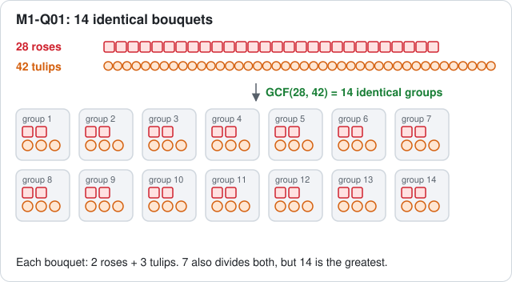

### M1-Q02 solution

**Answer: E (15 packages)**

1. You *build up* to equal totals from packs of 8 and 12, so equal totals are multiples of **LCM(8, 12) = 24**: 24, 48, 72, …
2. He needs **at least 50** of each. 48 is too few, so the smallest equal total is **72**.
3. Hot-dog packs: 72 ÷ 8 = 9. Bun packs: 72 ÷ 12 = 6.
4. Total packages: 9 + 6 = **15**.

**Check:** 9 × 8 = 72 hot dogs and 6 × 12 = 72 buns.

**Why not D (10)?** That is 6 + 4 packs, which gives 48 of each, less than 50. **A (5)** uses 24 of each and ignores "at least 50".

### M1-Q03 solution

**Answer: C (5 times)**

1. Both lights flash together every **LCM(6, 15) = 30 seconds**. (6 = 2 × 3 and 15 = 3 × 5, so the LCM is 2 × 3 × 5 = 30.)
2. Together at 0, 30, 60, 90 and 120 seconds.
3. The question says to count **both** 0 s and 120 s, so that is **5** times.

**Why not B (4)?** It forgets one end, either 0 s or 120 s. **A (2)** uses 6 × 15 = 90 instead of the LCM.

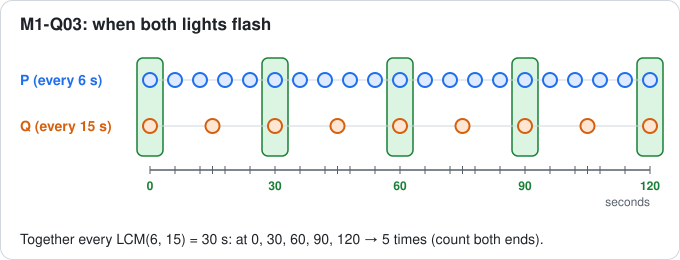

### M1-Q04 solution

**Answer: B (4)**

1. A number is divisible by 9 when its **digit sum** is a multiple of 9.
2. Known digits: 4 + 7 + 1 + 2 = 14.
3. The box holds one digit (0–9), so the total is between 14 and 23. The only multiple of 9 in that range is **18**.
4. 18 − 14 = **4**.

**Check:** 47 412 ÷ 9 = 5268 exactly.

**Why not A (1) or D (7)?** They make digit sums 15 and 21. Those are multiples of **3**, not 9.

### M1-Q05 solution

**Answer: A (24)**

1. Write the known numbers as primes: 18 = 2 × 3², GCF = 6 = 2 × 3, LCM = 72 = 2³ × 3².
2. **Power of 2:** the LCM has 2³ but 18 has only 2¹, so the other number must have **2³**.
3. **Power of 3:** the GCF has only 3¹. 18 already has 3², so the other number must have **3¹** (otherwise the GCF would contain 3²).
4. Other number = 2³ × 3 = **24**.

**Check:** GCF(18, 24) = 6 ✓ and LCM(18, 24) = 72 ✓.

**Why not D (72)?** GCF(18, 72) = 18, not 6. **B (36)** fails the same way: GCF(18, 36) = 18.

### M1-Q06 solution

**Answer: C (12 students)**

1. Take away the leftovers first: 50 − 2 = **48** pencils and 38 − 2 = **36** erasers were shared exactly.
2. The number of students must divide both 48 and 36. The greatest is **GCF(48, 36) = 12**.
3. Each student gets 48 ÷ 12 = 4 pencils and 36 ÷ 12 = 3 erasers.
4. The 2 leftovers really are leftovers, because 2 is less than 12 (you couldn't give each student one more).

**Why not A (2)?** That is GCF(50, 38), using the totals *before* removing the leftovers. **D (24)** does not divide 36.

### M1-Q07 solution

**Answer: B (2³ × 3² × 5)**

1. Split 360 into primes: 360 = 2 × 180 = 2 × 2 × 90 = 2 × 2 × 2 × 45 = 2 × 2 × 2 × 3 × 3 × 5.
2. Group the repeats: **2³ × 3² × 5**.

**Check:** 8 × 9 × 5 = 360, and 2, 3 and 5 are all prime.

**Why not A or C?** Both multiply to 360, but they contain 10 and 15, which are not prime. **D** = 4 × 27 × 5 = 540 and **E** = 16 × 9 × 5 = 720.

### M1-Q08 solution

**Answer: D (March 15)**

1. They swim together every **LCM(4, 6) = 12** days.
2. Count 12 days **forward** from March 3: 3 + 12 = **March 15**.

**Check on the calendar:** Maya swims on 3, 7, 11, 15 and Leo on 3, 9, 15. Both are on the 15th.

**Why not C (March 14)?** It counts March 3 itself as day 1. **E (March 27)** adds 4 × 6 = 24 instead of the LCM.

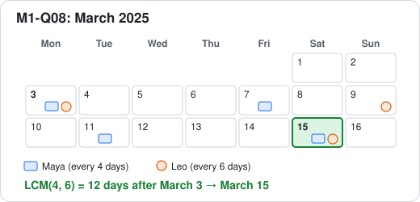

### M1-Q09 solution

**Answer: A (4 numbers)**

1. Factors come in pairs (a × b). The only way to get an **odd** count is a square, where one pair repeats.
2. Exactly **three** factors means 1, p and p², where p is prime. Example: 9 has 1, 3, 9.
3. Prime squares up to 50: 2² = 4, 3² = 9, 5² = 25, 7² = 49. (11² = 121 is too big.)
4. That is **4** numbers.

**Why not C (6)?** It counts every square from 4 to 49. But 16 has 1, 2, 4, 8, 16 (five factors) and 36 has nine. **B (5)** includes 1, which has only one factor.

### M1-Q10 solution

**Answer: A (2 eggs)**

1. Divide: 250 ÷ 12 = 20 remainder 10, so **250 = 20 × 12 + 10**.
2. 20 cartons are full and **10** eggs are in an unfinished carton.
3. A carton holds 12, so it needs 12 − 10 = **2** more eggs.

**Why not B (10)?** That is how many eggs are left over, not how many more are needed. **D (20)** is the number of full cartons.

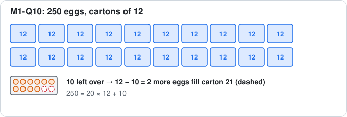

### M1-Q11 solution

**Answer: D (60 cups)**

1. You *build up* equal totals from packs of 20 and 15, so the fewest packs come from **LCM(20, 15) = 60**.
2. 60 plates = 3 packs and 60 cups = 4 packs (7 packs in total).
3. The question asks how many **cups**: **60**.

**Why not B (7)?** That is the number of packs, not cups. **A (5)** is GCF(20, 15), which would be fewer cups than a single pack holds.

### M1-Q12 solution

**Answer: E (4520)**

1. The test for 8 uses the **last three digits**.
2. Check each: 316 ÷ 8 = 39.5 ✗, 124 ÷ 8 = 15.5 ✗, 412 ÷ 8 = 51.5 ✗, 180 ÷ 8 = 22.5 ✗, **520 ÷ 8 = 65 ✓**.

**Why not A (2316)?** Its last **two** digits (16) are divisible by 8, but two digits is the rule for **4**. The rule for 8 needs three digits.

### M1-Q13 solution

**Answer: A (6:16 a.m.)**

1. The buses start at **different** times, so "add the LCM" does not work. List both schedules instead.
2. Bus A: 6:00, 6:08, **6:16**, 6:24, 6:32, …
3. Bus B: 6:04, **6:16**, 6:28, 6:40, …
4. The first time on both lists is **6:16**.

**Why not C (6:24)?** It assumes both start at 6:00 and adds LCM(8, 12) = 24 minutes. But bus B leaves at 6:16 and 6:28, not 6:24.

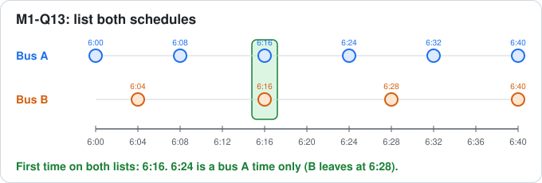

### M1-Q14 solution

**Answer: C (9 factors)**

1. List factor pairs of 36: 1 × 36, 2 × 18, 3 × 12, 4 × 9, 6 × 6.
2. Write each factor once: 1, 2, 3, 4, 6, 9, 12, 18, 36 → **9** factors.

**Shortcut:** 36 = 2² × 3², so the count is (2 + 1) × (2 + 1) = 9.

**Why not D (10)?** It counts the 6 in 6 × 6 twice.

### M1-Q15 solution

**Answer: E (3465)**

1. 45 = 5 × 9, so the number must be divisible by **5** and by **9**.
2. Divisible by 5 → last digit 0 or 5. It must be **odd**, so **B = 5**.
3. Divisible by 9 → digit sum 3 + A + 6 + 5 = 14 + A is a multiple of 9 → **A = 4** (sum 18).
4. The number is **3465**.

**Check:** 3465 ÷ 45 = 77.

**Why not A (3060)?** It is divisible by 45, but it is even. **B (3165)** has digit sum 15, so it fails the test for 9.

### M1-Q16 solution

**Answer: B (8 sets)**

1. The number of sets must divide both 48 and 72. Common factors: 1, 2, 3, 4, 6, 8, 12, 24.
2. Each set needs **at least 5 balls**: balls per set = 48 ÷ sets ≥ 5, so sets ≤ 9.6, meaning at most **9** sets.
3. The largest common factor that is 9 or less is **8**.
4. 8 sets → 6 balls and 9 cones each.

**Why not D (12) or E (24)?** They divide both totals, but they give only 4 or 2 balls per set. The GCF (24) is not the answer when an extra condition limits the size. **C (9)** does not divide 48.

### M1-Q17 solution

**Answer: D (17 rows)**

1. 135 ÷ 8 = 16 remainder 7, so **135 = 16 × 8 + 7**.
2. 16 full rows seat 128 students. The other **7** still need seats, so add one more row.
3. 16 + 1 = **17** rows.

**Why not C (16)?** It leaves 7 students standing. **B (7)** is the remainder.

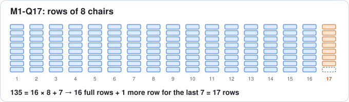

### M1-Q18 solution

**Answer: E (73)**

1. "1 left over" in groups of 4, 6 and 9 means **marbles − 1** is a common multiple of 4, 6 and 9.
2. LCM(4, 6, 9): 4 = 2², 6 = 2 × 3, 9 = 3², so LCM = 2² × 3² = **36**.
3. Marbles − 1 is 36, 72, 108, …, so marbles = 37, **73**, 109, …
4. Only **73** is between 50 and 100.

**Check:** 73 = 18 × 4 + 1 = 12 × 6 + 1 = 8 × 9 + 1.

**Why not D (72)?** 72 is the common multiple itself. It leaves **0** left over, not 1. **A (37)** fits the remainders but is below 50.

### M1-Q19 solution

**Answer: B (2² × 3)**

1. GCF: use only primes that appear in **both**, each with its **smaller** power.
2. 2: P has 2³, Q has 2² → **2²**.
3. 3: P has 3¹, Q has 3³ → **3¹**.
4. 5 and 7 are each in only one number, so leave them out.
5. GCF = 2² × 3 = **12**.

**Why not E?** That is the LCM: every prime with the larger power. **C** takes the larger powers of the shared primes.

### M1-Q20 solution

**Answer: D (3:03:00 p.m.)**

1. Use the same unit: 45 s and 1 min = **60 s**.
2. LCM(45, 60): 45 = 3² × 5 and 60 = 2² × 3 × 5, so LCM = 2² × 3² × 5 = **180 s = 3 minutes**.
3. 3:00:00 + 3 min = **3:03:00 p.m.**

**Check:** 180 ÷ 45 = 4 red blinks, and 180 ÷ 60 = 3 green blinks.

**Why not C (3:01:45)?** It adds 45 s + 60 s, which is not a common multiple. **E** uses 45 × 60 = 2700 s.

### M1-Q21 solution

**Answer: A (1)**

1. Test for 11: the **alternating sum** of the digits (+ − + −) must be 0 or a multiple of 11.
2. 6 − □ + 0 − 5 = 1 − □.
3. □ is a digit 0–9, so 1 − □ is between −8 and 1. The only multiple of 11 in that range is 0, so **□ = 1**.

**Check:** 6105 = 11 × 555.

**Why not D (7)?** It makes the digit sum 18, which is the test for **9**, not 11.

### M1-Q22 solution

**Answer: B (fewer than 100)**

1. Shared equally among 4, 6 or 10 means the count is a multiple of **LCM(4, 6, 10) = 60**: 60, 120, 180, …
2. Test each fact. Does it leave **exactly one** possibility?
   - **B, fewer than 100:** only 60 → decides it ✓
   - **C, fewer than 150:** 60 or 120 → still two options
   - **A, D, E:** every multiple of 60 is even, a multiple of 12 and divisible by 3 → no new information

**Why not C?** It sounds close, but 120 is still allowed.

### M1-Q23 solution

**Answer: A (2)**

1. 72 = 2³ × 3².
2. A perfect square has every prime to an **even** power. 3² is already even, but 2³ is odd.
3. Multiply by one more **2**: 72 × 2 = 144 = 2⁴ × 3² = 12 × 12.

**Why not E (8)?** 72 × 8 = 576 = 24 × 24 is also a square, but 8 is not the **smallest**. **B (3)** gives 216 = 2³ × 3³, which is not a square.

### M1-Q24 solution

**Answer: C (22 students)**

1. 4 left in rows of 6 means **2 short** of another full row. 6 left in rows of 8 also means **2 short**.
2. So adding 2 students fills every row: **students + 2** is a common multiple of 6 and 8.
3. LCM(6, 8) = 24, so students + 2 = 24, 48, … → students = **22** or 46.
4. Fewer than 40 → **22**.

**Check:** 22 = 3 × 6 + 4 ✓ and 22 = 2 × 8 + 6 ✓.

**Why not D (24)?** 24 fills every row exactly, leaving 0, not 4 or 6. **B (16)** works for rows of 6 but leaves 0 in rows of 8.

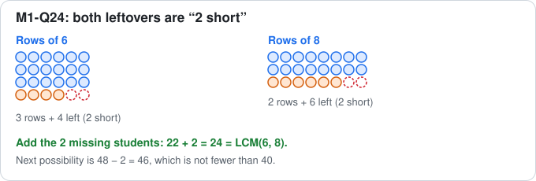

### M1-Q25 solution

**Answer: B (4 cookies)**

1. Cut existing totals into the greatest number of identical boxes: **GCF(54, 72) = 18** boxes. (54 = 2 × 3³, 72 = 2³ × 3², so the GCF is 2 × 3² = 18.)
2. Cookies per box: 72 ÷ 18 = **4**. (Muffins per box: 54 ÷ 18 = 3.)

**Why not A (3)?** That is muffins per box. **D (18)** is the number of boxes. Read which unknown the question asks for.

### M1-Q26 solution

**Answer: A (3 turns)**

1. Meshed gears pass teeth at the **same rate**. Gear A is back at its mark every 12 teeth, and gear B every 18 teeth.
2. Both marks are back together after **LCM(12, 18) = 36** teeth.
3. Gear A turns 36 ÷ 12 = **3** times (gear B turns 2 times).

**Why not E (36)?** That is teeth passed, not turns. **C (6)** is the GCF.

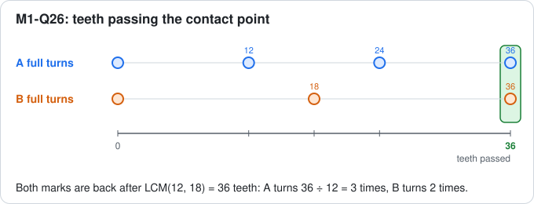

### M1-Q27 solution

**Answer: C (15 cards)**

1. The square's side must be a whole number of card widths **and** a whole number of card heights, so it is a common multiple of 6 and 10.
2. Smallest square → **LCM(6, 10) = 30 cm**.
3. Cards across: 30 ÷ 10 = 3. Cards down: 30 ÷ 6 = 5.
4. 3 × 5 = **15** cards.

**Check:** area 30 × 30 = 900 cm², and 15 cards × 60 cm² = 900 cm².

**Why not D (30)?** That is the side length. **B (8)** adds 3 + 5 instead of multiplying.

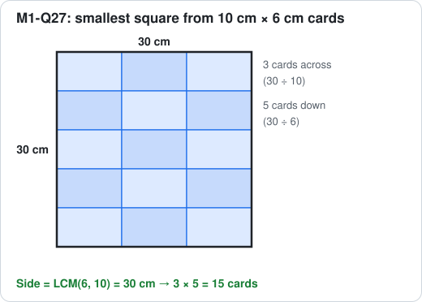

### M1-Q28 solution

**Answer: E (81)**

1. Student k changes locker n exactly when k is a **factor** of n. So locker n is changed once for each factor it has.
2. Starting closed, a locker ends **open** if it is changed an **odd** number of times.
3. Factors come in pairs, so most numbers have an even count. Only **perfect squares** have a repeated pair (9 × 9), which gives an odd count.
4. Among the choices, only **81 = 9 × 9** is a perfect square.

**Why not B (45)?** It is odd, but it has 6 factors (1, 3, 5, 9, 15, 45), an even count, so it ends closed.

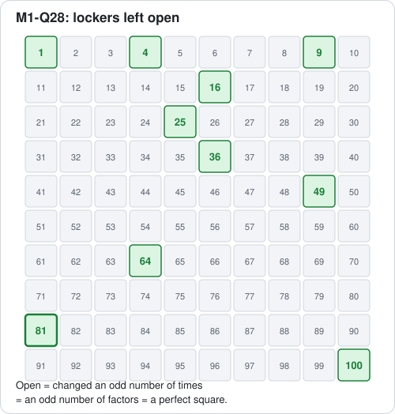

### M1-Q29 solution

**Answer: C (4 and 12 minutes)**

1. The chime is heard at 0, 36 and 60, so the interval must divide **36** and **60**.
2. Common factors of 36 and 60 that are at least 2: **2, 3, 4, 6, 12**.
3. The chime did **not** sound at 18. Any interval that divides 18 would have chimed there: 2, 3 and 6 are ruled out.
4. Still possible: **4 and 12**.

**Why not E (6 and 12)?** A 6-minute chime sounds at 0, 6, 12, **18**, … but minute 18 was silent.

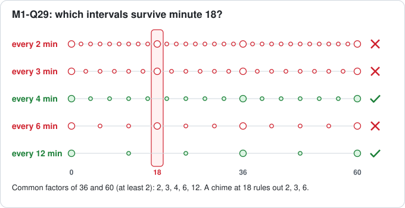

### M1-Q30 solution

**Answer: E (5 games)**

1. Each quarter gives two 10¢ tokens and one 5¢ token.
2. Five quarters give 5 × 2 = **10** ten-cent tokens (and five 5¢ tokens).
3. The game takes **only** 10¢ tokens, so 20¢ = 2 tokens per game.
4. 10 ÷ 2 = **5** games.

**Why not C (6)?** It divides all 125¢ by 20¢. The five 5¢ tokens can't go in the slot, so only 100¢ is usable.
