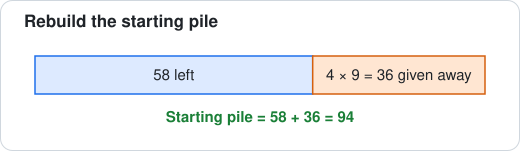

# M3 — Algebra: Learning

[← Back to the index](../../README.md) · [Go to the M3 practice questions →](doing.md)

## 1. What you remember

**From the test (your own recollection):**
- Algebra appeared. No specific equation or scenario was remembered.

**Recognized later when topics were suggested:**
- No follow-up recognition recorded for this category.

**Added for practice (not recalled from the test):**
- All specific scenarios are extensions chosen to cover common Grade 8 algebra.

All questions here are original practice. They are not copies of real test questions.

## 2. Four core patterns

### Build a rule from the story

Give the unknown a name and a unit. Listen for what happens **once** and what happens **for each** unit. A spool with 18 m of ribbon loses 2 m for each parcel, so after wrapping `p` parcels it has `18 − 2p` metres left. Try zero parcels and then one parcel. The answers should be 18 m and 16 m.

### Substitute before calculating

When you know the input, replace every occurrence of its letter with that number in brackets. For `2x² − (x + 1)` at `x = −3`, this gives `2(−3)² − (−3 + 1) = 18 − (−2) = 20`. Check the sign of the square by writing the multiplication out. A negative times a negative gives a positive.

### Work backward from a known output

An equals sign says both sides have the same value. To find the input, undo operations in reverse order and do the same thing to both sides. In `3n − 4 = 11`, add 4 to get `3n = 15`, then divide by 3. Put 5 back into the original equation to check that it gives 11. If the question asks for a related quantity, use the value of the letter to find that quantity too.

### Read a linear rule from a table

For a constant-rate relationship, divide the change in output by the change in input. If the input rises by 3 while the output rises by 12, the rate is 4 per input unit. To find the starting value, subtract four times an input from its matching output. Check the resulting rule on another column. Going the other way, calculate one output for each input, keeping the columns in order.

## 3. Worked example

A library has 58 bookmarks left after giving 4 bookmarks to each of 9 classes. How many bookmarks did the library start with?

A. 13

B. 22

C. 49

D. 94

E. 130

**Answer D.** Let `b` be the starting number. The clue is “left after giving,” so `b − 4 × 9 = 58`. Add the 36 bookmarks that left the library back to the 58 on hand to get 94. Choice B subtracts the 36 a second time. Check by handing out the bookmarks from your proposed starting pile. Only 94 leaves 58.

## 4. Practise

[Go to the M3 algebra drills](doing.md).
