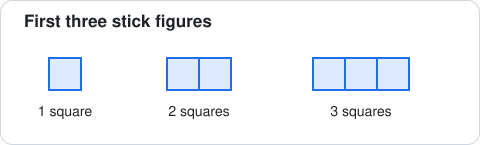
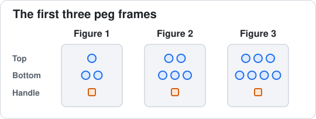
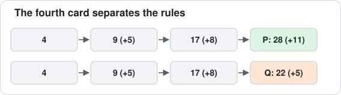
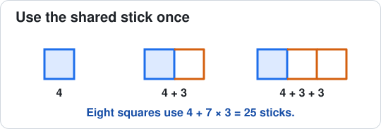
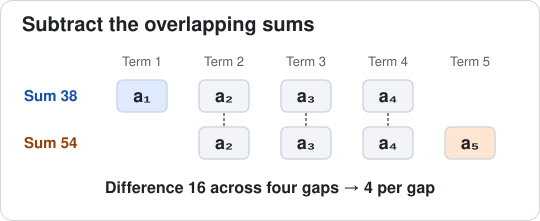
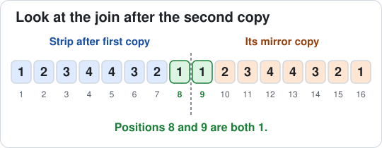

# M4 — Patterns and sequences: Doing

[← Back to the index](../../README.md) · [Review the M4 learning page](learning.md)

## How to use this page

These original drills practise the number patterns you recalled and extend them to diagrams and cycles. No additional pattern topics were recognized in follow-up. Answer each question on paper and mark correct, guessed, wrong or skipped before reading the key. Review every guess and miss. Save Q26–Q30 for the final weekend.

## Q01–Q05

### M4-Q01

The first row of a theatre has 14 seats. Every row behind it has 3 more seats than the row immediately ahead. How many seats are in row 12?

A. 33

B. 44

C. 47

D. 50

E. 56

### M4-Q02

A strip of film has 160 frames. An editor keeps half of the remaining frames at each pass. How many remain after three passes?

A. 20

B. 10

C. 40

D. 53

E. 80

### M4-Q03

A scoreboard opens at 6 points and increases by the same positive whole number of points at each update. It shows 26 at the fourth update. Which score can it show later?

A. 39

B. 43

C. 47

D. 51

E. 55

### M4-Q04

The printed border repeats leaf, star, wave, heart, dot in that order. The very first mark is a leaf. Which mark is in position 100?

A. Leaf

B. Star

C. Dot

D. Heart

E. Wave

### M4-Q05

A maker writes 4, 9, 17 on three cards. Two rules fit so far. Rule P adds 5 first and increases each new jump by 3. Rule Q alternately adds 5 and 8. Which possible fourth card would support P and rule out Q?

A. 17

B. 28

C. 25

D. 22

E. 31

## Q06–Q10

### M4-Q06

The fourth and tenth entries in a list are 31 and 13. Every step subtracts the same number. Which entry first drops below zero?

A. Entry 13

B. Entry 14

C. Entry 17

D. Entry 16

E. Entry 15

### M4-Q07

A robot lays sticks to make a straight row of squares. It keeps each shared side and uses it for both neighbours. How many sticks make a row of eight squares? Each horizontal or vertical unit edge is one stick.

A. 25

B. 22

C. 24

D. 17

E. 32

### M4-Q08

A trail guide numbers markers in order. Odd-position markers read 4, 7, 10, …, increasing by 3. Even-position markers read 40, 35, 30, …, decreasing by 5. What is printed on marker 8?

A. 25

B. 19

C. 20

D. 13

E. 30

### M4-Q09

A message is copied into three new files in each round. Only the new files continue to the next round. Round 2 produces 54 files. How many files were there just before round 1?

A. 3

B. 6

C. 9

D. 18

E. 27

### M4-Q10

In a sequence the first term is 8 and each new term adds 7. Which expression gives term n for every whole number n starting at 1?

A. 7n

B. 8n

C. 8n − 1

D. 7n + 1

E. 7n + 8

## Q11–Q15

### M4-Q11

A climber records distances along a wall at five successive beeps. Her forward jumps get 2 cm longer each time. The distances read 3, 7, __, 21, 31 cm. Which reading is missing?

A. 9 cm

B. 13 cm

C. 11 cm

D. 14 cm

E. 15 cm

### M4-Q12

A printer repeats a block of six symbols from position 1 onward. Position 8 is a moon. Of the positions listed, which must also be a moon, even if the block contains other moons?

A. Position 31

B. Position 28

C. Position 30

D. Position 26

E. Position 33

### M4-Q13

A frame has two straight rows of pegs and one handle peg. Figure n has n pegs in its top row and n + 1 in its bottom row. The handle peg is separate. How many pegs does figure 9 have?

A. 17

B. 20

C. 19

D. 18

E. 21

### M4-Q14

Labels are handed out in order from two bundles, alternating A, B, A, B. Bundle A supplies 2, 5, 8, … in steps of 3. Bundle B supplies 4, 8, 12, … in steps of 4. Which two handouts give labels marked 8?

A. 3 and 4

B. 3 and 5

C. 4 and 6

D. 4 and 5

E. 5 and 6

### M4-Q15

A counter starts at 2. Its instructions alternate “multiply by 3” and “subtract 1”, beginning with multiplication. What does it show after four instructions?

A. 11

B. 15

C. 14

D. 16

E. 17

## Q16–Q20

### M4-Q16

The first five terms in a list are 12, 10, 7, 3, −2. The amount subtracted increases by 1 at each step. What is the seventh term?

A. −7

B. −8

C. −15

D. −14

E. −13

### M4-Q17

A lighting cue repeats every five flashes in this order: gold, blue, white, blue, green. How many blue flashes occur among the first 23 flashes?

A. 4

B. 9

C. 8

D. 10

E. 12

### M4-Q18

A display begins with 5 dots. After each tap it either always adds 5 dots or always doubles the count. The first tap shows 10. Which additional observation would let you conclude that the display always adds 5?

A. Before any tap it showed 5.

B. Tap 1 added 5 dots.

C. Tap 2 showed 20 dots.

D. Tap 2 showed 15 dots.

E. Tap 1 doubled the count.

### M4-Q19

A festival uses numbered tickets starting at 1. Ticket colours repeat red, red, blue. A star is stamped on tickets 4, 8, 12 and every fourth ticket thereafter. Which ticket is the second blue ticket with a star?

A. 8

B. 12

C. 16

D. 20

E. 24

### M4-Q20

A sequence of positive numbers has the same multiplier at every step. It reads 3, __, 48, 192. What belongs in the gap?

A. 12

B. 9

C. 6

D. 16

E. 24

## Q21–Q25

### M4-Q21

Stage 1 is one row of four tiles. At every later stage a tile maker adds the same positive whole number of tiles to the right end. One stage has 22 tiles and the very next stage has 28. Which claim is correct?

A. 40 is stage 7.

B. 28 is stage 4.

C. 34 is stage 5.

D. 22 is stage 3.

E. 46 is stage 7.

### M4-Q22

A weaver threads beads in a repeating block of nine. Beads 1 through 4 are wood, beads 5 through 7 are glass, and beads 8 and 9 are metal. The pattern begins with a complete block. What are beads 52 and 54 made of, in that order?

A. Wood and glass

B. Glass and glass

C. Glass and metal

D. Metal and glass

E. Metal and metal

### M4-Q23

At noon a timer shows 2 minutes. Each new setting adds an odd number of minutes, beginning with 1 and using consecutive odd numbers in increasing order. What does the timer show after four changes?

A. 9 minutes

B. 18 minutes

C. 16 minutes

D. 11 minutes

E. 27 minutes

### M4-Q24

A sequence starts at 81 and multiplies by one third at each step. Which is its first term smaller than 1?

A. Term 4

B. Term 5

C. Term 7

D. Term 6

E. Term 8

### M4-Q25

A mosaic contains a straight row of n touching hexagons. Each new hexagon shares exactly one whole side with the previous one and touches no earlier hexagon. Lou counts every side of every hexagon, including a shared side twice. Which expression gives the amount she must subtract to get the number of distinct sides for every row length n?

A. 1

B. 6(n − 1)

C. n

D. 2(n − 1)

E. n − 1

## Q26–Q30 (final weekend)

### M4-Q26

An archive starts numbering its photographs at 1. Drawer 1 holds one photograph, drawer 2 holds two, drawer 3 holds three, and so on. Each drawer is filled before the next one starts. Which drawer contains photograph 24?

A. Drawer 5

B. Drawer 6

C. Drawer 9

D. Drawer 8

E. Drawer 7

### M4-Q27

A row of five mystery numbers increases by the same amount each step. The sum of the first four is 38. The sum of the last four is 54. By how much do neighbouring numbers differ?

A. 4

B. 2

C. 8

D. 16

E. 19

### M4-Q28

In a rhythm game the first two bars contain 2 beats and 5 beats. Starting with bar 3, each bar contains as many beats as the previous two bars combined. How many beats are in bar 6?

A. 17

B. 19

C. 24

D. 38

E. 31

### M4-Q29

A sign maker writes the digits 1, 2, 3, 4 from left to right. She extends the strip by writing a mirror copy of the entire strip immediately to its right, including the end digit. She performs this extension twice. Which digits occupy positions 8 and 9 in that order?

A. 4 and 4

B. 1 and 2

C. 2 and 1

D. 4 and 1

E. 1 and 1

### M4-Q30

A designer begins with one black tile. In each round every black tile is replaced by one black and one white tile. Every white tile is replaced by just one black tile. All replacements happen together. After a round the design contains 8 black and 5 white tiles. How many black and white tiles were present just before that round?

A. 3 black and 2 white

B. 3 black and 5 white

C. 5 black and 3 white

D. 5 black and 8 white

E. 8 black and 3 white

## Answer key

[Go to the full solutions](#full-solutions)

| ID | Answer | Tier | Reasoning | Closest distractor ruled out by |
|---|---|---|---|---|
| M4-Q01 | C | Medium | Row 12 is eleven increases after row 1, giving 14 + 11 × 3 = 47. | D. Twelve rows contain eleven gaps. |
| M4-Q02 | A | Medium | The three results are 80, 40 and 20 frames. | C. The original strip comes before pass 1. |
| M4-Q03 | D | Challenge | Four equal jumps cover 20 points, so scores increase by 5. Nine jumps give 51. | E. Multiples of 5 measure the increase. Each displayed score also includes the opening 6. |
| M4-Q04 | C | Medium | One hundred marks make 20 complete groups of five. The last mark of each group is a dot. | A. A leaf begins the next group at position 101. |
| M4-Q05 | B | Challenge | P makes jumps 5, 8, 11 and reaches 28. Q returns to a jump of 5 and reaches 22. | D. Repeating the first jump follows Q. |
| M4-Q06 | E | Challenge | Six steps lose 18, so the entries after 13 are 10, 7, 4, 1 and −2. | B. The fourth step after entry 10 still leaves a positive 1. |
| M4-Q07 | A | Medium | The first square uses 4 sticks and seven more squares add 3 each, giving 25. | C. Counting three per square misses the left edge of the first one. |
| M4-Q08 | A | Medium | Markers 2, 4, 6 and 8 read 40, 35, 30 and 25. | C. Marker 8 uses the fourth even-position value, three decreases from 40. |
| M4-Q09 | B | Challenge | Undo two rounds by dividing 54 by 3 twice, obtaining 6. | D. One division recovers the number after round 1. |
| M4-Q10 | D | Medium | Starting at 8 gives 8 + 7(n − 1), which simplifies to 7n + 1. | E. Putting n = 1 into that choice gives 15. |
| M4-Q11 | B | Medium | The first jump is 4 cm, so the next is 6 cm. That reaches 13 cm, then 8 cm more reaches 21 cm. | D. Averaging 7 and 21 assumes the two intervening jumps are equal. |
| M4-Q12 | D | Challenge | Position 26 lies 18 places after position 8, exactly three full repeats. | C. Divisibility by six aligns position 30 with position 6. The known moon is in slot 2. |
| M4-Q13 | B | Medium | Count 9 top pegs, 10 bottom pegs and 1 handle peg. | C. The two rows account for 19 pegs before the handle is counted. |
| M4-Q14 | D | Challenge | The handouts begin 2, 4, 5, 8, 8. B reaches 8 on its second turn and A on its third. | B. Handout 3 is A’s second turn, which shows 5. |
| M4-Q15 | C | Medium | The successive results are 6, 5, 15 and 14. | B. The multiplication that produces 15 is instruction 3. |
| M4-Q16 | C | Medium | Next subtract 6 to reach −8, then subtract 7 to reach −15. | B. That is the sixth term. |
| M4-Q17 | B | Medium | Twenty flashes contain eight blues. The next three flashes add just one more blue. | D. The second blue in the last partial group would be flash 24. |
| M4-Q18 | D | Challenge | At tap 2 the adding rule gives 15 and doubling gives 20. Only the adding rule fits a count of 15. | B. Both rules take the opening 5 to 10. |
| M4-Q19 | E | Challenge | A blue ticket is a multiple of 3 and a starred ticket a multiple of 4. The first two shared positions are 12 and 24. | B. That ticket is the first one meeting both conditions. |
| M4-Q20 | A | Medium | The last step multiplies by 4. Multiplying 3 by 4 gives 12, and 12 × 4 = 48. | E. Doubling 24 reaches 48 but fails to reproduce the last step. |
| M4-Q21 | A | Challenge | The adjacent stages fix the step at 6. Counts from stage 1 are 4, 10, 16, 22, 28, 34, 40. | C. Five additions reach 34 at stage 6. |
| M4-Q22 | C | Medium | After 45 beads, positions 52 and 54 occupy slots 7 and 9, giving glass and metal. | E. Slot 8 begins the metal section at bead 53. |
| M4-Q23 | B | Medium | Add the first four odd numbers to the opening 2, giving 2 + 1 + 3 + 5 + 7 = 18. | C. Sixteen is how many minutes were added. |
| M4-Q24 | D | Medium | The terms are 81, 27, 9, 3, 1 and one third. | B. Term 5 equals the boundary value of 1. |
| M4-Q25 | E | Challenge | There are n − 1 joins. Each join contributes one excess count because its side was counted twice and should count once. | D. Subtracting twice per join would remove that side entirely. |
| M4-Q26 | E | Medium | The first six drawers hold 1 + 2 + 3 + 4 + 5 + 6 = 21 photographs. Drawer 7 holds photographs 22 to 28. | B. Photograph 24 comes after the last photograph in drawer 6. |
| M4-Q27 | A | Challenge | The two sums share the middle three numbers. The difference 54 − 38 = 16 spans four gaps from first to last, so each gap is 4. | D. Sixteen measures the whole change from the first number to the fifth. |
| M4-Q28 | E | Medium | The bar lengths are 2, 5, 7, 12, 19 and 31. Add 12 and 19 for the sixth bar. | B. Nineteen is the length of the fifth bar. |
| M4-Q29 | E | Medium | The first extension ends in 4321. On the second extension its final 1 is copied first, so the middle pair is 11. | B. The last digit is copied at the join. |
| M4-Q30 | C | Challenge | Each new white came from one old black, so there were 5 old black tiles. All 8 old tiles produced one black each, leaving 8 − 5 = 3 old whites. | B. Three old black tiles would produce only three new whites. |

## Full solutions

Solve and mark each question before opening its solution. For a guess or miss, try the steps again on paper before comparing.

### M4-Q01 solution

**Answer C.** 47

1. Row 1 already has 14 seats. Count the gaps to row 12: 12 − 1 = 11.
2. Each gap adds 3 seats, so row 12 has 14 + 11 × 3 = 47 seats.

**Closest distractor.** D. Twelve rows contain eleven gaps.

### M4-Q02 solution

**Answer A.** 20

1. Start at 160 frames before any pass.
2. Halve once for each of the three passes: 160 → 80 → 40 → 20.
3. Check that three halvings divide 160 by 8.

**Closest distractor.** C. The original strip comes before pass 1.

### M4-Q03 solution

**Answer D.** 51

1. Use the two known positions to find four equal gaps covering 20 points. Each gap adds 20 ÷ 4 = 5.
2. Start at 6. Nine gaps add 45, giving 6 + 45 = 51.

**Closest distractor.** E. Multiples of 5 measure the increase. Each displayed score also includes the opening 6.

### M4-Q04 solution

**Answer C.** Dot

1. Group the marks into complete repeats of five.
2. Position 100 is the final position of the 20th group because 100 = 20 × 5.
3. Read the fifth symbol of the repeat: a dot.

**Closest distractor.** A. A leaf begins the next group at position 101.

### M4-Q05 solution

**Answer B.** 28

1. List the successive differences for P. They rise from 5 to 8 to 11, giving the next term 17 + 11 = 28.
2. Q repeats a difference of 5 after 8, giving 17 + 5 = 22.
3. Compare differences, since the lists agree up to 17.

**Closest distractor.** D. Repeating the first jump follows Q.

### M4-Q06 solution

**Answer E.** Entry 15

1. The known entries are six gaps apart and the total change is −18. Divide to find −3 per gap.
2. Continue from 13: 10, 7, 4, 1, −2.
3. The last of these is the first negative value.

**Closest distractor.** B. The fourth step after entry 10 still leaves a positive 1.

### M4-Q07 solution

**Answer A.** 25

1. Draw the first square with 4 sticks. Each next square borrows one side from its neighbour and needs 3 new sticks.
2. Seven attachments give 4 + 7 × 3 = 25 sticks.

**Closest distractor.** C. Counting three per square misses the left edge of the first one.

### M4-Q08 solution

**Answer A.** 25

1. Read only even marker positions. The first one, marker 2, reads 40.
2. Advance two positions at a time and subtract 5 on this subsequence: 40, 35, 30, 25.
3. Marker 8 is the fourth even position, so it reads 25.

**Closest distractor.** C. Marker 8 uses the fourth even-position value, three decreases from 40.

### M4-Q09 solution

**Answer B.** 6

1. One round multiplies the prior count by 3, so undo the last round with 54 ÷ 3 = 18.
2. Undo the previous round with 18 ÷ 3 = 6.
3. Verify forward: 6 → 18 → 54.

**Closest distractor.** D. One division recovers the number after round 1.

### M4-Q10 solution

**Answer D.** 7n + 1

1. The first term is 8, with n − 1 increases of 7 before term n.
2. Write 8 + 7(n − 1) and simplify to 7n + 1.
3. Substitute n = 1 and n = 2 to get 8 and 15.

**Closest distractor.** E. Putting n = 1 into that choice gives 15.

### M4-Q11 solution

**Answer B.** 13 cm

1. The jump from 3 to 7 is 4 cm.
2. The next two jumps are longer by 2 cm each, so they are 6 cm and 8 cm.
3. Add them in order: 7 → 13 → 21 cm.

**Closest distractor.** D. Averaging 7 and 21 assumes the two intervening jumps are equal.

### M4-Q12 solution

**Answer D.** Position 26

1. The repeat spans six positions.
2. Position 26 is 26 − 8 = 18 places after position 8.
3. Eighteen positions make three whole repeats, so the symbols at 26 and 8 are the same.

**Closest distractor.** C. Divisibility by six aligns position 30 with position 6. The known moon is in slot 2.

### M4-Q13 solution

**Answer B.** 20

1. Count row by row. There are 9 pegs on top and 10 on the bottom.
2. The handle adds one separate peg.
3. Combine the three counts: 9 + 10 + 1 = 20.

**Closest distractor.** C. The two rows account for 19 pegs before the handle is counted.

### M4-Q14 solution

**Answer D.** 4 and 5

1. Write the handouts in the order they occur: A gets 2, B gets 4, A gets 5, B gets 8, then A gets 8.
2. The first 8 occurs in the fourth entry, B's second turn.
3. A does reach 8, one turn of the sequence later.

**Closest distractor.** B. Handout 3 is A’s second turn, which shows 5.

### M4-Q15 solution

**Answer C.** 14

1. Apply the operations in order, carrying the latest result forward. The first multiplication gives 6, then subtracting 1 gives 5.
2. Multiply 5 by 3 to reach 15. Subtract 1 again to finish at 14.

**Closest distractor.** B. The multiplication that produces 15 is instruction 3.

### M4-Q16 solution

**Answer C.** −15

1. The amount subtracted grows by one each step.
2. Starting at −2, subtract 6 to get −8.
3. Subtract 7 to get −15. The two changes differ by one as required.

**Closest distractor.** B. That is the sixth term.

### M4-Q17 solution

**Answer B.** 9

1. Split 23 flashes into four full groups of five plus three more flashes.
2. Each full group contributes two blue flashes, for 8.
3. The final three positions contain one blue, so the total is 9.

**Closest distractor.** D. The second blue in the last partial group would be flash 24.

### M4-Q18 solution

**Answer D.** Tap 2 showed 15 dots.

1. Both rules fit the first count, so make a prediction at the next tap.
2. Adding again produces 15, while doubling produces 20.
3. A count of 15 therefore distinguishes the two rules in favour of adding.

**Closest distractor.** B. Both rules take the opening 5 to 10.

### M4-Q19 solution

**Answer E.** 24

1. A ticket must be a multiple of 3 to be blue and a multiple of 4 to carry a star.
2. The first positive common multiple is 12.
3. The next is 24. Both positions divide evenly by 3 and 4.

**Closest distractor.** B. That ticket is the first one meeting both conditions.

### M4-Q20 solution

**Answer A.** 12

1. Compare the last two supplied terms: 192 ÷ 48 = 4.
2. Test the same multiplier on the previous pair: 3 × 4 = 12.
3. Check the middle step: 12 × 4 = 48.

**Closest distractor.** E. Doubling 24 reaches 48 but fails to reproduce the last step.

### M4-Q21 solution

**Answer A.** 40 is stage 7.

1. The two adjacent known stages differ by 6, so move back or forward by 6 for each stage.
2. Start at stage 1 with 4 and list the stages: 4, 10, 16, 22, 28, 34, 40.
3. Stage 7 has 40. The six gaps from stage 1 add 36.

**Closest distractor.** C. Five additions reach 34 at stage 6.

### M4-Q22 solution

**Answer C.** Glass and metal

1. The beads repeat in groups of 9. After 45 beads, a fresh group begins at 46.
2. Position 52 is slot 7 and position 54 is slot 9.
3. Read those slots from the repeat: glass, then metal.

**Closest distractor.** E. Slot 8 begins the metal section at bead 53.

### M4-Q23 solution

**Answer B.** 18 minutes

1. The first term is 2, so reaching the fifth term takes four additions.
2. Use the first four odd increases: 1, 3, 5 and 7.
3. Add these to 2 to get 18.

**Closest distractor.** C. Sixteen is how many minutes were added.

### M4-Q24 solution

**Answer D.** Term 6

1. Start with 81 at position 1. Divide by 3 at each gap.
2. The terms at positions 2 through 5 are 27, 9, 3 and 1.
3. One more division gives ⅓ at position 6.

**Closest distractor.** B. Term 5 equals the boundary value of 1.

### M4-Q25 solution

**Answer E.** n − 1

1. Counting each hexagon separately gives 6n sides and counts both copies of each shared side.
2. Each hexagon after the first creates one join. A row of n hexagons therefore has n − 1 joins.
3. Subtract one extra count per join. The amount to subtract is n − 1, so the distinct-side count is 6n − (n − 1).

**Closest distractor.** D. Subtracting twice per join would remove that side entirely.

### M4-Q26 solution

**Answer E.** Drawer 7

1. Add the capacities of drawers 1 through 6 to get 1 + 2 + 3 + 4 + 5 + 6 = 21.
2. The next drawer begins at photograph 22 and holds seven photos, through number 28.
3. The target photo falls in this interval.

**Closest distractor.** B. Photograph 24 comes after the last photograph in drawer 6.

### M4-Q27 solution

**Answer A.** 4

1. Lay the two sums over the five positions. The middle three terms occur in both and cancel when you subtract.
2. The last term exceeds the first by 54 − 38 = 16.
3. There are four equal gaps from first to last, so the increase is 16 ÷ 4 = 4.

**Closest distractor.** D. Sixteen measures the whole change from the first number to the fifth.

### M4-Q28 solution

**Answer E.** 31

1. Start with 2 and 5. Sum the latest pair to obtain 7, then use 5 + 7 = 12.
2. The fifth value is 7 + 12 = 19.
3. The sixth value uses the two latest terms: 12 + 19 = 31.

**Closest distractor.** B. Nineteen is the length of the fifth bar.

### M4-Q29 solution

**Answer E.** 1 and 1

1. Reverse 1234 to get 4321 and append it, producing 12344321.
2. The second append starts with the reversal of the final 1.
3. At that new join the old final digit and new first digit are both 1.

**Closest distractor.** B. The last digit is copied at the join.

### M4-Q30 solution

**Answer C.** 5 black and 3 white

1. Each old tile contributes one new black, so 8 new blacks mean 8 old tiles.
2. New whites come only from old blacks, one per old black. Five new whites therefore mean five old blacks.
3. The remaining 8 − 5 = 3 old tiles were white.

**Closest distractor.** B. Three old black tiles would produce only three new whites.
