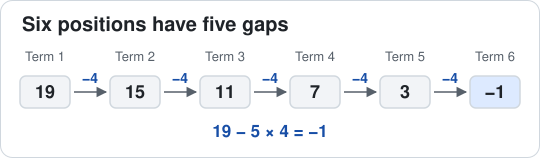
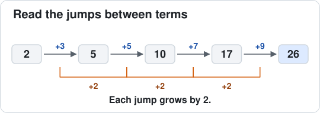
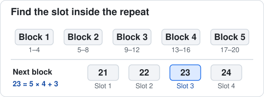
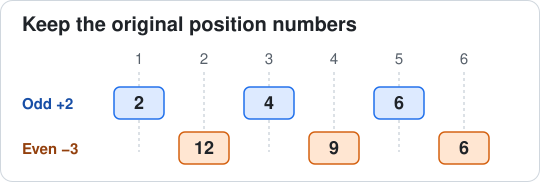
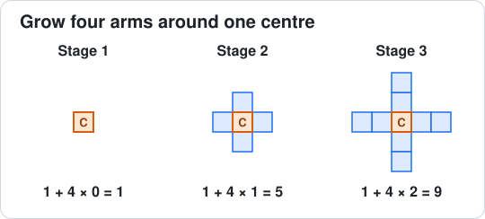
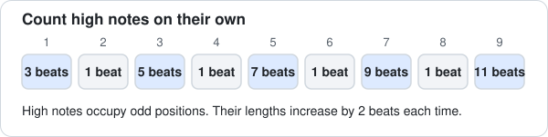

# M4 — Patterns and sequences: Learning

[← Back to the index](../../README.md) · [Go to the M4 practice questions →](doing.md)

## 1. What you remember

**From the test (your own recollection):**
- Number patterns appeared, including less obvious patterns.

**Recognized later when topics were suggested:**
- No follow-up recognition recorded for this category.

**Added for practice (not recalled from the test):**
- Figure-growth (sticks, tiles) and cyclic patterns are added for transfer.

All questions here are original practice. They are not copies of real test questions.

## 2. Four patterns to use

### Count the gaps between positions

If each step adds the same amount, the term at position *n* is the first term plus (*n* − 1) steps. For a sequence starting at 19 and falling by 4, term 6 is 19 − 5 × 4 = −1. To locate a target, divide its change from the first term by the signed step. A whole number of steps of zero or more lands on a term. Add one to get its position. Check by stepping to the term just before your target.

### Look at what changes between terms

Write each increase or decrease in the gap where it happens. In 2, 5, 10, 17, the jumps are 3, 5, 7. If the jumps keep increasing by 2, the next jump is 9 and the next term is 26. If the rule says the same *factor* applies each time, divide consecutive terms to find it. In 2, 6, 18, the factor is 3. Check a proposed rule against every supplied term and the stated conditions. A few terms can fit more than one rule.

### Separate repeating positions

If an entire block repeats, remove as many full blocks as possible. For a four-symbol block, position 23 has the third symbol because 23 = 5 × 4 + 3. An exact multiple of four lands on the fourth symbol. If the odd and even positions each grow by their own rule, write them on separate lines. Label the original positions above both lines so that when you fill a gap, you can put it back in the right place.

### Count a growing figure by pieces

Use the construction rule to split the drawing into parts that never overlap. These figures start with one tile and extend each of four straight arms by one tile at every stage.

Stage 3 has one centre and four arms of length two, giving 1 + 4 × 2 = 9 tiles. At stage *n*, each arm has grown *n* − 1 times. Check 1 + 4(*n* − 1) against the first two drawings before using it for a far stage.

## 3. Worked example

At a rehearsal, the conductor alternates high and low notes. The first high note lasts 3 beats and each later high note lasts 2 beats longer than the previous high note. Every low note lasts 1 beat. The order begins high, low, high, low. How many beats does the note in position 9 last?

A. 1

B. 9

C. 11

D. 13

E. 19

**Answer C.** The high notes occupy positions 1, 3, 5, 7 and 9. Position 9 is the fifth high note, four increases after the first. Its length is 3 + 4 × 2 = 11 beats. Choice E counts an increase at every position, including the intervening low notes.

## 4. Practise

[Open the M4 practice questions](doing.md) and record each answer before checking the key.
