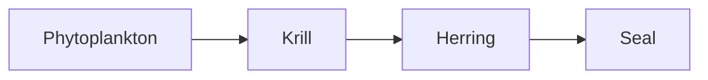
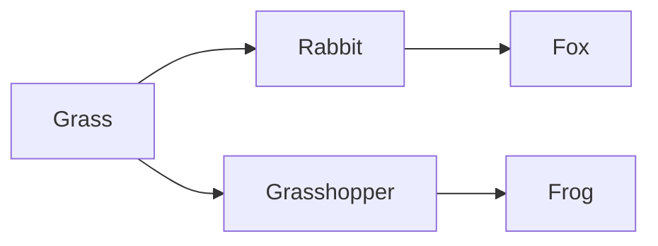
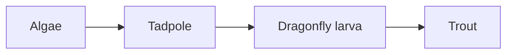
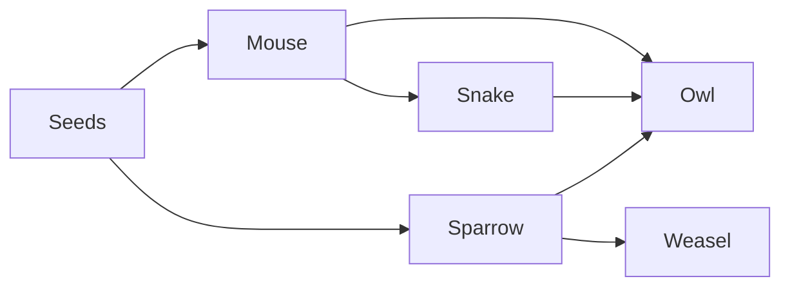
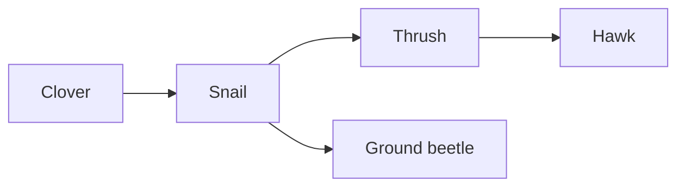
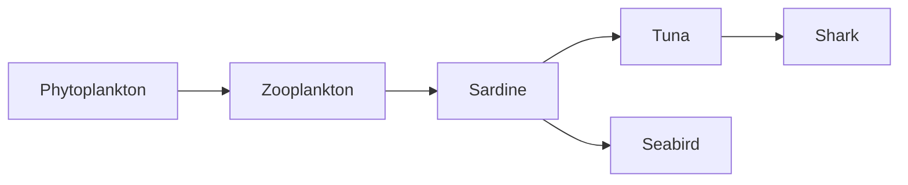
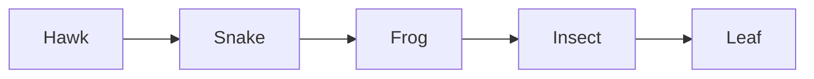
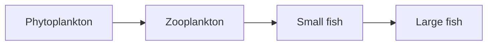

# S1 — Ecology and ecosystems: Doing

[← Back to the index](../../README.md) · [Review the S1 learning page](learning.md)

## How to use this page

1. Answer each question on paper **before** looking at the key.
2. Mark each attempt: ✅ correct, 🤔 guessed (even if right), ❌ wrong, ⏭️ skipped.
3. Review guesses as carefully as misses.
4. Questions S1-Q26 to S1-Q30 are saved for the final weekend. Do not open them early.

**Rules for every question on this page:**
- Use only the feeding relationships stated or drawn in the question. Do not add diets from memory.
- In every diagram, an arrow points **from the organism that is eaten to the organism that eats it** (the direction energy flows).
- Unless a question says otherwise, the diagram or list shows every feeding relationship in that community.

All questions are original practice. They are not copies of real test questions.

## Questions

### S1-Q01

In a field, mice eat seeds, snakes eat mice, and hawks eat snakes. Which statement correctly describes the snake?

A. It is prey of the mouse.

B. It is a predator of the hawk.

C. It is a predator of the mouse and prey of the hawk.

D. It is a producer, because it is in the middle of the chain.

E. It is a predator of both the seeds and the hawk.

### S1-Q02

In a garden pond community:

- Flies feed on flower nectar.
- Spiders eat flies.
- Dragonflies eat flies.
- Frogs eat spiders and dragonflies.
- Bats eat dragonflies.
- Herons eat frogs.

Which organism is eaten by **two** different predators **and** eats only **one** kind of animal?

A. Fly

B. Spider

C. Frog

D. Heron

E. Dragonfly

### S1-Q03

In a meadow, owls eat shrews, grass is eaten by crickets, and shrews eat crickets. Which food chain correctly shows the direction of energy flow?

A. Grass → Cricket → Shrew → Owl

B. Owl → Shrew → Cricket → Grass

C. Grass → Shrew → Cricket → Owl

D. Cricket → Grass → Shrew → Owl

E. Owl → Grass → Cricket → Shrew

### S1-Q04

An ocean food chain is shown below.

What does the arrow from Krill to Herring show?

A. Krill eat herring.

B. Energy flows from herring to krill.

C. Krill and herring compete for the same food.

D. Herring eat krill, so energy passes from krill to herring.

E. Herring are producers that make food for krill.

### S1-Q05

A student grows bean seedlings in two pots, P and Q. The pots are the same size, hold the same soil, have the same number of seeds, and are kept at the same temperature. Pot P is placed in shade and given 20 mL of water a day. Pot Q is placed in a sunny window and given 50 mL of water a day. After two weeks, the plants in pot P are much smaller.

Which conclusion is best supported?

A. Light was the limiting resource in pot P, because pot P was in shade.

B. The difference could be caused by light, by water, or by both; this comparison cannot tell which, because two resources were changed.

C. Water was the limiting resource in pot P, because plants need water more than light.

D. Space was the limiting resource in pot P, because its plants were crowded.

E. Neither light nor water affected the plants, because both pots had the same soil.

### S1-Q06

The diagram shows every feeding relationship in a small meadow.

Grass is already in short supply for grasshoppers. All the foxes leave the meadow. What is the most likely effect on the grasshoppers over the next few seasons?

A. Grasshoppers increase, because one of their predators is gone.

B. Grasshoppers are unaffected, because foxes do not eat grasshoppers.

C. Grasshoppers decrease, because foxes were their food.

D. Grasshoppers decrease, because rabbits increase and eat more of the grass that grasshoppers also need.

E. Grasshoppers increase, because the extra rabbits will eat the frogs.

### S1-Q07

In a forest, mushrooms grow on fallen logs. They break down the dead wood and return nutrients to the soil. In this description, the mushrooms are acting as which of the following?

A. Producers

B. Decomposers

C. Herbivores

D. Carnivores

E. Predators

### S1-Q08

In a pond, ducks eat water plants, carp eat the same water plants, and herons eat carp. The water plants are in short supply. Which pair of organisms is competing for a food resource?

A. Herons and carp

B. Water plants and ducks

C. Herons and water plants

D. Carp and water plants

E. Ducks and carp

### S1-Q09

On a northern island, lynx eat snowshoe hares. Scientists counted both populations each year.

| Year | Hares | Lynx |
|---|---|---|
| 1 | 40 | 4 |
| 2 | 60 | 6 |
| 3 | 80 | 10 |
| 4 | 50 | 14 |
| 5 | 30 | 9 |
| 6 | 45 | 5 |

Which explanation best fits the data from Year 3 to Year 5?

A. Lynx rose to their highest number in Year 4 while hares dropped; then, with fewer hares to eat, lynx dropped in Year 5.

B. Hares dropped because hares eat lynx, and there were fewer lynx to eat.

C. Lynx dropped first, and this caused the hares to drop.

D. Hares and lynx dropped by the same amount each year, so the two populations are unrelated.

E. Hares dropped even though lynx numbers stayed the same, so lynx had no effect.

### S1-Q10

A colony of bats lives near a river. At night the bats catch insects over the river and drink from it. During the day they hang hidden inside an old barn, out of the wind, rain, and sight of predators. Which resource does the barn provide for the bats?

A. Food

B. Water

C. Shelter

D. Light

E. Soil nutrients

### S1-Q11

A stream food chain is shown below.

From which organism does the dragonfly larva **directly** get its energy?

A. Trout

B. Algae

C. Sunlight

D. Both the trout and the algae

E. Tadpole

### S1-Q12

On a rocky shore, barnacles and mussels both attach themselves to the same bare rock surfaces. Both filter tiny food particles from the seawater, and food in the water is plentiful. Where mussels have covered a rock, young barnacles cannot settle. Which resource are barnacles and mussels mainly competing for?

A. Space

B. Light

C. Food

D. Water

E. Soil nutrients

### S1-Q13

The diagram shows every feeding relationship in a farmland community.

A disease kills all the mice in this community. Which organism **directly** loses a food source **and** has no other food shown in the diagram?

A. Owl

B. Sparrow

C. Snake

D. Weasel

E. Seeds

### S1-Q14

In a woodland:

- Voles eat grass.
- Deer eat grass.
- Foxes eat voles.
- Foxes also eat berries.

A student claims: "Every animal in this woodland that eats a plant is a herbivore." Which organism shows that the student's claim is **false**?

A. Vole

B. Fox

C. Deer

D. Grass

E. Berries

### S1-Q15

In a garden, ladybirds eat aphids. A student counted the aphids on one rose bush each week. Ladybirds were released onto the bush at the end of Week 3.

| Week | Aphids on the bush |
|---|---|
| 1 | 200 |
| 2 | 260 |
| 3 | 300 |
| 4 | 180 |
| 5 | 90 |

Between which two **consecutive** weeks did the number of aphids fall the most?

A. Week 1 to Week 2

B. Week 2 to Week 3

C. Week 4 to Week 5

D. Week 3 to Week 4

E. The aphids never fell between two consecutive weeks.

### S1-Q16

The diagram shows every feeding relationship in a hedgerow.

Which organism is prey for **two** different predators?

A. Clover

B. Snail

C. Thrush

D. Hawk

E. Ground beetle

### S1-Q17

Five lake organisms form a single straight food chain: each consumer eats only the organism directly before it in the chain. You are told:

- Algae is the producer.
- The pike is not eaten by any of the others.
- The minnow eats water fleas.
- The perch eats minnows.

Which food chain is correct?

A. Pike → Perch → Minnow → Water flea → Algae

B. Algae → Minnow → Water flea → Perch → Pike

C. Algae → Water flea → Perch → Minnow → Pike

D. Algae → Water flea → Minnow → Perch → Pike

E. Water flea → Algae → Minnow → Perch → Pike

### S1-Q18

In a forest, tall trees spread wide leaves high overhead. Small ferns on the forest floor grow poorly under the thickest part of the tree cover, even though the soil there is moist and rich in nutrients. Ferns in a sunny clearing nearby, in the same kind of soil, grow well. Which resource is most likely limiting the ferns under the trees?

A. Water

B. Soil nutrients

C. Light

D. Space for roots

E. Shelter

### S1-Q19

The diagram shows every feeding relationship in part of an ocean.

Overfishing removes almost all the sardines. An organism is **directly** affected if it eats sardines or is eaten by sardines. Which pair lists **only** organisms that are affected **indirectly**?

A. Tuna and seabird

B. Zooplankton and tuna

C. Phytoplankton and zooplankton

D. Shark and seabird

E. Phytoplankton and shark

### S1-Q20

A marsh wren lives among the tall reeds at the edge of a marsh. It builds its nest in the reeds, catches insects among them, and drinks the marsh water. Which best describes the wren's **habitat**?

A. The reed marsh where it lives and finds its food, water, and shelter

B. The insects it eats

C. Its nest only

D. Its role as a predator of insects

E. The water it drinks

### S1-Q21

Red beetles and grey beetles both eat the same kind of leaf. Neither beetle eats the other. A scientist sets up three identical tanks, each given the same amount of leaves every day, and counts the beetles after two months. Every tank containing red beetles starts with 50 red beetles. Every tank containing grey beetles starts with 50 grey beetles. All tanks have ample space, water and shelter.

| Tank | Beetles started in the tank | Red beetles after two months | Grey beetles after two months |
|---|---|---|---|
| 1 | Red only | 200 | 0 |
| 2 | Grey only | 0 | 180 |
| 3 | Red and grey together | 120 | 40 |

Which conclusion best fits the results?

A. Both populations are smaller when kept together, which fits competition for leaves, and the grey beetles are affected more.

B. Red beetles are predators of grey beetles, so grey beetles fall in Tank 3.

C. Grey beetles do better when red beetles are present.

D. Only the red beetles are affected by sharing the tank.

E. The results show that leaves are not a limiting resource for either beetle.

### S1-Q22

Which list contains **only** non-living resources that organisms need from their environment?

A. Water, insects, sunlight

B. Living seedlings, space, water

C. Grass, light, soil nutrients

D. Mice, shelter, water

E. Water, light, space

### S1-Q23

In a field, insects eat leaves, frogs eat insects, snakes eat frogs, and hawks eat snakes. A student drew this diagram of the food chain:

Using the rule that arrows point from the eaten to the eater, what is wrong with the student's diagram?

A. The organisms are in the wrong order; the frog and the snake should swap places.

B. Every arrow points the wrong way; it should be Leaf → Insect → Frog → Snake → Hawk.

C. The hawk should be removed, because a food chain can have only four organisms.

D. The leaf should be removed, because plants are not part of food chains.

E. Nothing is wrong; the diagram is correct.

### S1-Q24

On an imaginary planet, glims, zarks, and vexes are animals.

- Floots make their own food from light.
- Glims eat floots.
- Zarks eat glims.
- Vexes eat zarks and glims.

Which organism is not eaten by any other organism listed, but eats two different kinds of animals?

A. Floot

B. Glim

C. Vex

D. Zark

E. None of them

### S1-Q25

In a lake, pike eat perch. Young perch hide from pike among water plants near the shore. Over three years:

- The perch population fell from 500 to 200.
- The pike population stayed at about 40.
- Most of the water plants along the shore were cleared away for a beach.

Which explanation is best supported?

A. More pike ate the perch, because the pike population grew.

B. The perch fell because perch eat pike.

C. The drop cannot be linked to the plants, because perch do not eat the water plants.

D. Losing hiding places could have made young perch easier for the same number of pike to catch.

E. The perch fell because the pike population fell.

### S1-Q26

At a deep-sea vent there is no sunlight. Bacteria make food from chemicals in the hot water. Tubeworms get their food from bacteria living inside them. Crabs eat tubeworms, and octopuses eat crabs.

Which organism in this community plays the same role that plants play in a sunlit forest?

A. Tubeworm

B. Crab

C. Octopus

D. Bacteria

E. The chemicals in the water

### S1-Q27

The diagram shows every feeding relationship in a lake.

Researchers mark exactly one of these four populations with a harmless dye. The dye spreads only when an animal eats marked food. It stays detectable, and each population has had time to eat its usual food. Tests show dye in small fish and large fish, and none in phytoplankton. Which further test would tell the researchers which population they marked first?

A. Test zooplankton. A positive result identifies zooplankton as the starting population, and a negative result identifies small fish.

B. Test another large fish. A positive result identifies large fish as the starting population.

C. Test another small fish. A positive result identifies small fish as the starting population.

D. Test more phytoplankton. A negative result identifies zooplankton as the starting population.

E. Test lake water. Detecting dye there would identify the first marked population.

### S1-Q28

All summer, the algae in a lake grew very little, even though the water was warm, clear, and well lit. After a heavy rain washed fertilizer from nearby farms into the lake, the algae grew rapidly within days. Which resource was most likely limiting the algae before the rain?

A. Light

B. Space

C. Water

D. Shelter

E. Nutrients

### S1-Q29

On an island, native lizards eat beetles. At the start of Year 3, cane toads were brought to the island. The toads also eat beetles. Toads do not eat lizards, and lizards do not eat toads.

| Year | Lizards | Beetles | Toads |
|---|---|---|---|
| 1 | 50 | 900 | 0 |
| 2 | 52 | 880 | 0 |
| 3 | 51 | 890 | 20 |
| 4 | 40 | 600 | 80 |
| 5 | 28 | 400 | 150 |

Which explanation best fits the data?

A. The toads ate the lizards, so the lizards decreased.

B. The lizards decreased because the beetles increased.

C. Toads and lizards compete for beetles; as the toads increased, the beetles fell and the lizards had less food.

D. The lizards had already started falling before the toads arrived, so the toads are not involved.

E. The beetles fell because the lizards increased.

### S1-Q30

Inside a rotting log:

- Fungi break down the dead wood.
- Springtails eat the fungi.
- Mites eat springtails.
- Centipedes eat mites and springtails.

Which organism feeds on a decomposer?

A. Fungi

B. Springtail

C. Mite

D. Centipede

E. The dead wood

## Answer key

| ID | Answer | Tier | Reasoning | Closest distractor ruled out by |
|---|---|---|---|---|
| S1-Q01 | C | Medium | Snakes eat mice (predator of the mouse) and hawks eat snakes (prey of the hawk). | E: seeds are eaten by mice, not snakes, and the snake does not eat the hawk. |
| S1-Q02 | E | Challenge | Dragonflies are eaten by frogs and bats (two predators) and eat only flies (one kind of animal). | A: the fly is eaten by two predators but eats nectar, not an animal. Spider has one predator; frog eats two kinds of animal. |
| S1-Q03 | A | Medium | Crickets eat grass, shrews eat crickets, owls eat shrews; energy flows grass → cricket → shrew → owl. | B lists the right order with every arrow reversed (pointing to the food, not the eater). |
| S1-Q04 | D | Medium | An arrow points from the eaten to the eater, so herring eat krill and energy moves krill → herring. | A reads the arrow backwards. |
| S1-Q05 | B | Challenge | Light and water were both changed, so the comparison cannot isolate one cause. | A: shade is a likely cause, but P also got less water, so light alone cannot be concluded. D: pots and seed numbers were identical. |
| S1-Q06 | D | Challenge | No foxes → rabbits are not eaten → rabbits increase → more grass is eaten → less food for grasshoppers. | B: no arrow joins foxes and grasshoppers, but the effect travels indirectly through rabbits and the shared grass. A: foxes never ate grasshoppers. |
| S1-Q07 | B | Medium | Breaking down dead material and returning nutrients is what decomposers do. | A: mushrooms do not make their own food from sunlight in this description. |
| S1-Q08 | E | Medium | Ducks and carp both need the same scarce water plants. | A: herons eat carp; that is predator and prey, not competition. |
| S1-Q09 | A | Challenge | Lynx peaked in Year 4 (14) while hares fell (80 → 50); hares kept falling and lynx then fell in Year 5 (14 → 9). | C: lynx rose from Year 3 to Year 4 while hares were already falling, so lynx did not drop first. |
| S1-Q10 | C | Medium | Protection from wind, rain, and predators is shelter. | A and B: food and water come from the river, not the barn. |
| S1-Q11 | E | Medium | The arrow into the dragonfly larva comes from the tadpole, so it eats tadpoles. | B: algae energy reaches the larva only through the tadpole (an indirect source). |
| S1-Q12 | A | Medium | Mussels covering rock stop barnacles settling: they compete for rock surface (space). | C: the stem says food is plentiful, so it is not the limiting resource. |
| S1-Q13 | C | Challenge | Owl and snake both eat mice (direct loss), but the snake's only food is the mouse. | A: the owl loses mice directly but still has sparrows and snakes. |
| S1-Q14 | B | Challenge | The fox eats a plant (berries) but also eats voles, so it is an omnivore, not a herbivore. | C: the deer eats only grass, so it is a herbivore and fits the claim. |
| S1-Q15 | D | Medium | Falls: Week 3→4 is 300 − 180 = 120; Week 4→5 is 180 − 90 = 90. The largest fall is Week 3→4. | C: Week 4→5 is a fall of only 90, though the count there is lowest. |
| S1-Q16 | B | Medium | Snails are eaten by thrushes and ground beetles. | E/C: the ground beetle has no predator; the thrush has only the hawk. |
| S1-Q17 | D | Challenge | Perch eats minnow and minnow eats water flea, so flea → minnow → perch; pike is at the top; algae must be first, so the water flea is second. | C: it puts perch before minnow, but the perch eats the minnow. |
| S1-Q18 | C | Medium | Same soil grows ferns well in a sunny clearing, and the soil under the trees is moist and rich; the difference is light blocked by the trees. | A/B: the stem says water and nutrients are already good. |
| S1-Q19 | E | Challenge | Direct: zooplankton (lose a predator), tuna and seabird (lose food). Indirect: phytoplankton (through zooplankton) and shark (through tuna). | C/D each contain one directly affected organism (zooplankton / seabird). |
| S1-Q20 | A | Medium | A habitat is the place where an organism lives and meets its needs: the reed marsh. | D describes the wren's feeding role, not the place it lives. |
| S1-Q21 | A | Challenge | Compare each species with its own single-species tank. The mixed tank ends with 80 fewer red beetles (200 − 120) and 140 fewer grey beetles (180 − 40). With matched starting counts, this fits competition for leaves. | B: the stem says neither beetle eats the other. D: red beetles also finished below their single-species count. |
| S1-Q22 | E | Medium | Water, light, and space are all non-living. | D: shelter can be non-living, but mice are living. |
| S1-Q23 | B | Medium | The order is right but each arrow points toward the food instead of toward the eater. | A: the order (leaf, insect, frog, snake, hawk) is already correct; only the direction is wrong. |
| S1-Q24 | C | Medium | Nothing eats vexes, and vexes eat zarks and glims (two animals). | D: zarks are eaten by vexes and eat only one kind of animal. |
| S1-Q25 | D | Challenge | Young perch use the plants for cover. Clearing the plants could increase the catch per pike even with a steady pike count. The observations support this explanation without establishing the cause. | C: the plants matter as shelter, an indirect link, even though perch do not eat them. A: the pike count stayed near 40. |
| S1-Q26 | D | Medium | Bacteria make food (from chemicals), so they are the producers, like plants. | E: chemicals are an energy source, not an organism. A: tubeworms get food from bacteria, so they are consumers. |
| S1-Q27 | A | Challenge | The marker moves toward eaters. Starting at small fish or at zooplankton would mark both fish populations and leave phytoplankton unmarked. Only the zooplankton test separates these two cases. | C: small fish test positive in both surviving cases, either from the original dose or from eating marked zooplankton. |
| S1-Q28 | E | Medium | Fertilizer adds nutrients; growth jumped only once nutrients arrived. | A: the stem says the lake was already well lit. |
| S1-Q29 | C | Challenge | Lizards were steady (50–52) until toads arrived; then toads rose, beetles fell, and lizards fell. | D: lizards were stable in Years 1–3 and fell only after toads arrived. A: toads do not eat lizards. |
| S1-Q30 | B | Medium | Fungi break down dead wood, so they are the decomposer; springtails eat the fungi. | D: centipedes eat mites and springtails, not fungi. |
