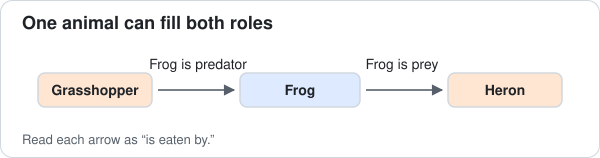
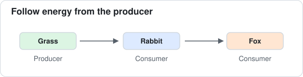
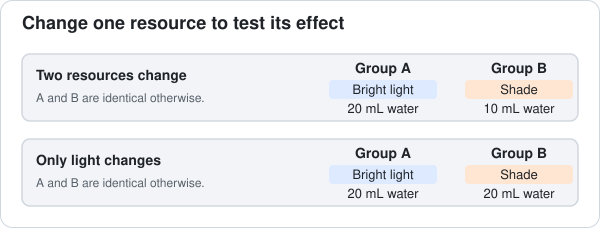
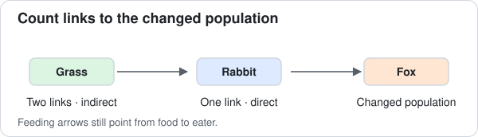
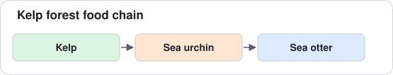

# S1 — Ecology and ecosystems: Learning

[← Back to the index](../../README.md) · [Go to the S1 practice questions →](doing.md)

## 1. What you remember

**From the test (your own recollection):**
- Identify predator and prey.
- Order organisms in a food chain.
- Identify ecological resources.
- Apply biological terminology.

**Recognized later when topics were suggested:**
- No follow-up recognition recorded for this category.

**Added for practice (not recalled from the test):**
- Food webs, competition, and population data are extensions.

All questions here are original practice. They are not copies of real test questions.

## 2. Core skills taught on this page

- Identify roles relative to another organism: an animal can be predator to one and prey to another.
- Read arrow direction in food chains as the direction energy flows.
- Use producer, consumer, herbivore, carnivore, omnivore, decomposer, habitat.
- Identify resources (water, light, shelter, space, nutrients) and competition for them.
- Separate direct effects from indirect effects in a food web.

### Key words

| Word | Meaning in a question |
|---|---|
| Producer | Makes its own food (usually from sunlight). Plants, algae, phytoplankton. |
| Consumer | Gets energy by eating other organisms. |
| Herbivore | A consumer that eats only plants or algae. |
| Carnivore | A consumer that eats only animals. |
| Omnivore | A consumer that eats both plants and animals. |
| Decomposer | Breaks down dead material and returns nutrients to the soil or water (for example, fungi and many bacteria). |
| Predator / prey | The predator eats the prey. These words always describe a **pair** of organisms. |
| Habitat | The place where an organism lives and finds its food, water, and shelter. |
| Resource | Something an organism needs from its surroundings: food, water, light, shelter, space, nutrients. |
| Competition | Two or more organisms need the **same** resource and there is not enough for all of them. |

## 3. Core patterns

### Pattern 1 — Roles are relative

- **Clue to notice:** the question asks whether an organism is a "predator" or "prey", or asks which organism is "both".
- **Decision to make:** relative to *which* other organism? List what the organism eats (it is a predator of those animals) and what eats it (it is prey of those). One animal can be both at once.
- **How to check:** say the pair out loud as a sentence: "The ___ eats the ___." If the sentence is not stated in the question or shown by an arrow, the relationship does not exist in this question. Use only the feeding relationships given; never add diets from memory.

### Pattern 2 — Arrows point from the eaten to the eater

- **Clue to notice:** a food chain or web drawn with arrows, or a choice written as `A → B → C`.
- **Decision to make:** an arrow shows where the **energy goes**, so it points *toward the organism that does the eating*. `Grass → Rabbit` means the rabbit eats the grass. To trace a chain that begins with a producer, start at the organism that makes its own food.
- **How to check:** read each arrow as "is eaten by". `Grass → Rabbit → Fox` reads "grass is eaten by rabbit, rabbit is eaten by fox." If any link reads backwards ("fox is eaten by rabbit"), the arrows are reversed.

### Pattern 3 — Find the resource that is actually in short supply

- **Clue to notice:** organisms grow poorly, move away, or fight over something; or two setups are compared.
- **Decision to make:** which resource is missing or shared? Name it from the list (water, light, shelter, space, nutrients, food). Ignore resources the question says are plentiful. If two setups differ in **more than one** resource, you cannot tell which one caused the difference.
- **How to check:** ask "If I supplied more of this one resource, would the problem go away?" Then check that nothing else in the stem was also changed.

### Pattern 4 — Direct versus indirect effects

- **Clue to notice:** an organism is removed, added, or changes in number, and the question asks about a different organism.
- **Decision to make:** is the organism asked about joined to the changed one by a single arrow (a **direct** effect: it loses food or loses a predator), or only through a middle organism (an **indirect** effect)? For indirect effects, follow the chain one link at a time.
- **How to check:** write each step as "X goes down, so Y (which eats X / is eaten by X) goes ___." Never write "unaffected" just because there is no arrow between two organisms.

## 4. Worked example

**Question.** In a coastal kelp forest, the only feeding relationships are shown below. Arrows point from the organism eaten to the eater.

Hunters remove most of the sea otters. What is the most likely effect on the kelp?

A. Kelp is unaffected, because sea otters do not eat kelp.

B. Kelp increases, because there are now fewer animals in the forest.

C. Kelp decreases, because sea urchins, now eaten by fewer otters, increase and eat more kelp.

D. Sea urchins decrease, because they have lost their predator.

E. Kelp decreases, because sea otters were producers that made food for the kelp.

**Answer: C.**

**Decisive step (Pattern 4):** there is no arrow between otters and kelp, so the effect must travel through the middle organism. Fewer otters → fewer urchins are eaten → urchins **increase** → more kelp is eaten → kelp **decreases**.

**Why the tempting wrong answer fails:** choice A treats "no arrow between them" as "no effect". That is only true for *direct* effects. Kelp is affected *indirectly*, through the urchins. Choice D reverses the first step: losing a predator lets a population grow, not shrink. Choice E invents a role; the kelp is the producer here.

## 5. Practise

Go to [S1 practice questions (doing.md)](doing.md). Commit to an answer for each question before you open the answer key.
