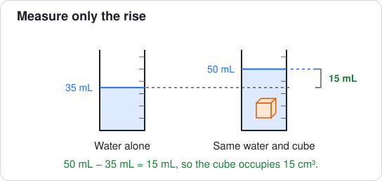
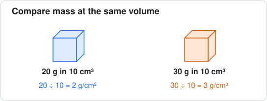
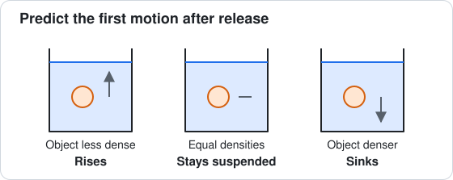
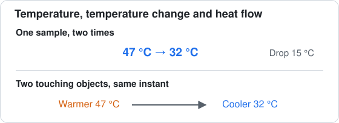
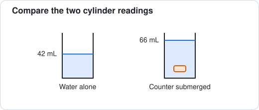

# S3 — Matter, fluids, and temperature: Learning

[← Back to the index](../../README.md) · [Go to the S3 practice questions →](doing.md)

## 1. What you remember

**From the test (your own recollection):**
- Nothing specific was recalled from the test for this category.

**Recognized later when topics were suggested:**
- Water displacement; mass, volume, and density; heat and temperature were recognized in follow-up.
- Changes of state received a tentative "maybe" and is optional.

**Added for practice (not recalled from the test):**
- Floating/sinking comparisons and cooling-curve reading are extensions.

All questions here are original practice. They are not copies of real test questions.

## 2. Four patterns to practise

**Find the volume that entered the water.** When the same cylinder is read twice, ask what changed between readings. A fully submerged object that absorbs no water displaces its own volume. Subtract the starting reading from the ending reading. Use 1 mL = 1 cm³. Check for spills, trapped air or other submerged objects before attributing the whole rise to the object.

**Compare mass per unit volume.** Density tells you the mass packed into each unit of volume. Divide mass by volume and carry the units, such as g/cm³. To work backward, multiply density by volume to get mass, or divide mass by density to get volume. Check equal-volume samples by comparing their masses. For equal masses, the smaller sample is denser.

**Decide what floats.** Compare an object’s average density, counting any sealed empty space in its volume, with the liquid’s density in the same units. Released away from the walls and bottom, a less dense object rises and a denser one sinks. Equal densities allow an object to stay suspended. Check your prediction by comparing its mass with the mass of an equal volume of liquid.

**Read temperature and change separately.** A thermometer reading gives temperature at one instant. A change needs two readings. For a temperature drop, subtract the ending value from the starting value. In a table, trace the same sample across the same interval. To determine the direction of net heat transfer between two objects in contact, compare their temperatures at that instant. Energy flows from warmer to cooler until the two reach the same temperature.

## 3. Worked example

A sealed plastic counter has a mass of 18 g. A student holds it fully under water with a thin pin of negligible volume. No water spills.

| Cylinder reading | Volume (mL) |
|---|---:|
| Water alone | 42 |
| Water and submerged counter | 66 |

Water has a density of 1.0 g/cm³. When the student releases the counter under water, what does it do?

A. It sinks because its density is 1.33 g/cm³.

B. It rises because its density is 0.75 g/cm³.

C. It stays suspended because it displaces its own volume.

D. It sinks because its mass is 18 g.

E. It rises because its density is 0.27 g/cm³.

**Answer B.** The counter occupies 66 − 42 = 24 mL, or 24 cm³. Its density is 18 ÷ 24 = 0.75 g/cm³, below the density of water. Choice E predicts the motion correctly but divides by all 66 mL, including the original water.

## 4. Practise

[Open the S3 practice questions](doing.md). Mark each attempt before checking the answer key.
