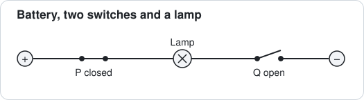
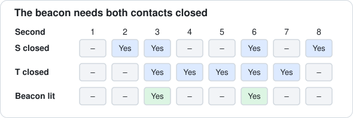

# S4 — Circuits and switches: Doing

[← Back to the index](../../README.md) · [Review the S4 learning page](learning.md)

## How to use this page

1. Answer each question on paper **before** looking at the key.
2. Mark each attempt: ✅ correct, 🤔 guessed (even if right), ❌ wrong, ⏭️ skipped.
3. Review guesses as carefully as misses.
4. Questions S4-Q26 to S4-Q30 are saved for the final weekend. Do not open them early.

These original circuits practise a topic recognized in follow-up. The [learning page](learning.md) records how the topic was chosen.

### Diagram guide

The marks `(+)` and `(-)` are the two terminals of one battery. Lines are wires and each `*` in a diagram is a connected junction. Bulbs appear in parentheses, switches in square brackets and test gaps in braces. A closed switch conducts and an open switch breaks its path. Use the switch states in each question. Assume a working battery, intact bulbs and ideal contacts unless a question describes a break. Consider only whether bulbs light. A labelled brace may also mark an intact wire segment when the question says so.

## Questions 01–05

<a id="s4-q01"></a>
### S4-Q01

Switch P is closed and Q is open. Which change alone would light the lamp?



A. Close Q

B. Move the lamp to the left of P

C. Exchange the positions of P and Q

D. Reverse the battery connections

E. Open P

<a id="s4-q02"></a>
### S4-Q02

Both bulbs are lit. The filament in L breaks, leaving a gap inside L. What happens?

```text
(+)--*--(L)--*--(-)
     |       |
     *--(M)--*
```

A. Both go dark

B. Both stay lit

C. Only L stays lit

D. M lights only if L is removed

E. Only M stays lit

<a id="s4-q03"></a>
### S4-Q03

Exactly one switch is open. Only bulb B is lit. Which switch is open?

```text
(+)--*--[T]--(A)--*--[R]--[S]--(-)
     |            |
     *--[U]--(B)--*
```

A. There is too little information

B. U

C. S

D. T

E. R

<a id="s4-q04"></a>
### S4-Q04

The contacts are on opposite sides of the gap. Copper conducts and dry plastic insulates. Which sample arrangement lights the bulb?

```text
(+)--(Bulb)--{gap}--(-)
```

A. Copper touches only the left contact

B. One bare copper strip touches both contacts

C. Dry plastic spans the gap

D. A copper strip and plastic strip in a chain span the gap

E. One copper piece on each contact, with air between the pieces

<a id="s4-q05"></a>
### S4-Q05

The red bulb is lit and the white bulb is dark. All switches can move independently. Which claim is forced?

```text
(+)--[M]--*--(Red)--------------*--(-)
          |                     |
          *--[X]--[Y]--(White)--*
```

A. M is open

B. M is closed and at least one of X and Y is open

C. Exactly one of X and Y is open

D. M and X must both be closed

E. X and Y must both be open

## Questions 06–10

<a id="s4-q06"></a>
### S4-Q06

All switches start closed. Which single switch can darken both bulbs?

```text
(+)--*--[A]--(L)--*--[C]--(-)
     |            |
     *--[B]--(R)--*
```

A. C

B. A

C. No single switch

D. Either A or B individually

E. B

<a id="s4-q07"></a>
### S4-Q07

A tester contains two sample gaps in series. With metal in both gaps the bulb lights. With sample X in gap 1 and sample Y in gap 2, it goes dark. Which follow-up would test X alone?

```text
(+)--{1}--(Bulb)--{2}--(-)
```

A. Repeat the same trial

B. Leave gap 2 empty

C. Keep X in gap 1 and put the original metal in gap 2

D. Exchange X and Y

E. Replace X with metal and leave Y

<a id="s4-q08"></a>
### S4-Q08

The top route has an open switch A. B is closed. Which bulbs light?

```text
(+)--*--(P)--[A]-------*--(-)
     |                 |
     *--(Q)--(R)--[B]--*
```

A. P and Q

B. Q and R

C. Q only

D. None

E. P only

<a id="s4-q09"></a>
### S4-Q09

The park wants the two lamps always to turn on and off together using a single switch. Both lamps must still have separate branches. U, V and W are intact wire segments. At which labelled position could workers insert the switch?

```text
(+)--{W}--*--{U}--(East)--*--(-)
          |               |
          *--{V}--(West)--*
```

A. V only

B. Either U or V

C. All three positions

D. U only

E. W only

<a id="s4-q10"></a>
### S4-Q10

A student sees L lit and knows P is closed. She opens P and L stays lit. Which description of the original circuit fits both observations?

```text
(+)--*--[P]--*--(L)--(-)
     |       |
     *--[Q]--*
```

A. P open, Q closed

B. A break immediately after L, with both switches closed

C. P closed, Q closed

D. P open, Q open

E. P closed, Q open

## Questions 11–15

<a id="s4-q11"></a>
### S4-Q11

Switch S connects to exactly one output, marked U or D. The two lines are separate after the selector. Which bulbs light when it connects to D?

```text
(+)--[selector S]  U--(K)-------*--(-)
                   D--(L)--(M)--|
```

A. M only

B. K only

C. L and M

D. K and L

E. All three

<a id="s4-q12"></a>
### S4-Q12

All bulbs are lit. The numbered braces mark intact wire segments. A wire breaks at one labelled position and now only R is lit. Which location matches?

```text
(+)--{3}--*--{1}--(P)--(Q)--{2}--*--{4}--(-)
          |                      |
          *--(R)-----------------*
```

A. Only 2

B. Either 3 or 4

C. Only 1

D. Either 1 or 2

E. No single break fits

<a id="s4-q13"></a>
### S4-Q13

P is open and Q is closed. A student adds a wire joining the two contacts of P. What will the bulb do?

```text
(+)--[P]--[Q]--(Bulb)--(-)
```

A. Light because the wire bridges P

B. Stay dark because P is open

C. Stay dark because two switches cannot control one bulb

D. Stay dark because the wire goes around Q

E. Light only while Q is open

<a id="s4-q14"></a>
### S4-Q14

The only lamps in a model house are in the attic and hall. Both switches are closed. The builder removes the attic bulb, leaving its socket open. Which statement explains the result?

```text
(+)--[A]--(Attic)--[H]--(Hall)--(-)
```

A. Hall stays lit because both switches are closed

B. Hall stays lit because it has its own switch

C. Hall stays lit because H is closed

D. Hall goes dark because its path passes through the empty socket

E. Hall flashes continuously because the socket is empty

<a id="s4-q15"></a>
### S4-Q15

The bulbs show blue lit and amber dark. Choose the complete list of conducting samples consistent with the display. Each gap holds either a conductor or an insulator.

```text
(+)--{Z}--*--{X}--(Blue)---*--(-)
          |                |
          *--{Y}--(Amber)--*
```

A. X and Y only

B. X, Y and Z

C. X and Z only

D. X only

E. Z only

## Questions 16–20

<a id="s4-q16"></a>
### S4-Q16

Which bulbs share exactly the same path through a branch, so that removing either one necessarily turns the other off?

```text
(+)--*--(J)--(K)--*--(-)
     |            |
     *--(L)-------*
     |            |
     *--(M)-------*
```

A. J and L

B. J and M

C. K and M

D. J and K

E. L and M

<a id="s4-q17"></a>
### S4-Q17

A door closes switch D. A floor pad closes switch F. A lamp should light if either one closes, including when both close. Starting with the circuit drawn, which modification meets the goal?

```text
(+)--[D]--[F]--(Lamp)--(-)
```

A. Remove F and leave a gap

B. Exchange D and F in the existing line

C. Rewire D and F side by side between the same two junctions, feeding the lamp

D. Add another lamp between D and F

E. Move D to the other side of the lamp

<a id="s4-q18"></a>
### S4-Q18

Three bulbs occupy separate branches. Switches A and B are closed and C is open. How many bulbs have a complete path?

```text
(+)--*--[A]--(1)--*--(-)
     |            |
     *--[B]--(2)--*
     |            |
     *--[C]--(3)--*
```

A. Three

B. The number depends on which branch is drawn first

C. Zero

D. One

E. Two

<a id="s4-q19"></a>
### S4-Q19

Lamp L is dark. A technician closes A, leaving B and C untouched, and L lights. What do the two observations together prove?

```text
(+)--*--[A]--*--[C]--(L)--(-)
     |       |
     *--[B]--*
```

A. Both B and C were open

B. B must have been closed

C. B and C were both closed

D. C was open

E. B was open and C was closed

<a id="s4-q20"></a>
### S4-Q20

An insulating sleeve covers the middle of one continuous copper strip. Its bare copper ends touch the two contacts in a lamp tester. Which prediction follows?

```text
(+)--{strip}--(Lamp)--(-)
```

A. The lamp stays dark because current must cross the sleeve

B. The lamp lights only if the sleeve touches a contact

C. The lamp stays dark unless the entire strip is bare

D. The lamp stays dark because copper conducts only at its surface coating

E. The lamp lights through the continuous copper

## Questions 21–25

<a id="s4-q21"></a>
### S4-Q21

The left-hand bulb is lit. Which statement about the switches must be true?

```text
(+)--(Left)--*--[A]--*--[C]--(-)
             |       |
             *--[B]--*
```

A. B and C must both be closed

B. C is closed and at least one of A and B is closed

C. A and B must both be closed

D. Exactly one switch is closed

E. Only A is closed

<a id="s4-q22"></a>
### S4-Q22

The master switch is open. Both branch switches are closed. What happens immediately after the master switch closes?

```text
(+)--*--[P]--(Map)----*--[Master]--(-)
     |                |
     *--[Q]--(Clock)--*
```

A. Only Clock comes on

B. Both stay dark

C. Both lights come on

D. Only Map comes on

E. The two lights take turns

<a id="s4-q23"></a>
### S4-Q23

The switches start in the states given below. You flip exactly one switch. Which list gives all possible numbers of lit bulbs immediately afterward?

```text
(+)--[C]--*--[A]--(L)--(M)--*--(-)
          |                 |
          *--[B]--(N)-------*
A closed    B open    C closed
```

A. 1 or 3

B. 0 or 1

C. 1, 2 or 3

D. 0, 1 or 3

E. 0 or 3

<a id="s4-q24"></a>
### S4-Q24

A bulb tester has a spring clip at each contact. Which setup would provide a conducting path across the gap? Bare metal conducts and rubber insulates.

```text
(+)--(Bulb)--{clips}--(-)
```

A. One clip holds a metal key while the other touches air

B. The clips grip separate metal keys that do not touch

C. Both clips touch only the rubber grip of one key

D. Both clips grip the bare shaft of the same metal key

E. One clip touches the metal shaft and the other touches only the rubber handle

<a id="s4-q25"></a>
### S4-Q25

Both bulbs are dark. M is closed and A is closed. Under these conditions, which conclusion about B follows?

```text
(+)--[M]--(P)--[B]--(Q)--[A]--(-)
```

A. B is open

B. No state of B fits

C. B is closed

D. B changes the two bulbs independently

E. Either switch position would give the observed display

## Questions 26–30 (final weekend)

<a id="s4-q26"></a>
### S4-Q26

A model lighthouse uses a rotating metal contact. The contact closes S during seconds 2, 3, 6 and 8 of an eight-second turn. A timer closes T during seconds 3 through 7 inclusive. During how many whole seconds does the beacon light?

```text
(+)--[S]--(Beacon)--[T]--(-)
```

A. Five

B. Two

C. Four

D. One

E. Seven

<a id="s4-q27"></a>
### S4-Q27

A worker can send a pulse down either wire of a two-wire cable by clipping (+) to its near end. The intended connections are U to Map and V to Desk, as shown. Each wire feeds one lamp. A lamp flashes only while its wire is selected. Both wires are intact. Which test reveals whether the far-end labels were exchanged?

```text
Near ends        Cable wires        Far ends (labels being tested)
    U o-----------------------------o--(Map)---*--(-)
    V o-----------------------------o--(Desk)--|
(+) clips to U or V, or to both for a test.
```

A. Clip (+) to neither and count dark lamps

B. Clip (+) only to U and record which lamp flashes

C. Clip (+) to both and count lit lamps

D. Disconnect the battery and watch both lamps

E. Clip (+) to both and record whether Map lights

<a id="s4-q28"></a>
### S4-Q28

A display board is folded along a crease. The fold breaks every wire marked x in the drawing and leaves the other wires intact. Which lamp can still light?

```text
(+)--*--x--(P)--*--(-)
     |          |
     *--(Q)--x--*
     |          |
     *--(R)-----*
```

A. R only

B. All three

C. P only

D. Q only

E. P and Q

<a id="s4-q29"></a>
### S4-Q29

A railway model has a two-position selector at each end of two tracks. Each selector touches exactly one track, upper or lower. The battery feeds the left selector and the lamp returns through the right selector. The tracks never touch. Both selectors point upper and the lamp is lit. The control cabin records two later snapshots. In which pair of snapshots is the lamp dark at the first snapshot and lit at the second? Each setting lists the left selector first.

```text
(+)--[left]  upper o----------------o upper  [right]--(Lamp)--(-)
             lower o----------------o lower
```

A. Upper/upper, then upper/lower

B. Lower/upper, then upper/lower

C. Lower/lower, then upper/lower

D. Lower/upper, then lower/lower

E. Upper/upper, then lower/lower

<a id="s4-q30"></a>
### S4-Q30

A test bench has a three-pin socket. Inside the plug exactly one pair of pins is joined by metal and the third pin is isolated. The clip tester lights when its two clips touch joined pins. Tests of pins 1 and 2, then pins 2 and 3, both give darkness. Across which pair should the technician put the clips to obtain light?

```text
(+)--(Test bulb)--clip A     clip B--(-)
                   plug pins  1  2  3
```

A. Pins 1 and 3

B. No two different pins

C. Pins 1 and 2

D. Any two different pins

E. Pins 2 and 3

## Answer key

[Go to the full solutions](#full-solutions)

| ID | Answer | Tier | Reasoning | Clue that rules out the closest distractor |
|---|---|---|---|---|
| S4-Q01 | A | Medium | Closing Q completes the only path through the lamp. | Exchanging the switches moves the break but leaves it in the path. |
| S4-Q02 | E | Medium | The M branch still joins the battery terminals. | A break in L would darken M only if they shared the broken path. |
| S4-Q03 | D | Challenge | B proves U and the shared R and S are closed. The break on A must be T. | An open R would interrupt B too. |
| S4-Q04 | B | Medium | A continuous conductor must join both contacts. | The plastic in the two-strip chain interrupts the route. |
| S4-Q05 | B | Challenge | Red proves M is closed. Either or both branch switches could break White’s path. | Both X and Y open also fits, so exactly one open is too strong. |
| S4-Q06 | A | Medium | Every path returns through C. | Opening A only interrupts L. |
| S4-Q07 | C | Challenge | The known metal restores a conducting path everywhere except through X, the sample under test. | Replacing X while keeping Y tests Y. |
| S4-Q08 | B | Medium | The lower route is complete through both Q and R. | Q and R share one path, so Q cannot light alone here. |
| S4-Q09 | E | Medium | W lies on the shared wire. Opening it disconnects both branches. | A switch at U leaves West connected. |
| S4-Q10 | C | Challenge | When Q conducts there is a complete route through L even after P opens. | With Q open, opening P breaks the last route. |
| S4-Q11 | C | Medium | The D route passes through L and M in series. | There is no route through M that skips L. |
| S4-Q12 | D | Challenge | Positions 1 and 2 both lie on the branch shared by P and Q. R bypasses both. | A break after Q at 2 interrupts current through P as well. |
| S4-Q13 | A | Medium | The wire provides a conducting route across P and Q already conducts. | An open switch can be bypassed by a conducting wire across its contacts. |
| S4-Q14 | D | Medium | The empty socket breaks the single path through Hall. | Giving each lamp a switch does not give it a separate branch. |
| S4-Q15 | C | Challenge | Blue proves both its own X and shared Z conduct. With Z conducting, amber’s dark branch shows Y insulates. | Z alone cannot complete the blue branch. |
| S4-Q16 | D | Medium | J and K occupy the same unbranched segment. | L and M have separate routes even though they connect to the same junctions. |
| S4-Q17 | C | Challenge | Separate switch paths let either closed switch complete the lamp circuit. | Exchanging two switches in series still requires both to close. |
| S4-Q18 | E | Medium | Branches A and B each connect both terminals. C breaks only its own route. | One open switch does not interrupt the other two branches. |
| S4-Q19 | E | Challenge | Lighting afterward proves C conducts. Beforehand, B could not have been closed or L would already have been lit. | A closed B would have provided the earlier route even with A open. |
| S4-Q20 | E | Medium | Current can travel along the copper core between its bare ends. | The sleeve surrounds the middle of the conductor without interrupting it. |
| S4-Q21 | B | Challenge | Every path uses C and one or both routes across the split must conduct. | A alone can bridge the split, so B is optional. |
| S4-Q22 | C | Medium | Closing the shared return completes both branch paths. | The drawing gives neither branch priority. |
| S4-Q23 | E | Challenge | Opening A or C leaves zero bulbs lit. Closing B gives three. | Opening A removes both bulbs on its branch together. |
| S4-Q24 | D | Medium | The continuous shaft bridges both clips. | One contact on rubber leaves a break even when the other touches metal. |
| S4-Q25 | A | Medium | All components share the one loop. An open B interrupts both bulbs. | A closed B would leave an uninterrupted path. |
| S4-Q26 | B | Medium | Both switches conduct in seconds 3 and 6. | Counting all four contact seconds includes seconds when T is open. |
| S4-Q27 | B | Challenge | Selecting only U singles out its far end. The diagram predicts Map if the labels agree. | Both lamps light when both wires are selected, even if the labels were exchanged. |
| S4-Q28 | A | Medium | Only the branch containing R avoids the crease entirely. | The break after Q prevents it lighting just as a break before P prevents P lighting. |
| S4-Q29 | D | Challenge | One selector on each track leaves no path. Moving the second to lower joins both ends of the lower track. | Choice B swaps which selector uses each track, so its second snapshot still leaves a break. |
| S4-Q30 | A | Medium | The two dark tests eliminate two of the three possible connections. Only the 1–3 pair remains. | Darkness on both tests involving pin 2 shows it is the isolated pin. |

## Full solutions

Solve and mark each question before opening its solution. For a guess or miss, try the steps again on paper before comparing.

<a id="s4-q01-solution"></a>
### S4-Q01 solution

**Answer A.** Close Q

1. Trace the only route through the lamp between the battery terminals.
2. It stops at Q.
3. Closing Q restores a complete route.

**Closest distractor.** Exchanging the switches moves the break but leaves it in the path.

<a id="s4-q02-solution"></a>
### S4-Q02 solution

**Answer E.** Only M stays lit

1. Trace M's route independently from L's.
2. M still connects both terminals along its own branch.
3. The break confined to L leaves M's loop complete.

**Closest distractor.** A break in L would darken M only if they shared the broken path.

<a id="s4-q03-solution"></a>
### S4-Q03 solution

**Answer D.** T

1. Lit B confirms that U and the shared R and S all conduct.
2. A also uses the shared switches, so their states cannot explain its darkness.
3. The only remaining break on A's path is T.

**Closest distractor.** An open R would interrupt B too.

<a id="s4-q04-solution"></a>
### S4-Q04 solution

**Answer B.** One bare copper strip touches both contacts

1. Trace from one contact through the object to the other.
2. Both connections and the entire path between them must conduct.
3. Touching just one contact leaves a gap.

**Closest distractor.** The plastic in the two-strip chain interrupts the route.

<a id="s4-q05-solution"></a>
### S4-Q05 solution

**Answer B.** M is closed and at least one of X and Y is open

1. Lit red confirms M is closed.
2. Trace white's own route through its two switches.
3. At least one must be open, and either alone would break the route.

**Closest distractor.** Both X and Y open also fits, so exactly one open is too strong.

<a id="s4-q06-solution"></a>
### S4-Q06 solution

**Answer A.** C

1. Trace each branch back to the battery.
2. All possible returns use C.
3. Opening C breaks every loop.

**Closest distractor.** Opening A only interrupts L.

<a id="s4-q07-solution"></a>
### S4-Q07 solution

**Answer C.** Keep X in gap 1 and put the original metal in gap 2

1. Bridge the other gap with known conducting metal.
2. Now the route has only one unknown connection, X.
3. Whether the lamp lights can then test X rather than two samples at once.

**Closest distractor.** Replacing X while keeping Y tests Y.

<a id="s4-q08-solution"></a>
### S4-Q08 solution

**Answer B.** Q and R

1. Trace the lower route through Q and R.
2. They are both closed, so the lower route is complete.
3. The incomplete upper route does not disconnect the lower route.

**Closest distractor.** Q and R share one path, so Q cannot light alone here.

<a id="s4-q09-solution"></a>
### S4-Q09 solution

**Answer E.** W only

1. Locate W on the common wire shared by the two branches.
2. Both closed loops would need that same connection.
3. Opening W breaks them both.

**Closest distractor.** A switch at U leaves West connected.

<a id="s4-q10-solution"></a>
### S4-Q10 solution

**Answer C.** P closed, Q closed

1. Trace through Q and lamp L to find a complete route.
2. Opening P interrupts the route through P only.
3. Q's route still conducts through L.

**Closest distractor.** With Q open, opening P breaks the last route.

<a id="s4-q11-solution"></a>
### S4-Q11 solution

**Answer C.** L and M

1. Follow the D route through L and then M.
2. There is no split between the two lamps along that route.
3. Components one after the other on the same route are in series.

**Closest distractor.** There is no route through M that skips L.

<a id="s4-q12-solution"></a>
### S4-Q12 solution

**Answer D.** Either 1 or 2

1. Locate positions 1 and 2 on the branch used by P and Q.
2. Breaking either location cuts that shared path.
3. R bypasses both places on its own branch.

**Closest distractor.** A break after Q at 2 interrupts current through P as well.

<a id="s4-q13-solution"></a>
### S4-Q13 solution

**Answer A.** Light because the wire bridges P

1. Q already conducts.
2. The added wire bridges the gap across P.
3. Trace the loop through the bridge and Q to confirm it is complete.

**Closest distractor.** An open switch can be bypassed by a conducting wire across its contacts.

<a id="s4-q14-solution"></a>
### S4-Q14 solution

**Answer D.** Hall goes dark because its path passes through the empty socket

1. Trace the only path supplying Hall.
2. The empty socket leaves a gap in that path.
3. There is no bypass around it.

**Closest distractor.** Giving each lamp a switch does not give it a separate branch.

<a id="s4-q15-solution"></a>
### S4-Q15 solution

**Answer C.** X and Z only

1. Blue lights, so its own X and shared Z both conduct.
2. Since Z also serves amber, the shared part works.
3. Amber's dark route therefore identifies Y as insulating.

**Closest distractor.** Z alone cannot complete the blue branch.

<a id="s4-q16-solution"></a>
### S4-Q16 solution

**Answer D.** J and K

1. Locate J and K on the same unbranched segment.
2. A complete route through the segment requires passage through both.
3. Their order along it does not change their effect on the loop.

**Closest distractor.** L and M have separate routes even though they connect to the same junctions.

<a id="s4-q17-solution"></a>
### S4-Q17 solution

**Answer C.** Rewire D and F side by side between the same two junctions, feeding the lamp

1. Put the switches on two separate routes between the same split and join.
2. Either closed switch then supplies a path through the lamp.
3. With both open there is no such route.

**Closest distractor.** Exchanging two switches in series still requires both to close.

<a id="s4-q18-solution"></a>
### S4-Q18 solution

**Answer E.** Two

1. Trace branches A and B independently from terminal to terminal.
2. Both routes are complete.
3. The break in C belongs only to C, so it leaves the other routes working.

**Closest distractor.** One open switch does not interrupt the other two branches.

<a id="s4-q19-solution"></a>
### S4-Q19 solution

**Answer E.** B was open and C was closed

1. The lamp after the change proves the shared C conducts.
2. If B had been closed before, B and C would already have completed the loop.
3. Beforehand L was dark, so B had to be open.

**Closest distractor.** A closed B would have provided the earlier route even with A open.

<a id="s4-q20-solution"></a>
### S4-Q20 solution

**Answer E.** The lamp lights through the continuous copper

1. Start at one bare end of the copper wire.
2. Follow the uninterrupted copper core to the other bare end.
3. The insulating coating does not interrupt the core between these contacts.

**Closest distractor.** The sleeve surrounds the middle of the conductor without interrupting it.

<a id="s4-q21-solution"></a>
### S4-Q21 solution

**Answer B.** C is closed and at least one of A and B is closed

1. Every route passes through C, so C must close.
2. At the split there are two possible paths.
3. One or both must close to finish the loop through C.

**Closest distractor.** A alone can bridge the split, so B is optional.

<a id="s4-q22-solution"></a>
### S4-Q22 solution

**Answer C.** Both lights come on

1. Both branch routes stop at the same gap on the return.
2. Closing that gap makes the common path conduct.
3. Each branch then has a complete loop through the battery.

**Closest distractor.** The drawing gives neither branch priority.

<a id="s4-q23-solution"></a>
### S4-Q23 solution

**Answer E.** 0 or 3

1. Opening A or C cuts the common path and leaves zero bulbs lit.
2. Closing B instead finishes the missing path and keeps the working paths intact.
3. That produces three lit bulbs.

**Closest distractor.** Opening A removes both bulbs on its branch together.

<a id="s4-q24-solution"></a>
### S4-Q24 solution

**Answer D.** Both clips grip the bare shaft of the same metal key

1. Both clips contact the same continuous metal shaft.
2. Follow the shaft from one clip to the other.
3. This conducting path bridges the gap.

**Closest distractor.** One contact on rubber leaves a break even when the other touches metal.

<a id="s4-q25-solution"></a>
### S4-Q25 solution

**Answer A.** B is open

1. The two bulbs share a single loop.
2. An open B breaks that loop.
3. With no alternative path, both bulbs go out.

**Closest distractor.** A closed B would leave an uninterrupted path.

<a id="s4-q26-solution"></a>
### S4-Q26 solution

**Answer B.** Two

1. Check each row for S and T both conducting at the same time.
2. The simultaneous states occur at seconds 3 and 6.
3. One closed switch by itself is insufficient.

**Closest distractor.** Counting all four contact seconds includes seconds when T is open.



<a id="s4-q27-solution"></a>
### S4-Q27 solution

**Answer B.** Clip (+) only to U and record which lamp flashes

1. Select only U to isolate its route.
2. Trace the wire all the way to its far end.
3. It ends at Map on the diagram, so Map is predicted if the labels are correct.

**Closest distractor.** Both lamps light when both wires are selected, even if the labels were exchanged.

<a id="s4-q28-solution"></a>
### S4-Q28 solution

**Answer A.** R only

1. A branch is broken if it crosses the crease.
2. Trace the routes through the drawing to compare their crossings.
3. Only R's route avoids the crease throughout.

**Closest distractor.** The break after Q prevents it lighting just as a break before P prevents P lighting.

<a id="s4-q29-solution"></a>
### S4-Q29 solution

**Answer D.** Lower/upper, then lower/lower

1. One selector is on each track, so neither track is linked at both ends.
2. Move the second selector to the lower track.
3. The selectors now join both ends of that track.

**Closest distractor.** Choice B swaps which selector uses each track, so its second snapshot still leaves a break.

<a id="s4-q30-solution"></a>
### S4-Q30 solution

**Answer A.** Pins 1 and 3

1. List the three possible pairs: 1–2, 1–3 and 2–3.
2. Each of the two dark tests rules out the pair it tests.
3. Both eliminations leave 1–3.

**Closest distractor.** Darkness on both tests involving pin 2 shows it is the isolated pin.
