# S5 — Forces and balance: Doing

[← Back to the index](../../README.md) · [Review the S5 learning page](learning.md)

These original questions practise forces and balance, a topic you recognized in follow-up. The everyday tools and force-arrow problems are extensions.

Work on paper. Mark each attempt correct, guessed, wrong or skipped before checking the key. Review guesses as well as misses. Save Q26–Q30 for the final weekend.

## Q01–Q05

### S5-Q01

A level, weightless beam has equally spaced marks and a pivot at mark 0. A 4 N load hangs at L3.

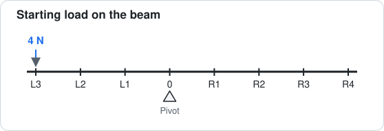

Where should a 6 N load hang to balance it?

A. R4

B. R3

C. L2

D. R2

E. R1

### S5-Q02

A wheelbarrow is lifted by its handles. Its wheel stays on the ground while the soil in its tray rises. Treat the wheel axle as the fixed point about which the frame turns. Which list gives the pivot, the load being lifted, and the place where effort is applied, in order?

A. Soil, axle, handles

B. Axle, handles, soil

C. Axle, soil, handles

D. Handles, soil, axle

E. Soil, handles, axle

### S5-Q03

A level, weightless beam has equally spaced marks and a pivot at mark 0. A 5 N load hangs at L2 and a 3 N load at R4.

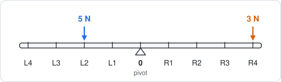

Which single change would balance the beam?

A. Move the right load to R3.

B. Add a 2 N load at R1.

C. Add a 2 N load at L1.

D. Move the left load to L3.

E. Hang a 2 N load at the pivot.

### S5-Q04

Two children pull a sled along the same straight rope line. The arrows give all horizontal forces. What is the net horizontal force?

A. 3 N right

B. 13 N right

C. 3 N left

D. 0 N

E. 13 N left

### S5-Q05

A level, weightless beam has equally spaced marks and a pivot at mark 0. A bag hangs at L3. Two identical small weights hang together at R2. The beam balances.

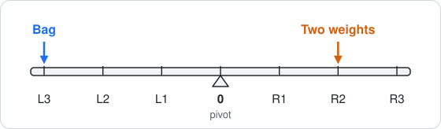

One small weight is removed. Where should the bag be hung to restore balance if it may hang between marks?

A. L1

B. Halfway between L1 and L2

C. L3

D. Halfway between L2 and L3

E. L2

## Q06–Q10

### S5-Q06

A level, weightless beam has equally spaced marks and a pivot at mark 0. A 4 N load hangs at L3 and a mystery load hangs at R2. The beam balances.

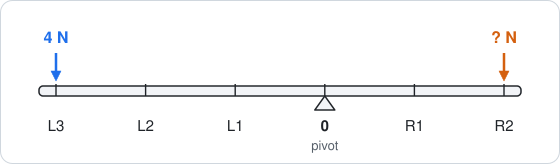

How heavy is the mystery load?

A. 12 N

B. 2 N

C. 4 N

D. 6 N

E. 8 N

### S5-Q07

A puck is sliding east along a straight track. At this instant the only horizontal forces are 3 N east and 7 N west, both through its centre. Which description fits the next instant, before the puck can stop?

A. It moves east at constant speed.

B. It moves east and slows down.

C. It moves east and speeds up.

D. It moves west immediately.

E. It remains at rest.

### S5-Q08

A hand presses straight down on a level spanner. Its head fits around a nut that acts as the pivot. You can press 4 cm, 8 cm or 12 cm from the nut. At which point will the same push have the greatest turning effect?

A. Every position has the same effect.

B. 8 cm from the nut

C. Directly over the nut

D. 4 cm from the nut

E. 12 cm from the nut

### S5-Q09

A level, weightless beam has equally spaced marks and a pivot at mark 0. Two identical stones hang at L1 and R3, one stone per mark.

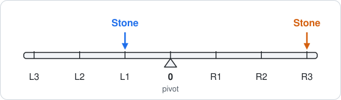

Which description fits the instant after release from rest?

A. Left end starts to drop.

B. It stays level.

C. Both ends start to drop together.

D. Right end starts to drop.

E. The pivot starts to rise.

### S5-Q10

A level, weightless beam has equally spaced marks and a pivot at mark 0. Loads of 3 N at L4 and 2 N at L1 are balanced by a single load at R2.

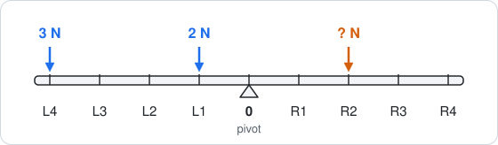

The right load is moved to R1. How much extra weight must be hung at R1 with it to restore balance?

A. 2 N

B. 14 N

C. 3.5 N

D. 5 N

E. 7 N

## Q11–Q15

### S5-Q11

A level, weightless beam has equally spaced marks and a pivot at mark 4. A 2 N load hangs at mark 1 and a 3 N load at mark 6.

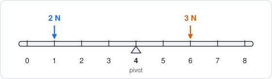

Which statement describes the initial turn?

A. The beam stays level.

B. The direction depends on the size of one mark.

C. The end near mark 1 drops.

D. The end near mark 6 drops.

E. Both ends rise.

### S5-Q12

Two horizontal pushes and one horizontal pull act on a crate along the same line. All three are shown. Which force would bring their total to zero?

A. 5 N right

B. 1 N right

C. 5 N left

D. 9 N left

E. 13 N left

### S5-Q13

A level, weightless beam has equally spaced marks and a pivot at mark 0. A load hangs at L2 and an identical load hangs at R2.

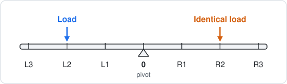

A third load is now hung at mark 0. What happens on release?

A. The result depends on the third load’s weight.

B. The left end drops because it was loaded first.

C. The heavier combined load makes one side drop.

D. The right end drops because it has the last numbered mark.

E. The beam stays level.

### S5-Q14

One horizontal handle turns a water valve. A worker can push perpendicular to the handle in the same turning direction using any one of the following settings. Which gives the greatest turning effect?

A. 3 N at 12 cm

B. 6 N at 6 cm

C. 8 N at 5 cm

D. 4 N at 10 cm

E. 5 N at 9 cm

### S5-Q15

A suitcase hangs motionless from a single vertical luggage scale. The Earth pulls downward on the suitcase with 38 N. Air forces are negligible. Which force balances that pull on the suitcase?

A. A 76 N upward pull from the scale

B. A 38 N upward pull from the scale

C. A 38 N downward pull from the suitcase on the scale

D. A 19 N upward pull from the scale

E. A 38 N horizontal pull from the handle

## Q16–Q20

### S5-Q16

A level, weightless beam has equally spaced marks and a pivot at mark 0. A 2 N load hangs at L4 and another 2 N load hangs at L2.

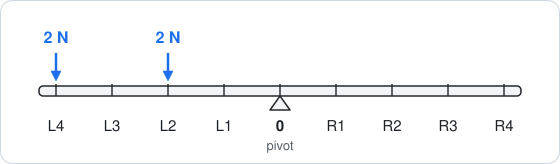

What turning effect must a right-side load produce to balance the beam?

A. 24 N-marks

B. 6 N-marks

C. 4 N-marks

D. 12 N-marks

E. 8 N-marks

### S5-Q17

A waiter lifts the lid of a hinged food warmer. A spring scale pulls straight up on the level lid at a point 20 cm from the hinge. Which measurement locates the pivot for calculating the turn?

A. The position of the hinge pin

B. The centre of the scale dial

C. The position of the lid’s far edge

D. The position of the scale hook

E. The height of the warmer above the floor

### S5-Q18

A level, weightless beam has equally spaced marks and a pivot at mark 0. A 6 N load hangs at L2 and a 4 N load hangs at R3.

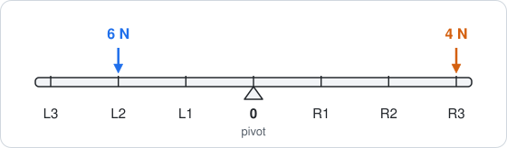

Both loads move one mark toward the pivot. What happens when the beam is released?

A. Right drops because the right turn is now 8 and the left turn is 6.

B. It stays level because neither weight changed.

C. Left drops because the left load is heavier.

D. Left drops because it is closer to the pivot.

E. It stays level because both moved the same distance.

### S5-Q19

A lift is moving downward in a straight line. At the instant shown, the only forces on it are a 900 N upward cable pull and 900 N downward gravity. If these forces stay the same, what happens next?

A. It speeds up downward.

B. It starts moving upward.

C. It continues downward at constant speed.

D. It stops immediately.

E. It slows to a stop.

### S5-Q20

A level, weightless beam has equally spaced marks and a pivot at mark 0. An unknown weight hangs at L4 and a second unknown weight hangs at R2. The beam is balanced.

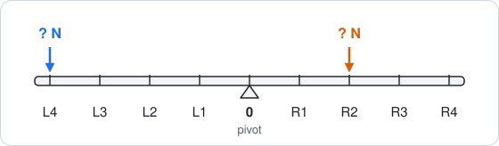

What can you determine without knowing either weight in newtons?

A. The left weight is exactly 2 N.

B. The left weight is twice the right weight.

C. The right weight is exactly 4 N.

D. The right weight is twice the left weight.

E. The two weights are equal.

## Q21–Q25

### S5-Q21

A crowbar lifts the edge of a stone slab. A small block under the bar stays fixed and supports the point where the bar turns. A worker pushes down on the long end. Which part serves as the pivot?

A. The tip of the long handle

B. The centre of the slab

C. The contact between the bar and the slab

D. The worker’s palm

E. The contact between the bar and the small block

### S5-Q22

A level, weightless beam has equally spaced marks and a pivot at mark 0. A 6 N load hangs at L2. A 3 N load may hang at any of R1, R2, R3 or R4.

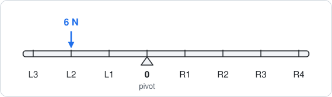

At how many of those four settings will the left end start to drop?

A. 3 settings

B. 4 settings

C. 2 settings

D. 1 setting

E. 0 settings

### S5-Q23

A model boat feels two horizontal forces pointing east, 4 N and 6 N. All horizontal forces act along the same line. A single westward force keeps the boat travelling straight at constant speed. How large is it?

A. 10 N

B. 6 N

C. 24 N

D. 2 N

E. 4 N

### S5-Q24

A horizontal gate pivots in plan view around a hinge, like a clock hand turning on a table. Two students stand equally far from the hinge. One pushes straight toward the hinge along the gate. The other pushes at a right angle to the gate. Both push with 10 N. Which explanation fits?

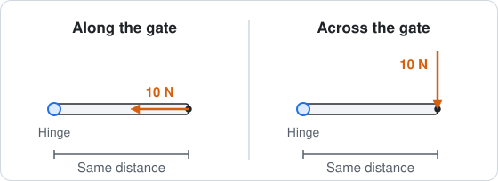

A. Both pushes turn it equally because their force and distance are equal.

B. Only the perpendicular push has a turning effect.

C. Neither can turn a gate unless the students stand at the hinge.

D. The pushes cancel because their sizes match.

E. Only the inward push has a turning effect.

### S5-Q25

A level, weightless beam has equally spaced marks and a pivot at mark 0. An 8 N load hangs at L2. A hook at R4 holds two identical bags and balances the beam.

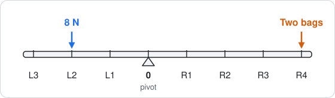

How heavy is each bag?

A. 4 N

B. 16 N

C. 2 N

D. 8 N

E. 1 N

## Q26–Q30 · Final weekend

### S5-Q26

A level, weightless beam has equally spaced marks and a pivot at mark 3. A 2 N sign hangs at mark 0 and a 4 N sign hangs at mark 6. A builder can relocate the pivot to any other numbered mark.

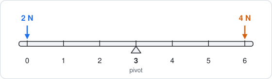

At which mark should the pivot be placed to balance the signs?

A. Mark 4

B. Mark 3

C. Mark 1

D. Mark 2

E. Mark 5

### S5-Q27

A parcel rests on a level shelf. The shelf pushes up on it with 12 N and gravity pulls it down with 12 N. The shelf suddenly slides away without touching it again. Ignore air resistance. What is the net force on the parcel just after contact ends?

A. 24 N upward

B. 0 N

C. 24 N downward

D. 12 N upward

E. 12 N downward

### S5-Q28

A technician records the turn of a level test arm around a fixed pin as 24 N·cm. A vertical force gauge at the end reads 6 N. With a weightless arm and no other load, which label belongs on the blank horizontal distance from the pin to the gauge?

A. 0.004 m

B. 4 m

C. 40 m

D. 0.04 m

E. 0.4 m

### S5-Q29

A tray has two vertical support cords, one at each end. The tray stays level and at rest. Cord A pulls up with 16 N. Cord B pulls up with 9 N. An apple on the tray weighs 7 N. The tray and apple are the only loads. If the apple is removed and the empty tray alone hangs from one scale, what does the scale read?

A. 9 N

B. 18 N

C. 7 N

D. 32 N

E. 25 N

### S5-Q30

In a top view of a square sign, each marked point is the same distance from the central pivot O. A short push points upward on the page at the right-edge point R. Which second push of the same size would give an equal turn in the opposite direction?

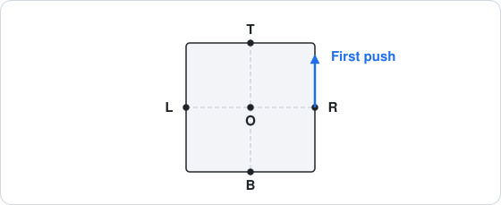

A. Down the page at B

B. Up the page at L

C. Up the page at T

D. Left on the page at R

E. Down the page at L

## Answer key

[Go to the full solutions](#full-solutions)

| ID | Answer | Tier | Reasoning | Closest distractor ruled out by |
|---|---|---|---|---|
| S5-Q01 | D | Medium | The left turn is 4 × 3 = 12. A 6 N load needs two marks on the opposite side. | B. Equal distances would give the heavier right load the larger turn. |
| S5-Q02 | C | Medium | The frame turns about the axle while the gardener raises the soil by pulling up on the handles. | B. The gardener supplies effort at the handles. |
| S5-Q03 | C | Challenge | The turns start at 10 left and 12 right. The left needs exactly two more N-marks. | B. Adding on the right enlarges the existing right-side advantage. |
| S5-Q04 | C | Medium | Opposing forces subtract. The 8 N pull leaves 3 N toward the left. | A. The larger pull points left. |
| S5-Q05 | B | Challenge | Removing one of two identical weights halves the right turn. Halve the bag’s three-mark distance to 1.5 marks. | A. One full mark is less than half the original three-mark distance. |
| S5-Q06 | D | Medium | The left turn is 12 N-marks. Divide by the right distance of two marks. | E. Multiplying 4 by the right distance does not match the turns. |
| S5-Q07 | B | Challenge | The puck still has eastward velocity. The 4 N westward net force opposes it. | D. A westward net force changes velocity gradually. |
| S5-Q08 | E | Medium | A perpendicular push turns the spanner most strongly at the largest distance from the pivot. | D. Bringing the effort closer reduces its turning effect. |
| S5-Q09 | D | Medium | The right stone hangs farther from the fixed pivot and produces the greater turn. | B. Identical weights produce equal turns only at equal distances. |
| S5-Q10 | E | Challenge | The two left turns total 14. The original right load is 14 ÷ 2 = 7 N. At R1, 14 N total is needed, so add 7 N. | B. The original 7 N load still acts at R1. |
| S5-Q11 | A | Challenge | The loads are three marks left and two marks right of mark 4. Both produce 6 N-marks. | D. The 3 N load is closer to the pivot. |
| S5-Q12 | C | Medium | The two rightward forces total 9 N. With 4 N left, another 5 N left is needed. | A. An extra rightward force would increase the existing net force. |
| S5-Q13 | E | Challenge | The original turns are equal. The third load’s weight is unknown, but that does not matter: at zero distance from the pivot it adds zero turn, so the information is sufficient. | C. The added load acts directly at the pivot. |
| S5-Q14 | E | Medium | Multiply each force by its distance. The strongest turn is 5 × 9 = 45 N·cm. Each other setting gives 40 or 36 N·cm. | C. The largest push gives 40 N·cm, less than 45 N·cm. |
| S5-Q15 | B | Medium | The suitcase remains at rest, so the scale supplies an equal upward force on it. | C. That force acts on the scale. |
| S5-Q16 | D | Medium | The two left loads turn in the same direction. Their effects add to 2 × 4 + 2 × 2 = 12. | E. The load at L2 contributes another 4 N-marks. |
| S5-Q17 | A | Medium | The lid rotates about the hinge pin, so distances for its turning effects start there. | D. The hook locates the applied force. |
| S5-Q18 | A | Challenge | Use the new positions L1 and R2. The resulting turns are 6 × 1 and 4 × 2. | E. The move removes 6 N-marks from the left and 4 from the right. |
| S5-Q19 | C | Medium | The net force is zero, so the downward velocity stays the same. | D. Equal forces give zero change in velocity. |
| S5-Q20 | D | Challenge | The left distance is twice the right distance. Equality of turns fixes the ratio, while several pairs of weights give that ratio. | B. The left weight already has twice the distance. |
| S5-Q21 | E | Medium | The bar turns around the support on the block. | C. The slab pushes back where the load acts. |
| S5-Q22 | A | Challenge | The left turn is 12. The right turns are 3, 6, 9 and 12. Three are strictly smaller. | B. At R4 the turns match and neither end drops. |
| S5-Q23 | A | Medium | The boat has zero acceleration. The westward force cancels a total eastward force of 10 N. | D. The two eastward forces act together. |
| S5-Q24 | B | Challenge | The perpendicular push swings the gate sideways. The inward push has zero perpendicular distance from its line of action to the hinge. | A. The line of the inward push goes straight through the pivot. |
| S5-Q25 | C | Medium | The left turn is 16. The hook must carry 16 ÷ 4 = 4 N altogether, so each bag weighs 2 N. | A. The 4 N at the right hook is shared by two bags. |
| S5-Q26 | A | Challenge | At mark 4 the distances are four marks and two marks. Both turns equal 8. Moving the pivot changes both distances. | D. That placement gives the heavier sign a longer arm. |
| S5-Q27 | E | Medium | Gravity still acts with 12 N, and the shelf no longer supplies any upward force. | B. Once the shelf slides clear, it exerts no force on the parcel. |
| S5-Q28 | D | Medium | The distance is 24 N·cm ÷ 6 N = 4 cm. Divide centimetres by 100 to get metres. | E. Four centimetres is four hundredths of a metre. |
| S5-Q29 | B | Challenge | Vertical balance gives 25 N for the loaded tray. Subtract the apple’s 7 N to get the weight of the tray alone. | E. The two cords together support both the tray and the apple. |
| S5-Q30 | B | Medium | The right-side upward push turns the sign counterclockwise. Pushing upward on the left turns it clockwise with the same arm length. | E. Pushing down at L helps push R upward. |

## Full solutions

Solve and mark each question before opening its solution. For a guess or miss, try the steps again on paper before comparing.

### S5-Q01 solution

**Answer D.** R2

1. The left turn is 4 × 3 = 12 N-marks.
2. The opposite 6 N load must match it, so place it 12 ÷ 6 = 2 marks away.

**Closest distractor.** B. Equal distances would give the heavier right load the larger turn.

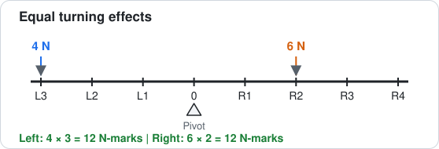

### S5-Q02 solution

**Answer C.** Axle, soil, handles

1. Find the fixed axis around which the frame turns: the wheel's axle.
2. The gardener applies an upward force at the handles.
3. Together this gives the pivot and direction of effort.

**Closest distractor.** B. The gardener supplies effort at the handles.

### S5-Q03 solution

**Answer C.** Add a 2 N load at L1.

1. Compare 10 N-marks left with 12 right.
2. The left side needs exactly 2 N-marks more.
3. Find the option whose left-side force times distance supplies that amount.

**Closest distractor.** B. Adding on the right enlarges the existing right-side advantage.

### S5-Q04 solution

**Answer C.** 3 N left

1. The 8 N leftward pull opposes the 5 N rightward pull.
2. Subtract the smaller magnitude from the larger: 8 − 5 = 3 N.
3. The net direction is left.

**Closest distractor.** A. The larger pull points left.

### S5-Q05 solution

**Answer B.** Halfway between L1 and L2

1. One of two identical right loads remains, halving the right turn.
2. The left force remains the same, so halve its lever arm.
3. Half of 3 marks is 1.5 marks.

**Closest distractor.** A. One full mark is less than half the original three-mark distance.

### S5-Q06 solution

**Answer D.** 6 N

1. Add the left turns to find 12 N-marks.
2. On the right this must be 2 marks times the unknown force.
3. Divide 12 by 2 to get 6 N.

**Closest distractor.** E. Multiplying 4 by the right distance does not match the turns.

### S5-Q07 solution

**Answer B.** It moves east and slows down.

1. The puck continues moving east at that instant.
2. The net force is 4 N west and produces westward acceleration.
3. This reduces the eastward speed.

**Closest distractor.** D. A westward net force changes velocity gradually.

### S5-Q08 solution

**Answer E.** 12 cm from the nut

1. Take the nut as the pivot.
2. All compared pushes are perpendicular.
3. The longest distance gives the greatest product of force and distance.

**Closest distractor.** D. Bringing the effort closer reduces its turning effect.

### S5-Q09 solution

**Answer D.** Right end starts to drop.

1. The stones have equal weight.
2. The right stone hangs farther from the fixed pivot.
3. With equal force and greater distance its turn is larger.

**Closest distractor.** B. Identical weights produce equal turns only at equal distances.

### S5-Q10 solution

**Answer E.** 7 N

1. Add left turns to get 14 N-marks.
2. The old right load at R2 was 14 ÷ 2 = 7 N.
3. At R1 the total must be 14 N, so add 7 N.

**Closest distractor.** B. The original 7 N load still acts at R1.

### S5-Q11 solution

**Answer A.** The beam stays level.

1. Measure both arms from mark 4: 3 marks left and 2 marks right.
2. Multiply the loads by those distances. Each turn is 6 N-marks.
3. Their opposite directions give balance.

**Closest distractor.** D. The 3 N load is closer to the pivot.

### S5-Q12 solution

**Answer C.** 5 N left

1. Sum the right forces to 9 N.
2. There are already 4 N leftward.
3. An additional 9 − 4 = 5 N to the left cancels the rightward total.

**Closest distractor.** A. An extra rightward force would increase the existing net force.

### S5-Q13 solution

**Answer E.** The beam stays level.

1. The original turns match.
2. The third load acts at the pivot, where distance is zero.
3. Its turn is weight × 0 = 0, independent of its unknown weight.

**Closest distractor.** C. The added load acts directly at the pivot.

### S5-Q14 solution

**Answer E.** 5 N at 9 cm

1. Find force times distance for each option.
2. The 5 N force at 9 cm gives 45 N·cm.
3. The other choices give 40 or 36 N·cm, so 45 is greatest.

**Closest distractor.** C. The largest push gives 40 N·cm, less than 45 N·cm.

### S5-Q15 solution

**Answer B.** A 38 N upward pull from the scale

1. The suitcase stays at rest, so the net vertical force is zero.
2. Its weight pulls down and the scale supports it upward.
3. The scale force equals the weight in magnitude.

**Closest distractor.** C. That force acts on the scale.

### S5-Q16 solution

**Answer D.** 12 N-marks

1. The two left loads turn in the same direction.
2. The products are 2 × 4 = 8 and 2 × 2 = 4 N-marks.
3. Add them for a combined 12 N-marks.

**Closest distractor.** E. The load at L2 contributes another 4 N-marks.

### S5-Q17 solution

**Answer A.** The position of the hinge pin

1. Watch the part of the lid that stays along the fixed turning axis.
2. This axis runs through the hinge pin.
3. Measure distances for the turning effect from there.

**Closest distractor.** D. The hook locates the applied force.

### S5-Q18 solution

**Answer A.** Right drops because the right turn is now 8 and the left turn is 6.

1. Use the new positions, L1 and R2.
2. The turns are 6 × 1 = 6 and 4 × 2 = 8 N-marks.
3. The right turn exceeds the left by 2.

**Closest distractor.** E. The move removes 6 N-marks from the left and 4 from the right.

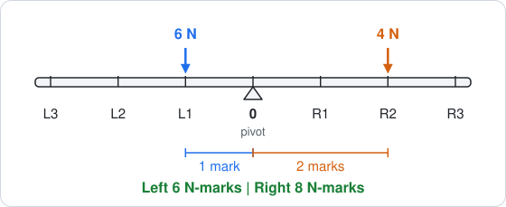

### S5-Q19 solution

**Answer C.** It continues downward at constant speed.

1. The forces cancel so acceleration is zero.
2. The object already has downward velocity.
3. With no acceleration that velocity is constant.

**Closest distractor.** D. Equal forces give zero change in velocity.

### S5-Q20 solution

**Answer D.** The right weight is twice the left weight.

1. Equal turns give left weight × left distance = right weight × right distance.
2. The left arm is twice the right arm, so right weight must be twice left weight.
3. Doubling both weights preserves that ratio, so the individual values are not fixed.

**Closest distractor.** B. The left weight already has twice the distance.

### S5-Q21 solution

**Answer E.** The contact between the bar and the small block

1. Find the point where the bar stays supported as it rotates.
2. This is the contact with the block.
3. That support is the pivot.

**Closest distractor.** C. The slab pushes back where the load acts.

### S5-Q22 solution

**Answer A.** 3 settings

1. The left turn is 12 N-marks.
2. The right turns at the listed distances are 3, 6, 9 and 12.
3. Three are strictly smaller; the last one balances.

**Closest distractor.** B. At R4 the turns match and neither end drops.

### S5-Q23 solution

**Answer A.** 10 N

1. Constant velocity means zero acceleration and therefore zero net force.
2. The eastward forces total 10 N.
3. The cancelling force must be 10 N west.

**Closest distractor.** D. The two eastward forces act together.

### S5-Q24 solution

**Answer B.** Only the perpendicular push has a turning effect.

1. The sideways perpendicular push has a nonzero turning arm from the hinge.
2. The inward push acts along a line through the hinge, making its perpendicular turning arm zero.
3. Only the sideways push turns the gate in this comparison.

**Closest distractor.** A. The line of the inward push goes straight through the pivot.

### S5-Q25 solution

**Answer C.** 2 N

1. The left turn is 16 N-marks.
2. A hook 4 marks away needs 16 ÷ 4 = 4 N in all.
3. Each of the two identical bags contributes half, or 2 N.

**Closest distractor.** A. The 4 N at the right hook is shared by two bags.

### S5-Q26 solution

**Answer A.** Mark 4

1. At pivot mark 4 the distances are 4 marks and 2 marks.
2. Multiply each load by its distance to get 8 N-marks on both sides.
3. The opposite turns cancel at that location.

**Closest distractor.** D. That placement gives the heavier sign a longer arm.

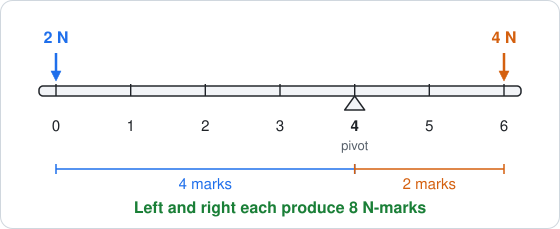

### S5-Q27 solution

**Answer E.** 12 N downward

1. The shelf's upward contact force disappears once the object is unsupported.
2. Gravity still acts at 12 N downward.
3. That is the net force.

**Closest distractor.** B. Once the shelf slides clear, it exerts no force on the parcel.

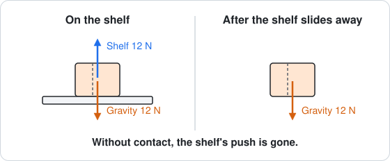

### S5-Q28 solution

**Answer D.** 0.04 m

1. Distance = turning effect ÷ force, so 24 ÷ 6 = 4 cm.
2. Divide by 100 to convert the length to 0.04 m.

**Closest distractor.** E. Four centimetres is four hundredths of a metre.

### S5-Q29 solution

**Answer B.** 18 N

1. The loaded tray is balanced vertically, so its total downward weight equals the 25 N support.
2. Remove the apple's 7 N from the total.
3. The tray alone weighs 18 N.

**Closest distractor.** E. The two cords together support both the tray and the apple.

### S5-Q30 solution

**Answer B.** Up the page at L

1. An upward push on the right turns the sign counterclockwise.
2. An equal upward push the same distance to the left has the same magnitude and turns clockwise.
3. That opposite turn cancels the first.

**Closest distractor.** E. Pushing down at L helps push R upward.

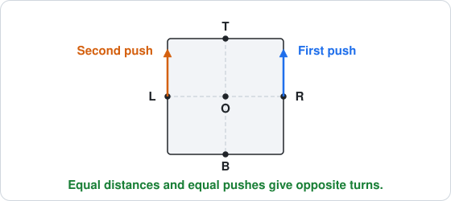
